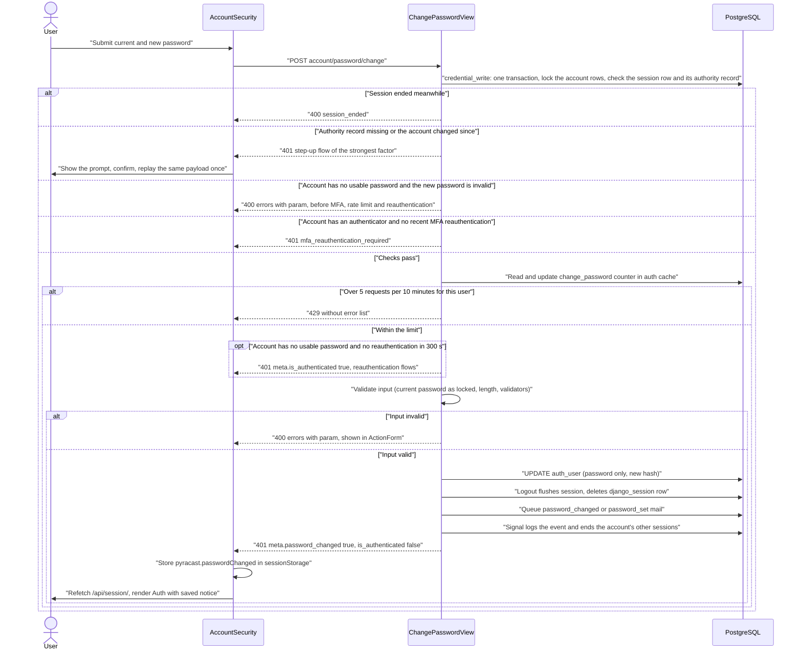

# Change or set the account password while signed in

A signed-in user opens the account settings page and submits a new password, together with the current one if the account has a usable password. Accounts created through a social provider have no usable password; they set a first one after step-up reauthentication. Success replaces the password hash, ends the current session, invalidates every other session of the user, queues a notice mail and returns the browser to the login screen.

## Entry points

- `web/src/features/account/account-security.tsx` `AccountSecurity` (password disclosure) in `account-settings.tsx`, the account page `/app/account/` opened from the workspace shell's "Account" button.
- `POST /api/auth/browser/v1/account/password/change` served by `pyracast.accounts.headless.ChangePasswordView` (routed in `src/pyracast/accounts/auth_urls.py`).
- `/admin/password_change/` is a console route of `pyracast.platform_admin.site.PlatformAdminSite.get_urls` that only redirects to `/app/account/`.
- Step-up UI: `StepUpPrompt` and `ReauthenticationForm` (`features/account/step-up.tsx`, `security-reauthentication.tsx`; flow `step-up-reauthentication`).

## Sequence

## Data

| Table | R/W | What |
| --- | --- | --- |
| `auth_user` | R/W | Row locked and read to check the current password (a hasher upgrade saves `password` only); saved with `update_fields=["password"]` and the new Argon2 hash |
| `django_session` | R/W | Current session row checked, then deleted by logout; the account's other sessions are deleted with their device records |
| `usersessions_usersession` | W | The account's rows are deleted (`sessions_revoked`, reason `password_changed` or `password_set`, with `count`) |
| `account_emailaddress`, `mfa_authenticator`, `socialaccount_socialaccount` | R | Credential state locked and compared with the session's authority record; primary address for the notification; reauthentication flows of an account without a password |
| `accounts_userlanguagepreference` | R | Saved language of the account; the notification mail uses it, else the request language |
| `notifications_outboundmail` | W | Notice intent `account/email/password_changed` or `password_set`, stored in the transaction |
| `pyracast_authentication_cache` | R/W | `change_password` rate-limit history and its lock key per user (separate `auth_cache` connection) |

## Authorization

- Authentication: allauth `AuthenticatedAPIView` returns 401 with login flows for anonymous requests; the view works only on `request.user`. `CsrfViewMiddleware` checks `X-CSRFToken` (the browser view is not CSRF-exempt); `pyracast.accounts.middleware.SessionLifetime` enforces 90 days absolute and 30 days idle before the view.
- Knowledge proof: `ChangePasswordInput.clean_current_password` (view input layer) when the account has a usable password, checked against the password as read under the account's locks; recent reauthentication (`ACCOUNT_REAUTHENTICATION_TIMEOUT` 300 s) in allauth's `ChangePasswordView.handle` when it has none, by the strongest factor the account holds. An account with an authenticator also needs a recent MFA reauthentication (`security.has_mfa_evidence(within=CONFIRMATION)`) besides the current password.
- Rate limit: allauth `rate_limit(action="change_password")`, `5/10m/user` in `ACCOUNT_RATE_LIMITS` (`PASSWORD_CHANGE_MAX_ATTEMPTS`, `PASSWORD_CHANGE_WINDOW_MINUTES`); it runs after the authority check, the new-password validation of an account without a password and the MFA check, and before the reauthentication check, so that 401 also counts but a refused first password does not. A wrong current password logs `password_change_failed` (user id and client IP) from `ChangePasswordInput.clean_current_password`. No tenant or role check applies to any signed-in user, staff included; the database enforces nothing here.

## Failure paths

| Condition | Result |
| --- | --- |
| Anonymous or expired session | 401 with login flows, no `password_changed`; UI refreshes the session and shows `sessionExpired` |
| CSRF token wrong, or body not a JSON object | 403 `csrf_failed`, or 400 `bad_request` |
| More than 5 requests per 10 minutes, or rate-limit lock not obtained | 429 without error list; `authentication_request_throttled` event logged |
| Another request of the same session still running for over 5 s | 429 `session_busy` with `retry_after`, `Retry-After: 1` (`SessionRequestSerialization`); also logged as `authentication_request_throttled` |
| Session ended by another session meanwhile | 400 `session_ended` |
| No authority record in the session, or another session changed the account's credential state since this one signed in or confirmed | 401 asking for the strongest factor first, even when the current password was given (for an account without an authenticator the `reauthenticate` flow); UI opens the prompt and resumes the change once |
| Account with an authenticator, no recent MFA reauthentication | 401 `mfa_reauthentication_required` with flow `mfa_reauthenticate`; the UI replays the change after the authenticator |
| No usable password, no fresh reauthentication | 401 with `is_authenticated` true; UI opens the prompt and resumes the change once after the confirmation |
| Current password wrong, or missing for an account that has one | 400 on `current_password` (`enter_current_password` or required) |
| New password under 15 characters, common, too similar, or over 1024 characters | 400 on `new_password` (for example `password_too_short`); for an account without a password this answer comes before any confirmation |
| Mail cannot be delivered | The change completes as on success (the notice is an intent the worker retries or ends `failed`): hash saved, session flushed, event logged, 401 with `meta.password_changed` true |
| Success | 401, `meta.password_changed` true, `meta.is_authenticated` false |

## Rules and invariants

- Leave guard (`frontend-data-layer`): a change the server confirmed (2xx, or the 401 with `meta.password_changed`) stops asking before the session is read again; a 401 asking for reauthentication hands the change to the confirmation prompt (`web/src/features/account/account-security.tsx` `changePassword`).
- The success response is deliberately a 401: the session is gone. Only `ChangePasswordView.post` adds `meta.password_changed`, and `post` runs after validation, so the flag cannot appear on an expiry or reauthentication 401.
- `processes.credential_write` runs the whole change in one transaction that first locks the account's rows (the order of `account_state`) before any session row, so it is ordered with every revocation and credential change of the account. The mail intent, the revocation and the hash commit together.
- Set versus change is decided server side from the account as locked: `current_password` is required exactly when `has_usable_password()` is true; an empty one means "set" and queues `password_set` instead of `password_changed`.
- Order on success: save hash, logout (`logout` audit event), mail intent, then the `password_changed`/`password_set` signal (audit event, and `revoke_other_sessions` ends the account's other sessions and removes their device records). Every pending code or sign-in step of the account ends too, since it rests on the credential state.
- `PasswordInput` disables stripping and caps password fields at 1024 characters; whitespace is part of the password.
- The `pyracast.passwordChanged` sessionStorage flag is consumed by the `Auth` effect only after `auth/session` answers.

## Tests

- `tests/test_session.py` `test_password_change_requires_current_password_and_invalidates_all_sessions`, `test_expired_session_cannot_report_a_successful_password_change` (an anonymous client, not a timed-out session); `tests/test_auth_lifecycle.py` `test_password_change_requires_at_least_fifteen_characters`, `test_password_whitespace_is_preserved_across_login_reauthentication_and_change`; `tests/test_authentication_limits.py` (the limit and `password_change_failed`); `tests/test_step_up.py`, `tests/test_session_authority.py` (factor asked first, reads under the locks); `tests/test_session_lifecycle.py` (other sessions end); `tests/test_account_settings_answers.py`; `tests/test_social_accounts.py` `test_last_enabled_provider_cannot_be_removed` (set password after email reauthentication, status and hash only); `tests/test_account_mail_content.py` (notification, account language); `tests/test_admin_mfa_bootstrap.py` (admin redirect); `tests/test_account_mail_failures.py` `test_password_change_with_failing_mail_completes_and_is_audited`.
- Playwright: `web/tests/account-security.spec.ts` (step-up prompt and replay), `web/tests/social-auth.spec.ts` (first password, expired session; mocked API), `web/integration/auth-security.spec.ts` (full change, then login). Gaps: no test of the 1024-character cap on `new_password`.
