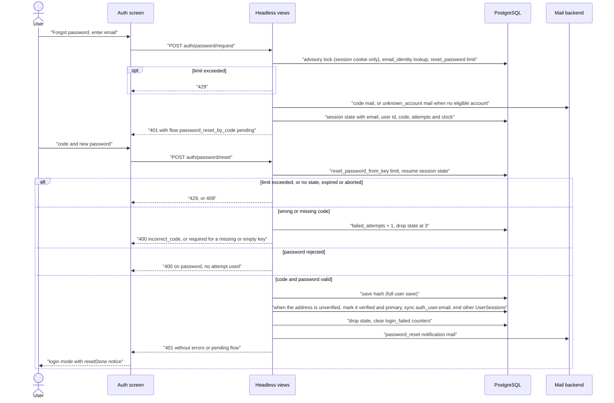

# Reset a forgotten password by emailed code

An anonymous user on the sign-in screen asks for a reset code, receives it by email, then submits the code with a new password. The pending reset lives in the requester's Django session. On success the password is replaced, other sessions die and the user returns to sign-in (no automatic login).

## Entry points

- `web/src/components/auth.tsx` `Auth`, modes `forgot` and `reset`: reached from "Forgot password?", or on mount when `GET auth/session` reports a pending `password_reset_by_code` flow (reload resume). Client: `web/src/lib/auth-api.ts` `authRequest`.
- `POST /api/auth/browser/v1/auth/password/request` -> `pyracast.accounts.headless.RequestPasswordResetView`; `POST .../auth/password/reset` -> `ResetPasswordView` (wrapped in `require_POST` in `pyracast.urls`). Actor: anonymous. Both only swap the input class (`RequestPasswordResetInput`, `ResetPasswordInput`) on allauth's headless views; code, attempts and state are allauth's `PasswordResetVerificationProcess`.
- Mail: `AccountAdapter.render_mail` and `send_mail`; project templates `account/email/password_reset_code_*`, stock `unknown_account` and `password_reset`. No command, script or Dramatiq job; mail is sent inline through the SMTP or Gmail API backend.

## Sequence

## Data

| Table | R/W | What |
|---|---|---|
| `django_session` | R/W | State under `account_password_reset_verification`: email, user id, plaintext code, `failed_attempts`, `at`, `code_confirmed`. Removed on success, abort, or when any auth response resumes it expired. Other sessions' rows are deleted when `revoke_other_sessions` runs. |
| `account_emailaddress` | R/W | `email_identity` lookup; a confirmed code marks an unverified matching address verified and primary. |
| `auth_user` | R/W | Resume reads the user; success writes the hash with a full `save`; verifying an address also rewrites `email`. |
| `usersessions_usersession` | R/W | Rows of the user's other sessions are ended only when the reset verified an address (`email_changed` signal). |
| `pyracast_authentication_cache` | R/W | Rate-limit histories via the autocommit `auth_cache` connection; success clears `login_failed` counters for all the user's addresses. |

## Authorization

- No authentication. CSRF is enforced on both POSTs by `CsrfViewMiddleware` (token from `/api/session/`). The code exists only in the requesting session, so another browser gets 409.
- Eligibility is decided at request time in `RequestPasswordResetInput.clean_email` via `pyracast.accounts.authentication.email_identity(for_recovery=True)`: either exactly one account owns the verified address and it is active, or none does and the lowest-id active account whose only address is this primary is chosen.
- `ACCOUNT_RATE_LIMITS` `reset_password` (after input validation) and `reset_password_from_key` (before anything else), consumed inside the allauth views. `SessionRequestSerialization` holds a per-session advisory lock whenever a session cookie exists, so parallel attempts cannot lose counts. No MFA at reset; TOTP is still required at the next login, and staff without TOTP cannot sign in (`AccountAdapter.authenticate`).

## Failure paths

| Condition | Result |
|---|---|
| Missing CSRF token / non-POST method (including allauth's GET code check) | 403 / 405 |
| Malformed JSON, invalid email, missing field | 400 (empty body for bad JSON, else `errors` with `param`); a missing `key` costs an attempt |
| Request limit 5/h IP or 3/h email, reset limit 10/h IP, or advisory lock wait over 5 s | 429; the reset limit counts every POST, including 409s and wrong codes; the lock gives `session_busy` with `Retry-After: 1` |
| Email unknown, inactive, duplicated verified, or unverified but not the account's only address | Same 401 and pending flow as success; the mail is `unknown_account`; the stored state has no code, so every submitted code is `incorrect_code` |
| Reset without state or session, after 600 s, or after 3 failures | 409, no `errors` |
| Wrong code, or missing or empty code | 400 `incorrect_code` on `key`, or `required` on `key`; each costs an attempt and the third also aborts the state |
| Password short, common, similar or over 1024 | 400 on `password`, state kept |
| Another account verified the address meanwhile | Verification is skipped silently (`can_set_verified`), reset still returns 401; a racing verification raises an unhandled `IntegrityError` after the hash is saved |
| Mail backend raises | Not handled in project code; 500, on reset after the password is saved |

## Rules and invariants

- Code: 8 letters from `BCDFGHJKLMNPQRSTVWXZ` as `XXXX-XXXX` (allauth default), compared case-insensitively without punctuation, valid 600 s, 3 attempts; only a wrong or missing code costs one. A new request in the same session replaces its state; codes from other sessions for the same user stay valid until they expire.
- `ResetPasswordView.post` saves the password, then `confirm_code` (allauth `verify_email`, not `AccountAdapter.confirm_email`), then `finish`. No shared transaction.
- A reset proves mailbox ownership: an unverified signup address becomes verified and a squatter's password is replaced. With several unverified claimants only the lowest active user id can recover.
- Other sessions end through Django's session auth hash; `revoke_other_sessions` runs only when the reset verified an address (`email_changed`), otherwise `UserSession` rows linger until the next login purge.
- Every accepted request is the same 401 and sends one mail via `transaction.on_commit` (immediate under autocommit) in the request language (no `user` in the context). `ACCOUNT_LOGIN_ON_PASSWORD_RESET` is False, so `Auth` reads 401 without errors or pending flow as success.

## Tests

- `tests/test_auth_lifecycle.py`: generic response, session binding, single use, revocation, 12-character minimum, expiry, attempt limit, unsafe identity states, ownership proof. `tests/test_session_serialization.py`: parallel wrong and correct codes, missing or expired session, non-POST methods, CSRF denial. `tests/test_company_registration.py`: recovery after the signup race. `tests/test_transactional_mail.py`: code mail layout and expiry (direct `render_mail`). Playwright: `web/tests/auth-registration.spec.ts` (mocked happy path, pending-flow precedence), `web/integration/auth-security.spec.ts` (real stack reset, then TOTP login).
- Gaps: no test of the 429 limits, `unknown_account` and `password_reset` mails, `login_failed` clearing, an address verified elsewhere before the reset, `UserSession` revocation on the verification branch, mail failure, or any frontend error state.
