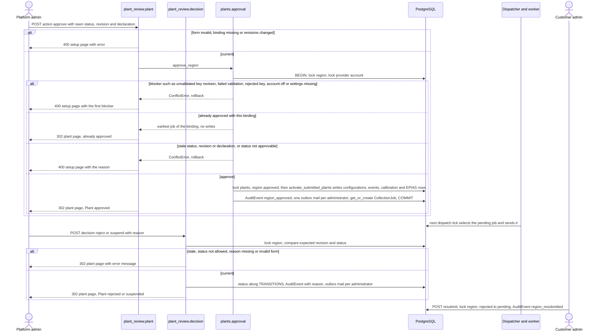

# Approve, reject or suspend a plant

A platform administrator (active staff superuser with verified MFA) reviews a submitted plant in the operator console and decides on its `Region`. Approval needs a connection binding validated for the current credential revision; it activates exactly the declared values the review page showed as an immutable `PlantConfiguration` and inserts the first forecast job, which the dispatcher sends later. Reject and suspend need a customer-facing reason and change only the status. Each decision mails the workspace administrators; a rejected plant's administrator can correct it and resubmit it.

## Entry points

- Screen: `regions/templates/admin/regions/region/setup.html`, rendered by `pyracast.platform_admin.plant_review.plant` at `/admin/plants/{id}/`. **Approve plant** (shown while the status is `pending` or `suspended`, disabled unless the view flag `can_approve` holds) posts `action=approve` with hidden revision, binding, credential revision, expected status and declaration fingerprint, checked by `BindingActionForm.current_binding` (`src/pyracast/platform_admin/forms.py`). The page reads the declarations once per render (`plants.approval.declarations`) and shows per plant only the values approval activates: a submission marked "Awaiting approval", else the current configuration. `BindingActionForm.show_declaration` puts their hash (`fingerprint_of`) into the form, also on a page shown again after a refused action.
- `POST /admin/plants/{id}/decision/` (reject when pending, suspend when approved) -> `plant_review.decision` -> `ReviewDecisionForm` -> `decide_review`; the same form carries the actions of flow `location-change`.
- Customer: `POST /api/tenants/{t}/regions/{r}/resubmit/` -> `pyracast.api.views.RegionResubmitView` -> `resubmit_region`, shown by `ReviewNotice` (`web/src/features/plant/review-notice.tsx`) on a rejected plant.
- Operations: `approve_region`, `decide_review`, `resubmit_region` (`pyracast.plants.approval`); `activate_submitted_plants` (`pyracast.plants.operations`); command `fixture_demo`. Customer view: the portfolio polling (`plant-portfolio`); `PlantWorkspace` shows the status tag and `ReviewNotice` for any status other than `approved`.
- Approval and decisions exist only in the console: no platform API, no record-browser action.

## Sequence

## Data

| Table | R/W | What |
| --- | --- | --- |
| `regions_region` | R/W | Locked; `status` (only through `set_review_status`), `approved_binding` (kept on suspension, cleared when the region returns to pending); `revision` is the guard |
| `connections_sitebinding`, `connections_provideraccount` | R | Binding of the current revision with `validated_at` and `validated_credential_revision`, `health`; account locked for `credential_revision`, `enabled`, `authorized_at`, `authentication_failed_revision` |
| `plants_plant`, `plants_plantsubmission`, `plants_calibrationrun` | R/W, R, W | Plant locked, `current_configuration` set; the submission is the declaration while its `base_configuration` is the current configuration, and is kept after approval; pending or running runs become `superseded` |
| `plants_plantconfiguration`, `plants_plantevent` | R/W, W | New revision per plant whose declaration is a submission awaiting approval, or whose configuration is bound to another binding (its values carried over); `configuration_created` |
| `metering_epiasconnection`, `metering_epiascollectionjob` | R, R/W | With an enabled connection, `enqueue_connection(initial=True)`: `get_or_create` of 90 daily `realtime_generation` jobs, plus 12 monthly `settlement_injection` jobs when a settlement plant is known |
| `forecasts_collectionjob`, `regions_auditevent` | R/W, W | First `forecasts` job via `get_or_create` (slot is approval time, target is local tomorrow); `region_approved` (names the binding), `region_rejected` and `region_suspended` (the reason), `region_resubmitted` |
| `notifications_outboundmail` | W | One intent per active workspace administrator with a verified address, for approval, rejection and suspension, in the decision's transaction |

## Authorization

- Console: `PlatformAdminSite.has_permission` (active staff superuser with MFA evidence) wraps every admin route through `admin_view`, which adds CSRF and, for every POST, a recent authenticator confirmation.
- Operation: `require_platform_admin` (active staff superuser, no MFA check) first in `approve_region` and `decide_review`. Administrators are not tenant scoped. `resubmit_region` is a workspace-administrator operation (`authorize_workspace_admin`, admin route `regions/{r}/resubmit/` under the `submission` throttle).
- Database: `region_approved_binding_fk` keeps the binding in the same region, `region_status_chk` limits values, `region_status_approved_binding_chk` ties `approved` to a binding, `collectionjob_binding_endpoint_scheduled_for_uniq` prevents a duplicate job. Nothing ties `approved` to a validated binding; the operation does.

## Failure paths

| Condition | Result |
| --- | --- |
| Anonymous, or not active staff superuser with MFA | Admin 302 to the admin login (anonymous to `/app/?next=<console path>`, signed in to `/app/`) |
| Missing CSRF token; GET on `/decision/`; POST without a recent authenticator confirmation; region missing or trashed | 403; 405; 403 confirmation page, nothing stored; 404 |
| Approve: hidden fields missing | Setup page 400 with field errors |
| Approve: blocker (binding unvalidated for this credential revision, last validation failed, key rejected, account disabled or unauthorized, settings missing), page of an earlier status, revision or declaration, status not approvable (a rejected plant) | Setup page 400 with that reason; the first blocker is named; after a changed declaration the page shows the current values with their hash, so approving it approves what it shows |
| Approve: stale binding or key revision, plant without a declaration (`plant_submission_required`) | Setup page 400 with the generic "setup could not be applied" message |
| Reject or suspend with stale revision or status, wrong status, no reason or one over 500 characters, or invalid fields | 302 and the refusal's message, "The review could not be applied..." or "Choose a review action..." |
| Resubmit: not a member / not an administrator / region not rejected or revision changed / body invalid | 403 `membership_required` / 403 `workspace_admin_required` / 409 `conflict` or `region_revision_changed` / 400 `invalid_request`; a plant already in review answers 200 unchanged |
| Lock wait over 5 s (`lock_timeout`) | Console write: nothing saved, redirect with a retry message; resubmit: 503 `busy` |

## Rules and invariants

- Lock order is region, provider account, plants. `validate_binding` and `claim` start with the region, so approval is serialized against validation and collection; a key replacement locks only the account and waits.
- Status changes only along `regions.review.TRANSITIONS` through `set_review_status`: approve from pending or suspended, reject from pending, suspend from approved, resubmit from rejected, and a changed setup or location returns any of them to pending. A rejected plant is never approved; a suspended one is reinstated by approval.
- Approval is refused when the page's status, revision or declaration fingerprint is stale; the fingerprint hashes each plant's id, name and declared values (numbers as floats, a negative zero as zero), not the rows holding them, and is compared after the plants are locked, so an edit or rename after the page opened refuses it and equal values approve. A repeated approve or decision reports "already" with no second audit row, job or mail; an approve of an already approved binding still checks the blockers first.
- Re-approval after suspension writes a new job, audit event and mail, and a new configuration revision only for plants bound to another binding.
- Suspension changes no other row: `binding_is_current` requires `approved`, so scheduling, claim, publication and reminders stop; queued jobs turn `stale` when claimed. `dispatch_collections` sends the inserted job, and `claim` lets only the binding's first forecast job run outside configured clocks. A new configuration supersedes calibration runs and, with an enabled EPIAS connection, queues the initial EPIAS backfill. `PlantConfiguration` is immutable by convention only. `can_approve` repeats the approval precondition for the button only; the operation re-checks it.
- The decision reason lives only in the audit details and reaches every workspace member through `reviewed_at` and `review_reason` of the site list. A plant in review keeps its declaration editable: every technical edit while the region is `pending` or `rejected` is stored in its submission (`plant-configuration-revision`); resubmission never approves.

## Tests

- Operation and concurrency: `tests/test_approval_rules.py` (shown declarations and their hash), `tests/test_review_transitions.py` (transition table, fingerprint, no second audit row), `tests/test_review_reason.py` (reason, resubmission, races, real API round trip), `tests/test_review_mail.py` (one intent per administrator, rolled back with the decision), `tests/test_domain.py`, `tests/test_jobs.py` (`test_concurrent_approvals_share_atomic_first_job`), `tests/test_site_onboarding.py` (materialization, re-approval, missing submission), `tests/test_account_rotation.py`.
- Boundaries: `tests/test_admin_setup.py`, `tests/test_admin_workspace.py` (decision guards, CSRF, `can_approve`), `tests/test_console_step_up.py`, `tests/test_console_failures.py`, `tests/test_admin_mfa_bootstrap.py`, `tests/test_routed_surface.py` (removed platform routes answer 404). Playwright: `web/integration/admin-csp.spec.ts` approves against live Django; `web/tests/regions.spec.ts` covers the rejection notice and resubmission and `web/tests/plant-onboarding.spec.ts` the customer refresh, both with a mocked API.
- Gaps: no test that `approve_region` or `decide_review` reject a non-superuser; no HTTP test for same-binding re-approval under a schedule.
