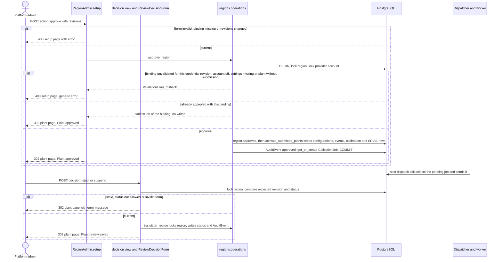

# Approve, reject or suspend a plant

A platform administrator (active staff superuser with verified MFA) reviews a submitted plant in the operator workspace and decides on its `Region`. Approval needs a connection binding validated for the current credential revision; it turns the customer's `PlantSubmission` into an immutable `PlantConfiguration` and inserts the first forecast job, which the dispatcher sends later. Reject and suspend only change the status, and customers see the result through the dashboard's polling.

## Entry points

- Screen: `regions/templates/admin/regions/region/setup.html`, rendered by `RegionAdmin.setup` (`pyracast/admin.py`) at `/admin/plants/{id}/` (`PlatformAdminSite.plant`) and `/admin/regions/region/{id}/setup/`. **Approve plant** (shown for every status except `approved`, disabled unless the view flag `can_approve` holds) posts `action=approve` with hidden revision, binding and credential revision checked by `BindingActionForm.current_binding` (`pyracast/admin_forms.py`).
- `POST /admin/plants/{id}/decision/` (reject when pending, suspend when approved) -> `PlatformAdminSite.decision` -> `ReviewDecisionForm.apply` (`pyracast/admin_workspace.py`); the same form carries the actions of flow `location-change`.
- Unguarded duplicates: `RegionAdmin` changelist actions `approve`, `reject`, `suspend` (`POST /admin/regions/region/`); `POST /api/platform/regions/{id}/approve/` (`ApproveView`, body `binding_id`) and `.../transition/` (`TransitionView`, body `status`) in `pyracast/api/views.py`, no caller in `web/`.
- Operations: `approve_region`, `transition_region` (`pyracast/regions/operations.py`); `activate_submitted_plants` (`pyracast/plants/operations.py`); command `fixture_demo`. Customer view: `Dashboard` (`web/src/components/dashboard.tsx`) polls `/api/tenants/{t}/sites/` every 30 s; `PlantWorkspace` shows `region.status` and a notice for any status other than `approved`.

## Sequence

## Data

| Table | R/W | What |
| --- | --- | --- |
| `regions_region` | R/W | Locked; `status`, `approved_binding`; `revision` is the guard |
| `connections_sitebinding`, `connections_provideraccount` | R | Binding of the current revision with `validated_at` and `validated_credential_revision`; account locked for `credential_revision`, `enabled`, `authorized_at` |
| `plants_plant`, `plants_plantsubmission`, `plants_calibrationrun` | R/W, R, W | Plant locked, `current_configuration` set, automatic calibration off; submission kept after approval; pending or running runs become `superseded` |
| `plants_plantconfiguration`, `plants_plantevent` | R/W, W | New revision per plant that has none or is bound to another binding; `configuration_created` |
| `metering_epiasconnection`, `metering_epiascollectionjob` | R, R/W | With an enabled connection, `enqueue_connection(initial=True)`: `get_or_create` of 90 daily `realtime_generation` jobs, plus 12 monthly `settlement_injection` jobs when a settlement plant is known (existing settlement jobs are queried) |
| `forecasts_collectionjob`, `regions_auditevent` | R/W, W | First `forecasts` job via `get_or_create` (slot is approval time, target is local tomorrow); the idempotent branch reads the binding's earliest job; `approved`, `rejected`, `suspended` |

## Authorization

- View: `PlatformAdminSite.has_permission` (active, staff, superuser, MFA) wraps all admin routes through `admin_view`, which adds CSRF; API views use `PlatformAdmin` (active superuser, MFA, no staff flag) with session CSRF.
- Operation: `require_admin` (active superuser, no MFA) first in `approve_region`, `transition_region` and `ReviewDecisionForm.apply`. Administrators are not tenant scoped.
- Database: `approved_binding_region_fk` keeps the binding in the same region, `region_status` limits values and `unique_collection_slot` prevents a duplicate job; nothing ties `approved` to a validated binding.

## Failure paths

| Condition | Result |
| --- | --- |
| Anonymous, or not active staff superuser with MFA | Admin 302 to `/admin/login/`, which redirects to `/app/?next=/admin/`; API 403 |
| Missing CSRF token; GET on `/decision/` | 403; 405 |
| Region missing or trashed; API binding not of the current region revision | Admin 404; API 404 `not_found` |
| Approve form stale, binding unvalidated for this credential revision, account disabled or unauthorized, Solcast settings missing, plant without submission | Setup page 400 with one generic "setup could not be applied" message; API 400 `invalid_request`; changelist message "Validate the current binding before approval." |
| Reject or suspend with stale revision or status, wrong status, or invalid fields | 302 and "The review could not be applied." or "Choose a review action..." |
| Lock wait over 5 s (`lock_timeout`) | API 503 `workspace_busy`; admin views do not catch it, so HTTP 500 |

## Rules and invariants

- Lock order is region, provider account, plants. `validate_binding` commits and `claim` start with the region, so approval is serialized against validation and collection; rotation locks only the account and waits.
- Approval is idempotent per binding while it stays validated: the same binding already approved returns its earliest job. Re-approval after reject or suspend writes a new job and audit event, and a new configuration revision only for plants bound to another binding.
- `approve_region` has no status guard: rejected and suspended plants can be approved, and a concurrent reject loses to a later approval. `transition_region` has no state machine either; only the review form requires pending for reject and approved for suspend, and the changelist and API paths skip it.
- Suspension changes no other row: `binding_is_current` requires `approved`, so scheduling, claim, publication and reminders stop; queued jobs turn `stale` when claimed. `dispatch` sends the inserted job, and `claim` lets only the binding's first forecast job run outside configured clocks. A new configuration resets `automatic_calibration_enabled`, supersedes calibration runs and, with an enabled EPIAS connection, queues the initial EPIAS backfill (90 daily realtime jobs, plus 12 monthly settlement jobs when a settlement plant is known). `PlantConfiguration` is immutable by convention only; no constraint enforces it. `can_approve` repeats the approval precondition for the button only; the operation re-checks it.

## Tests

- Operation and concurrency: `tests/test_domain.py`, `tests/test_jobs.py` (`test_concurrent_approvals_share_atomic_first_job`), `tests/test_site_onboarding.py` (materialization, re-approval, missing submission), `tests/test_account_rotation.py`. Boundaries: `tests/test_admin_setup.py`, `tests/test_admin_workspace.py` (decision guards, CSRF, identity matrix, `can_approve`), `tests/test_api.py` (API approve and suspend, changelist approve over HTTP), `tests/test_admin_mfa_bootstrap.py`, `tests/test_trash_api.py` (changelist actions skip trashed regions). Playwright: `web/integration/admin-csp.spec.ts` approves against live Django; `web/tests/plant-onboarding.spec.ts` covers the customer refresh with a mocked API.
- Gaps: no test that `approve_region` or `transition_region` reject a non-superuser; changelist reject and suspend run only as direct calls; no HTTP test for a stale approve form, approving a rejected plant from the page, same-binding re-approval under a schedule, or the admin response to a lock timeout.
