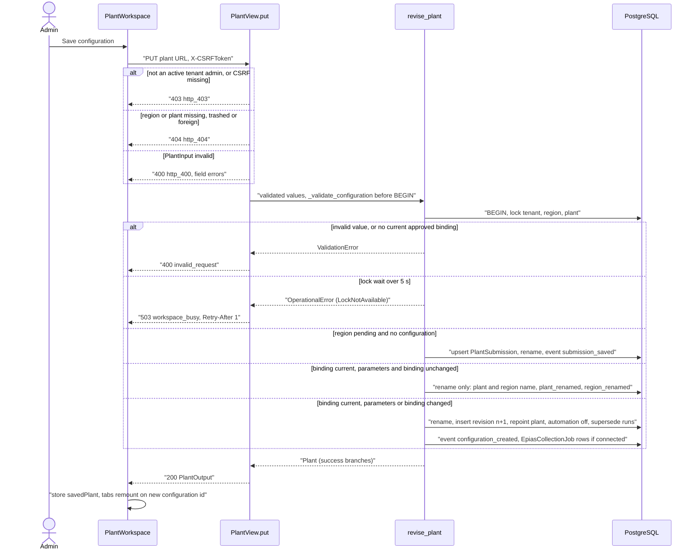

# Edit a plant's name and technical configuration

A workspace administrator saves the plant name and electrical or geometry parameters from the Settings tab (or the `configure_plant` command). While the region is pending and the plant has no configuration, the save overwrites the customer's `PlantSubmission`; otherwise it needs a current approved binding. A save whose parameters and binding equal the current configuration changes nothing but the name; any other save appends an immutable `PlantConfiguration` revision, switches the plant to it, turns automatic calibration off, supersedes unfinished calibration runs and inserts fresh history jobs for a connected EPİAŞ plant. A new name renames the plant and its region. Viewers see the form read-only.

## Entry points

- Screen: `web/src/components/plant-workspace.tsx` `PlantWorkspace`, Settings tab, "Technical details" (shown when a configuration or submission exists); inputs `plant-configuration-fields.tsx` `PlantConfigurationFields`, body `configurationInput`; submit via `ActionForm` (`ui.tsx`) and `request` (`lib/api.ts`). `plant-onboarding.tsx` reuses the fields but POSTs (`site-onboarding`).
- `PUT /api/tenants/{t}/regions/{r}/plants/{p}/` -> `pyracast/plants/api.py` `PlantView.put` -> `operations.revise_plant`. `PlantView.get` has no web caller.
- `PUT|PATCH /api/tenants/{t}/regions/{r}/` -> `pyracast/api/views.py` `RegionView.put` (`patch` delegates) -> `regions.operations.update_region`: renames the `Region` only, no web caller.
- Command `configure_plant`: `create_plant`, or `revise_plant` with `--plant-id`; actor is `--username`. Approval (`activate_submitted_plants`) reuses `_save_configuration`, see `plant-approval`.

## Sequence

## Data

| Table | R/W | What |
| --- | --- | --- |
| `accounts_tenant`, `accounts_membership`, `regions_region` | R | Tenant then region locked; membership read by the permission class and `require_workspace_admin`; region `status` selects the branch, `approved_binding` supplies the binding |
| `connections_sitebinding`, `connections_provideraccount` | R | `_binding`, `binding_is_current` (region approved at the binding's revision, account enabled and authorized, credential revision) |
| `plants_plant` | R/W | Locked; `name`, `current_configuration`, automation flags and `next_calibration_check_at` |
| `plants_plantsubmission` | W | Upserted only while region is pending and plant has no configuration; kept after approval |
| `plants_plantconfiguration`, `plants_plantevent`, `plants_calibrationrun` | R/W, W, W | New row per changed save, `revision` = previous + 1; events `submission_saved`, `configuration_created`, `plant_renamed` (old and new name); `pending` and `running` runs become `superseded` |
| `metering_epiasconnection`, `metering_epiascollectionjob`, `forecasts_collectionschedule` | R, W, R | Enabled connection: 90 realtime jobs and, with a settlement plant, 12 settlement months for the new configuration; rows only, dispatched later |
| `regions_region`, `regions_auditevent` | W | A new plant name also renames the region: `region_renamed` |

## Authorization

- DRF: default `IsAuthenticated` and `WorkspaceWritePermission` (`api/permissions.py`) reject non-safe methods unless the user is an active tenant admin, before the view runs; session authentication enforces CSRF.
- View: `ScopedView.plant_queryset` requires membership (403) and a live region and plant of that tenant (404 `http_404`).
- Operation: `require_workspace_admin` repeats it under the tenant lock; the only check for the command. UI: `ActionForm` disables the fieldset and hides Save without `useCanManageWorkspace` (cosmetic). Database: check constraints on capacities and angles; unique `(plant, revision)`.

## Failure paths

| Condition | Result |
| --- | --- |
| Anonymous, not a tenant admin (viewer, outsider, inactive) or missing CSRF token | 403 `http_403` |
| Region or plant absent, trashed or of another tenant | 404 `http_404`; 404 `not_found` if trashed between the view check and the lock |
| Unknown field (non-field error), missing, blank or over-long name, missing or null capacity, non-numeric or boolean value, tilt over 90, negative value | 400 `http_400` |
| Capacity 0, azimuth 360 or more, angles without fixed mounting (serializer lets these pass) | 400 `invalid_request`, message list |
| Not (region pending and no configuration) and no current approved binding: rejected, suspended, location change or new binding awaiting approval, provider account disabled or credentials changed | 400 `invalid_request`, "An approved current provider binding is required." |
| Lock wait over 5 s (`lock_timeout`) | 503 `workspace_busy`, `Retry-After: 1` |
| Command: bad user, region, plant, access or value | `CommandError`, one generic message; a lock timeout escapes as `OperationalError` |

## Rules and invariants

- Lock order is tenant, region, plant; `connect_epias` locks region then plant, so the region lock serializes it with a revision. The submission branch needs `region.status == "pending"` and no configuration.
- `PUT` is a full replace: omitted optional fields fall back to null, `net_export` and `unknown`. On the configuration branch a save makes a revision only when a saved column differs (the seven parameters or the binding, compared after `_binding` succeeds); an identical or name-only save keeps the configuration, calibration, automation and EPİAŞ jobs. A revision starts uncalibrated because activations are per configuration (`forecasting.calibration_at`). A plant rename (`_rename`, on both branches) also renames the region unless it already has that name; `create_plant` and `update_region` do not synchronize names. On the submission branch an unchanged submission is kept with its `submitted_by` and no `submission_saved` event.
- Only `pending` and `running` runs are superseded; earlier activations stay on their revision. Old EPİAŞ jobs are superseded lazily when claimed (`metering/jobs.py` `_current`).
- No expected-revision check: concurrent admins overwrite each other. `update_region` is idempotent and keeps region revision and approval.
- Validation exists in `PlantInput`, `_validate_configuration`, constraints and the browser; the operation is authoritative. Angles do not enter power calculations (only tracking mounting does, `plants/transfer.py`); `automatic_forecast.py` compares them only across a binding change.

## Tests

- `tests/test_plant_operations.py` (revision history, invalid input, geometry, boundaries), `test_plant_api.py` (PUT, CSRF), `test_site_onboarding.py` (PUT on a submission, revisions after approval), `test_workspace_authorization.py`, `test_calibration_automation.py`, `test_metering_history_backfill.py`, `test_plant_commands.py`, `test_region_editing.py`.
- Playwright (mocked API) in `web/tests`: `regions.spec.ts`, `workspace.spec.ts`, `workspace-roles.spec.ts`, `plant-onboarding.spec.ts`. Gaps: no concurrent `revise_plant` test; none for a rejected, suspended or re-approval region; no `submission_saved` assertion; no browser test of a save error.
