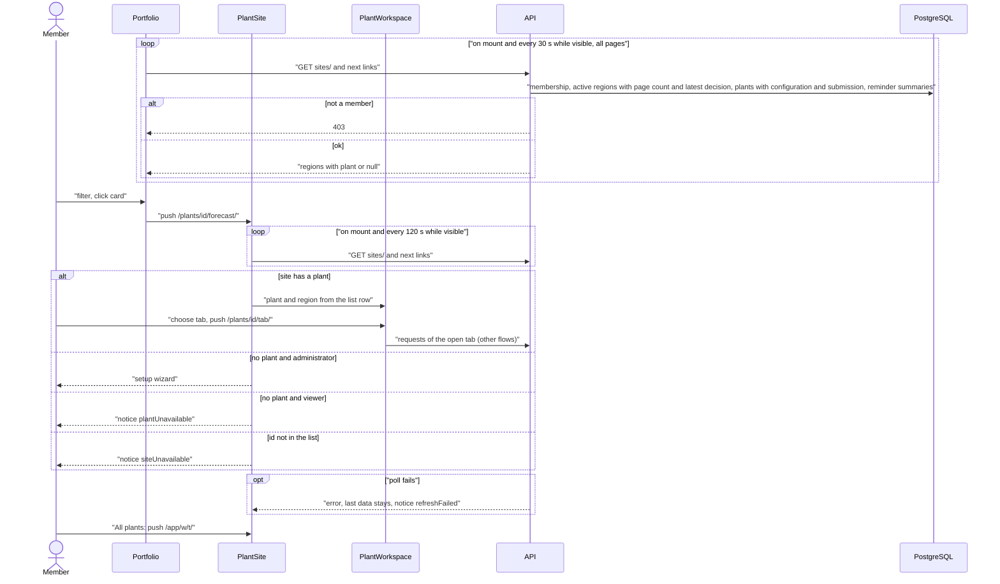

# Browse the plant portfolio, open a plant and move between its tabs

A workspace member (administrator or viewer) lands on the portfolio, which lists the workspace's sites with approval status, filters them in the browser and opens one at its own address. Opening a site shows its plant: an existing plant gets the plant shell with five tabs, a location without a plant gets the setup wizard (administrator) or a notice (viewer). Browsing writes no domain row and contacts no provider; the lists poll while the tab is visible.

## Entry points

- Routes (`web/src/app/app/w/[tenantId]/`): the portfolio at `/app/w/{t}/`, an open plant at `/app/w/{t}/plants/{site}/{section}/` with `section` one of `forecast`, `production`, `calibration`, `outages`, `settings` and the date and view in the query (`routes` in `web/src/lib/routes.ts`; an id that is not a positive integer or an unknown section is a 404 page).
- Screens: `web/src/features/portfolio/portfolio.tsx` `Portfolio` (cards, search, approval filter, polls every 30 s), `web/src/features/plant/plant-site.tsx` `PlantSite` (resolves the site from the same list, polls every 120 s, then plant shell, wizard or notice), `web/src/features/plant/plant-workspace.tsx` `PlantWorkspace` (tab bar, review notice), `web/src/features/portfolio/plant-icon.tsx` `PlantIcon`.
- `GET /api/tenants/{t}/sites/` -> `pyracast.plants.site_api.SitesView.get` (paged, 50 per page, `SiteOutput`). `GET /api/tenants/{t}/regions/{r}/plants/` (`pyracast.plants.api.PlantsView.get`) is a member read with no web caller.
- Actors: administrator and viewer. Creation is `site-onboarding`.

## Sequence

## Data

| Table | R/W | What |
| --- | --- | --- |
| `accounts_membership` | R | `active_membership` in the route policy on every request |
| `regions_region` | R | Active rows of the tenant ordered by id, plus the page `COUNT`: name, coordinates, timezone, revision, status |
| `regions_auditevent` | R | Latest `region_approved`, `region_rejected` or `region_suspended` row per region (`with_review_outcome`): `reviewed_at`, `review_reason` |
| `plants_plant` | R | One plant per region (`plant_region_uniq`) |
| `plants_plantconfiguration`, `plants_plantsubmission` | R | Approved configuration (absent until approval) and the customer declaration shown before it |
| `notifications_reminderschedule`, `notifications_reminderrecipient`, `notifications_notificationdelivery`, `connections_provideraccount`, `account_emailaddress` | R | `reminder_summaries`: schedule state and latest delivery per listed region, null without a saved schedule |
| `django_session`, `usersessions_usersession` | W | Session middleware: the activity marker and device record, at most once a minute |

## Authorization

- `SessionAuthentication` and the route policy `RoutePolicy` (`pyracast.api.permissions.ROUTE_POLICIES`): `sites/` GET and `regions/{r}/plants/` GET are member routes, `sites/` POST and `regions/{r}/plants/` POST admin routes. Rows are scoped by `tenant_id` on the region, plants only through that region.
- The administrator role only gates browser controls (`tenant.role === "admin"` in `Portfolio`: add plant, recycle bin; `useCanManageWorkspace`: wizard, delete); the writes enforce admin in their own flows.

## Failure paths

| Condition | Result |
| --- | --- |
| Not signed in | 401 `not_authenticated`, `WWW-Authenticate: Session`; the browser confirms the session |
| Not a member | 403 `membership_required` |
| Region of another tenant, trashed or unknown on `plants/`; `?page=` past the end | 404 `not_found` |
| Another request of the same session holds the session lock over 5 s | 429 `session_busy`, `Retry-After: 1`; the browser repeats the read once after at most 2 s, then shows a failed poll |
| Sites read fails (HTTP error, or a `next` link outside `/api/` or repeated), nothing loaded yet | Alert and a retry button instead of cards |
| Sites read fails with data on screen | Alert `refreshFailed` beside the cards or the open plant; a 403 or 404 drops the data |
| Id of the plant address not in the list (unknown, foreign, trashed) | Notice `siteUnavailable` and an "All plants" button |
| Site without plant, viewer | Notice `plantUnavailable` |
| Region not approved | Tag and review notice in the shell (`ReviewNotice`); tabs stay usable |

## Rules and invariants

- Every error body is `{code, message, fields?, retry_after?, request_id?}`; see `api-error-contract`.
- `SiteOutput` is built from `site_queryset` and `sites`: one query for the page, one for its plants with configuration and submission, plus the page `COUNT` and the reminder reads; the request stays within a fixed query budget however many sites exist.
- `fetchList` follows every `next` link (it must start with `/api/`, no repeats) and swaps the data once all pages arrived, so filters and counts cover the whole workspace; a list of several pages polls that many times less often. An open plant learns about approval only through the sites poll: `region.status` and the plant come from the selected list row.
- `PlantWorkspace` is keyed by plant id, so tab, date and source state reset on another site. It keeps its just-saved plant until the poll returns the same or a newer revision (`latestPlant`), so an old poll cannot revert an edit. Tab and view changes are router navigations (`usePlantNavigation`); the address survives reload and Back.
- A plant card shows the plant name, the declared or approved DC capacity (or "Complete setup"), the timezone and, when a schedule exists, `Daily email: <state>` with the latest delivery.

## Tests

- `tests/test_site_onboarding.py` (`test_site_list_prepares_plants_without_per_row_queries`), `tests/test_site_read_model.py` (no binding in rows, a trashed site leaves the list), `tests/test_http_budgets.py` (`sites/` budget; `test_site_list_reads_do_not_grow_with_the_number_of_sites`), `tests/test_reminder_outcome.py` (reminder per card, fixed statements), `tests/test_review_reason.py` (decision time and reason in the list).
- `tests/test_route_policy.py` (each role meets its route policy), `tests/test_workspace_authorization.py` (viewer reads `sites/`), `tests/test_company_registration.py` (403 for a foreign tenant), `tests/test_routed_surface.py` (removed read routes answer 404), `tests/test_session_serialization.py` (bounded session wait and 429).
- `web/tests/plant-onboarding.spec.ts` (filters across pages, tab survives reload, complete-setup entry, approval refresh), `web/tests/workspace.spec.ts` (first-load sites error with retry, failed refresh keeps the cards until access is denied), `web/tests/query-layer.spec.ts` (three-page portfolio keeps the request budget, hidden tab makes no request), `web/tests/app-routes.spec.ts` and `web/tests/routes.spec.ts` (addresses), `web/tests/transport.spec.ts` (busy session retried once), `web/tests/regions.spec.ts` (rejected plant notice), `web/integration/workspace.spec.ts`: real API.
- Gaps: the `plantUnavailable` and `siteUnavailable` notices, the viewer without a plant and the unused `regions/{r}/plants/` read have no test.
