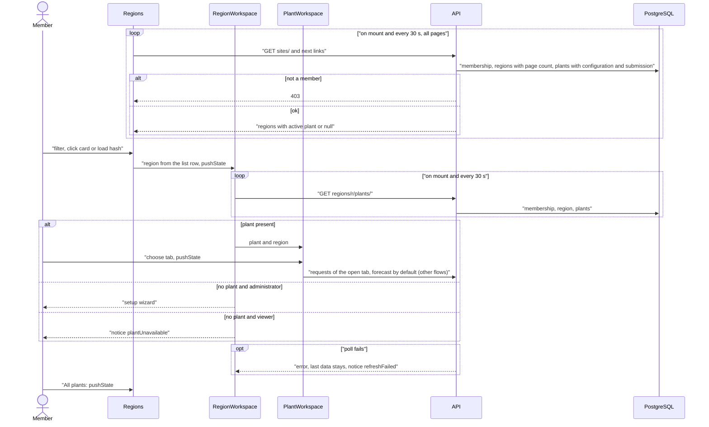

# Browse the plant portfolio, open a plant and move between its tabs

A workspace member (administrator or viewer) lands on the overview, which lists the workspace's sites with approval status, filters them in the browser and opens one through a URL hash. Opening a site loads its plant: an existing plant gets the plant shell with five tabs, a location without a plant gets the setup wizard (administrator) or a notice (viewer). Browsing writes no domain row and polls every 30 seconds; these endpoints contact no provider.

## Entry points

- Screens: `web/src/components/dashboard.tsx` `Regions` (cards, search, approval filter, hash `#plant-<region id>`), `web/src/components/region-workspace.tsx` `RegionWorkspace` (plant shell, wizard or notice), `web/src/components/plant-workspace.tsx` `PlantWorkspace` (tab bar, status notice, hash `#plant-<region id>/<tab>`), `web/src/components/plant-icon.tsx` `PlantIcon` (card icons).
- `GET /api/tenants/{t}/sites/` -> `pyracast.plants.site_api.SitesView.get` (paged, 50 per page, `SiteOutput`); `GET /api/tenants/{t}/regions/{r}/plants/` -> `pyracast.plants.api.PlantsView.get` when a site opens.
- Actors: administrator and viewer. Creation is `site-onboarding`. No web caller: `SiteView.get` (`sites/{r}/`), `pyracast.api.views.RegionsView.get` (`regions/`), `RegionView.get` (`regions/{r}/`), `PlantView.get`.

## Sequence

## Data

| Table | R/W | What |
| --- | --- | --- |
| `accounts_membership` | R | `require_member` on every request |
| `regions_region` | R | Active rows of the tenant by id, plus the page `COUNT`: name, coordinates, timezone, revision, status |
| `plants_plant` | R | One plant per region (`one_plant_per_region`) |
| `plants_plantconfiguration`, `plants_plantsubmission` | R | Approved configuration (absent until approval) and the customer declaration shown before it |
| `usersessions_usersession`, `django_session` | W | Middleware on every poll: allauth `last_seen_at` each request, `last_activity_at` at most once a minute |

## Authorization

- `SessionAuthentication` and `IsAuthenticated` (`REST_FRAMEWORK` in `pyracast.settings`); anonymous calls get 403. `WorkspaceWritePermission` passes every safe method, so reads are not role-gated. Tenant membership: `require_member`, called by `site_queryset` and `ScopedView.plant_queryset`; rows are scoped by `tenant_id` on the region, plants only through that region.
- The administrator role only gates browser controls (`tenant.role === "admin"` in `Regions`: add plant, recycle bin; `useCanManageWorkspace`: wizard, delete); the writes enforce admin in their own flows.

## Failure paths

| Condition | Result |
| --- | --- |
| Not signed in or not a member | 403 `http_403`; alert with the message |
| Region of another tenant, trashed or unknown on `plants/`; `?page=` past the end | 404 `http_404` |
| Another request of the same session holds the session lock over 5 s | 429 `session_busy`, `Retry-After: 1`; the browser shows it as a failed poll, no retry |
| Sites poll fails (HTTP error, or a `next` link outside `/api/` or repeated), overview open | Card grid replaced by an alert and a retry button until a poll succeeds |
| Sites or plants poll fails, plant open | Alert `refreshFailed`; the plant stays on screen |
| Plants request fails before any plant is known | Alert and "All plants" button, no wizard |
| Hash names an unknown, foreign or trashed site | The list is shown; the hash is left unchanged |
| Region without active plant, viewer | Notice `plantUnavailable` |
| Region not approved | Tag and notice in the shell (`awaitingApproval`, `approvalStatus`); tabs stay usable |

## Rules and invariants

- `SiteOutput.get_plant` reads `active_plants`, which only `site_queryset` prefetches (3 queries for queryset and serializer, pinned by test; the paginated view adds a `COUNT`); any other queryset raises `KeyError`.
- `useCollection` follows every `next` link (must start with `/api/`, no repeats) and swaps the data once all pages arrived, so filters and counts cover the whole workspace. An open plant learns about approval only through the sites poll: `region.status` comes from the selected list row.
- `RegionWorkspace` prefers the polled plant over `created` and `initialPlant`; `PlantWorkspace` keeps its just-saved plant until the poll returns the same or a newer revision (`latestPlant`), so an old poll cannot revert an edit. `RegionWorkspace` is keyed by region id and `PlantWorkspace` by plant id, so tab, date and source state reset on another site. Hash grammar: `#plant-<region id>` site, `#plant-<region id>/<forecast|production|calibration|outages|settings>` tab, `#plants` list. `pushState` does not fire `hashchange`; only back and forward do.

## Tests

- `tests/test_site_onboarding.py`: 3-query list, 403 on `sites/` and `sites/{r}/` for a foreign tenant. `tests/test_workspace_authorization.py`: viewer reads `sites/`, `regions/` and `regions/{r}/`. `tests/test_plant_api.py`: plant list count, detail, cross-tenant 403 and 404 (on the detail URL). `tests/test_api.py`: region read API, cross-tenant 403 and 404, anonymous 403 on `regions/`.
- `web/tests/plant-onboarding.spec.ts` (on `mockApi`): filters across pages, hash survives reload, refresh failures, approval refresh, complete-setup entry; `web/tests/workspace.spec.ts`: open card, first-load sites error with retry; `web/tests/regions.spec.ts`: "All plants" returns to the refreshed list; `web/integration/workspace.spec.ts`: real API.
- Gaps: browser back or forward, hash with unknown id, viewer without plant, trashed rows absent from `sites/`, grid replaced by a later poll error, `session_busy` on polls, unused read endpoints.
