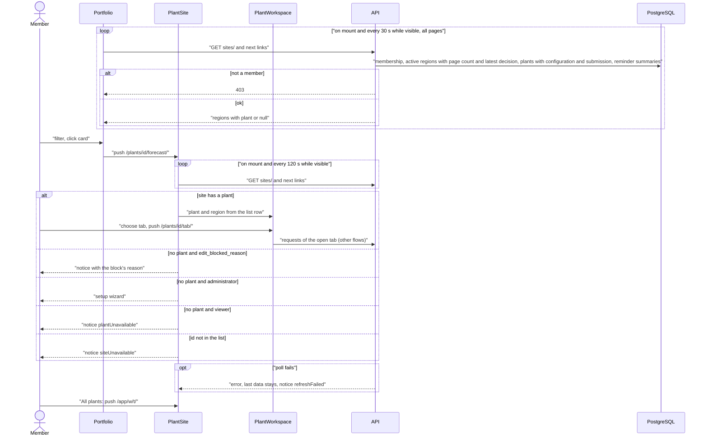

# Browse the plant portfolio, open a plant and move between its tabs

A workspace member (administrator or viewer) lands on the portfolio, which lists the workspace's sites with approval status and the one thing each needs from the customer, filters them in the browser and opens one at its own address. Opening a site shows its plant: an existing plant gets the plant shell with five tabs, a location without a plant gets the setup wizard (administrator) or a notice (viewer), and a blocked location without a plant shows the block's reason to everyone. Browsing writes no domain row and contacts no provider; the lists poll while the tab is visible.

## Entry points

- Routes (`web/src/app/app/w/[tenantId]/`): the portfolio at `/app/w/{t}/`, an open plant at `/app/w/{t}/plants/{site}/{section}/` with `section` one of `forecast`, `production`, `calibration`, `outages`, `settings` and the date and view in the query (`routes` in `web/src/lib/routes.ts`; an id that is not a positive integer or an unknown section is a 404 page).
- Screens: `web/src/features/portfolio/portfolio.tsx` `Portfolio` (cards, search in `portfolio-search.ts`, approval filter, attention count, the deletion notice `web/src/features/trash/recent-deletion.tsx` `DeletedNotice`, polls every 30 s), `web/src/features/plant/plant-site.tsx` `PlantSite` (resolves the site from the same list, polls every 120 s, then plant shell, wizard or notice), `web/src/features/plant/plant-workspace.tsx` `PlantWorkspace` (tab bar, review notice), `web/src/features/portfolio/plant-icon.tsx` `PlantIcon`.
- `GET /api/tenants/{t}/sites/` -> `pyracast.plants.site_api.SitesView.get` (paged, 50 per page, `SiteOutput`). `GET /api/tenants/{t}/regions/{r}/plants/` (`pyracast.plants.api.PlantsView.get`) is a member read with no web caller.
- Actors: administrator and viewer. Creation is `site-onboarding`.

## Sequence

## Data

| Table | R/W | What |
| --- | --- | --- |
| `accounts_membership` | R | `active_membership` in the route policy on every request |
| `regions_region` | R | Active rows of the tenant ordered by id, plus the page `COUNT`: name, coordinates, timezone, revision, status |
| `connections_sitebinding`, `connections_provideraccount` | R | The approved binding and its account, joined to the region, for `binding_is_current` behind `edit_blocked_reason` and `attention` |
| `regions_auditevent` | R | Latest `region_approved`, `region_rejected` or `region_suspended` row per region (`with_review_outcome`): `reviewed_at`, `review_reason` |
| `plants_plant` | R | One plant per region (`plant_region_uniq`) |
| `plants_plantconfiguration`, `plants_plantsubmission` | R | Approved configuration and the submission; `PlantOutput.parameters` is the declaration (the submission while it awaits approval, else the configuration) |
| `notifications_reminderschedule`, `notifications_reminderrecipient`, `notifications_reminderrecipienttie`, `notifications_notificationsettings`, `notifications_notificationdelivery`, `connections_provideraccount`, `accounts_membership`, `auth_user`, `account_emailaddress` | R | `reminder_summaries`: schedule state (explicit addresses with their member ties, the recipient limit) and latest delivery per listed region, null without a saved schedule; the workspace's active members and their verified addresses through `notifications/recipients.py` `workspace` |
| `django_session`, `usersessions_usersession` | W | Session middleware: the activity marker and device record, at most once a minute |

## Authorization

- `SessionAuthentication` and the route policy `RoutePolicy` (`pyracast.api.permissions.ROUTE_POLICIES`): `sites/` GET and `regions/{r}/plants/` GET are member routes, `sites/` POST and `regions/{r}/plants/` POST admin routes. Rows are scoped by `tenant_id` on the region, plants only through that region.
- The administrator role only gates browser controls (`tenant.role === "admin"` in `Portfolio`: add plant, recycle bin; `useCanManageWorkspace`: wizard, delete); the writes enforce admin in their own flows.

## Failure paths

| Condition | Result |
| --- | --- |
| Not signed in | 401 `not_authenticated`, `WWW-Authenticate: Session`; the browser confirms the session |
| Not a member | 403 `membership_required` |
| Region of another tenant, trashed or unknown on `plants/`; `?page=` past the end | 404 `not_found` |
| Another request of the same session holds the session lock over 5 s | 429 `session_busy`, `Retry-After: 1`; the browser repeats the read once after at most 2 s, then shows a failed poll |
| Sites read fails (HTTP error, or a `next` link outside `/api/` or repeated), nothing loaded yet | The error and Retry (`ReadFailed`) instead of cards, also on the open plant (`plant-site.tsx`) |
| Sites read fails with data on screen | Alert `refreshFailed` beside the cards or the open plant; a 403 or 404 drops the data until a later read is answered, through later failures and language changes |
| Id of the plant address not in the list (unknown, foreign, trashed) | Notice `siteUnavailable` and an "All plants" button |
| Site without plant, viewer | Notice `plantUnavailable`; with `edit_blocked_reason`, that reason as for an administrator |
| Region not approved | Tag and review notice in the shell (`ReviewNotice`); tabs stay usable. An approved plant whose connection is not current repeats the card's attention sentence there |
| Code of an on-demand section cannot load, or another render failure under the plant routes | Plant route error (`web/src/app/app/w/[tenantId]/plants/error.tsx`, `RouteError`) beside "Reload page": "Try again" reloads the page for a section that could not load, since a failed chunk stays failed for the document (`recovery`), and renders again otherwise |
| Any other render failure under `/app/`, outside the plant routes | `web/src/app/app/error.tsx` (`RouteError` with "Try again", "Reload page" and a link "Go to the start screen" to `/app/`); an unknown `/app/` address shows `web/src/app/app/not-found.tsx` with a link to `/app/` |

## Rules and invariants

- Every error body is `{code, message, fields?, retry_after?, request_id?}`; see `api-error-contract`.
- `SiteOutput` is built from `site_queryset` and `sites`: one query for the page (with the approved binding and its account), one for its plants with configuration and submission, plus the page `COUNT` and the reminder reads; the request stays within a fixed query budget however many sites exist.
- `fetchList` follows every `next` link (it must start with `/api/`, no repeats) and swaps the data once all pages arrived, so filters and counts cover the whole workspace; a list of several pages polls that many times less often. An open plant learns about approval only through the sites poll: `region.status` and the plant come from the selected list row.
- `PlantWorkspace` is keyed by plant id, so its forecast options (resolution, source) and saved plant reset on another site; tab and date come from the address. It keeps its just-saved plant until the poll returns the same or a newer `parameters_revision` (`latestPlant`), so an old poll cannot revert an edit. Tab and view changes are router navigations (`usePlantNavigation`); the address survives reload and Back.
- The calibration, outages and production sections, and the performance view inside production, load their code on demand (`next/dynamic` with `sectionUnavailable` from `web/src/lib/on-demand.ts`). While a first opened section loads, only the section slot shows "Loading section…" and the header and tabs stay; a tab change keeps the outgoing section with busy tabs until the next one is ready.
- A plant card shows the plant name (else the location name), the DC capacity of `plant.parameters`, the timezone, "Needs attention: <reason>" when `SiteOutput.attention` is set and, when a schedule exists, `Daily email: <state>` with the latest delivery. Its action reads "Open plant" for a plant or a blocked location, else "Complete setup" for an administrator and "Waiting for an administrator to finish setup" for a viewer.
- `Site.attention` (`plants/sites.py`) comes from stored rows only and names one reason: a block (`suspended`, `connection_unavailable`, from `operations.plant_edit_block`) before a missing plant (`setup_incomplete`) and that before a rejection (`review_rejected`). The portfolio counts the sites with a reason.
- The search matches the shown name and the zone, folding case by the locale and the Turkish dotted and dotless i; a narrowed list announces "n of m plants shown" in a status line.
- After a deletion the portfolio shows "<name> is in the recycle bin." with Undo (a restore) until it is dismissed, undone, the workspace changes or the plant is restored through the add-plant wizard; Undo turns it into a restored confirmation (`plant-trash-and-restore`).

## Tests

- `tests/test_site_onboarding.py` (`test_site_list_prepares_plants_without_per_row_queries`), `tests/test_site_read_model.py` (no binding in `sites/` or `regions/{r}/plants/` rows, a trashed site leaves the list), `tests/test_http_budgets.py` (`sites/` budget; `test_site_list_reads_do_not_grow_with_the_number_of_sites`), `tests/test_reminder_outcome.py` (reminder per card, fixed statements), `tests/test_review_reason.py` (decision time and reason in the list).
- `tests/test_route_policy.py` (each role meets its route policy), `tests/test_workspace_authorization.py` (viewer reads `sites/`), `tests/test_company_registration.py` (403 for a foreign tenant), `tests/test_routed_surface.py` (removed read routes answer 404), `tests/test_session_serialization.py` (bounded session wait and 429).
- `tests/test_site_states.py` (attention reason and edit block per state). `web/tests/site-setup.spec.ts` (attention marks and count, search count, member and blocked locations without a plant), `web/tests/recycle-bin.spec.ts` (deletion notice and Undo), `web/tests/plant-onboarding.spec.ts` (filters across pages, tab survives reload, complete-setup entry, approval refresh), `web/tests/workspace.spec.ts` (first-load sites error with retry, failed refresh keeps the cards until access is denied), `web/tests/query-layer.spec.ts` (three-page portfolio keeps the request budget, hidden tab makes no request), `web/tests/app-routes.spec.ts` and `web/tests/routes.spec.ts` (addresses), `web/tests/on-demand-sections.spec.ts` (each section loads on first open, loading slot, busy tabs, unloadable section reloads), `web/tests/transport.spec.ts` (busy session retried once), `web/tests/regions.spec.ts` (rejected plant notice), `web/integration/workspace.spec.ts`: real API.
- `tests/test_plant_parameters.py` (`regions/{r}/plants/` read of the parameter revision).
- Gaps: the `plantUnavailable` and `siteUnavailable` notices have no test.
