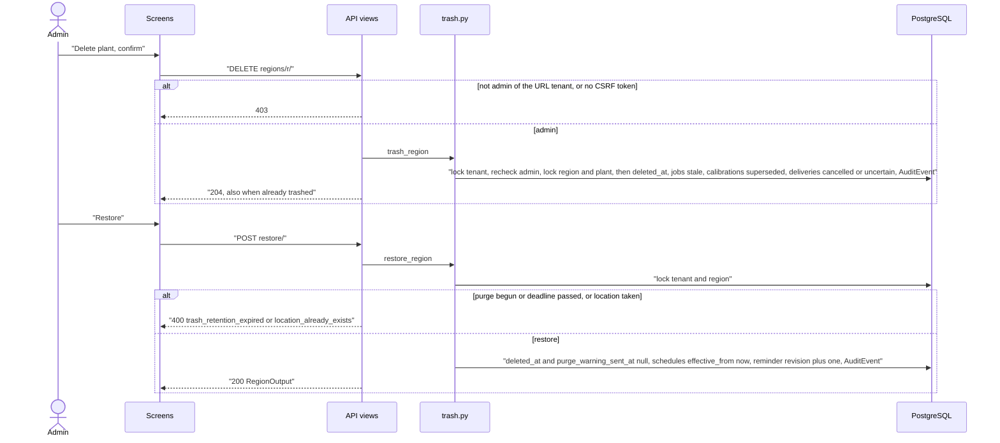

# Move a site to the recycle bin and restore it

A workspace administrator uses "Delete plant" in plant settings, which soft-deletes the whole site (the region) with its one plant and stops its collection, calibration and reminders. A plant has no trash of its own: it leaves and returns with its location. The recycle bin lists every trashed region and restores it within 30 days if the location is still free. After the deadline the row stays listed with `restore_blocker` set until the dispatcher starts purging it (`trash-retention-purge`).

## Entry points

- Screen: `web/src/features/plant/workspace/settings-section.tsx` `SettingsSection` shows `MoveToRecycleBin` (`web/src/features/trash/move-to-recycle-bin.tsx`) under Technical details to admins: a confirmation naming the plant, saying that collection and reminders stop and bin days get no forecasts. It calls the region endpoint; the plant workspace exists only for a region with a plant, so a plantless site cannot be deleted from the web. After the delete the workspace reloads, returns to the portfolio and leaves an Undo notice there (`web/src/features/trash/recent-deletion.tsx`, see `plant-portfolio`). The portfolio's "Recycle bin" button (admins) opens `/app/w/{t}/trash/` (`TrashPage`) with `RecycleBin` (`web/src/features/trash/recycle-bin.tsx`): rows titled with the plant name, restore via POST `{}`, then a "<name> restored." notice with "Open plant". The add-plant wizard also restores a binned plant at the entered coordinates (`site-onboarding`).
- `DELETE /api/tenants/{t}/regions/{r}/` -> `pyracast.api.views.RegionView.delete` -> `pyracast.trash.trash_region`. The plant route answers only `PUT` (405 for `DELETE`).
- `GET /api/tenants/{t}/trash/regions/` -> `pyracast.api.trash.TrashedRegionsView` (paginated, 50 per page, oldest deletion first; rows whose purge has begun are left out). Each row carries `plant_name` (the plant's name, else the location's), `latitude`, `longitude` and `restore_blocker`, `trash_retention_expired`, `location_already_exists` or null, from `trash.restore_blocker`, the function restore raises from.
- `POST .../regions/{r}/restore/` -> `RestoreRegionView` -> `restore_region`. Actor: workspace administrator, throttled under `submission`; no command, job or broker message.

## Sequence

## Data

| Table | R/W | What |
| --- | --- | --- |
| `accounts_tenant`, `accounts_membership` | R | Tenant row locked `FOR UPDATE`; admin role of the actor |
| `regions_region` | R/W | `deleted_at` set or cleared; restore also clears `purge_warning_sent_at` and reads `purge_started_at`; unique active location per tenant |
| `plants_plant` | R | Locked on trash; one plant per region (`plant_region_uniq`) |
| `forecasts_collectionschedule`, `notifications_reminderschedule` | R/W | Restore: collection schedule created with the default times if missing; it and the reminder schedule get `effective_from = now` (no catch-up) and the reminder schedule's `revision` advances |
| `notifications_notificationdelivery` | W | Trash: pending and retry become `cancelled`; sending becomes `cancelled` when transmission has not started, else `uncertain` with its lease kept so a late outcome still lands (`definition_trashed`) |
| `forecasts_collectionjob`, `plants_calibrationrun`, `plants_plantevent` | W | Trash: pending, retry, running jobs become `stale`, leases cleared; pending and running calibrations become `superseded` (reason `trashed`) with one `calibration_completed` event each |
| `connections_provideraccount` | W | Restore: `revalidation_due_at` brought forward to now when the approved binding awaits revalidation |
| `regions_auditevent` | W | `region_trashed`/`region_restored` |

## Authorization

- View: `RoutePolicy` (`src/pyracast/api/permissions.py`): `DELETE` on the region and `POST` on restore are admin routes (active admin of the URL tenant), the trash list a member route. Viewers, outsiders and anonymous users are refused on `DELETE` and restore. `SessionAuthentication` enforces CSRF (`X-CSRFToken`).
- Operation: every `trash.py` mutation calls `tenant_membership(role=admin, lock=True)`, which locks the tenant row and rechecks the role, so an administrator transfer cannot interleave.
- List: any member can read the bin through the API; the web shows it to admins only. A region is fetched by `tenant_id`; a foreign id gives 404.

## Failure paths

| Condition | Result |
| --- | --- |
| Anonymous | 401 `not_authenticated` |
| Not a member, a viewer, missing CSRF token | 403 `membership_required`, `workspace_admin_required`, `csrf_failed` |
| Region outside the URL tenant, or already purged | 404 `not_found` |
| `DELETE` on a plant | 405 `method_not_allowed` |
| Restore at or after `deleted_at + 30 days`, or once a purge has begun (whatever the clock says) | 400 `trash_retention_expired` |
| Restore a region whose coordinates (rounded to 6 decimals) match an active region | 400 `location_already_exists` |
| Restore body with any field (`EmptyInput`) | 400 `invalid_request`, "Unknown fields are not accepted." |
| Row lock wait over 5 s (`lock_timeout`) | 503 `busy`, `Retry-After: 1` |
| UI error | Delete: the confirmation stays open with the reason. Restore: error notice and a reload of the bin; a failed Undo shows its alert beside the notice |

## Rules and invariants

- Lock order: tenant, region, plant (trash); tenant, region, then the approved binding's provider account (restore). The tenant lock also serializes the location check with `submit_region` and location review. `purge_expired` takes no tenant lock.
- Trash is idempotent and never extends the deadline; restoring a region that is not trashed returns it unchanged.
- Restore is strict (`now >= deleted_at + RETENTION` is expired) while purge is inclusive (`deleted_at <= now - RETENTION`), so no instant is both. `restore_blocker` reads purge state and deadline first, then the location, so a region past its deadline reports expiry even when its location is taken; it is computed in one query for the whole list.
- Restore revives no work: stale jobs, superseded calibrations and cancelled deliveries stay; `effective_from = now` stops back-filling. An approved plant still validated with an earlier key makes its provider account's revalidation due at once (`forecasts.revalidation.queue_revalidation`, flow `provider-credential-recovery`). Trash leaves EPIAS jobs untouched; a claim supersedes them while the region is trashed. A running job's lease is cleared on trash, so a late `publish` returns false. Clearing `purge_warning_sent_at` lets a region trashed again be warned again.

## Tests

- `tests/test_trash_operations.py`, `tests/test_trash_api.py`, `tests/test_trash_boundaries.py`: effects, deadline boundary, tenant scope, CSRF, concurrent trash, blocked in-flight work, the plant route without `DELETE` or restore. `tests/test_trash_restore_rules.py`: list and restore name the same blocker, deliveries trashed before and during transmission. `tests/test_purge_warning.py`: restore clears the warning.
- `tests/test_site_onboarding.py` (location conflicts, operation level), `tests/test_workspace_authorization.py` (roles). Playwright: `web/tests/recycle-bin.spec.ts` (named rows, restored notice, Undo, failed delete), `web/tests/workspace.spec.ts` (mocked API), `web/integration/workspace.spec.ts` (real backend: plant `DELETE` refused by in-page fetch, then UI site delete and restore).
- Gaps: no 503 test on these routes.
