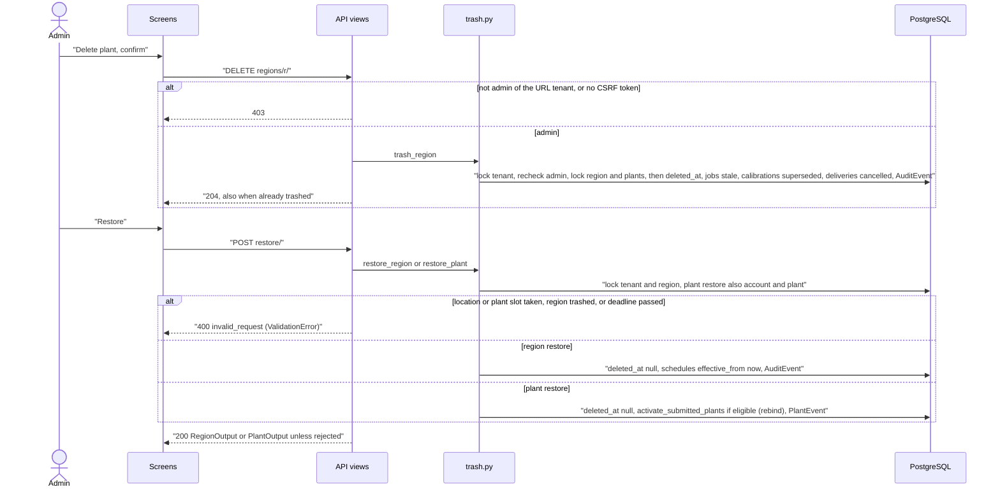

# Move a site or plant to the recycle bin and restore it

A workspace administrator uses "Delete plant" in plant settings, which soft-deletes the whole site (the region) and stops its collection, calibration and reminders. The recycle bin lists every trashed region and plant and restores it within 30 days if the location is still free. After the deadline the row stays listed with `can_restore` false until the dispatcher purges it (`trash-retention-purge`).

## Entry points

- Screen: `web/src/components/plant-workspace.tsx` `PlantWorkspace` settings tab shows `MoveToRecycleBin` (`web/src/components/recycle-bin.tsx`) to admins. It receives `regionBase`, so it calls the region endpoint; `RegionWorkspace` renders it only when the region has a plant, so a plantless site cannot be deleted from the web. `dashboard.tsx` `Regions` then hides the row and reloads. Its "Recycle bin" button (admins) opens view `trash` with `RecycleBin`: lists via `useCollection`, restore via POST `{}`.
- `DELETE /api/tenants/{t}/regions/{r}/` -> `pyracast.api.views.RegionView.delete` -> `pyracast.trash.trash_region`.
- `DELETE .../regions/{r}/plants/{p}/` -> `pyracast.plants.api.PlantView.delete` -> `trash_plant`. No web caller.
- `GET /api/tenants/{t}/trash/regions/` and `trash/plants/` -> `pyracast.api.trash.TrashedRegionsView`, `TrashedPlantsView` (paginated, 50 per page, oldest deletion first).
- `POST .../regions/{r}/restore/` -> `RestoreRegionView` -> `restore_region`; `POST .../plants/{p}/restore/` -> `RestorePlantView` -> `restore_plant` (routed in `src/pyracast/plants/urls.py`). Actor: workspace administrator; no command, job or broker message.

## Sequence

## Data

| Table | R/W | What |
| --- | --- | --- |
| `accounts_tenant`, `accounts_membership` | R | Tenant row locked `FOR UPDATE`; admin role of the actor |
| `regions_region`, `plants_plant` | R/W | `deleted_at` set or cleared; unique active location per tenant and one active plant per region |
| `forecasts_collectionschedule`, `notifications_reminderschedule` | R/W | Region restore: collection schedule created with the cutoff time if missing; it and non-retired reminder schedules get `effective_from = now` (no catch-up) |
| `notifications_notificationdelivery` | W | Region trash: pending and retry become `cancelled`, sending becomes `uncertain` (`definition_trashed`) |
| `forecasts_collectionjob`, `plants_calibrationrun` | W | Region trash: pending, retry, running jobs become `stale`, leases cleared; calibrations (also on plant trash) become `superseded` |
| `connections_sitebinding`, `connections_provideraccount`, `plants_plantsubmission`, `metering_epiasconnection` | R | Plant restore reads the approved binding, locks its account, reads the submission and an enabled EPIAS connection |
| `plants_plantconfiguration`, `metering_epiascollectionjob` | W | Plant restore with a changed binding: new configuration revision; with an enabled EPIAS connection, initial job rows (no broker message) |
| `regions_auditevent`, `plants_plantevent` | W | `region_trashed`/`region_restored`; `plant_trashed`/`plant_restored`, `configuration_created` on rebind |

## Authorization

- View: DRF defaults in `settings.py` (`IsAuthenticated`, `WorkspaceWritePermission`: active admin of the URL tenant for every non-safe method). Viewers, outsiders and anonymous users get 403 on DELETE and restore. `SessionAuthentication` enforces CSRF (`X-CSRFToken`).
- Operation: every `trash.py` mutation calls `require_workspace_admin`, which locks the tenant row and rechecks the role, so an administrator transfer cannot interleave.
- Lists: `require_member` only, so any member can read the bin through the API; the web shows it to admins only. Region and plant are fetched by `tenant_id` and `region_id`; a foreign id gives 404.

## Failure paths

| Condition | Result |
| --- | --- |
| Anonymous, missing CSRF token, not admin of the tenant | 403 |
| Region or plant outside the URL tenant or region, or already purged | 404 `not_found` |
| Trash a live plant, or restore any plant, under a trashed region | 400 `invalid_request`, `detail` holds the localized sentence for `parent_region_trashed` |
| Restore at or after `deleted_at + 30 days` | 400 `invalid_request`, localized sentence for `trash_retention_expired` |
| Restore a region whose coordinates (rounded to 6 decimals) match an active region | 400 `invalid_request`, localized sentence for `location_already_exists` |
| Restore a plant while the region has another active plant | 400 `invalid_request`, localized sentence for `location_already_has_plant` |
| Restore body with any field (`EmptyInput`) | 400 `http_400`, "Unknown fields are not accepted." |
| Row lock wait over 5 s (`lock_timeout`) | 503 `workspace_busy`, `Retry-After: 1` |
| UI error | Delete: message in the open confirmation. Restore: error notice; the bin is not reloaded |

## Rules and invariants

- Lock order: tenant, region, provider account (plant restore only), plants. The tenant lock also serializes the location check with `submit_region` and location review. `purge_expired` takes no tenant lock.
- Trash is idempotent and never extends the deadline. Region trash does not touch its plants' `deleted_at`: a plant trashed earlier keeps its own deadline and stays in the bin after the region is restored.
- Restore is strict (`now >= deleted_at + RETENTION` is expired) while purge is inclusive (`deleted_at <= now - RETENTION`), so no instant is both. `can_restore` uses the same bound (plus the parent for plants) but ignores location and plant-slot conflicts. Check order decides which sentence `detail` holds: region restore tests the location before the deadline; plant restore tests the parent before the deadline and the already-active no-op.
- Region restore revives no work: stale jobs, superseded calibrations and cancelled deliveries stay; `effective_from = now` stops back-filling. Trash leaves EPIAS jobs untouched; a claim supersedes them while the plant or region is trashed.
- Plant restore re-activates only if the region is approved, the binding is current and validated, and the plant has a configuration or submission. It adds a revision only if the approved binding changed while trashed; that also resets automatic calibration. A running job's lease is cleared on region trash, so a late `publish` returns false.

## Tests

- `tests/test_trash_operations.py`, `tests/test_trash_api.py`, `tests/test_trash_boundaries.py`: effects, deadline boundary, tenant scope, CSRF, concurrent trash, blocked in-flight work.
- `tests/test_plant_restore_configuration.py` (rebinding), `tests/test_site_onboarding.py` (location conflicts, operation level), `tests/test_workspace_authorization.py` (roles). Playwright: `web/tests/workspace.spec.ts` (mocked API), `web/integration/workspace.spec.ts` (real backend: plant DELETE by in-page fetch and UI restore, then UI site delete and restore).
- Gaps: no 503 test on these routes, no UI test of a failed delete or restore, no HTTP test of `location_already_exists` or `location_already_has_plant` on restore, and `web/tests/workspace-roles.spec.ts` asserts a label that does not exist.
