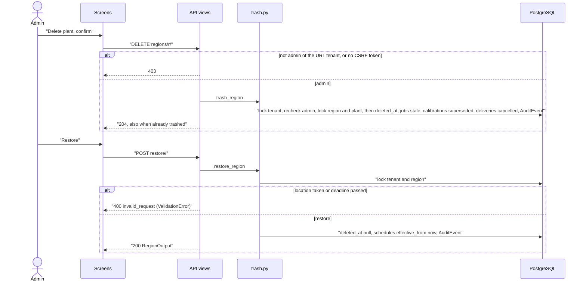

# Move a site to the recycle bin and restore it

A workspace administrator uses "Delete plant" in plant settings, which soft-deletes the whole site (the region) with its one plant and stops its collection, calibration and reminders. A plant has no trash of its own: it leaves and returns with its location. The recycle bin lists every trashed region and restores it within 30 days if the location is still free. After the deadline the row stays listed with `can_restore` false until the dispatcher purges it (`trash-retention-purge`).

## Entry points

- Screen: `web/src/components/plant-workspace.tsx` `PlantWorkspace` settings tab shows `MoveToRecycleBin` (`web/src/components/recycle-bin.tsx`) to admins. It receives `regionBase`, so it calls the region endpoint; `RegionWorkspace` renders it only when the region has a plant, so a plantless site cannot be deleted from the web. `dashboard.tsx` `Regions` then hides the row and reloads. Its "Recycle bin" button (admins) opens view `trash` with `RecycleBin`: lists via `useCollection`, restore via POST `{}`.
- `DELETE /api/tenants/{t}/regions/{r}/` -> `pyracast.api.views.RegionView.delete` -> `pyracast.trash.trash_region`. The plant route has no `DELETE` (405).
- `GET /api/tenants/{t}/trash/regions/` -> `pyracast.api.trash.TrashedRegionsView` (paginated, 50 per page, oldest deletion first).
- `POST .../regions/{r}/restore/` -> `RestoreRegionView` -> `restore_region`. Actor: workspace administrator; no command, job or broker message.

## Sequence

## Data

| Table | R/W | What |
| --- | --- | --- |
| `accounts_tenant`, `accounts_membership` | R | Tenant row locked `FOR UPDATE`; admin role of the actor |
| `regions_region` | R/W | `deleted_at` set or cleared; unique active location per tenant |
| `plants_plant` | R | Locked on trash; one plant per region (`one_plant_per_region`) |
| `forecasts_collectionschedule`, `notifications_reminderschedule` | R/W | Restore: collection schedule created with the cutoff time if missing; it and the reminder schedule get `effective_from = now` (no catch-up) |
| `notifications_notificationdelivery` | W | Trash: pending and retry become `cancelled`, sending becomes `uncertain` (`definition_trashed`) |
| `forecasts_collectionjob`, `plants_calibrationrun` | W | Trash: pending, retry, running jobs become `stale`, leases cleared; pending and running calibrations become `superseded` |
| `regions_auditevent` | W | `region_trashed`/`region_restored` |

## Authorization

- View: DRF defaults in `settings.py` (`IsAuthenticated`, `WorkspaceWritePermission`: active admin of the URL tenant for every non-safe method). Viewers, outsiders and anonymous users get 403 on DELETE and restore. `SessionAuthentication` enforces CSRF (`X-CSRFToken`).
- Operation: every `trash.py` mutation calls `require_workspace_admin`, which locks the tenant row and rechecks the role, so an administrator transfer cannot interleave.
- List: `require_member` only, so any member can read the bin through the API; the web shows it to admins only. A region is fetched by `tenant_id`; a foreign id gives 404.

## Failure paths

| Condition | Result |
| --- | --- |
| Anonymous, missing CSRF token, not admin of the tenant | 403 |
| Region outside the URL tenant, or already purged | 404 `not_found` |
| `DELETE` on a plant | 405 |
| Restore at or after `deleted_at + 30 days` | 400 `invalid_request`, localized sentence for `trash_retention_expired` |
| Restore a region whose coordinates (rounded to 6 decimals) match an active region | 400 `invalid_request`, localized sentence for `location_already_exists` |
| Restore body with any field (`EmptyInput`) | 400 `http_400`, "Unknown fields are not accepted." |
| Row lock wait over 5 s (`lock_timeout`) | 503 `workspace_busy`, `Retry-After: 1` |
| UI error | Delete: message in the open confirmation. Restore: error notice; the bin is not reloaded |

## Rules and invariants

- Lock order: tenant, region, plant. The tenant lock also serializes the location check with `submit_region` and location review. `purge_expired` takes no tenant lock.
- Trash is idempotent and never extends the deadline.
- Restore is strict (`now >= deleted_at + RETENTION` is expired) while purge is inclusive (`deleted_at <= now - RETENTION`), so no instant is both. `can_restore` uses the same bound but ignores location conflicts. Restore tests the location before the deadline, so `detail` names the location conflict first.
- Restore revives no work: stale jobs, superseded calibrations and cancelled deliveries stay; `effective_from = now` stops back-filling. Trash leaves EPIAS jobs untouched; a claim supersedes them while the region is trashed. A running job's lease is cleared on trash, so a late `publish` returns false.

## Tests

- `tests/test_trash_operations.py`, `tests/test_trash_api.py`, `tests/test_trash_boundaries.py`: effects, deadline boundary, tenant scope, CSRF, concurrent trash, blocked in-flight work, the plant route without `DELETE` or restore.
- `tests/test_site_onboarding.py` (location conflicts, operation level), `tests/test_workspace_authorization.py` (roles). Playwright: `web/tests/workspace.spec.ts` (mocked API), `web/integration/workspace.spec.ts` (real backend: plant `DELETE` refused by in-page fetch, then UI site delete and restore).
- Gaps: no 503 test on these routes, no UI test of a failed delete or restore, no HTTP test of `location_already_exists` on restore, and `web/tests/workspace-roles.spec.ts` asserts a label that does not exist.
