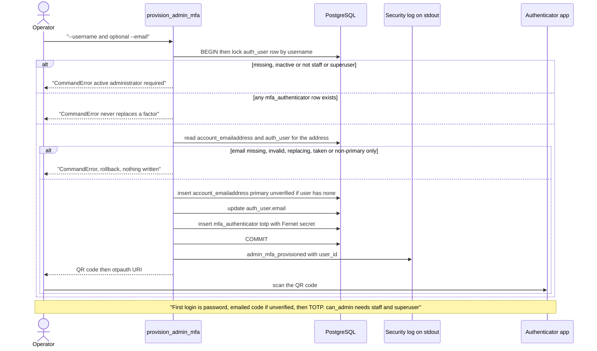

# Create the first platform administrator and provision TOTP by CLI

A host operator with shell access creates a superuser with Django's stock `createsuperuser`, then runs `pyracast provision_admin_mfa --username <name> [--email <address>]`. The command, in one transaction, keeps the user's primary email identity or creates an unverified one, and inserts an encrypted TOTP factor; it then prints the enrollment QR code and `otpauth` URI once. Until that factor exists a staff or superuser account cannot sign in, so this CLI is the only supported way to obtain a working platform administrator.

## Entry points

- `pyracast createsuperuser`: stock Django command reached through `pyproject.toml` script `pyracast` -> `pyracast.cli` `main` (`execute_from_command_line`). Project code adds nothing; it creates `auth_user` with `is_staff` and `is_superuser` and the optional `email`, but no `EmailAddress` row. `AUTH_PASSWORD_VALIDATORS` run only interactively and can be bypassed at the prompt; `--noinput` takes `DJANGO_SUPERUSER_PASSWORD` unvalidated, or leaves an unusable password.
- `pyracast provision_admin_mfa --username --email`: `pyracast.accounts.management.commands.provision_admin_mfa` `Command.handle`, helper `bind_administrator_email` (no other caller). Actor: operator via the local shell or `docker compose exec api` in production.
- Documented callers: `README.md` "First administrator and demo" and `docs/DEPLOYMENT.md` step 4. No tracked script, CI job or test runs `createsuperuser` and the command end to end.
- First sign-in afterwards uses the customer screen `web/src/components/auth.tsx` (flow in `sign-in-and-sign-out`); recovery codes are managed in `two-factor-management`.

## Sequence

## Data

| Table | R/W | What |
|---|---|---|
| `auth_user` | R/W | Row locked `FOR UPDATE` by exact username; `email` is rewritten (lower-cased) on every success; read for another user with the same email (`iexact`). |
| `account_emailaddress` | R/W | Reads the user's primary row, any of the user's rows, and other users' rows equal to the address (`iexact`); inserts one primary row with `verified=False` only when the user has none. Never updates or deletes. |
| `mfa_authenticator` | R/W | Existence check on any type; inserts one `totp` row with `data.secret` = `mfa:v1:` + Fernet token (HKDF context `pyracast-mfa-credentials-v1`, keys from `SECRET_KEY` then `SECRET_KEY_FALLBACKS`). No `recovery_codes` row. |
## Authorization

- No application authorization: the trust boundary is shell access to the host or container (`Command.help` says "trusted operator channel"). There is no operator identity, password or step-up.
- Target eligibility is checked inside the command: active and (`is_staff` or `is_superuser`). Later admin access uses other predicates: `get_can_admin` needs both flags, `PlatformAdminSite.has_permission` needs active, staff and superuser, `pyracast.api.views` `PlatformAdmin` needs active and superuser; all three also need MFA evidence in the session.
- Enforcement that makes the CLI the only bootstrap path: `pyracast.accounts.authentication` `AuthenticationBackend` and `pyracast.accounts.social` `SocialAccountAdapter.pre_social_login` (existing social accounts) refuse privileged users without a `totp` row; `pyracast.accounts.middleware` `PrivilegedAuthenticatorEnrollment` blocks GET and POST on the customer TOTP endpoint for them; `pyracast.accounts.mfa_views` `ManageTOTPView` refuses their `DELETE`.
- Database: partial unique constraint `unique_authenticator_type` allows one `totp` row per user; `select_for_update` serializes two concurrent provisioning runs for the same user.

## Failure paths

| Condition | Result |
|---|---|
| `--username` missing | argparse error, exit 2 |
| Unknown, inactive, or neither staff nor superuser | `CommandError` "An active administrator account is required." (one message for all three), exit 1 |
| Any authenticator (TOTP or recovery codes) exists | `CommandError` "...never replaces a factor." |
| Second concurrent run for the same user | Waits on the row lock, then the same "never replaces a factor" error |
| No primary email row and no `--email` | `CommandError` "--email is required to bind a legacy administrator's email identity." |
| Address (supplied or from the primary row) invalid or longer than 254 characters | `CommandError` "A valid email address is required." |
| Primary row exists with a different address | `CommandError` "An email identity already exists; provisioning never replaces it." |
| Address used by another `EmailAddress` or `User.email` | `CommandError` "...already associated with another account." |
| Non-primary rows only and no primary | `CommandError` "Resolve the existing email identities before provisioning." |
| Any `CommandError` above | Transaction rolled back, nothing written, nothing printed to stdout |
| Console cannot encode the QR (`UnicodeEncodeError`) | Factor already committed; prints a fallback line, then the URI |
| Output lost after commit (closed pipe, lost terminal; inferred) | Factor exists, secret is gone; a rerun is refused, no supported recovery |
| Privileged user without TOTP signs in later | 400 generic login error, counted as a failed password (password), or `PermissionDenied` (social) |

## Rules and invariants

- The factor, the email identity and `auth_user.email` commit or roll back together; the audit event, QR and URI come after commit, so they are never emitted for a failed run.
- The secret is generated once and not stored in plaintext or logged. The URI is the only copy; `record_security_event` logs event name, `user_id` and a null `client_ip`, with no operator identity and no database row. Logger `pyracast` writes to `sys.stdout` (`settings.LOGGING`), so under `docker compose exec` the line reaches the operator's terminal, not the container log stream. No job is enqueued and no mail or external call is made.
- A new email identity is created unverified on purpose: with `ACCOUNT_EMAIL_VERIFICATION = "mandatory"` the login runs the emailed code before TOTP, so mailbox ownership is proven at first sign-in. A kept primary row that is already verified skips that stage. Login is email-only (`ACCOUNT_LOGIN_METHODS`) and `pyracast.accounts.authentication` `email_identity` consults only `EmailAddress`, accepting a lone unverified primary; without that row the user cannot be found.
- Provisioning never replaces, resets or rotates a factor, and never replaces an email identity. Allauth's `activate_totp` flow is bypassed (direct `Authenticator.objects.create`), so no `authenticator_added` signal fires: no `mfa_added` event, no notification mail, no `revoke_other_sessions`.
- The live customer-side guards (middleware for GET and POST, `ManageTOTPView` for DELETE) make a lost factor unrecoverable through the product; only database or shell edits remain. `MFAAdapter.can_delete_authenticator` is not reached: allauth calls it only from its HTML form, and the project is headless-only.

## Tests

- `tests/test_admin_mfa_bootstrap.py`: password alone cannot sign in (400, no factor created), customer TOTP endpoint 403 for admins, every `api/platform/` route 403 without MFA evidence, command encrypts the secret and never replaces a factor, ASCII-console fallback, ineligible users, legacy admin with explicit `--email`, email conflict/invalid/replacement/non-primary rollbacks.
- `tests/test_session_serialization.py` `test_provisioned_legacy_admin_needs_totp_after_email_code`: provision, emailed code, TOTP, then `/admin/` 200.
- `tests/test_mfa_secrets.py` (adapter encryption and `can_delete_authenticator`), `tests/test_admin_recovery_security.py` (recovery codes and the staff DELETE refusal).
- Gaps: no test for `createsuperuser`, the `admin_mfa_provisioned` log event, the two-run concurrency case, or the `--email` casing against an existing row (`test_legacy_administrator_requires_explicit_email_and_proves_ownership_later` covers a staff-only target); `tests/test_browser.py` and `web/integration/admin-csp.spec.ts` seed the administrator through the ORM, so no Playwright test covers CLI output to sign-in.
