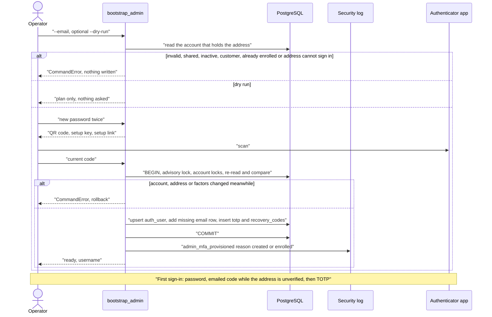

# Create a platform administrator and reset its authenticator by CLI

A host operator with shell access runs `pyracast bootstrap_admin --email <address>`. The command asks for a new password, shows a private QR code, setup key and link for an authenticator app, checks one code from the app, and then, in one transaction, creates or promotes the account, keeps or adds an unverified email identity and stores an encrypted TOTP factor with its recovery codes. It also enrolls an administrator whose factors were removed. `pyracast reset_mfa --email <address> --reason lost_device|compromised` removes every second factor of an account for a lost or compromised authenticator. Until a TOTP factor exists a staff or superuser account cannot sign in, so these commands are the only way to obtain a working platform administrator.

## Entry points

- `pyracast bootstrap_admin --email [--dry-run]`: `pyracast.accounts.management.commands.bootstrap_admin` `Command.handle`, reached through the `pyracast` script in `pyproject.toml` (`pyracast.cli` `main`). Actor: operator at a terminal, locally or through `docker compose exec api` in production.
- `pyracast reset_mfa --email --reason [--dry-run]`: `pyracast.accounts.management.commands.reset_mfa` `Command.handle`.
- Shared base `pyracast.accounts.management.operator` (`OperatorCommand`): answers are read from stdin (`getpass` for passwords at a terminal), `operator_address` normalizes the address, `account_using` finds the one account that holds it.
- Documented callers: `README.md` "First administrator and demo" and `docs/DEPLOYMENT.md` step 4. First sign-in afterwards uses the customer screen `web/src/features/auth/auth.tsx` (flow in `sign-in-and-sign-out`); recovery codes are saved in `two-factor-management`.

## Sequence

## Data

| Table | R/W | What |
|---|---|---|
| `auth_user` | R/W | The account holding the address (`email` or an `account_emailaddress` row, case-insensitive) is locked; a new account gets a generated username. Success sets `is_staff` and `is_superuser`, the new password and, when empty, `email`. |
| `account_emailaddress` | R/W | Reads the account's rows; inserts the address unverified when the account has none for it, primary only when it has no primary row. Never updates or deletes. |
| `mfa_authenticator` | R/W | Bootstrap inserts one `totp` row (`data.secret` = `mfa:v1:` + Fernet token, HKDF context `pyracast-mfa-credentials-v1`, keys from `SECRET_KEY` then `SECRET_KEY_FALLBACKS`) and one `recovery_codes` row. Reset deletes every row of the account. |
| `django_session`, `usersessions_usersession` | W (reset) | Reset deletes the account's sessions and their device records. |
| `notifications_outboundmail` | W (reset) | One `account/email/second_factor_reset` notice to the primary address, mailed later by the notification worker. |

## Authorization

- No application authorization: the trust boundary is shell access to the host or container. There is no operator identity, password or step-up.
- Bootstrap targets no account or an active account that is `is_staff` or `is_superuser` and has no authenticator of any type; it then sets both flags. The sign-in refusals use the same test (`authorization.requires_admin_mfa`). Console admission needs active staff and superuser plus MFA evidence (`has_platform_admin_session`).
- Enforcement that makes the commands the only enrolment path: `pyracast.accounts.authentication` `AuthenticationBackend` and `pyracast.accounts.social` `SocialAccountAdapter.pre_social_login` refuse privileged accounts without a `totp` row; `pyracast.accounts.mfa_views` `ManageTOTPView` answers 403 to every method for them; `MFAAdapter.can_delete_authenticator` refuses their TOTP removal.
- Concurrency: the final step takes the advisory lock `OPERATOR_LOCK`, then the account's locks in the account lock order (addresses, provider identities, account row, authenticators), re-reads the holder and compares it with the account the run started from. Both commands share this.

## Failure paths

| Condition | Result |
|---|---|
| `--email` missing (either command) or `--reason` missing or not one of the two (reset) | argparse error, exit 2 |
| Address invalid or over 254 characters | `CommandError` "Enter a valid email address." |
| Address held by more than one account | `CommandError` "...more than one account. Resolve that first." |
| Inactive account | `CommandError` "...is inactive. Nothing was changed." |
| Account neither staff nor superuser | `CommandError` naming a customer account; use an address of its own |
| Account already has any authenticator | `CommandError` "Reset it with reset_mfa first." |
| Existing account could not sign in afterwards with the address (not verified and not its only, primary address) | One fixed `CommandError` before anything is asked, and again under the locks; nothing stored |
| Passwords differ, password over 1,024 characters or with a null character, or refused by `AUTH_PASSWORD_VALIDATORS` | `CommandError` before the QR code is shown; nothing stored |
| Code from the app does not match | `CommandError`; nothing stored, a rerun starts clean |
| Account, address or factors changed during the run | `CommandError` "...changed while the command ran"; rolled back |
| Console cannot encode the QR (`UnicodeEncodeError`) | A fallback line; the setup key and link are still printed |
| `reset_mfa`: unknown address, account without a factor | `CommandError`; nothing changed |
| `reset_mfa`: confirmation address not retyped identically, or the address moved to another account meanwhile | `CommandError`; nothing changed |
| Privileged account without TOTP signs in | 400 generic login error with a `login_refused` line (`mfa_not_provisioned`), or `PermissionDenied` for a provider sign-in |

## Rules and invariants

- The password, the account, the address row and both factor rows commit or roll back together; `admin_mfa_provisioned` (`reason` `created` or `enrolled`) and `mfa_reset_by_operator` (`reason`, `count` of rows removed) are written after the commit. Lines carry no address, password, code or secret and no operator identity. They go to the `pyracast.security` logger: the file named by `PYRACAST_SECURITY_LOG_PATH` when set (deployments point it at the container log stream), else stdout. The setup key and link appear only on the operator's terminal. An alert policy watches `admin_mfa_provisioned`.
- The secret is generated before the transaction and stored only after the operator proved the app by a valid code, so a lost terminal leaves nothing half-enrolled.
- A new address is stored unverified on purpose: while `ACCOUNT_EMAIL_VERIFICATION = "mandatory"` holds, the first sign-in runs the emailed code before TOTP, proving mailbox ownership. A verified address skips that step. Sign-in accepts an unverified address only for the account whose only address row it is, primary; hence the refusal before anything is stored.
- Enrolment bypasses allauth's `activate_totp` (`TOTP.activate` and `RecoveryCodes.activate`), so no `mfa_added` event, notification mail or session revocation follows. Both commands change the account's credential state, which ends its pending sign-in steps and reauthentications.
- `reset_mfa` removes factors of any account, ends its sessions (`sessions_revoked`, reason `mfa_reset`) and queues the notice in the same transaction; a failure after the notice is stored rolls everything back. The next step it prints is `bootstrap_admin` for a privileged account, Account settings for a customer.
- Bootstrap never replaces a factor and never changes an existing address.

## Tests

- `tests/test_admin_mfa_bootstrap.py`: creation from the terminal (QR, key, link, encrypted secret, recovery row, audit line), re-enrolment, dry run, ineligible accounts, invalid address, wrong answers and policy refusals storing nothing, changes meanwhile, the sign-in usability refusal, the longest sign-in password, ended pending steps, ASCII-console fallback, passwords not echoed, password alone cannot sign in, customer TOTP endpoint 403 for administrators.
- `tests/test_mfa_reset.py`: factors, sessions and notice removed together, dispatcher publishes the notice in the account language, rollback after a stored notice, re-enrolment after a reset, ended pending steps, dry run, refusals and confirmation mismatches.
- `tests/test_session_serialization.py` `test_a_bootstrapped_administrator_needs_the_authenticator_after_the_email_code`: bootstrap, emailed code, TOTP, then `/admin/` 200.
- `tests/test_mfa_secrets.py` (adapter encryption, `test_administrators_cannot_remove_their_required_factor`), `tests/test_admin_recovery_security.py` (customer-only factor removal).
- Gaps: the alert policy; no browser test covers command output to sign-in (`tests/support/browser.py` seeds the administrator through the ORM).
