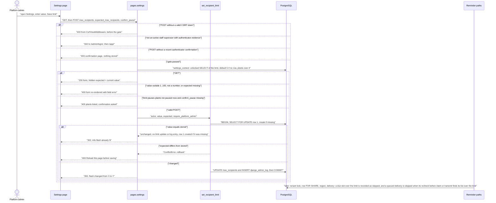

# Set the global recipients-per-plant limit

A platform administrator (active staff superuser with authenticator evidence) opens Settings in the server-rendered `/admin/` console and saves one number: the maximum count of distinct reminder recipients per plant. The page lists the plants over the limit, asks for confirmation when a new limit pauses more plants, edits the singleton `NotificationSettings` row behind a stale-value guard and writes a Django admin log entry. Customer reminder saves, the scheduler and the notification worker read the same row, so a lowered limit pauses over-limit plants without deleting their lists.

## Entry points

- Screen: `regions/templates/admin/workspace/settings.html`, extending `src/pyracast/regions/templates/admin/workspace/base.html` (rail and mobile menu link "Settings"). It is a Django template, not Next.js.
- `GET|POST /admin/settings/` (URL name `admin:workspace_settings`) -> `pyracast.platform_admin.pages.settings` -> `read_models.settings_context`, `recipient_limit.crowded_plants` and `newly_paused`, `WorkspaceSettingsForm` (`platform_admin/forms.py`, validation only) and `pyracast.notifications.operations.set_recipient_limit`. Other methods get 405.
- `/admin/notifications/notificationsettings/` (changelist, `1/change/`, `1/history/`) -> `pyracast.platform_admin.records.NotificationSettingsAdmin`: a read-only view of the same row (no add, change or delete route or permission). No console template links it.
- Readers of the value: `notifications.operations.recipient_limit` (callers: `configure_reminders`, `scheduler._create_slot`, `jobs.process_notification`, `jobs._mark_transmit` with the share lock; `overview.reminder_overview`, `plants_at_recipient_limit` and `settings_context` without it).

## Sequence

## Data

| Table | R/W | What |
| --- | --- | --- |
| `notifications_notificationsettings` | R/W | Singleton row `id=1` (`notificationsettings_id_chk`, `notificationsettings_max_recipients_chk`: 1 to 100, `notifications.models.MAX_RECIPIENT_LIMIT`, smallint). GET and the page checks read it without a lock; reminder paths read it `FOR SHARE`; `set_recipient_limit` locks it `FOR UPDATE`, creating it if absent, validates the value with the model's validators (`full_clean`) and updates only `max_recipients`. |
| `django_admin_log` | W | One `CHANGE` row per effective change: object `1`, repr "Email reminder settings", message "Recipient limit changed from X to Y.", user = actor. |
| `notifications_reminderschedule`, `notifications_reminderrecipient`, `accounts_membership`, `regions_region`, `plants_plant` | R | Enabled schedules of live plants, counted as the scheduler counts recipients, for the over-limit list. |
| `auth_user`, `django_session`, `mfa_authenticator`, `django_content_type` | R | Session user and flags, the session's authenticator record, content type for the log row. The session middleware refreshes session rows at most once a minute. |

## Authorization

- Gate: `PlatformAdminSite.has_permission` requires an active staff superuser and `security.has_mfa_evidence` (any age). `admin_view` adds CSRF, `never_cache`, a recent authenticator confirmation for every unsafe method and `contained`. A failure redirects to `admin:login`, which `PlatformAdminSite.login` sends to `/app/?next=<console path>` (anonymous) or `/app/`.
- CSRF: `CsrfViewMiddleware` and `admin_view` (`csrf_protect`); a POST without a valid token is 403 before the gate runs, also for anonymous callers.
- Operation: `set_recipient_limit` repeats `require_platform_admin` (active staff superuser). It checks no authenticator evidence, so it is a second line, not a replacement for `has_permission`.
- Database: the singleton and range check constraints bound the row even for writers that bypass the form. Tenant scope: none. The setting is platform-wide; customers read it through the reminders API (`recipient_limit`, `recipient_count`, `recipient_limit_exceeded`).

## Failure paths

| Condition | Result |
| --- | --- |
| Anonymous, member, staff non-superuser, superuser without authenticator evidence, inactive user | 302 to `/admin/login/?next=...`, then to `/app/`, no write |
| POST with a missing or wrong CSRF token | 403 |
| Unsafe method without a recent authenticator confirmation | 403 confirmation page, nothing stored |
| Method other than GET or POST (HEAD included) after the gate | 405 |
| Value 0, negative, above 100 (the field offers `max="100"`), non-numeric, empty, or `expected` missing or below 1 | 400, page re-rendered with the error summary "Review the recipient limit" |
| Limit pauses reminders of plants not paused now, no `confirm_pause` | 400, plants listed, nothing stored |
| `expected_max_recipients` differs from the locked row (and the value differs from it) | 400, non-field error "The settings changed. Reload this page before saving." The bound hidden field stays stale, so a resubmit fails again until the page is reloaded |
| Value equals the stored value | 302 and the info flash "The recipient limit is already N.", no limit update and no log entry; row 1 is created if it was missing |
| Audit insert fails (`DatabaseError`) | Whole transaction rolls back, value unchanged; the view does not catch it, so 500 |
| Row lock not granted within the 5 s `lock_timeout` (a worker, scheduler or reminder save holds it), deadlock or statement timeout | Nothing stored; retry flash and redirect to the referring console page (overview if unknown); JSON callers get 503 `Retry-After: 1` |
| A second request on the same session while one runs (5 s advisory lock) | 503 page with `Retry-After: 1`; a GET reloads once, a write is never replayed |

## Rules and invariants

- Every path that creates, edits or sends reminders against the limit reads it `FOR SHARE` (raw SQL in `recipient_limit(lock=True)`) in the order tenant, `NotificationSettings`, region, delivery (`configure_reminders`, `scheduler._create_slot`, `jobs.process_notification`, `jobs._mark_transmit`). Readers never wait for each other; only `set_recipient_limit` takes `FOR UPDATE`, so it waits for checks under the old limit. Member-removal cleanup (`recipients.remove_member_recipients`) edits lists without it. The settings page takes only the settings lock, so it cannot deadlock with them. The SMTP or API transmission runs after that transaction commits, so it holds no lock and a limit lowered after the check does not stop it.
- Lowering never edits data. `scheduler.recipient_refusal` compares the effective recipient count with the limit: the scheduler records each due slot as a `skipped` delivery with `recipient_limit_exceeded` and no recipients, and a queued delivery ends `skipped` with the same code in `process_notification` or `_mark_transmit` (via `jobs._authorize`). Raising it again does not revive skipped slots; the scheduler only looks back to yesterday and an existing delivery for a slot blocks re-creation.
- The over-limit list and the confirmation check (`newly_paused`) read without a lock, before `set_recipient_limit`, so they can be out of date by the time the limit is saved.
- `configure_reminders` refuses a list above the limit unless the effective count strictly shrinks or a disabled save is unchanged, so an over-limit plant can still be reduced.
- Without a row, `recipient_limit()` answers the model default 5 and the first locked read creates it. No migration seeds the row.

## Tests

- pytest: `tests/test_admin_workspace.py` (`test_settings_are_validated_audited_and_stale_safe`, `test_settings_audit_failure_rolls_back_value` on `set_recipient_limit` directly, the access matrix, GET without provider or mail I/O), `tests/test_recipient_limit_impact.py` (confirmation naming the plants, no confirmation without new pauses, fixed query count), `tests/test_console_outcomes.py` (unchanged and double-submitted limit), `tests/test_notification_admin.py` (read-only stock page, add and delete refused, member API sees the limit, identity matrix), `tests/test_console_step_up.py` and `tests/test_console_failures.py` (authenticator confirmation, retry message under a held row lock, busy session), `tests/test_notifications.py` (`test_notification_settings_database_constraints`, limit applies to the API, queued deliveries skipped after a reduction, gradual reduction of an over-limit list), `tests/test_notification_groups.py` (over-limit slot recorded as skipped), `tests/test_language.py` (Turkish page text "Ayarlar").
- Playwright: `web/integration/admin-csp.spec.ts` asserts a CSRF-less POST is 403, submits 6 once under CSP, and checks the page at desktop and mobile widths; `tests/e2e/test_admin_csp_spec.py` runs it against a live server and asserts the stored value.
- Gaps: no concurrent stale-write test; the 500 on audit failure is not exercised through the view; the stale 400 message is asserted only by status code.
