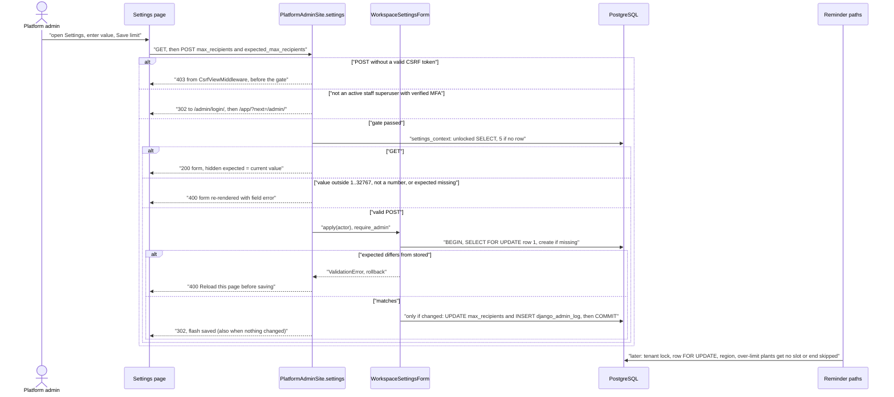

# Set the global recipients-per-plant limit

A platform administrator (active staff superuser with a verified second factor) opens Settings in the server-rendered `/admin/` console and saves one number: the maximum count of distinct reminder recipients per plant. The page edits the singleton `NotificationSettings` row behind a stale-value guard and writes a Django admin log entry. Customer reminder saves, the scheduler and the notification worker read the same row, so a lowered limit pauses over-limit plants without deleting their lists.

## Entry points

- Screen: `regions/templates/admin/workspace/settings.html`, extending `admin/workspace/base.html` (rail and mobile menu link "Settings"). It is a Django template, not Next.js.
- `GET|POST /admin/settings/` (URL name `admin:workspace_settings`) -> `pyracast.admin.PlatformAdminSite.settings` -> `admin_workspace.settings_context` and `WorkspaceSettingsForm.apply`. Other methods get 405.
- `/admin/notifications/notificationsettings/` (changelist, `1/change/`, `add/`, `1/history/`) -> `pyracast.admin.NotificationSettingsAdmin`: stock model admin on the same row. No console template links it; it has no stale guard (see Rules).
- Readers of the value: `notifications.operations.recipient_limit` (callers: `configure_reminders`, `scheduler._enqueue_schedule`, `jobs.process_notification`, `jobs._mark_transmit`, `views.reminder_schedule_payload`, `settings_context`). `apply` reads the row itself.

## Sequence

## Data

| Table | R/W | What |
| --- | --- | --- |
| `notifications_notificationsettings` | R/W | Singleton row `id=1` (`CHECK id = 1`, `CHECK max_recipients >= 1`, smallint columns). GET and every POST read it without a lock. `apply` locks it `FOR UPDATE`, creating it if absent, and updates only `max_recipients` |
| `django_admin_log` | W | One `CHANGE` row per effective change: object `1`, repr "Email reminder settings", message "Recipient limit changed from X to Y.", user = actor |
| `auth_user`, `django_session`, `mfa_authenticator`, `django_content_type` | R; `django_session` R/W | Session user, superuser and staff flags, the session's TOTP or recovery-code record behind `has_verified_mfa`, content type for the log row; `SessionLifetime` middleware saves `last_activity_at` into the session when the stored one is at least 60 s old |

## Authorization

- Gate: `PlatformAdminSite.has_permission` requires an active staff user (stock `AdminSite`), `is_superuser` and `accounts.security.has_verified_mfa`. `admin_view` wraps the URL; a failure redirects to `admin:login`, which `PlatformAdminSite.login` sends to `/app/?next=/admin/`.
- CSRF: `CsrfViewMiddleware` and `admin_view` (`csrf_protect`); a POST without a valid token is 403 before the gate runs, also for anonymous callers.
- Operation: `WorkspaceSettingsForm.apply` repeats `accounts.operations.require_admin` (active superuser). It does not check MFA or staff, so it is a second line, not a replacement for `has_permission`.
- Database: the singleton and positive-value check constraints bound the row even for writers that bypass the form. Tenant scope: none. The setting is platform-wide; customers read it only through the reminders API (`recipient_limit`, `recipient_slots_remaining`, `recipient_limit_exceeded`).

## Failure paths

| Condition | Result |
| --- | --- |
| Anonymous, member, staff non-superuser, superuser without verified MFA, inactive user | 302 to `/admin/login/?next=...`, then to `/app/?next=/admin/` (the page target is dropped), no write |
| POST with a missing or wrong CSRF token | 403 |
| Method other than GET or POST (HEAD included) after the gate; unsafe methods also need a CSRF token | 405 |
| Value 0, negative, above 32767, non-numeric, empty, or `expected` missing or below 1 | 400, page re-rendered with the error summary "Review the recipient limit" |
| `expected_max_recipients` differs from the locked row | 400, non-field error "The settings changed. Reload this page before saving." The bound hidden field stays stale, so a resubmit fails again until the page is reloaded |
| Value equals the stored value | 302 and the "saved" flash, but nothing is written and no log entry exists |
| Audit insert fails (`DatabaseError`) | Whole transaction rolls back, value unchanged; the view does not catch it, so 500 |
| Row lock not granted within the 5 s `lock_timeout` (a worker, scheduler or reminder save holds it) | `OperationalError`, 500: the DRF `workspace_busy` 503 mapping does not cover admin views |
| A second request on the same session while one runs (5 s advisory lock) | 429 JSON `session_busy` from `SessionRequestSerialization` |

## Rules and invariants

- Every path that creates, edits or sends reminders against the limit reads it under the row lock, in the order tenant, `NotificationSettings`, region, delivery (`configure_reminders`, `scheduler._enqueue_schedule`, `jobs.process_notification`, `jobs._mark_transmit`). Member-removal cleanup (`recipients.remove_member_recipients`) edits lists without it. The settings page takes only the settings lock, so it cannot deadlock with them, but every pre-send check and slot creation is serialized on this one row across all tenants. The SMTP or API transmission runs after that transaction commits, so it holds no lock and a limit lowered after the check does not stop it.
- Lowering never edits data. The scheduler and `jobs._skip_reason` compare the effective recipient count with the limit: the scheduler records each due slot as a `skipped` delivery with `recipient_limit_exceeded` and no recipients, and a queued delivery ends `skipped` with the same `recipient_limit_exceeded` in `process_notification` or `_mark_transmit`. Raising it again does not revive skipped slots; the scheduler only looks back to yesterday and an existing delivery for a slot blocks re-creation.
- `configure_reminders` refuses a list above the limit unless the effective count strictly shrinks or a disabled save is unchanged, so an over-limit plant can still be reduced.
- Without a row, `recipient_limit()` answers 5 (`or 5`) and the first locked read creates it with the model default 5. No migration seeds the row.
- `NotificationSettingsAdmin` writes through a plain `ModelForm`; Django's stock change view takes no row lock (framework design, not read here): concurrent saves are last-write-wins and bypass the `expected` guard. It forbids delete, and add only while no row exists.

## Tests

- pytest: `tests/test_admin_workspace.py` (`test_settings_are_validated_audited_and_stale_safe`, `test_settings_audit_failure_rolls_back_value` on `apply` directly, the anonymous/member/staff/unverified-admin/inactive 302 matrix for GET and POST, GET without provider or mail I/O), `tests/test_notification_admin.py` (stock admin edit seen by the member API, add and delete 403, invalid values, add when missing, CSRF, identity matrix), `tests/test_notifications.py` (`test_notification_settings_database_constraints`, limit applies to the API, queued deliveries skipped after a reduction, gradual reduction of an over-limit list, migration seeds 5), `tests/test_language.py` (Turkish page text "Ayarlar"), `tests/test_api_localization.py` (limit 2 seeded for message tests).
- Playwright: `web/integration/admin-csp.spec.ts` asserts a CSRF-less POST is 403, submits 6 once under CSP, and checks the page at desktop and mobile widths; `tests/test_browser.py` runs it against a live server and asserts the stored value.
- Gaps: no concurrent stale-write or lock-contention test; no test that the stock admin and the Settings page agree; the stale 400 message, the no-op flash and a missing `expected` field are not asserted in any language (only status codes and the log count); the 500 on audit failure is not exercised through the view; the log entry is asserted only by message text.
