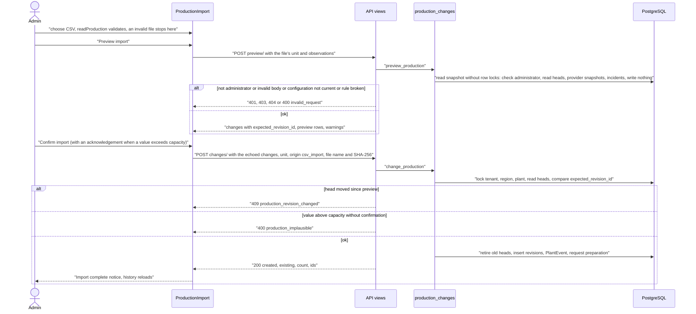

# Import production from a CSV file

A workspace administrator picks a CSV of completed 30 or 60 minute energy intervals on the Production tab. The browser validates it, the API previews it against the current values and the administrator confirms; the confirmed batch is saved as new immutable observation revisions that override provider values and request a calibration run. An entered value is saved only for a row that differs from what is shown: the preview leaves out a row equal to the shown provider value, so those slots keep their provider values. The `import_production` command is an older insert-only writer that shares the table but not the rules.

## Entry points

- Screen: `web/src/features/production/production-import.tsx` `ProductionImport`, mounted by `web/src/features/production/production-history.tsx` `ProductionHistory` only when `canManage` and a current configuration id exist. Parser: `ProductionImport` calls `web/src/lib/production.ts` `readProduction`, which loads the reader's catalogue and, only when the header row or a status cell needs them, the other language's names before it reads the rows; its messages come from the `ProductionCsv` translator.
- `POST /api/tenants/{t}/regions/{r}/plants/{p}/production/preview/` -> `pyracast.plants.api.ProductionPreviewView` -> `production_changes.preview_production`.
- `POST .../production/changes/` -> `ProductionChangesView` -> `production_changes.change_production` (the commit step; shared with inline edits in `production-history`).
- Command `import_production` (`--username --plant-id --configuration-id --unit --file`) -> `production_changes.import_observations`. There is no REST endpoint for it.

## Sequence

## Data

| Table | R/W | What |
| --- | --- | --- |
| `accounts_tenant`, `accounts_membership`, `regions_region`, `plants_plant` | R (locked on commit only) | Administrator check, active rows, writers serialized |
| `plants_plantconfiguration`, `connections_sitebinding`, `connections_provideraccount` | R | Configuration must be current (`configuration_is_current`) on the web path and for new command rows; binding zone converts local boundaries |
| `plants_productionobservation` | R/W | Current heads read; commit sets `is_current=false` on replaced heads with one statement and inserts the revisions with one (`supersedes`, `recorded_by`) |
| `plants_plantevent` | W | `production_changed` (web) or `observations_imported` (command), only when rows were created |
| `plants_plant` (`calibration_preparation_due_at`) | W | `request_preparation` marks the plant in the transaction; one attempt follows the commit and the dispatcher's calibration phase prepares what is left, which may add a `pending` `plants_calibrationrun` |
| `metering_epiasconnection`, `metering_epiassnapshot`, `metering_epiascollectionjob`, `incidents_*` | R | Preview current values and provider-hour warnings |
| `forecasts_forecastsnapshot` | R | Command estimated-actuals coverage (`reference_intervals`) |

## Authorization

- View: `SessionAuthentication` and the route policy (`pyracast.api.permissions.ROUTE_POLICIES`): both routes need an active membership with the administrator role and share the `production_import` throttle (120 per hour per user). Then `ScopedView.plant_queryset` loads the active region of the tenant and the plant of the region.
- Operation: `tenant_membership(role=ADMIN)` again; the commit takes it with the tenant row lock, so it serializes with administrator reassignment. Preview needs it too, without locks.
- Browser: the section is hidden unless `useCanManageWorkspace()`; viewers have no CSV path (the inline editor sends their single edits to `change-requests/production/`, flow `change-request-submission`).
- Command: acts as any `--username`; the operation check decides. Database constraints (`productionobservation_*`) guard shape and overlap, not roles.

## Failure paths

| Condition | Result |
| --- | --- |
| File over 2 MiB (checked on `file.size` first), wrong header, parse error, 0 or over 2000 rows, naive timestamp, length not 30 or 60 minutes, future end, bad energy, quality `mixed` (an aggregated slot of a production export), other bad quality or source, overlap inside the file | Error notice (`ProductionImport.choose_a_csv_no_larger_than_2` for size, otherwise a `ProductionCsv.*` message for the first problem only), nothing sent. A wrong header reads "Use the columns of a file downloaded under Actual production: Start, End, Actual (MWh), Status and Source."; row messages name the column as the file has it and the line where the row starts in the file (blank lines and text quoted over several lines counted); an overlap reads "Rows {first} and {second} cover the same time. Remove one of them or correct its time." |
| The other language's names cannot be loaded when the file needs them | Refused with "The names of the other language could not be loaded. Try again."; a file without a header record gets the header message without that load |
| Every row equals the shown provider value | Preview 400 `invalid_request` "This file changes no value."; nothing is saved |
| A row whose date or time is not valid (30 February, no offset) | 400 "Row {row}: the date or time is not valid."; the command prints it after "Observation import failed: ", the row counted as a line of the file |
| Not signed in | 401 `not_authenticated` |
| Viewer; foreign tenant; bad CSRF | 403 `workspace_admin_required`; 403 `membership_required`; 403 `csrf_failed` |
| Unknown region or plant; unknown configuration id or one of another plant | 404 `not_found` |
| Body fails the serializer (naive timestamp, boolean or negative energy, quality, empty or over 2000 rows, unknown field, unknown action, `set` without energy) | 400 `invalid_request` with `fields` (an unknown top-level field has a message only) |
| Configuration not current (revised, region changed, provider account disabled or unauthorized); command checks it only for rows it would insert | 400 `invalid_request`, "requires the current approved configuration" |
| Not on the local half-hour grid, crosses local midnight, first and last local day 31 or more days apart, overlaps another row or a non-reverted head, head of a previous configuration, revert without a head | 400 `invalid_request`, message without row number |
| Commit with a value above 1.25 times the plant's power ceiling and no `confirm_implausible` | 400 `production_implausible`, field `changes` |
| Head changed between preview and commit | 409 `production_revision_changed` |
| More than 120 requests in an hour | 429 `throttled` |
| Commit lock wait over 5 s | 503 `busy`, `Retry-After: 1` |
| Statement over 60 s | 503 `request_timeout` |
| Preview or commit request fails | Alert above the form or `ActionForm` error; the old preview table stays visible after a failed commit. A lost preview shows the message of a failed read (network, invalid answer, or the request error with its status for a bare gateway status or the maintenance refusal) with Try again, which reads it again |
| Confirmation whose answer was lost | The "Change not confirmed" alert, with the repeatable text while the same preview is confirmed again (the capacity acknowledgement is the form's checkbox, so unchecking it shows the general text), and the production rows are read again; while the preview read failed the general notice stays beside that failure |
| Command: no estimated actuals for the interval | "Observation import failed: No satellite data for the selected time range." |
| Command: any other validation or permission refusal | `CommandError` "Observation import failed: " plus the refusal message; unreadable file, header, row, unknown user or plant gives "Observation import failed: invalid file, input, access, or record." |

## Rules and invariants

- Commit lock order is tenant, region, plant. Preview runs in one `REPEATABLE READ`, read-only transaction (`pyracast.db.read_snapshot`) and takes no row lock, so it does not wait for a writer.
- Optimistic concurrency: preview returns `expected_revision_id` per row (null if no head); commit rejects the whole batch on any mismatch. A commit sent again after it was applied is a replay: it answers like the first call and changes nothing. Rows equal to the head (energy, quality, source, reverted flag) count as `existing` on every write path: no revision; with no created row there is no event and no calibration request.
- kWh becomes MWh by moving the decimal point of the number as written (1234.56 kWh is 1.23456 MWh), so equal energy is equal in either unit when compared with the shown provider value and the saved value. The preview echoes `energy` in the file's unit and the commit sends the same unit.
- Each column is accepted under the API name (`starts_at`, `ends_at`, `energy_kwh` or `energy_mwh`, `quality`, `source`, optional `timezone`) or under its exported name in English or Turkish (Start / Başlangıç, End / Bitiş, "Actual (MWh)" or "Actual (kWh)" / "Gerçekleşen (MWh)" or "Gerçekleşen (kWh)", Status / Durum, Source / Kaynak), in any order, so a downloaded file imports again unchanged. A leading byte order mark is removed once before parsing and line counting. Every cell is read literally: a status cell is the status whose code or label (either language) it equals, whatever the header's language; a source cell is stored as written, less the one leading apostrophe the download adds to formula-like text (`unguarded` in `web/src/lib/csv.ts`). The preview leaves out a row equal to the provider value shown for its slot in energy and that value's own status (its source cell is not compared), so a downloaded file never turns provider values into entered ones. The format help shows the exported header and an example row in the reader's language.
- A value whose mean power exceeds 1.25 times the lower of DC capacity and power limit is warned in the preview (`energy_exceeds_capacity`); the screen then requires an acknowledgement before it sends `confirm_implausible`. The event details record `origin: csv_import`, `file_name` and `file_sha256`.
- While a chosen file is read, ready or previewed and not yet imported, the import registers with the leave guard (`frontend-data-layer`), so leaving asks first; a choice refused as too large or unreadable, and a cleared choice, do not register.
- Manual rows of any quality suppress the whole provider hour; the preview warns (`provider_hour_incomplete`) only when a provider hour is partly covered.
- Command path: no revision tokens, no 31-day limit, no capacity check; an overlap with any current head must match it exactly (interval, configuration, energy, quality, source) and must not be reverted, or the call conflicts; such a duplicate counts as existing before the currency check, so it succeeds even with a no-longer-current configuration; new rows need a current configuration and matching estimated actuals. The command accepts a CSV with `starts_at`, `ends_at`, `energy` and optional `quality` and `source` (defaults `valid`, `operator`), only a `.csv` file under the working directory, at most 2 MiB and 2000 rows.

## Tests

- Backend: `tests/test_production_changes.py` (stale and overlap batches, preview tokens, configuration boundaries, API permissions including viewer 403 on preview and changes, concurrent winner), `tests/test_production_writes.py` (replay, preview without row locks, capacity confirmation, event details), `tests/test_native_production.py` (provider-hour warnings, invalid batches, preview then commit through the API, command overlap rules), `tests/test_plant_commands.py` (command replay, path, header, size and row guards, specific refusals), `tests/test_plant_operations.py` (command operation), `tests/test_workspace_authorization.py`, `tests/test_routed_surface.py` (no `observations/` route).
- Playwright on `mockApi`: `web/tests/workspace.spec.ts` (import, stale file reads, `parseProduction`), `web/tests/exports.spec.ts` (an export imports again, `mixed` refusal), `web/tests/epias-production.spec.ts` (preview, unit by column, import over an open draft, capacity acknowledgement, Turkish import review), `web/tests/localization.spec.ts`, `web/tests/responsive.spec.ts`. Against live Django: `web/integration/workspace.spec.ts` exports a day and imports it again (preview, confirm, one already present).
- `web/tests/unconfirmed-writes.spec.ts`: a lost confirmation and a lost preview.
- Gaps: no UI test of the `future` and size messages.
