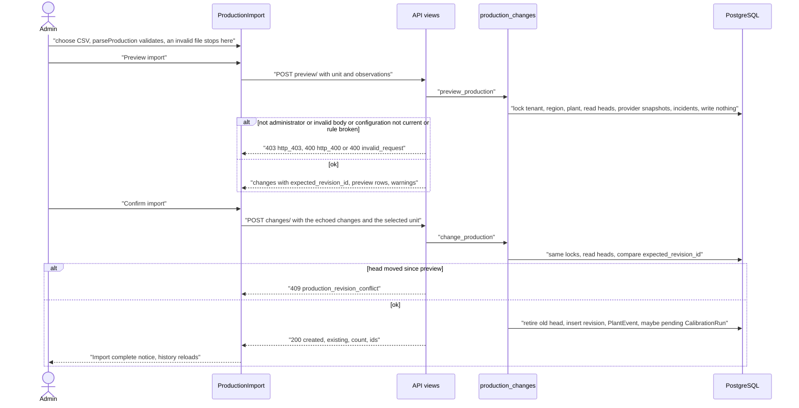

# Import production from a CSV file

A workspace administrator picks a CSV of completed 30 or 60 minute energy intervals on the Production tab. The browser validates it, the API previews it against the current values and the administrator confirms; the confirmed batch is saved as new immutable observation revisions that override provider values and may schedule a calibration run. Two older insert-only writers (a legacy REST endpoint and the `import_production` command) share the table but not the rules.

## Entry points

- Screen: `web/src/components/production-import.tsx` `ProductionImport`, mounted by `production-history.tsx` `ProductionHistory` only when `canManage` and a current configuration id exist. Parser: `web/src/lib/production.ts` `parseProduction`.
- `POST /api/tenants/{t}/regions/{r}/plants/{p}/production/preview/` -> `pyracast.plants.api.ProductionPreviewView` -> `production_changes.preview_production`.
- `POST .../production/changes/` -> `ProductionChangesView` -> `production_changes.change_production` (the commit step; shared with inline edits in `production-history`).
- Legacy, no web caller: `GET .../observations/` (paginated live heads) and `POST .../observations/` (201) -> `ObservationsView` -> `operations.import_observations`; command `import_production` (`--username --plant-id --configuration-id --unit --file`) calls the same operation.

## Sequence

## Data

| Table | R/W | What |
| --- | --- | --- |
| `accounts_tenant`, `accounts_membership`, `regions_region`, `plants_plant` | R (tenant, region, plant locked) | `require_workspace_admin`, active rows, writers serialized |
| `plants_plantconfiguration`, `connections_sitebinding`, `connections_provideraccount` | R | Configuration must be current (`configuration_is_current`) on the web path and for new legacy rows, binding zone converts local boundaries |
| `plants_productionobservation` | R/W | Current heads read; commit sets `is_current=false` on the replaced head and inserts a revision (`supersedes`, `recorded_by`) |
| `plants_plantevent` | W | `production_changed` (web) or `observations_imported` (legacy, command) only when rows were created; `calibration_scheduled` with a new run |
| `plants_calibrationrun`, `plants_calibrationactivation` | R/W, R | `prepare_calibration`, in the same transaction, may add a `pending` run; the dispatcher later sends it to the `calibration` queue |
| `metering_epiasconnection`, `metering_epiassnapshot`, `metering_epiascollectionjob`, `incidents_*` | R | Preview current values and provider-hour warnings; `prepare_calibration` measurement selection |
| `forecasts_forecastsnapshot` | R | Legacy estimated-actuals coverage (`reference_intervals`) and `prepare_calibration` references |

## Authorization

- View: `SessionAuthentication`, `IsAuthenticated`, `WorkspaceWritePermission` (non-safe methods need the tenant administrator role) and `ScopedView.plant_queryset` (`require_member`, region of the tenant, plant of the region). Legacy `GET` is open to any member.
- Operation: `require_workspace_admin` again inside the transaction; it locks the tenant row, so it serializes with administrator reassignment. Preview needs it too.
- Browser: the section is hidden unless `useCanManageWorkspace()`; viewers have no CSV path (the inline editor sends their single edits to `change-requests/production/`, flow `change-request-submission`).
- Command: acts as any `--username`; the operation check decides. Database constraints (`plant_observation_*`) guard shape and overlap, not roles.

## Failure paths

| Condition | Result |
| --- | --- |
| File over 2 MiB (checked on `file.size` first), wrong header, parse error, 0 or over 2000 rows, naive timestamp, length not 30 or 60 minutes, future end, bad energy, quality or source, overlap inside the file | Error notice (`ProductionImport.choose_a_csv_no_larger_than_2` for size, otherwise a `ProductionCsv.*` message for the first problem only), nothing sent |
| Not signed in, viewer, foreign tenant | 403 `http_403` |
| Unknown region or plant; unknown configuration id or one of another plant | 404 `http_404` (`get_object_or_404`); 404 `not_found` (`DoesNotExist`) |
| Body fails the serializer (naive timestamp, boolean or negative energy, quality, empty or over 2000 rows, unknown field, unknown action, `set` without energy) | 400 `http_400` with field details |
| Configuration not current (revised, region changed, provider account disabled or unauthorized); legacy checks it only for rows it would insert | 400 `invalid_request`, "requires the current approved configuration" |
| Not on the local half-hour grid, crosses local midnight, first and last local day 31 or more days apart, overlaps another row or a non-reverted head, head of a previous configuration, revert without a head | 400 `invalid_request`, message without row number |
| Head changed between preview and commit, or a commit that created revisions sent again | 409 `production_revision_conflict` |
| Lock wait over 5 s | 503 `workspace_busy`, `Retry-After: 1` |
| Preview or commit request fails | Alert above the form or `ActionForm` error; the old preview table stays visible after a failed commit |
| Legacy and command: no estimated actuals for the interval | 400 `invalid_request` with "Matching historical estimates are unavailable"; the command raises one `CommandError` "Observation import failed: invalid file, input, access, or record." for every failure |

## Rules and invariants

- Lock order is tenant, region, plant (`require_workspace_admin`, then `lock_production_configuration`). Preview takes the same write locks as commit although it writes nothing.
- Optimistic concurrency: preview returns `expected_revision_id` per row (null if no head); commit rejects the whole batch on any mismatch, so retrying a commit that created revisions conflicts. Rows equal to the head (energy, quality, source, reverted flag) count as `existing`: no revision; with no created row there is no event and no calibration.
- kWh is divided by 1000 on arrival; the preview echoes `energy` in the file unit and the client re-sends `unit` itself, so a unit change in the UI discards the preview.
- Manual rows of any quality suppress the whole provider hour; the preview warns only when a provider hour is partly covered.
- Legacy path: no revision tokens, no 31-day limit, an overlap with any current head must match it exactly (interval, configuration, energy, quality, source) and must not be reverted, or the call conflicts; such a duplicate counts as existing before the currency check, so it succeeds even with a no-longer-current configuration; new rows need a current configuration and matching estimated actuals. The command also accepts a CSV without `quality` and `source` (defaults `valid`, `operator`) and only files under the working directory.

## Tests

- Backend: `tests/test_production_changes.py` (stale and overlap batches, preview tokens, configuration boundaries, API permissions including viewer 403 on preview and changes, repeated commit 409, concurrent winner), `tests/test_native_production.py` (provider-hour warnings, invalid batches, preview then commit through the API, legacy overlap rules), `tests/test_plant_commands.py` (command replay, path, header, size and row guards), `tests/test_plant_api.py` and `tests/test_plant_operations.py` (legacy endpoint and operation), `tests/test_workspace_authorization.py` (viewer 403 on legacy POST only).
- Playwright on `mockApi`: `web/tests/workspace.spec.ts` (import, stale file reads, `parseProduction`), `web/tests/epias-production.spec.ts` (preview, unit change, import over an open draft, Turkish import review), `web/tests/localization.spec.ts`, `web/tests/responsive.spec.ts`.
- Gaps: no `web/integration` spec; no test of a failing preview or commit in the UI, the `future`, `quality` and size messages, the client-side 30/60 minute rule, the CLI against a non-administrator, or the web path rejecting a file the CLI would accept.
