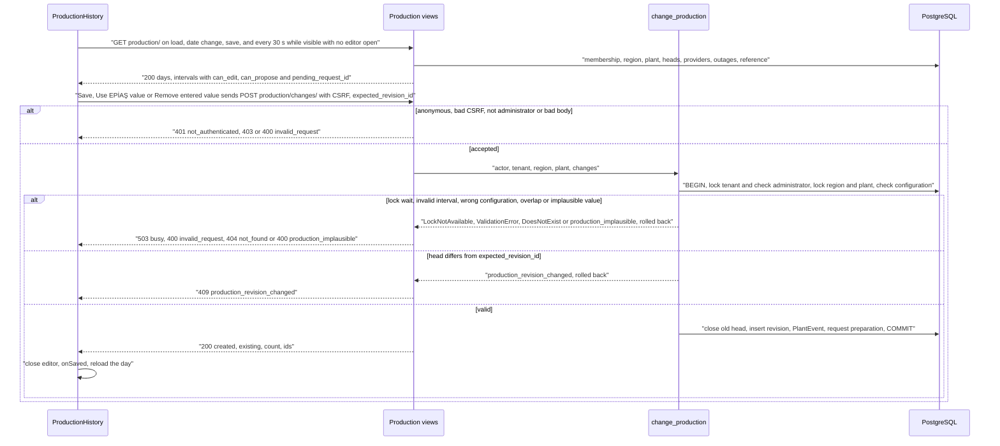

# View a production day and correct intervals

A workspace member opens a plant's Production tab and sees one local day of native 30 or 60 minute intervals, each with its effective value, source and provider original. A workspace administrator saves or reverts one interval, which appends an immutable revision, records a plant event and requests a calibration run. Any other member stages corrected intervals of the shown day into a draft and sends them as one request (`change-request-submission`).

## Entry points

- `web/src/features/production/production-history.tsx` `ProductionHistory` (mounted by `web/src/features/plant/workspace/production-section.tsx` `ProductionSection`, which `PlantWorkspace` loads on demand as in `plant-portfolio`, for `/app/w/{tenant}/plants/{region}/production/?date=`, key per configuration): date navigation, a 30 s poll through the query layer (paused while an editor is open or the tab is hidden, never overlapping), `save`, `reloadEditor`, the screen state `web/src/features/production/history/screen.ts` (shown day, access, full-day view, editor, draft with its reason and send state; one rule per event), the draft `web/src/features/production/history/proposal-draft.tsx`, `web/src/features/production/history/source-details.tsx` (`production-source/` of `epias-connection`), client-side CSV of the day (disabled until the reload after a save has answered), `ProductionImport` for admins (`production-csv-import`).
- `GET /api/tenants/{t}/regions/{r}/plants/{p}/production/` -> `pyracast.plants.api.ProductionView` -> `pyracast.plants.production.production_history`, then `pyracast.change_requests.queries.with_own_pending_requests` adds `pending_request_id` per interval. The UI always sends `start_date = end_date`, `native_intervals=true`. Actors: any member. The days read (`forecast-view`) does not call `production_history`: its production days come from `plants.production.native_production_days` (one measurement selection over its 30 days; no reference availability, observations or edit state).
- `POST .../production/changes/` -> `ProductionChangesView` -> `pyracast.plants.production_changes.change_production`. Actor: workspace administrator. `approve_request` (`change-request-review`) calls `change_production` directly; `production-import.tsx` posts its CSV commit to this same endpoint.
- No command, job or external call; the requested calibration run is prepared after commit or by the dispatcher's calibration phase (`calibration-run`).

## Sequence

## Data

| Table | R/W | What |
| --- | --- | --- |
| `plants_productionobservation` | R/W | Append-only revisions (`supersedes`, `is_current`, `is_reverted`); GET reads the heads in range (rows no later revision supersedes); a write clears `is_current` on the old head and inserts the new row |
| `plants_plant`, `regions_region`, `accounts_tenant`, `accounts_membership` | R; tenant, region, plant `FOR UPDATE` on write | Scope, role, timezone and coordinates; lock order tenant, region, plant |
| `plants_plantconfiguration`, `connections_sitebinding` | R | Current configuration, binding timezone and coordinates |
| `metering_epiassnapshot`, `metering_epiascollectionjob`, `metering_epiasconnection` | R | Provider hours, identity filter and job check, disconnect state |
| `forecasts_forecastsnapshot` | R | Estimated-actuals bounds and reference availability per interval |
| `incidents_plantincident`, `incidents_incidentrevision` | R | Outage overlay on the effective value |
| `change_requests_changerequest`, `change_requests_productionchangeitem` | R | One read-only statement: the actor's own pending production requests and their items, for `pending_request_id` |
| `plants_plantevent` | W | `production_changed` with `origin`, `configuration_id`, `created_ids`, `unchanged`, `file_name`, `file_sha256`, only when a row was created |
| `plants_plant` (`calibration_preparation_due_at`) | W | `request_preparation` marks the plant in the write transaction and tries once after commit; the dispatcher's calibration phase prepares what is left |

## Authorization

- Authentication: `SessionAuthentication` with CSRF; the route policy (`pyracast.api.permissions.ROUTE_POLICIES`) makes the read a member route and `production/changes/` an administrator route throttled under `production_import` (120 per hour per user).
- Read: the policy requires an active membership, then `ScopedView.plant_queryset` loads the active region and plant inside that tenant (404 otherwise).
- Write: the policy, then `tenant_membership(role=ADMIN, lock=True)` inside the transaction after locking the tenant, so it serializes with administrator reassignment.
- `can_edit`, `can_revert`, `can_propose` are computed server-side; the UI only mirrors them and `change_production` re-validates. Database: unique current head, no overlap among current non-reverted rows, duration, finite energy, quality and revert-has-source constraints, and a trigger that lets a row change only from current to superseded and requires a revision to supersede the same plant and interval.

## Failure paths

| Condition | Result |
| --- | --- |
| Anonymous | 401 `not_authenticated` |
| Bad CSRF; non-member (any method) | 403 `csrf_failed`; 403 `membership_required` |
| Non-administrator POST | 403 `workspace_admin_required` |
| Location trashed or missing, or in another tenant; `configuration_id` not of this plant or a row vanished before the lock | 404 `not_found` |
| Unknown field, missing `expected_revision_id`, bad type or quality, `set` without energy, over 2,000 changes; bad query value | 400 `invalid_request` with `fields` (an unknown top-level field has a message only) |
| Query range over 31 days or only one date; interval not completed, misaligned, crossing local midnight, batch over 31 local days; configuration not current, interval of a previous configuration, overlap, revert with nothing to revert | 400 `invalid_request` |
| A written value above 1.25 times the plant's power ceiling without `confirm_implausible` | 400 `production_implausible`, field `changes`; the editor offers a confirming save |
| Stale `expected_revision_id` | 409 `production_revision_changed`; the editor keeps the draft and its old token; for administrators Save and the revert stay disabled until Reload values or a field edit, which re-enables both but keeps the stale token, so the next save conflicts again |
| An administrator's save or revert whose answer was lost (`UnconfirmedError`) | The editor keeps the write as its outstanding attempt (`Draft.attempt`: the action, its values, the exact change row with its expected revision and plausibility confirmation) and the "Change not confirmed" notice, and the rows are read again by a read started after the loss. Save and Revert stay enabled (also after a 429) and edits are accepted; the notice shows the repeatable text only while the values equal the attempt, and the next save of identical values sends the attempt unchanged. Reload current values moves only the revision a new edit is sent against. The notice belongs to the attempt, not to the latest failure: a Reload, an edit, changed bounds and an access or day change keep it |
| First read of the day fails | The error and Retry (`ReadFailed`) |
| Reload current values fails | A read failure of the editor, dropped by the next answered read of the rows; with an attempt outstanding the general "Change not confirmed" notice stays beside it |
| More than 120 write requests in an hour | 429 `throttled` |
| Tenant, region or plant lock wait over 5 s | 503 `busy`, `Retry-After: 1`; the editor enters the same failed state as for 409 |
| Statement over 60 s; deadlock | 503 `request_timeout`; 503 `database_conflict` |
| Any other database error | 500 `server_error` |
| Interval stops being editable under an open editor, or comes to hold the member's own pending request | UI state `orphaned`: values read-only, the cause stated, Cancel only. An editor with an outstanding attempt is orphaned instead of closed and keeps the unknown outcome; while the viewer still writes directly it offers the retained write again ("Save {energy} MWh ({quality})" or Remove correction), with its field named by the plant date of its interval |

## Rules and invariants

- Revert is a tombstone: a new `is_reverted` head copies the old values, so selection falls back to the provider value or to missing. Setting identical values is a no-op reported as `existing`, with no revision, event or calibration request.
- Effective value per hour: current-configuration manual rows win; a manual row suppresses the whole overlapping provider hour; otherwise, only for a `net_export` configuration with an enabled connection and snapshots matching its provider IDs and EIC, settlement injection, then provisional realtime generation; after a disconnect stored provider values do not appear. An overlapping outage relabels `valid` as `outage`.
- Corrections recorded under an earlier configuration are listed in `previous_configuration_observations` beside every interval they overlap; they never enter the effective value or the day total, and they make the interval read-only.
- A write is replayed, not refused, when its token was already superseded by the identical value it asks for: it changes nothing and answers like the first call, so a retry after a lost response succeeds. A batch that mixes replayed and new changes is a 409.
- Lock timeout is 5 s and statement timeout 60 s (`DATABASES` options).
- The preparation attempt runs after commit; when it fails the save stands, the failure is logged and the plant is retried an hour later.
- Each interval's `pending_request_id` is the actor's latest own pending production request with an item overlapping it; the table shows it as "Waiting for approval · View", linking to that request's inbox detail.
- A member's draft belongs to its day: while it exists the day navigation is locked, and when Back or a link shows another day the screen offers to return to the draft's day or to discard the draft, staging and sending nothing meanwhile; the return to the draft's day changes only the address (`history.replaceState` through `usePlantNavigation().keep`), without a request. A staged draft, and an editor whose values differ from those it opened with or whose write runs or is unconfirmed, register with the leave guard (`frontend-data-layer`): leaving the page or the app's views asks first, and Back and Forward ask before the entry loads (after Stay the address names the other entry while the view keeps the input). A configuration change that remounts the history while a draft is staged or an editor value changed shows `PlantWorkspace.configurationChanged` until the next day or view change. While a request is sent nothing can be staged, edited or removed; a draft holding an interval that now waits for the member's own request cannot be sent until that item is removed. Editing a staged item outside daylight shows the full day, discarding closes any editor, and staging, updating and removing an item are announced. A day change closes an idle editor, so a day whose read failed can be refreshed; a promotion to administrator drops the draft.
- Day total is null unless every daylight window is covered; polar night requires the whole local day. The default screen view keeps daylight intervals and the producing range; inline edits record source `operator`. The table labels a value by its `source_kind`: UEVM (title "Settlement (UEVM)"), "Real-time (EPİAŞ)" or "Entered", with "Corrected" added only when the entered value replaces an EPİAŞ value; the stored `source` text appears only in the CSV download (`csv-export`), which takes each provider value's own status from `provider_originals[].quality`. Members and administrators see "Edit" and "Use EPİAŞ value ({value} MWh)" only when one EPİAŞ value covers exactly the edited interval and no other entered value of the day overlaps it; otherwise "Remove entered value", with "This interval will have no value." when no EPİAŞ value touches the interval, else "The entered value is removed."; a member's draft lists the revert by the same action. The open editor's row stays shown outside daylight.

## Tests

- `tests/test_production_changes.py` (batch atomicity, stale 409, permissions, concurrent winner, database constraints), `tests/test_production_writes.py` (replay, mixed batch, preview without locks, event details, capacity confirmation, earlier-configuration corrections), `tests/test_production_history.py`, `tests/test_native_production.py`, `tests/test_production_read_consistency.py`, `tests/test_read_query_budgets.py`, `tests/test_daylight_journal.py`, `tests/test_own_pending_markers.py` (`pending_request_id`: own, latest, other members and workspaces, read only, fixed query count); `tests/test_calibration_requests.py` (a save commits while preparation raises); `tests/test_api_contention.py` (503 mapping); `tests/test_route_policy.py`.
- End to end: `tests/e2e/test_workspace_spec.py` runs `web/integration/workspace.spec.ts` against live Django (set, set, revert, set) and checks the revision chain. `web/tests/epias-production.spec.ts`, `journal-date.spec.ts`, `journal-timezone.spec.ts`, `production-history-model.spec.ts`, `production-export.spec.ts`, `change-requests.spec.ts` mock the API with `page.route`; `production-screen-model.spec.ts` meets every screen state with every event and control, `production-proposal-model.spec.ts` covers staging and refusals, `unconfirmed-writes.spec.ts` lost saves and reverts, `connection-loss.spec.ts` failed first reads, `leave-guard.spec.ts` leaving with a changed editor value.
- Gaps: no test that a save leaves a pending `CalibrationRun`; no 503 test on this endpoint itself.
