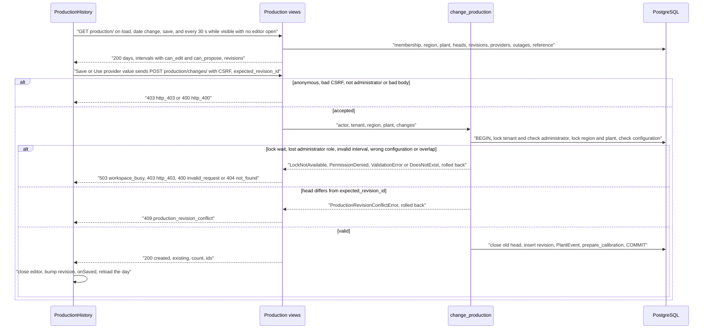

# View a production day and correct intervals

A workspace member opens a plant's Production tab and sees one local day of native 30 or 60 minute intervals, each with its effective value, source and provider original. A workspace administrator saves or reverts one interval, which appends an immutable revision, records a plant event and prepares a calibration run. A viewer reaches the same table but proposes instead (`change-request-submission`).

## Entry points

- `web/src/components/production-history.tsx` `ProductionHistory` (mounted by `plant-workspace.tsx` for the Production tab, key per configuration): date navigation, 30 s poll, `save`, `reloadEditor`, source disclosure (`production-source/` status of `epias-connection`), client-side CSV of the day, `ProductionImport` for admins (`production-csv-import`).
- `GET /api/tenants/{t}/regions/{r}/plants/{p}/production/` -> `pyracast.plants.api.ProductionView` -> `pyracast.plants.production.production_history`. The UI always sends `start_date = end_date`, `native_intervals=true`. Actors: any member.
- `POST .../production/changes/` -> `ProductionChangesView` -> `pyracast.plants.production_changes.change_production`. Actor: workspace administrator. `approve_request` (`change-request-review`) calls `change_production` directly; `production-import.tsx` posts its CSV commit to this same endpoint.
- `GET .../reported-production/` -> `pyracast.plants.epias_api.EpiasHistoryView` -> `pyracast.metering.history.read_production_day`. Any member; no web caller (only a stale mock in `web/tests/responsive.spec.ts`).
- No command, job or external call; the pending calibration run is dispatched later (`calibration-run`).

## Sequence

## Data

| Table | R/W | What |
| --- | --- | --- |
| `plants_productionobservation` | R/W | Append-only revisions (`supersedes`, `is_current`, `is_reverted`); GET reads heads and every revision in range; a write clears `is_current` on the old head and inserts the new row |
| `plants_plant`, `regions_region`, `accounts_tenant`, `accounts_membership` | R; tenant, region, plant `FOR UPDATE` on write | Scope, role, timezone and coordinates; lock order tenant, region, plant |
| `plants_plantconfiguration`, `connections_sitebinding` | R | Current configuration, binding timezone and coordinates |
| `metering_epiassnapshot`, `metering_epiascollectionjob`, `metering_epiasconnection` | R | Provider hours, identity filter and job check, disconnect state |
| `forecasts_forecastsnapshot` | R | Estimated-actuals bounds and reference availability per interval |
| `incidents_plantincident`, `incidents_incidentrevision` | R | Outage overlay on the effective value |
| `plants_plantevent` | W | `production_changed` with the ids of every batch row, only when a row was created |
| `plants_calibrationrun`, `plants_calibrationactivation` | R/W, R | `prepare_calibration` skips when a run is `pending` or `running`, else may insert a `pending` run and a `calibration_scheduled` event |

## Authorization

- Authentication: `SessionAuthentication` with CSRF plus `IsAuthenticated`; the default `WorkspaceWritePermission` limits every non-safe method to the tenant administrator (`pyracast.api.permissions`).
- Read: `ScopedView.plant_queryset` calls `require_member`, then loads region and plant inside that tenant (404 otherwise). `reported-production` re-checks membership in `metering.operations.member_plant`.
- Write: view permission, then `require_workspace_admin` inside the transaction after locking the tenant, so it serializes with administrator reassignment.
- `can_edit`, `can_revert`, `can_propose` are computed server-side; the UI only mirrors them and `change_production` re-validates. Database: unique current head, no overlap among current non-reverted rows, duration, finite energy, quality and revert-has-source constraints.

## Failure paths

| Condition | Result |
| --- | --- |
| Anonymous, bad CSRF, non-member (any method), or non-administrator POST | 403 `http_403` |
| Region or plant missing, trashed or in another tenant; `configuration_id` not of this plant or a row vanished before the lock | 404 `http_404` in the view; 404 `not_found` inside the write |
| Unknown field, missing `expected_revision_id`, bad type or quality, `set` without energy, over 2,000 changes; `reported-production` date after yesterday in Istanbul | 400 `http_400` |
| Query range over 31 days or only one date; interval not completed, misaligned, crossing local midnight, batch over 31 local days; configuration not current, interval of a previous configuration, overlap, revert with nothing to revert | 400 `invalid_request` |
| Stale `expected_revision_id` | 409 `production_revision_conflict`; the editor keeps the draft and its old token; for administrators Save and Use provider value stay disabled until Reload values or a field edit, which re-enables Save but keeps the stale token, so the next save conflicts again |
| Tenant, region or plant lock wait over 5 s | 503 `workspace_busy`, `Retry-After: 1`; the editor enters the same failed state as for 409 |
| Statement over 60 s or any other database error | Unmapped, 500 |
| Interval stops being editable under an open draft | UI state `orphaned`: draft read-only, Cancel only |

## Rules and invariants

- Revert is a tombstone: a new `is_reverted` head copies the old values, so selection falls back to the provider value or to missing. Setting identical values is a no-op reported as `existing`, with no revision, event or calibration.
- Effective value per hour: current-configuration manual rows win; a manual row suppresses the whole overlapping provider hour; otherwise, only for a `net_export` configuration with an enabled connection and snapshots matching its provider IDs and EIC, settlement injection, then provisional realtime generation; after a disconnect stored provider values no longer appear. An overlapping outage relabels `valid` as `outage`.
- Direct writes have no replay key: after a lost response a retry carries a stale token and gets 409. Lock timeout is 5 s and statement timeout 60 s (`DATABASES` options).
- `prepare_calibration` runs inside the write transaction, under the tenant, region and plant locks, and can fail the save by raising.
- Day total is null unless every daylight window is covered; polar night requires the whole local day. `reported-production` uses Istanbul hours, picks settlement before realtime per hour and reports `calibration_blocker`.
- The poll pauses while the editor is open or the tab is hidden; a sequence counter drops stale reads.

## Tests

- `tests/test_production_changes.py` (batch atomicity, stale 409 including an identical retry, permissions, concurrent winner, database constraints), `tests/test_production_history.py`, `tests/test_native_production.py`, `tests/test_production_read_consistency.py`, `tests/test_read_query_budgets.py`, `tests/test_daylight_journal.py`; `tests/test_epias_api.py`, `tests/test_metering_history.py`, `tests/test_epias_authorization.py` for `reported-production`.
- End to end: `tests/test_browser.py` runs `web/integration/workspace.spec.ts` against live Django (set, set, revert, set) and checks the revision chain. `web/tests/epias-production.spec.ts`, `journal-date.spec.ts`, `journal-timezone.spec.ts`, `change-requests.spec.ts` mock the API with `page.route`.
- Gaps: no test that a save creates a `CalibrationRun`; no 503 test on this endpoint; the mocked 409 body differs from the real one.
