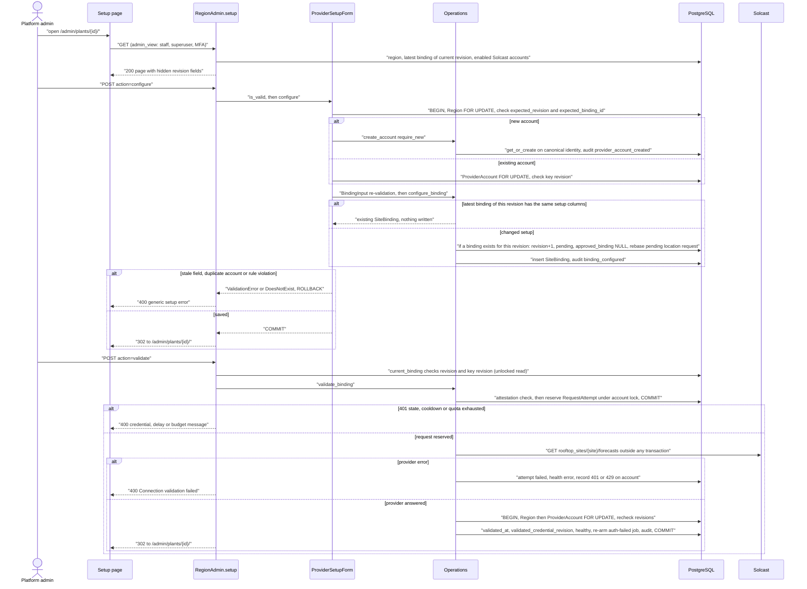

# Configure and validate a plant's provider account and site binding

A platform administrator opens a plant's review page in the `/admin/` console, saves a Solcast account (existing or new, with a write-only encrypted key) plus a site binding for the region's current revision, then presses Validate, which spends one counted Solcast request. Success marks the binding validated for the account's current key revision, which unlocks approval (the separate `plant-approval` flow); changing an existing binding instead opens a new pending region revision and removes approval, while saving the same values keeps the binding and approval.

## Entry points

- Console page: `GET|POST /admin/plants/{id}/` -> `pyracast.admin.PlatformAdminSite.plant`, which delegates to `RegionAdmin.setup`; reached from Overview, Plants and Operations rows (`review_url`). Template `src/pyracast/regions/templates/admin/regions/region/setup.html`, form behaviour in `src/pyracast/regions/static/pyracast/admin-workspace.js` (loaded by `admin/workspace/base.html`).
- Duplicate route: `GET|POST /admin/regions/region/{id}/setup/` -> the same `RegionAdmin.setup` (`RegionAdmin.get_urls`), linked from the record browser list (`review_link`) and from `GET /admin/regions/region/{id}/change/` (`admin/regions/region/change_form.html`). Both redirect to `/admin/plants/{id}/` on success.
- POST actions handled here: `configure` (`pyracast.admin_forms.ProviderSetupForm.configure`) and `validate` (`BindingActionForm.current_binding` then `pyracast.connections.operations.validate_binding`). `approve`, `clear_cooldown` and `epias_*` share the view but belong to other flows; `configure` with a key on an existing account is the `provider-credential-recovery` branch.
- Platform API (no web caller, excluded from OpenAPI by `pyracast.api.schema`): `POST /api/platform/accounts/` -> `pyracast.api.views.AccountView`, `POST /api/platform/regions/{r}/bindings/` -> `BindingView`, `POST /api/platform/bindings/{b}/validate/` -> `ValidateView`. They call `create_account`, `configure_binding` and `validate_binding` directly and also accept provider `fixture`.
- Operator script: `scripts/check_solcast.py` `main` -> `capture`, one quota-counted live `settings` or `forecast` capture for a current-revision binding.
- The `fixture_demo` command (flow `fixture-demo`) calls the same three operations with the fixture provider.

## Sequence

## Data

| Table | R/W | What |
| --- | --- | --- |
| `regions_region` | R/W | Locked `FOR UPDATE` by configure and by the post-HTTP validation commit; a changed reconfigure bumps `revision`, sets `status = pending`, clears `approved_binding` |
| `connections_sitebinding` | R/W | One insert per changed configure, pinned to `region_revision` and copying region coordinates and timezone; validation writes `validated_at`, `validated_credential_revision`, `health` |
| `connections_provideraccount` | R/W | Insert for a new account (canonical identity, Fernet `encrypted_api_key`, `daily_quota`, `authorized_by/at`); locked for selection and reservation; 401 sets `authentication_failed_revision`, 429 sets `request_blocked_until` |
| `forecasts_requestattempt` | R/W | Daily count per account and UTC day; one row per validation (`purpose = validation`) or script run (`inspect_settings`, `inspect_forecast`); `outcome` uncertain, succeeded or failed |
| `forecasts_collectionjob` | R/W | Latest due forecast job of the approved binding is re-armed to `pending` when it failed with `provider_authentication_failed`; the page lists recent jobs |
| `regions_auditevent` | R/W | Writes `provider_account_created`, `provider_secret_rotated` (key branch), `binding_configured`, `location_change_rebased`, `connection_validated`; nothing for failed validations or unchanged saves. The page reads recent activity |
| `regions_regionlocationchangerequest` | R/W | Page context; a changed reconfigure moves a pending request's `base_revision` to the new revision |
| `plants_plant`, `plants_plantsubmission`, `plants_plantconfiguration`, `metering_epiasconnection`, `accounts_tenant`, `forecasts_forecastsnapshot`, `notifications_notificationdelivery`, `mfa_authenticator` | R | Page context (`review_context`) and MFA evidence only |

## Authorization

- Console: `PlatformAdminSite.has_permission` requires active staff, `is_superuser` and `has_verified_mfa` (a TOTP or recovery-code record in the session backed by a live `Authenticator`); `admin_view` adds CSRF protection and sends everyone else to the admin login, which redirects to `/app/?next=/admin/`.
- Operations: `require_admin` (active superuser, no MFA or staff check) in `create_account`, `rotate_secret`, `configure_binding`, `validate_binding`.
- API: `PlatformAdmin` (active superuser plus MFA, no `is_staff`), session authentication with CSRF. It has none of the form's optimistic checks, and `ValidateView` accepts a binding of any revision.
- Script: no actor, no audit; whoever holds database settings and the decryption key can spend quota.
- Database: `canonical_provider_account` unique index, `provider_account_encrypted_api_key` check, binding checks (`horizontal_binding`, capacity, azimuth, losses, power basis, health). `daily_quota` has no range check and nothing enforces one binding per revision. Provider accounts are platform-wide, deliberately shared across tenants.

## Failure paths

| Condition | Result |
| --- | --- |
| Anonymous, not staff, not superuser or no MFA evidence | 302 to the admin login, which redirects to `/app/?next=/admin/` |
| Missing CSRF token / method other than GET or POST / region missing or trashed | 403 / 405 / 404 |
| Form field errors (new account without identity, key, reference or quota; quota outside 1..10; key on existing account without confirmation; selected account disabled or not Solcast; attestation unchecked; hidden fields missing) | 400, field errors, key never re-rendered |
| Configure: stale revision, binding id or account key revision; duplicate new identity; invalid key format; account changed before the lock; `configure_binding` or `BindingInput` rule (for example capacity 0) | 400 "The setup could not be applied. Check the values or reload..." (specific messages are swallowed); the whole transaction, including a key rotation, rolls back |
| Validate: stale revision, binding id or key revision; unknown `action`; binding without attestation | Same 400 generic message, no attempt row |
| Validate: account blocked for its current key revision after a 401 | 400 "Update the private API key before validating this connection again." No attempt row |
| Validate: active cooldown / quota used, account disabled or unauthorized | 400 "The provider is limiting requests..." / "The provider's request budget is unavailable..." No attempt row |
| Validate: Solcast HTTP error, timeout, malformed payload, invalid site id or stored secret, unsafe response | 400 "Connection validation failed...", attempt `failed` (counts against quota even when no HTTP request was sent), `health = error` |
| Region revision or key revision changed, or region trashed, while the request was in flight | 400 generic setup error, attempt stays `uncertain`, binding not validated |
| Row lock wait (Region or ProviderAccount) over `lock_timeout = 5s` | Console: unhandled `OperationalError` (500). API: 503 `workspace_busy` with `Retry-After: 1` |
| Second request of the same session while one is running (Validate holds the session advisory lock through the Solcast call) | After 5 s: 429 JSON `session_busy`, also on console pages |
| API errors | 403 `http_403` without superuser and MFA; 400 `http_400` (serializer) or `invalid_request` (operation rule); 404 `http_404` (unknown binding in `ValidateView`) or `not_found`; 503 `provider_authentication_failed`; 429 `provider_throttled` with `Retry-After`; 429 `quota_exhausted`; 502 `provider_unavailable` |
| Script without `--live` | argparse error "Live requests require --live." (exit 2, Django not loaded) |
| Script: output outside cwd, binding missing or not current, invalid site id or non-Solcast account (all before quota is spent), already run today for that kind, account blocked or out of quota, provider failure (attempt `failed`) | Exit with "Live check stopped (<ErrorType>); no automatic retry." |

## Rules and invariants

- Lock order is Region, then ProviderAccount: configure (existing account only; a new account is inserted, and `configure_binding` reads the account unlocked), the validation commit (which then locks the latest CollectionJob) and approval. Reservation locks only ProviderAccount. `lock_timeout=5s` comes from the connection options in `settings.py`.
- Optimistic concurrency: configure carries `expected_revision`, `expected_binding_id` and `existing_account` as `id:credential_revision`; validate carries `binding_id`, `expected_revision` and `credential_revision`. A double submit of the first setup fails the binding check instead of creating revision 2.
- The first binding of a revision does not change the region. A save whose setup columns (account, site, capacities, basis, attestation, angles, losses, installation date, reference, coordinates and timezone) equal the latest binding of the revision returns that binding without writing a binding, revision or audit event; the console says "Nothing changed.", or "API key replaced..." when only the key was rotated (the rotation itself writes the new key and `provider_secret_rotated`). Any other later save creates revision N+1, drops approval at once and moves a pending location request to the new revision (`location_change_rebased`); an approved plant stops collecting (`binding_is_current` fails) until it is validated and approved again.
- Validation only proves access: `SolcastProvider.validate` fetches the forecast window and discards it. Site correctness rests on operator attestation (`settings_verification_reference`, installation date, `capacity_semantics_verified`, `tilt = 0`); reference and installation date are checked again before any quota is spent.
- Quota: one `RequestAttempt` per request, counted per account and UTC day against `daily_quota` (1..10 for new accounts, shared by every plant on the account). The reservation commits before HTTP; no transaction is open during the call (20 s read, 5 s connect, no redirects). A post-HTTP mismatch keeps the attempt `uncertain`, which still counts.
- 401 blocks the account for the current `credential_revision` until a key rotation; 429 extends `request_blocked_until` (provider `Retry-After`, else 900 s, plus jitter); other failures only set binding `health = error`, which nothing but a later successful validation resets.
- A successful validation of the approved binding re-arms only a forecast job whose last error is `provider_authentication_failed` (attempts reset to 0); the dispatcher's `pending_job_ids` publishes it, nothing is sent to Dramatiq directly.
- Account identity is `CASEFOLD(BTRIM(...) COLLATE "pg_unicode_fast")`; the stored `external_account_id` is the canonical form. Keys must be 1..1024 printable ASCII characters without spaces and are stored as `encrypted:v1:` Fernet tokens.
- `check_solcast.py` allows one attempt per binding, kind and UTC day and writes allowlisted fields plus a metadata file only inside the working directory (default `.codex/solcast`).

## Tests

- `tests/test_admin_setup.py`: end-to-end configure, validate, approve without key exposure; superuser and MFA gate; CSRF; stale revisions; duplicate identity; key rotation rollback; validation failure, quota and 401/429 messages; duplicate first submit.
- `tests/test_admin_workspace.py` (new-account quota rules, `can_approve`), `tests/test_domain.py` (binding rules, revision bump, post-network recheck, attestation, quota day), `tests/test_providers.py` (Solcast adapter: fixed origin, timeouts, site id and secret checks before transport, redaction), `tests/test_provider_identity.py`, `tests/test_provider_secrets.py`, `tests/test_provider_database_keys.py`, `tests/test_account_rotation.py`, `tests/test_quota_clock.py`, `tests/test_revalidation_schedule.py`, `tests/test_api.py` (platform endpoints, fixture provider only), `tests/test_api_contention.py` (503 `workspace_busy` mapping), `tests/test_solcast_capture.py` (script).
- Gaps: no Playwright or browser test for the console page or `admin-workspace.js`; `tests/test_admin_setup.py` uses only the duplicate `/admin/regions/region/{id}/setup/` URL, so `validate` is never posted to `/admin/plants/{id}/`; nothing pins the console 500 on lock timeout, the 429 `session_busy` during a slow validation, quota spent on an invalid `site_id`, or validation of a non-current binding through `ValidateView`.
