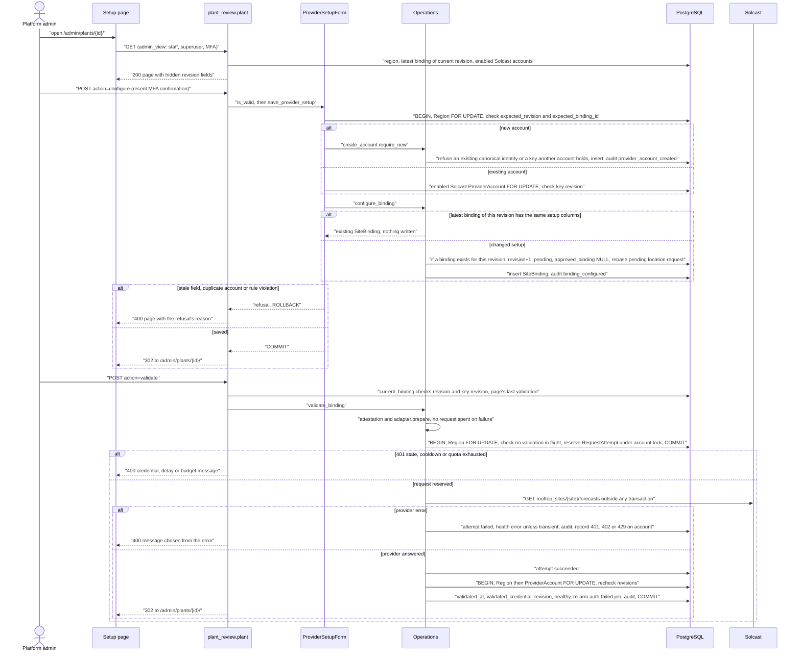

# Configure and validate a plant's provider account and site binding

A platform administrator opens a plant's review page in the `/admin/` console, saves a Solcast account (an existing one, or a new one with a write-only encrypted key) plus a site binding for the region's current revision, then presses Validate, which spends one counted Solcast request. Success marks the binding validated for the account's current key revision, which unlocks approval (the separate `plant-approval` flow); changing an existing binding instead opens a new pending region revision and removes approval, while saving the same values keeps the binding and approval.

## Entry points

- Console page: `GET|POST /admin/plants/{id}/` -> `pyracast.platform_admin.plant_review.plant`, which dispatches the POST `action` to one handler each. Reached from the Overview, Plants and Operations rows and the record browser (`review_url`). Template `src/pyracast/regions/templates/admin/regions/region/setup.html`, form behaviour in `src/pyracast/regions/static/pyracast/admin-workspace.js` (loaded by `src/pyracast/regions/templates/admin/workspace/base.html`).
- Handlers here: `configure` (`ProviderSetupForm` in `pyracast.platform_admin.forms` -> `pyracast.connections.setup.save_provider_setup`) and `validate` (`BindingActionForm.current_binding`, then `pyracast.forecasts.validation.validate_binding`). `approve` and `epias_*` share the view but belong to other flows. The form takes an API key only for a new account; an existing account's key is replaced and its provider delay cleared on its provider account page (`provider-credential-recovery`), which the saved connection links.
- Operator script: `scripts/check_solcast.py` `main` -> `capture`, one quota-counted live `settings` or `forecast` capture for a current-revision binding.
- The `fixture_demo` command (flow `fixture-demo`) calls `create_account`, `configure_binding` and `validate_binding` with the fixture provider.
- There is no customer or platform API for setup; those routes answer 404.

## Sequence

## Data

| Table | R/W | What |
| --- | --- | --- |
| `regions_region` | R/W | Locked `FOR UPDATE` by configure and by both validation transactions; a changed reconfigure bumps `revision`, sets `status = pending`, clears `approved_binding` |
| `connections_sitebinding` | R/W | One insert per changed configure, pinned to `region_revision` and copying region coordinates and timezone; validation writes `validated_at`, `validated_credential_revision`, `health` |
| `connections_provideraccount` | R/W | Insert for a new account (canonical identity, Fernet `encrypted_api_key`, keyed `api_key_fingerprint`, `daily_quota`, `authorized_by/at`); locked for selection and reservation; 401 sets `authentication_failed_revision`, 402 and 429 set `request_blocked_until` |
| `forecasts_requestattempt` | R/W | Daily count per account and UTC day; one row per validation (`purpose = validation`) or script run (`inspect_settings`, `inspect_forecast`); `outcome` uncertain, succeeded or failed, with `http_status` on failure |
| `forecasts_collectionjob` | R/W | Latest due forecast job of the approved binding is re-armed to `pending` when it failed with `provider_authentication_failed`; the page lists recent jobs |
| `regions_auditevent` | R/W | Writes `provider_account_created`, `binding_configured`, `location_change_rebased`, `connection_validated`, `connection_validation_failed`; nothing for unchanged saves. The page reads recent activity |
| `regions_regionlocationchangerequest` | R/W | Page context; a changed reconfigure moves a pending request's `base_revision` to the new revision |
| `plants_plant`, `plants_plantsubmission`, `plants_plantconfiguration`, `metering_epiasconnection`, `accounts_tenant`, `forecasts_forecastsnapshot`, `notifications_notificationdelivery`, `mfa_authenticator` | R | Page context (`review_context`) and MFA evidence only |

## Authorization

- Console: `PlatformAdminSite.has_permission` requires an active staff superuser with MFA evidence (`has_mfa_evidence`: a TOTP or recovery-code record in the session backed by a live `Authenticator`); `admin_view` adds CSRF protection and, for every POST, a recent authenticator confirmation, and sends everyone else to the admin login.
- Operations: `require_platform_admin` (active staff superuser, no MFA check) in `create_account`, `configure_binding`, `save_provider_setup` and `validate_binding`.
- Script: no actor, no audit; whoever holds database settings and the decryption key can spend quota.
- Database: `provideraccount_provider_external_account_id_uniq`, `provideraccount_api_key_fingerprint_uniq`, `provideraccount_encrypted_api_key_chk`, `provideraccount_provider_chk`, `provideraccount_daily_quota_chk` (1..10), `sitebinding_region_region_revision_uniq` (one binding per region revision), `sitebinding_validated_chk` (validation moment and key revision together), binding checks (capacity, azimuth, losses, power basis, health). Provider accounts are platform-wide, deliberately shared across tenants.

## Failure paths

| Condition | Result |
| --- | --- |
| Anonymous, not staff, not superuser or no MFA evidence | 302 to the admin login: anonymous to `/app/?next=<console path>`, signed in to `/app/` |
| Missing CSRF token / method other than GET or POST / region missing or trashed | 403 / 405 / 404 |
| POST without a recent authenticator confirmation | 403 confirmation page, nothing stored; a typed key is entered again |
| Form field errors (new account without identity, key, reference or quota; quota outside 1..10; account not selectable; attestation unchecked; hidden fields missing) | 400, field errors, key never re-rendered |
| Configure: stale revision, binding id or key revision; duplicate new identity; invalid key format; a key another account already holds ("This API key is already stored on the account ..."); `configure_binding` rule (for example capacity 0) | 400 with the operation's own reason; the whole transaction rolls back. A region or account that vanished shows "The setup could not be applied..." |
| Validate: stale revision, binding id or key revision; unknown `action`; binding without attestation | 400 "The setup could not be applied..." and no attempt row; missing hidden fields name "Reload this page" |
| Validate: page opened before the last validation | 400 "validated after this page opened", no provider request |
| Validate: unanswered validation of the same binding younger than one minute | 400 "being validated now", no second request |
| Validate: account blocked for its current key revision after a 401 | 400 "Update the private API key before validating this connection again." No attempt row |
| Validate: active cooldown / quota used, account disabled or unauthorized, or an approved plant's request still needed by the account's forecasts | 400 "The provider is limiting requests..." / "The provider's request budget is unavailable..." No attempt row |
| Validate: invalid resource ID, unreadable stored key or account that cannot be validated | 400 with that reason before any request is reserved |
| Validate: provider failure after the reservation (HTTP error, timeout, malformed payload, unsafe response) | 400 with one message chosen from the error (rejected key on 401 or 403, site not visible on 404, limiting on 429, unreachable without a status, provider error on 5xx, refused request on other statuses, unreadable answer); attempt `failed` (counts against quota), audit `connection_validation_failed`, one `provider_validation_failed` log line; `health = error` unless the provider was only unreachable, throttled or failing |
| Region revision or key revision changed, or region trashed, while the request was in flight | 400 generic setup error, attempt stays `succeeded` and counted, binding not validated |
| Row lock wait (Region or ProviderAccount) over `lock_timeout = 5s` on a console write | Nothing saved; redirect to the console page with "Another change to this record is in progress..." |
| Second request of the same session while one is running (Validate holds the session advisory lock through the Solcast call) | After 5 s a no-store 503 page with `Retry-After: 1`; a GET reloads once |
| Script without `--live` | argparse error "Live requests require --live." (exit 2, Django not loaded) |
| Script: output outside cwd, binding missing or not current, invalid site id or non-Solcast account (all before quota is spent), already run today for that kind, account blocked or out of quota, provider failure (attempt `failed`) | Exit with "Live check stopped (<ErrorType>); no automatic retry." |

## Rules and invariants

- Lock order is Region, then ProviderAccount, then the latest CollectionJob: configure (existing account only; a new account is inserted), validation (reservation under the region lock, then the commit), approval. A reservation for collection locks only ProviderAccount. `lock_timeout=5s` comes from the connection options in `settings.py`.
- Optimistic concurrency: configure carries `expected_revision`, `expected_binding_id` and `existing_account` as `id:credential_revision`; validate carries `binding_id`, `expected_revision`, `credential_revision` and `expected_validated_at`. A double submit of the first setup fails the binding check instead of creating revision 2.
- The first binding of a revision does not change the region. A save whose setup columns (account, site, capacities, basis, attestation, angles, losses, installation date, reference, coordinates and timezone) equal the latest binding of the revision returns that binding without writing a binding, revision or audit event; the console says "Nothing changed.". Any other later save creates revision N+1, returns the region to pending, drops approval at once and moves a pending location request to the new revision (`location_change_rebased`); an approved plant stops collecting (`binding_is_current` fails) until it is validated and approved again.
- Validation only proves access: `SolcastProvider.validate` fetches the forecast window and discards it. Site correctness rests on operator attestation (`settings_verification_reference`, installation date, `capacity_semantics_verified` for a horizontal reference); the attestation, the resource ID and the stored key are checked again before any quota is spent.
- Quota: one `RequestAttempt` per request, counted per account and UTC day against `daily_quota` (1..10, shared by every plant on the account). The reservation commits before HTTP; no transaction is open during the call (5 s connect, 20 s read, 30 s for the whole body, no redirects). The attempt is `succeeded` once the provider answered, even when the commit then refuses a changed setup. Validating an approved plant keeps the forecast reserve (`keep_forecast_reserve`, see `provider-quota-and-backoff`); a pending plant's validation does not.
- 401 blocks the account for the current `credential_revision` until the key is replaced; 429 extends `request_blocked_until` (provider `Retry-After`, else 900 s, plus jitter), 402 until the next UTC day; other failures only set binding `health = error` (and only when `refuses_binding`), which nothing but a later successful validation resets.
- A successful validation of the approved binding re-arms only its latest started forecast job (`latest_forecast_job`, no import job) when that job failed with `provider_authentication_failed` and is not older than the due slot (`armed_again_by_validation`; attempts reset to 0); the dispatcher's `pending_job_ids` publishes it, nothing is sent to Dramatiq directly.
- Account identity is `CASEFOLD(BTRIM(...) COLLATE "pg_unicode_fast")`; the stored `external_account_id` is the canonical form. Keys must be 1..1024 printable ASCII characters without spaces and are stored as `encrypted:v1:` Fernet tokens. A resource ID is letters, digits, hyphens and underscores, refused at the form and in `configure_binding`.
- `check_solcast.py` allows one attempt per binding, kind and UTC day and writes allowlisted fields plus a metadata file only inside the working directory (default `.dev/solcast`).

## Tests

- `tests/test_admin_setup.py`: end-to-end configure, validate, approve without key exposure; superuser and MFA gate; CSRF; stale revisions; duplicate identity; validation failure, quota and 401/429 messages; duplicate first submit; identical saves. `tests/test_provider_setup.py`: superseded binding, in-flight validation, health after refusal, resource ID. `tests/test_validation_feedback.py`, `tests/test_validation_audit.py`, `tests/test_setup_refusals.py`: the failure messages, audit line and named refusals.
- `tests/test_console_step_up.py` (confirmation before a console write), `tests/test_console_failures.py` (row-lock retry message, busy-session page, stale validation page), `tests/test_admin_workspace.py` (new-account quota rules, `can_approve`), `tests/test_domain.py` (binding rules, revision bump, post-network recheck, attestation, quota day), `tests/test_provider_account_invariants.py` (quota, one binding per revision, validation moment), `tests/test_providers.py` (Solcast adapter: fixed origin, timeouts, site id and secret checks before transport, redaction), `tests/test_provider_identity.py`, `tests/test_provider_secrets.py`, `tests/test_provider_database_keys.py`, `tests/test_provider_key_fingerprint.py`, `tests/test_quota_clock.py`, `tests/test_revalidation_schedule.py`, `tests/test_routed_surface.py` (removed platform routes answer 404), `tests/test_solcast_capture.py` (script).
- `web/integration/admin-csp.spec.ts` (console page under CSP against live Django: setup disclosures, account mode and disabled key field), `web/tests/admin-workspace-submit.spec.ts` (`admin-workspace.js` sends a form once and keeps the pressed action).
- Gaps: no browser test submits configure or validate on the console page.
