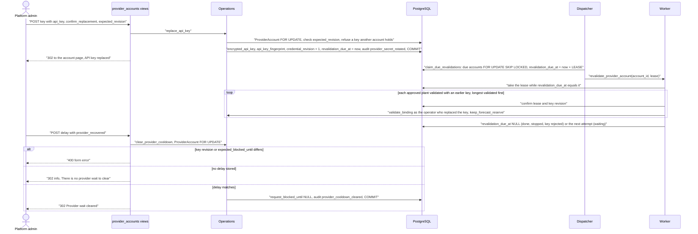

# Replace a provider API key or clear a provider delay

A platform administrator recovers a shared Solcast account on its provider account page in two separate confirmed actions. Replacing the key stores the new encrypted key and its keyed fingerprint, bumps `credential_revision` (which lifts a 401 block) and queues every approved plant of the account for automatic revalidation in the background, within the daily request budget. After the provider confirms recovery, a second action clears the stored request delay. Both are audited per account; plant setup, approval and region revisions stay as they are.

## Entry points

- Console: `GET /admin/provider-accounts/` (URL name `admin:workspace_provider_accounts`) and `GET /admin/provider-accounts/{id}/` (`admin:workspace_provider_account`) -> `pyracast.platform_admin.provider_accounts.accounts` / `account`; templates `src/pyracast/regions/templates/admin/workspace/provider_accounts.html` and `provider_account.html`. The plant page links its saved account and, during a delay, shows "Manage the provider account".
- Key: `POST /admin/provider-accounts/{id}/key/` (`admin:workspace_provider_account_key`, Solcast accounts only) with `api_key`, `confirm_replacement`, `expected_revision` -> `provider_accounts.key_replacement` (`KeyReplacementForm`) -> `pyracast.connections.operations.replace_api_key` -> `pyracast.connections.secrets.encrypt_secret` and `api_key_fingerprints`.
- Delay: `POST /admin/provider-accounts/{id}/delay/` (`admin:workspace_provider_account_delay`) with `provider_recovered`, `expected_revision`, `expected_blocked_until` -> `provider_accounts.delay_clearance` (`DelayClearanceForm`) -> `pyracast.connections.recovery.clear_provider_cooldown`.
- Revalidation: the dispatcher's collection phase calls `pyracast.forecasts.revalidation.dispatch_revalidations`; the worker runs job kind `revalidate_provider_account` (`orchestration.kinds.REVALIDATION`, queue `default`, bound in `background.deadlines.ACTORS`) -> `revalidation.deliver_revalidation` -> `revalidate_account` -> `pyracast.forecasts.validation.validate_binding` per plant.
- Restore: `pyracast.trash.restore_region` calls `revalidation.queue_revalidation` for a restored plant's approved binding.
- No REST route replaces a key or clears a delay.

## Sequence

## Data

| Table | R/W | What |
| --- | --- | --- |
| `connections_provideraccount` | R/W | Locked `FOR UPDATE`; replacement writes `encrypted_api_key`, `api_key_fingerprint`, `credential_revision` and `revalidation_due_at`; the run writes `revalidation_due_at`, and its validations' `record_provider_failure` writes `authentication_failed_revision` on a 401 and `request_blocked_until` on a 402 or 429 of the current key; clearing writes `request_blocked_until`; `daily_quota` is never touched |
| `connections_sitebinding` | R/W | The run's validations write `validated_at`, `validated_credential_revision` and `health`; the setup and the approval are unchanged |
| `forecasts_requestattempt` | R/W | Each revalidation reserves one `validation` request; the account page reads the UTC day's ledger |
| `forecasts_collectionjob` | R/W | A successful validation can re-arm the plant's latest due forecast job refused for the key (rule in `provider-quota-and-backoff`) |
| `regions_auditevent` | R/W | `provider_secret_rotated` and `provider_cooldown_cleared` (account target, `revision` = `credential_revision`); the run reads the replacement's event for its operator and records `connection_validated` or `connection_validation_failed` per plant |

## Authorization

- Console: the console gate (`admin-console-access`): an active staff superuser with MFA evidence for a live authenticator, a proof by the authenticator within the last hour for every request and a recent confirmation for every unsafe one; `admin_view` also adds CSRF, `never_cache` and `contained`.
- Operations: `require_platform_admin` in `replace_api_key`, `clear_provider_cooldown` and `validate_binding`. The run validates as the operator whose `provider_secret_rotated` event carries the current revision; an operator who lost platform rights, or a missing event, stops it (outcome `stopped`, due time cleared).
- Database: `provideraccount_encrypted_api_key_chk` requires the `encrypted:v1:` prefix; `provideraccount_api_key_fingerprint_uniq` keeps one key on one account. Accounts are platform-wide, shared across tenants.

## Failure paths

| Condition | Result |
| --- | --- |
| Not staff, superuser or authenticator evidence / missing CSRF | 302 to `/admin/login/`, then to `/app/` / 403 |
| Unsafe method without a recent authenticator confirmation | 403 confirmation page, nothing written |
| Unknown account, or key replacement on a fixture account | 404 |
| Missing confirmation, key over 1024 characters, with spaces or non-printable characters | 400 with a field error, key never re-rendered, nothing written |
| Key revision changed since the page was built | 400 "The account changed. Reload this page." (key) or "The account changed. Reload before confirming recovery." (delay) |
| Key already stored on another account (any configured application key, also on a concurrent save) | 400 on `api_key`: "This API key is already stored on the account ..." |
| Clear with a changed delay / no delay stored | 400 "The provider delay changed. Reload before confirming recovery." / 302 info "There is no provider wait to clear.", no audit row |
| Lock timeout, deadlock or statement timeout | Nothing written; retry flash and redirect to the referring console page; JSON callers get 503 |
| Run: key replaced or lease moved on during the run | Outcome `stopped` or `lease_lost`; the due time the newer replacement or dispatch set is kept |
| Run: 401, or the account's 401 block | `key_rejected`, due time cleared |
| Run: a stored provider delay / used-up quota / a provider answer that is unreachable, throttled or failing | `waiting`, due at the delay's end / the next UTC day / after `RETRY_DELAY` (15 minutes) |
| Run: a plant refused for the forecast reserve | The run goes on with later plants; a run that reaches its end is `waiting`, due when room may be free again (`revalidation._after_the_next_slot`). A later plant's outcome that ends the run sets its own due time |
| Run: the account row cannot be locked at `_take_lease` (lock timeout or deadlock) | Outcome `contended`: nothing written, the delivery ends normally (`job_claim_contended`, `worker-runtime`), the dispatch lease stays and the account is due again when it ends (5 minutes) |
| Run: a plant refused by the provider (403, 404, non-retryable) / by a validation rule | That plant gets `error` health / keeps its health; the run goes on |

## Rules and invariants

- Replacement never touches `request_blocked_until` or `RequestAttempt`: a stored delay survives a new key and the daily budget is unchanged. The 401 block lifts only because `authentication_failed_revision` no longer equals `credential_revision` (`quota.deferral`); `record_provider_failure` ignores errors from an older revision.
- Every binding of the account stops being current (`binding_is_current` compares `validated_credential_revision`): `claim` turns their jobs `stale`, `approve_region` refuses them and customers see `freshness: "stale"` until the run validates them. The account page names how many approved plants wait for revalidation and the next attempt; `revalidation.stale_bindings` selects them.
- The budget: a revalidation keeps the forecast reserve (`budget.remaining_forecast_requests`, see `provider-quota-and-backoff`), so it never takes a request a collecting plant still needs that UTC day.
- The run is leased: `claim_due_revalidations` sets `revalidation_due_at` to `now + LEASE` and the message carries that lease; the worker takes it only while the value still equals it and writes a strictly later one; an unpublished claim is due again at once. A run stops starting validations after `LAST_REQUEST_START` and leaves the rest to the next dispatch. `validate_binding` checks the run's `credential_revision` again under the account lock before a request is counted, so a key replaced during the run spends nothing on the old key; a refusal of a superseded key leaves the health a newer key set.
- Restoring an approved plant awaiting revalidation makes its account's run due at once (lock order region, then account); a run holding the lease ends `lease_lost` and the next dispatch takes the plant.
- Clearing is optimistic: the page carries `expected_blocked_until` and `credential_revision`, and a NULL expectation cannot clear a delay recorded later. Natural expiry never nulls `request_blocked_until`, so only a manual clear lets throttled jobs run before their `available_at`.
- Keys: `encrypt_secret` accepts 1..1024 printable ASCII and encrypts with `MultiFernet` (HKDF-SHA256 of each application key, context `pyracast-provider-credentials-v1`); the fingerprint is an HMAC-SHA256 under a key derived for `pyracast-provider-key-fingerprint-v1`, stored for the primary key and checked under every configured key. An account whose key another account already held carries no fingerprint, and its page asks for its own key.

## Tests

- `tests/test_provider_accounts.py` (pages, replacement, clearing, refusals), `tests/test_provider_key_fingerprint.py`, `tests/test_provider_key_fingerprint_migration.py`, `tests/test_account_rotation.py`, `tests/test_provider_recovery.py`, `tests/test_key_revalidation.py` (also the restore that queues revalidation), `tests/test_revalidation_progress.py`, `tests/test_revalidation_simulation.py`, `tests/test_provider_revalidation_reserve.py`, `tests/test_claim_contention.py` (`contended`), `tests/test_console_outcomes.py`, `tests/test_console_failures.py`. Effects: `tests/test_collection_review_regressions.py`, `tests/test_revalidation_schedule.py`, `tests/test_delivery_health.py`, `tests/test_provider_secrets.py`.
- Gaps: the Playwright test opens the provider accounts list but neither replaces a key nor clears a delay.
