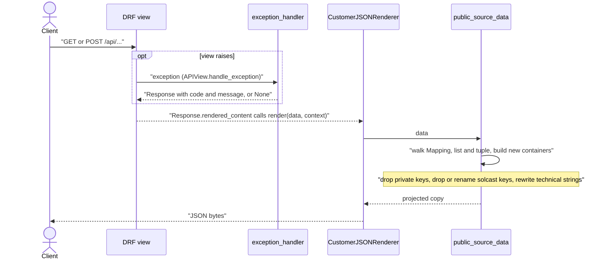

# Hide provider details from customer API responses

Every Django REST Framework (DRF) response of a project view is rendered by `CustomerJSONRenderer`. The renderer first rebuilds the payload with `public_source_data`, which drops private fields, removes or renames provider-named keys and replaces provider names inside technical strings with `null`. Stored rows are never changed; only the bytes sent to the client are.

## Entry points

- `pyracast.api.renderers` `CustomerJSONRenderer.render`: the only production caller. It is the sole entry of `DEFAULT_RENDERER_CLASSES` in `pyracast.settings`, and no project view overrides `renderer_classes`, so it renders every project DRF view, success and error alike (error bodies come from `pyracast.api.errors` `exception_handler`). It applies to every path and ignores the request.
- `pyracast.api.public` `public_source_data`: the recursive projection; called only by the renderer in `src/` and directly by tests.
- Not covered: allauth headless routes under `/api/auth/` including the project overrides (allauth views, not DRF), the social login callbacks, the JSON answers built by `pyracast.api.errors` `error_json` (session lock, session tag and the error handlers), the `JsonResponse` of `pyracast.platform_admin.historical`, the Django admin console, health checks, email and the browser-built CSV.
- Actor: none; it runs for every authenticated or anonymous API caller. No route serves operator data through DRF: the console is Django views, and unlisted `/api/platform/...` and `/api/schema/` paths answer 404.

## Sequence

## Data

| Table | R/W | What |
| --- | --- | --- |
| None | - | Pure in-memory transformation of the response payload. It reads and writes no table, queue or external service. It projects JSON columns that other flows store (`ForecastResult.payload`, `CalibrationRun.dataset_manifest` and `result`) and leaves them untouched. |

## Authorization

- None in this flow. Access control is the view's (`tenant-authorization`); the renderer only shapes what an already authorized caller sees.
- There is no exemption by path or by user: platform administrators receive the same projection on any DRF route. Provider detail for operators lives in the console (`pyracast.platform_admin`, Django templates), which this flow does not touch.

## Failure paths

| Condition | Result |
| --- | --- |
| Private key at any depth (`_PRIVATE_FIELDS`) | Key and value removed, no marker |
| `provider` key whose value is not a string (also `None`), or is `solcast` or `fixture` (case-folded) | Key removed; any other string is kept |
| Key containing `solcast` other than `solcast_ghi_wm2`, `solcast_kwh_m2` | Key removed; those two become `reference_ghi_wm2`, `reference_kwh_m2` |
| String containing `solcast` inside a technical subtree | Whole string equal to `solcast_forecast` or `solcast_estimated_actuals` becomes `forecast` or `estimated_actuals` (under any technical key); a string directly under `quality_flags` gets `reference` for the word; anything else becomes `null` |
| Redacted string | Becomes `null`, not a marker text; a technical string inside a list becomes a `null` item |
| Provider name in an unlisted field outside a technical subtree (for example `label`) | Passes through unchanged |
| Error body | `code` and `message` come from catalogued text; `code` is technical, `message` is not, so catalogued messages pass unchanged |
| View raises an unmapped exception other than `SuspiciousOperation` or `BadRequest` | The handler answers 500 `{code: "server_error", message, request_id}`, which passes through this renderer like any other body |
| Redaction raises inside `render` | Not handled by the exception handler; Django answers 500 (reasoned, not exercised by any test) |

## Rules and invariants

- Denylist, not allowlist: a new field is public until its name is added to `_PRIVATE_FIELDS`, and a string is rewritten only below a key in `_TECHNICAL_FIELDS` (`result`, `dataset_manifest`, `provenance`, `vintage`, `detail`, `code` and others). Matching is on the case-folded key (`str(key)` for integer keys); the walk follows `Mapping`, `list` and `tuple` only and turns tuples into lists. Only the substring `solcast` is detected.
- `technical` is sticky: once inside a technical subtree every descendant string is rewritten. Exempt and copied verbatim, even if they say "Solcast": `name`, `username`, `email`, `recipient` while `technical` is false, and any `source` key whose value is a string (text a customer or operator entered for a production value) at any depth, technical or not.
- Inside a technical subtree user-text keys are rewritten too (`{"result": {"name": "Solcast"}}` yields `null`); `tests/test_public_data.py` pins this.
- The projection builds new dicts and lists; the stored payload stays intact (pinned by `tests/test_public_data.py`). The renderer projects only the bytes, so anything that reads `response.data` (test client, middleware) sees the unredacted value.
- Stored provenance keeps operator detail: below `capacity_normalization`, `reference_capacity_normalization` and `reference_import` only allowlisted fields are delivered (the import's id, hash and time, and a short list of source settings); the rest of those subtrees is dropped before the walk.
- Two keys that map to the same public key (`solcast_ghi_wm2` and `reference_ghi_wm2`) overwrite each other in iteration order.
- `authorized_by_id`, `site_id` and `resource_id` are private. Internal numeric ids such as `binding_id` and `snapshot_id` and the `binding_revision` value are not private (no recorded decision); a test pins `provenance.binding_id` as public.

## Tests

- `tests/test_public_data.py`: user text and production attribution preserved, provider-named `source_kind` values mapped to public names, `quality_flags` rewrite, user text rewritten inside a technical subtree, `provider: None` dropped, the allowlisted provenance subtrees, the renderer giving the same bytes with no request and on any path (built with `APIRequestFactory`), calibration detail over the real API with a check that stored rows are unchanged, credential removal at any depth. Its email test checks `notifications.mail` `build_message`, which does not use this projection.
- `tests/test_public_schema.py`: the generated schema validates and contains no provider name. `tests/test_midnight_forecast_fallback.py` pins `provenance.binding_id` in a public response. `web/tests/public-site.spec.ts` checks marketing pages only.
- Gaps: no test sweeps every customer endpoint for provider names; none for a new unlisted field, for `provider: fixture`, for the key collision, or for deployment under a script prefix; no Playwright test sees a redacted API payload.
