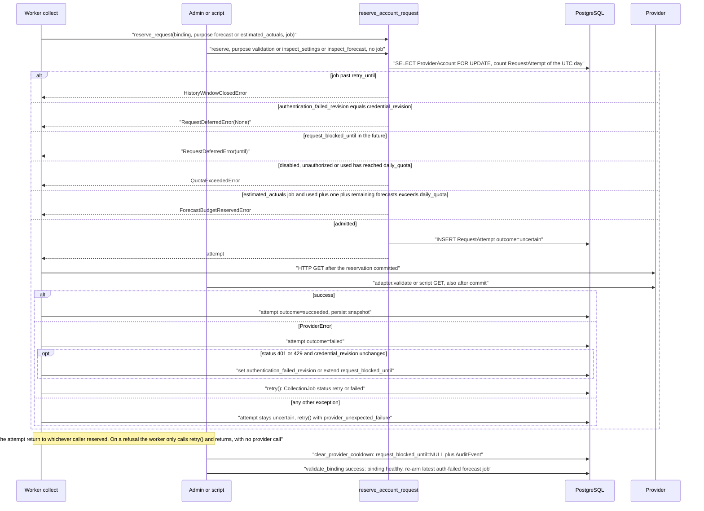

# Provider quota ledger, forecast budget, cooldown and credential blocks

Every Solcast or fixture request made by the collection worker, by connection validation (console or platform API) or by the `check_solcast.py --live` script first reserves one `RequestAttempt` under a row lock on the shared `ProviderAccount`, against that account's UTC-day quota. `estimated_actuals` jobs (night history and the 15-minute job beside each forecast slot) must also leave the requests still needed by scheduled forecasts. A provider 401 blocks the account's current credential revision and a 429 sets an account-wide cooldown; collection jobs then wait, retry or fail, and a platform administrator recovers through key rotation plus validation or an audited cooldown reset. Accounts are shared across tenants, so one account's state affects every site bound to it.

## Entry points

- Worker: Dramatiq actor `collect_forecast` (`src/pyracast/runtime.py` `deliver`, `max_retries=0`) -> `src/pyracast/forecasts/jobs.py` `collect` -> `claim`, `reserve_request`, `record_provider_failure`, `retry`.
- Backoff helpers in `src/pyracast/provider_retry.py`: `rate_limit_retry_after` (Retry-After or 900 s for a 429) and `next_retry_at` (attempt backoff, minimum, Retry-After, 0-30 s jitter, capped at `MAX_RETRY_AT`), called by `record_provider_failure` for the account cooldown and by `retry` in `src/pyracast/forecasts/jobs.py` for `available_at`; `src/pyracast/metering/jobs.py` also uses `next_retry_at`.
- Dispatcher: `manage.py dispatch` -> `src/pyracast/runtime.py` `dispatch` -> `pending_job_ids`, which also returns `provider_throttled` retries whose account has `request_blocked_until IS NULL`.
- Console: `GET|POST /admin/plants/<id>/` (`PlatformAdminSite.plant`) or `/admin/regions/region/<id>/setup/`, both -> `src/pyracast/admin.py` `RegionAdmin.setup`; `action=validate` -> `validate_binding`, `action=clear_cooldown` -> `src/pyracast/connections/recovery.py` `clear_provider_cooldown`. Template `admin/regions/region/setup.html` shows the "Provider request delay" callout only while the cooldown lies in the future.
- Platform API: `POST /api/platform/bindings/<binding_id>/validate/` -> `src/pyracast/api/views.py` `ValidateView` -> `validate_binding` (no caller in `web/src`).
- Script: `scripts/check_solcast.py --live --binding-id N --kind settings|forecast` -> `capture` -> `reserve_account_request` (purpose `inspect_settings` or `inspect_forecast`), `record_provider_failure`.
- Development: `manage.py fixture_demo` (refuses unless `DEBUG`) calls `validate_binding` and `collect` directly on a fixture account.
- Read-only surfaces: `GET /api/tenants/<t>/regions/<r>/collection-schedule/` (`src/pyracast/forecasts/schedule.py` `get_schedule`, `schedule_payload`) rendered by `web/src/components/collection-schedule.tsx`; console health counters and labels in `src/pyracast/forecasts/monitoring.py`, `src/pyracast/admin_health_queries.py`, `src/pyracast/admin_workspace.py`.

## Sequence

## Data

| Table | R/W | What |
|---|---|---|
| `forecasts_requestattempt` | R/W | The ledger: one row per admitted request (`utc_day`, `purpose`, `outcome` uncertain/succeeded/failed, `correlation_id`); counted per account and UTC day. Purge keeps rows and nulls `binding`/`job`. |
| `connections_provideraccount` | R/W | Row lock for every reservation; reads `daily_quota`, `enabled`, `authorized_at`, `credential_revision`; writes `request_blocked_until`, `authentication_failed_revision`. |
| `connections_sitebinding` | R/W | Bindings of the account for the forecast budget; validation writes `health`, `validated_at`, `validated_credential_revision`. |
| `forecasts_collectionjob` | R/W | Budget reads every forecast job of each binding; `claim` and `retry` write `status`, `available_at`, `attempts`, `last_error` and the lease; validation re-arms an auth-failed job. |
| `forecasts_collectionschedule` | R | Enabled flag, local clocks and `effective_from` for future forecast slots in the budget. |
| `regions_region` | R | Approved, not deleted, `approved_binding` for budget eligibility; row-locked by `claim` and by a successful validation. |
| `regions_auditevent` | W | `provider_cooldown_cleared`, `connection_validated`. |

## Authorization

- Worker path has no user: admission relies on `claim` -> `binding_is_current` (approved region at the binding's revision, enabled and authorized account, binding validated at the current credential revision) in `src/pyracast/forecasts/jobs.py`, and `reserve_account_request` rechecks `enabled` and `authorized_at` under the lock.
- Console: `PlatformAdminSite.has_permission` (active staff superuser plus verified MFA) through `admin_view`; `validate_binding` and `clear_provider_cooldown` call `require_admin`. `BindingActionForm.current_binding` rejects stale region or credential revisions; the "provider recovered" checkbox is enforced only by the form.
- Platform API: `PlatformAdmin` permission (active superuser plus verified MFA) and `require_admin` in the operation. `ValidateView` does not check that the binding is the region's current one before the request is spent.
- Script: shell, database and encryption-key access only, gated by the explicit `--live` flag; no application identity and no audit event. `fixture_demo` needs `DEBUG` and an active superuser name.
- Tenants never write this state; members read shared-account usage through `get_schedule` (`require_member`).

## Failure paths

| Condition | Result |
|---|---|
| Worker: `RequestDeferredError(None)` (credential blocked) | Job `failed`, `provider_authentication_failed`; execution attempt refunded |
| Worker: `RequestDeferredError(until)` | Job `retry`, `provider_throttled`, `available_at` = now + max(backoff, time to cooldown end) + 0-30 s jitter; attempt refunded; a history job is `failed` when that reaches `retry_until` |
| Worker: `QuotaExceededError` (quota used, or account disabled or unauthorized) | `quota_exhausted`, attempt refunded; forecast job `retry` at next UTC midnight; history job waits at least until then and is `failed` when that reaches `retry_until` |
| Worker: `ForecastBudgetReservedError` (`estimated_actuals` job) | `history_budget_reserved`, next try no sooner than 30 min; `failed` when that reaches `retry_until`, which is always the case for the 15-minute job |
| `claim` or reservation past `retry_until`, or window closed after reservation | `failed`, `history_window_closed` (the post-reservation case marks the attempt `failed`) |
| Provider 401 | Account blocked for this credential revision; job `failed`, `provider_authentication_failed` |
| Provider 429 | Account cooldown = max(existing, now + max(60 s, Retry-After or 900 s) + 0-30 s jitter); job `retry`, `provider_throttled`; the execution attempt is kept, so the third one fails a forecast job |
| Provider 403, other 3xx/4xx, 501, 505, or invalid payload schema | Attempt `failed`; job `failed`, `provider_failure`; no account state change |
| Provider 408, 425, other 5xx, or `ProviderError` without status (transport, undecodable or unsafe body, invalid site id, undecryptable key) | Attempt `failed`; job `retry`, `provider_failure`; a forecast job waits at least 4 then 8 min and is `failed` after 3 attempts, a history job retries inside its window |
| Any other exception during the provider call | Attempt stays `uncertain` and still counts; job `retry`, `provider_unexpected_failure`; forecast job `failed` after 3 attempts |
| Key rotated, binding not yet validated at the new revision | `claim` marks the dispatched job `stale` (`binding_is_current` fails) without a provider request |
| API validate: credential blocked / throttled / quota | 503 `provider_authentication_failed` / 429 `provider_throttled` with `Retry-After` / 429 `quota_exhausted` |
| API validate: provider error | 502 `provider_unavailable`; attempt `failed`, binding `health=error`, 401 or 429 recorded on the account |
| Validate: Solcast binding without settings reference or installation date | `ValidationError` before any reservation (API 400 `invalid_request`) |
| Validate: region revision or key differs from the binding, checked only after the provider call | `ValidationError` (API 400, console generic error); attempt stays `uncertain` |
| Console validate | HTTP 400 page with form error: "Update the private API key...", "The provider is limiting requests...", "The provider's request budget is unavailable..." or "Connection validation failed..." |
| Console clear cooldown: checkbox missing, changed key or changed delay | HTTP 400 with a field error or "The setup could not be applied..."; a cooldown that is already NULL reports success without an audit event |
| Script | Same kind already attempted today for the binding: `ValueError` before reservation; reservation refusals propagate unchanged; an HTTP, `ValueError` or `ProviderError` failure after reservation marks the attempt `failed` and raises a generic `ProviderError`; an output file write error (`OSError`) propagates unchanged, the attempt stays `uncertain` and the quota and daily guard stay consumed; never retried |

## Rules and invariants

- Lock order: `reserve_account_request` takes only the `ProviderAccount` row lock and counts the ledger inside it, so concurrent workers, validations and scripts serialize on one account budget. The provider HTTP call happens after commit, never inside the lock. Open-Meteo weather calls in the same job are not ledgered.
- Quota day is UTC (`now.astimezone(UTC).date()`), with the caller's `now` advanced by the monotonic time spent waiting for the lock. Every outcome, including `uncertain`, counts against `daily_quota`.
- `daily_quota` 1-10 is enforced only at creation (`create_account`, `AccountInput`, the setup form); there is no database constraint, and no application path changes `daily_quota` or `enabled` afterwards.
- Check order: history deadline, credential block, cooldown, enabled/authorized/quota, forecast budget. `RequestDeferredError` subclasses `QuotaExceededError`, so handlers must test it first.
- Forecast budget (`src/pyracast/forecasts/budget.py` `remaining_forecast_requests`) is enforced only for `estimated_actuals` reservations with a job. It counts distinct (binding, slot) pairs still needing a request this UTC day: pending, retry or running forecast jobs with no attempt today and due before the day ends, plus future schedule slots, across every approved binding of the account that is validated at the current key revision, has a forecast job and no disabled schedule. Forecast, validation and script reservations ignore it.
- Forecast clocks are capped at `daily_quota - 1` (one request kept for night history) per region, not per account.
- `record_provider_failure` acts only on 401 and 429, ignores failures from an older credential revision and never shortens a cooldown. Rotation preserves the cooldown; only `clear_provider_cooldown` sets it to NULL (expiry does not), and that leaves the ledger and the credential block untouched. Nothing resets `authentication_failed_revision`; rotation outdates it.
- A throttled `retry` job is woken early only when `request_blocked_until IS NULL` (`pending_job_ids`, `claim`): after an administrative reset, or when the account never stored a cooldown.
- Admission waits (deferred or quota) refund the job's execution attempt, so they never exhaust the three-attempt forecast limit; a real 429 response does. History jobs have no attempt limit, only `retry_until`.
- Retry-After (`provider_retry.retry_after_seconds`) is read only for 429 and 503, accepts delta seconds or an HTTP date, and is never shortened; an unparseable value counts as absent and extreme hints saturate at `MAX_RETRY_AT`.

## Tests

- `tests/test_quota_clock.py`, `tests/test_jobs.py` (concurrent reservations, quota until next UTC day), `tests/test_domain.py` (UTC reset, validation consumes quota, `uncertain` after a post-network mismatch), `tests/test_provider_identity.py` (canonical accounts share quota), `tests/test_collection_schedule.py` (forecast and history share the atomic quota).
- `tests/test_collection_resilience.py` (shared cooldown, credential block by revision, stale failures, API `Retry-After`, 403, unexpected errors stay `uncertain`), `tests/test_provider_retry.py`, `tests/test_collection_review_regressions.py` (900 s default, cooldown reset wakes the throttled job, validation re-arms auth failure), `tests/test_api.py` (429 and 502 mapping).
- `tests/test_provider_recovery.py` (audited, optimistic cooldown reset through the console), `tests/test_nightly_solcast.py` (forecast budget versus night history), `tests/test_collection_calendar_windows.py` (15-minute job fails on reserved budget), `tests/test_solcast_capture.py`, `tests/test_admin_setup.py`, `tests/test_collection_status.py`, `tests/test_delivery_health.py`, `tests/test_admin_health_queries.py`, `tests/test_trash_operations.py` (ledger kept on purge).
- Playwright: `web/tests/workspace.spec.ts` "region collection schedule validates and saves distinct local times" renders usage counts and the `quota_exhausted` label from a mock only.
- Gaps: no test that validation or `check_solcast` reservations may consume budget reserved for forecasts; no test of several regions on one account overcommitting forecast clocks; no test that three real 429 responses fail a forecast job; no test of `ValidateView` on a superseded binding; no browser test of the console cooldown callout; no budget performance bound with long job history.
