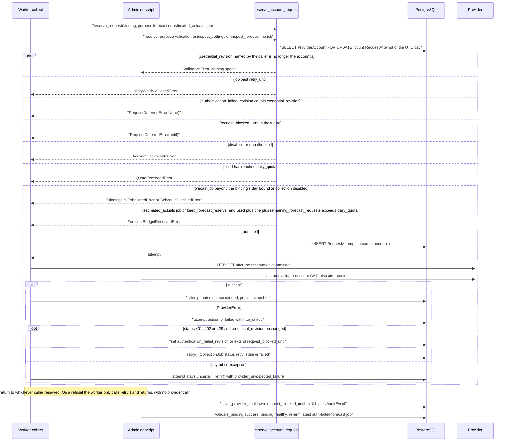

# Provider quota ledger, forecast budget, cooldown and credential blocks

Every Solcast or fixture request made by the collection worker, by connection validation in the console or by the `check_solcast.py --live` script first reserves one `RequestAttempt` under a row lock on the shared `ProviderAccount`, against that account's UTC-day quota. A forecast job must also fit the binding's own day bound, and `estimated_actuals` jobs (night history and the 15-minute job beside each forecast slot) and validations of approved plants (also the automatic revalidation after a key replacement) must leave the requests still needed by the account's forecasts. A provider 401 blocks the account's current credential revision, a 402 or 429 sets an account-wide wait; collection jobs then wait, retry, end or fail, and a platform administrator recovers on the provider account page by replacing the key, after which the plants are revalidated automatically, or by an audited delay reset. Accounts are shared across tenants, so one account's state affects every site bound to it.

## Entry points

- Worker: Dramatiq actor `collect_forecast` (`orchestration.kinds.COLLECTION`, deliver in `src/pyracast/forecasts/runtime.py`, `max_retries=0`) -> `forecasts/jobs/collect.py` `collect` -> `src/pyracast/forecasts/jobs/claim.py` `claim` and `retry`, and `forecasts/quota.py` `reserve_request` and `record_provider_failure`. The three-attempt limit is `background.retry_policy.PROVIDER_JOB`.
- Backoff helpers in `src/pyracast/provider_retry.py`: `rate_limit_retry_after` (Retry-After or 900 s for a 429), `next_retry_at` (attempt backoff, minimum, Retry-After, 0-30 s jitter, capped at `MAX_RETRY_AT`) and `next_provider_day` (UTC midnight plus two minutes), called by `record_provider_failure` for the account wait and by `retry` in `src/pyracast/forecasts/jobs/claim.py` for `available_at`; `src/pyracast/metering/jobs.py` also uses `next_retry_at`.
- Dispatcher: `pyracast dispatch` -> `forecasts/runtime.py` `dispatch_collections` -> `src/pyracast/forecasts/jobs/ready.py` `pending_job_ids`, which also returns `provider_throttled` retries whose account has `request_blocked_until IS NULL`.
- Console: `GET|POST /admin/plants/<region_id>/` (`pyracast.platform_admin.plant_review.plant`); `action=validate` -> `validate` -> `forecasts/validation.py` `validate_binding`. Template `src/pyracast/regions/templates/admin/regions/region/setup.html` shows the "Provider request delay" callout only while the wait lies in the future and links the provider account page. `POST /admin/provider-accounts/<id>/delay/` -> `pyracast.platform_admin.provider_accounts.delay_clearance` -> `src/pyracast/connections/recovery.py` `clear_provider_cooldown`; key replacement and revalidation are flow `provider-credential-recovery`. Account creation is the console setup action (`connections.setup.save_provider_setup`, `connections.operations.create_account`).
- Revalidation: actor `revalidate_provider_account` (`forecasts/revalidation.py` `revalidate_account`) calls `validate_binding` per approved plant awaiting revalidation.
- Script: `scripts/check_solcast.py --live --binding-id N --kind settings|forecast` -> `capture` -> `reserve_account_request` (purpose `inspect_settings` or `inspect_forecast`), `record_provider_failure`.
- Development: `manage.py fixture_demo` (refuses unless `DEBUG`) calls `validate_binding` and `collect` directly on a fixture account.
- Read-only surfaces: the plant's own requests of the UTC day in `GET /api/tenants/<t>/regions/<r>/collection-schedule/` (`schedule_payload`, flow `collection-schedule`); account-level usage, waits and blocks only in the console (the provider account pages with the UTC day's ledger and the requests still needed, `orchestration/delivery_health.py` `check` rendered by `platform_admin/health.py`, and the read-only request attempt records).

## Sequence

## Data

| Table | R/W | What |
|---|---|---|
| `forecasts_requestattempt` | R/W | The ledger: one row per admitted request (`utc_day`, `purpose`, `outcome` uncertain/succeeded/failed, the provider's `http_status`, `correlation_id`); counted per account and UTC day. `purpose` is `RequestPurpose` (`requestattempt_purpose_chk`). Purge keeps rows and nulls `binding`/`job`. |
| `connections_provideraccount` | R/W | Row lock for every reservation; reads `daily_quota`, `enabled`, `authorized_at`, `credential_revision`; writes `request_blocked_until`, `authentication_failed_revision`. The database refuses a quota outside 1..10 (`provideraccount_daily_quota_chk`) and a failed revision the account never had. |
| `connections_sitebinding` | R/W | Bindings of the account for the forecast budget; validation writes `health`, `validated_at`, `validated_credential_revision`. |
| `forecasts_collectionjob`, `forecasts_forecastsnapshot` | R/W | The budget reads the open jobs of each binding, its forecast jobs of the UTC day and whether a job's answer is stored; `claim` and `retry` write `status`, `available_at`, `attempts`, `last_error` and the lease; validation re-arms an auth-failed job. |
| `forecasts_collectionschedule` | R | Enabled flag, local clocks and `effective_from` through `forecast_timing`: the day bound and future forecast slots in the budget. |
| `regions_region` | R | Approved, not deleted, `approved_binding` for budget eligibility; row-locked by `claim` and by validation. |
| `regions_auditevent` | W | `provider_cooldown_cleared`, `connection_validated`, `connection_validation_failed`. |

## Authorization

- Worker path has no user: admission relies on `claim` -> `binding_is_current` (approved region at the binding's revision, enabled and authorized account, binding validated at the current credential revision; `connections/currency.py`), and `reserve_account_request` rechecks `enabled` and `authorized_at` under the lock.
- Console: `PlatformAdminSite.has_permission` (active staff superuser plus verified MFA); every unsafe request also needs a recent confirmation with the authenticator (`admin_view`). `validate_binding` and `clear_provider_cooldown` call `require_platform_admin`. `BindingActionForm.current_binding` rejects stale region or credential revisions; the validate form also names the validation it saw, so a repeated submit spends no second request. The "provider recovered" checkbox is enforced only by the form.
- Script: shell, database and encryption-key access only, gated by the explicit `--live` flag; no application identity and no audit event. `fixture_demo` needs `DEBUG` and an active staff superuser name.
- Tenants never write this state; members read only the plant's own request count through the schedule read (member route of `RoutePolicy`).

## Failure paths

| Condition | Result |
|---|---|
| Worker: `RequestDeferredError(None)` (credential blocked) | Job `failed`, `provider_authentication_failed`; attempt returned |
| Worker: `RequestDeferredError(until)` | Job `retry`, `provider_throttled`, `available_at` = now + max(backoff, time to the wait's end) + 0-30 s jitter; attempt returned; a windowed job is `failed` when that reaches `retry_until` |
| Worker: account disabled or unauthorized, or quota used | `account_unavailable` or `quota_exhausted`, attempt returned; the job waits for the next provider day (UTC midnight plus two minutes), a windowed job is `stale` when that reaches `retry_until` |
| Worker: forecast job whose slot day's bound is full, or collection disabled after the claim | Job `stale`, `quota_exhausted` or `schedule_disabled`; attempt returned |
| Worker: a UTC day holding one slot of a plant more than it has clocks (a daylight-saving change moves a late clock across UTC midnight) | The bound admits as many as there are clocks; the day's last slot is skipped as above and holds no room in the reserve |
| Worker: `ForecastBudgetReservedError` (`estimated_actuals` job) | `history_budget_reserved`, attempt returned, next try no sooner than 30 min; `stale` when that reaches `retry_until`, which is always the case for the 15-minute job |
| `claim` or reservation past `retry_until`, or window closed after reservation | `failed`, `history_window_closed` (the post-reservation case marks the attempt `failed`) |
| Provider 401 | Account blocked for this credential revision; job `failed`, `provider_authentication_failed` |
| Provider 402 | Account blocked until the next provider day; job `retry`, `provider_allowance_exhausted` at that moment, attempt returned; a windowed job is `stale` when that reaches `retry_until` |
| Provider 429 | Account wait = max(existing, now + max(60 s, Retry-After or 900 s) + 0-30 s jitter); job `retry`, `provider_throttled`; the execution attempt is kept, so the third one fails a forecast job |
| Provider 403 or 404, other 3xx/4xx, 501, 505, or an invalid, oversized or key-echoing answer | Attempt `failed`; job `failed`, `provider_access_denied`, `provider_site_not_found`, `provider_failure`, `provider_server_error` or `provider_invalid_response`; no account state change, no second request |
| Provider 408, 425, other 5xx, transport error, non-JSON body, or a body not complete within 30 s | Attempt `failed`; job `retry`, `provider_failure`, `provider_server_error`, `provider_unreachable` or `provider_invalid_response`; a forecast job waits at least 4 then 8 min and is `failed` after 3 attempts, a history job retries inside its window |
| Any other exception during the provider call | Attempt stays `uncertain` and still counts; job `retry`, `provider_unexpected_failure`; forecast job `failed` after 3 attempts |
| Key replaced, binding not yet validated at the new revision | `claim` marks the dispatched job `stale` (`binding_not_current`) without a provider request |
| Validate an approved plant whose request the forecasts still need | `ForecastBudgetReservedError`, no attempt; the console shows "The provider's request budget is unavailable..."; a revalidation run tries the later plants and is due again after the account's next slot (`provider-credential-recovery`) |
| Validate: Solcast binding without settings reference or installation date | `ValidationError` before any reservation; the console shows its generic setup error |
| Validate: region revision differs from the binding | `ConflictError` "no longer current" before any reservation |
| Validate: an unanswered validation attempt younger than a minute exists | `ConflictError`, no request |
| Validate: region or key changed during the provider call | `ValidationError`; the attempt stays `succeeded` and the binding unchanged |
| Validate: provider error | Attempt `failed` with its status, binding `health=error` unless the provider was only unreachable or failing, `connection_validation_failed` audit event, 401/402/429 recorded on the account |
| Console validate | HTTP 400 page with form error: "Update the private API key...", "The provider is limiting requests...", "The provider's request budget is unavailable..." or a cause-specific message (rejected key, no site found, unreadable answer, unreachable, provider error, refused request) |
| Provider account page, clear wait: checkbox missing, changed key or changed delay | HTTP 400 with a field error or the conflict message; a wait that is already NULL reports "There is no provider wait to clear" without an audit event |
| Script | Same kind already attempted today for the binding: `ValueError` before reservation; reservation refusals propagate unchanged; an HTTP, `ValueError` or `ProviderError` failure after reservation marks the attempt `failed` and raises a generic `ProviderError`; an output file write error (`OSError`) propagates unchanged, the attempt stays `uncertain` and the quota and daily guard stay consumed; never retried |

## Rules and invariants

- Lock order: `reserve_account_request` takes only the `ProviderAccount` row lock and counts the ledger inside it, so concurrent workers, validations and scripts serialize on one account budget; `validate_binding` holds the Region row while it reserves. The provider HTTP call happens after commit, never inside the lock.
- Quota day is UTC (`now.astimezone(UTC).date()`), with the caller's `now` advanced by the monotonic time spent waiting for the lock. Every outcome, including `uncertain`, counts against `daily_quota`.
- `daily_quota` 1-10 is enforced at creation (`create_account`, the console setup form) and by the database; no application path changes `daily_quota` or `enabled` afterwards. An unsupported purpose raises `ValidationError` before the lock.
- Check order: the caller's key revision, history deadline, credential block, wait, enabled/authorized, quota, then the forecast day bound or the forecast reserve.
- Day bound (`quota._admit_forecast`): a binding sends at most as many forecast jobs of a UTC day's slots as it has clocks, however often they are edited (`budget.forecast_starts`, `budget.slot_day`); a job's retries and the approval job are free, and the bound reads the quota of the locked account. A job counts against its slot's UTC day whenever it is sent, so one first sent on a later day (refused for the used-up quota and sent at 00:02 UTC, held by a wait, or reopened by a validation) takes no start from that day's own slots: on that day the plant sends one forecast more than its clocks, and the account quota and the forecast reserve count it on the day it is sent.
- A fully booked day: a forecast's retries are free against the day bound and limited only by the quota, so a provider failure on a day whose requests are all spoken for costs one forecast of that day: the failed one when it was the day's last request, otherwise its retry runs first and the day's last forecast is refused for the used-up quota. A refused job waits for the next provider day and is sent then unless a later slot of its plant came first; every later slot is still sent at its clock.
- Forecast reserve (`forecasts/budget.py` `remaining_forecast_requests`) is kept by `estimated_actuals` reservations with a job and by reservations with `keep_forecast_reserve`, which `validate_binding` sets for an approved plant; a pending plant's validation, forecast and script reservations ignore it. It sums `forecast_need` over every approved plant of the account that collects now or once revalidated (`budget.approved_bindings`), counting the requests claim still sends in the UTC day: an open forecast job unless its answer is stored, or a worker holds its lease and that lease's request is in flight or answered; any other open job only when claim takes it before the day ends (`jobs.claim.claimable_from`, so a throttled retry whose account wait was cleared counts), it is not older than the due slot, has attempts left (`jobs.claim.attempts_used_up`) and, under a saved schedule, lies on the schedule (`timing.on_the_schedule`, shared with claim). It adds the slots still to come, the due slot the scheduler opens again unless its job's answer is stored, and the latest job refused for the key that a validation would reopen (`timing.armed_again_by_validation`). Each of these not sent yet needs a start of its slot's UTC day, also when that day has passed, capped at the starts that day's bound still admits (`budget.forecast_need`); a plant without a first forecast job or with a disabled schedule needs nothing. It adds one validation request for each plant awaiting revalidation. Validating such a plant counts only the forecasts of the plants that collect now, of the waiting plants whose validation is in flight (`budget.validations_in_flight`) and of that plant. The provider account page shows the account-wide number as "Still needed by forecasts and revalidations today".
- A validation stays in flight for `budget.VALIDATION_IN_FLIGHT` (the provider request deadline plus two lock waits, 60 s). An answer committed later checks the reserve again under the account lock and, when the room is gone, leaves the plant unvalidated and raises `ForecastBudgetReservedError`; its request stays counted.
- A successful validation reopens the plant's latest forecast job refused for the key (`validation._rearm_after_validation`, by the locked account's quota) only when the plant awaited it (not validated with the account's key, or that key recorded as rejected: `timing.awaits_validation`) and the schedule in force still collects the job (not older than its `effective_from` or the due slot, at one of its clocks or the approval job). With collection disabled nothing is reopened; validating a plant already validated with the current key leaves that job ended.
- Forecast clocks are capped at `daily_quota - 1` (one request kept for night history) per region, not per account.
- `record_provider_failure` acts only on 401, 402 and 429, ignores failures from an older credential revision and never shortens a wait. Key replacement preserves the wait; only `clear_provider_cooldown` sets it to NULL (expiry does not, but `deferral` ignores a wait in the past), and that leaves the ledger and the credential block untouched. Nothing resets `authentication_failed_revision`; a key replacement outdates it.
- A throttled `retry` job is woken early only when `request_blocked_until IS NULL` (`jobs.ready.cleared_cooldown`, used by `pending_job_ids` and `claim`): after an administrative reset, or when the account never stored a wait.
- Waits, refusals and skips return the job's execution attempt, so they never exhaust the three-attempt forecast limit; a real 429 response does. History jobs have no attempt limit, only `retry_until`.
- Retry-After (`provider_retry.retry_after_seconds`) is read only for 429 and 503, accepts delta seconds or an HTTP date, and is never shortened; an unparseable value counts as absent and extreme hints saturate at `MAX_RETRY_AT`.

## Tests

- `tests/test_quota_clock.py`, `tests/test_jobs.py` (concurrent reservations, quota until next UTC day), `tests/test_domain.py` (UTC reset, validation consumes quota), `tests/test_provider_identity.py` (canonical accounts share quota), `tests/test_provider_account_invariants.py` (quota and credential state), `tests/test_collection_schedule.py` (forecast and history share the atomic quota), `tests/test_collection_timing.py` (day bound per slot day, a carried job, a day with one slot more than its clocks, the reserve against a reference model in `tests/support/budget_reference.py`).
- `tests/test_collection_failures.py` (one outcome per answer, 402 block, three 429 answers end a forecast job, lock timeouts), `tests/test_collection_resilience.py` (shared wait, credential block by revision, unexpected errors stay `uncertain`), `tests/test_provider_retry.py`, `tests/test_collection_review_regressions.py` (900 s default, wait reset wakes the throttled job, validation re-arms auth failure), `tests/test_validation_audit.py`, `tests/test_validation_feedback.py` (cause-specific messages).
- `tests/test_provider_recovery.py` (audited, optimistic wait reset through the console), `tests/test_console_step_up.py` (recent confirmation), `tests/test_nightly_solcast.py` (forecast budget versus night history), `tests/test_collection_calendar_windows.py` (15-minute job fails on reserved budget), `tests/test_provider_revalidation_reserve.py` and `tests/test_revalidation_simulation.py` (validations keep the forecast reserve), `tests/test_provider_accounts.py` (account page numbers), `tests/test_solcast_capture.py`, `tests/test_admin_setup.py`, `tests/test_collection_status.py`, `tests/test_delivery_health.py`, `tests/test_admin_health_queries.py`, `tests/test_trash_operations.py` (ledger kept on purge).
- Playwright: `web/tests/workspace.spec.ts` "region collection schedule validates and saves distinct local times" asserts that no account counters render, from a mock only.
- Gaps: no test that `check_solcast` reservations may consume budget reserved for forecasts; no test of several regions on one account overcommitting forecast clocks; no browser test of the console wait callout; no budget performance bound with long job history.
