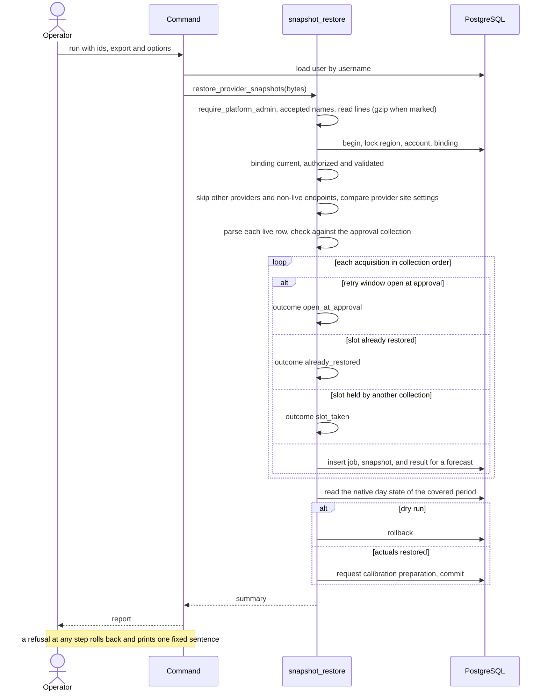

# Restore live provider snapshots from a reset export

After a database reset (`database-reset-and-restore`) a platform administrator runs `restore_provider_snapshots` to read the Solcast export of the erased database back into the plant's recreated binding. Each live forecast and estimated-actuals snapshot becomes a native, succeeded collection of that binding, with its acquisition, availability and job fields as they were, because the provider's endpoint reaches back only seven days. A dry run reports the outcome and rolls back; a repeated run adds nothing.

## Entry points

- Command `restore_provider_snapshots` (`uv run --locked pyracast restore_provider_snapshots`), `pyracast.forecasts.management.commands.restore_provider_snapshots.Command`. Options `--username`, `--tenant-id`, `--region-id`, `--binding-id` and `--export` (a path, or `-` for standard input; plain or gzip JSON lines), all required; `--dry-run`; `--accept-recorded-difference installation_date`, repeatable. It calls `pyracast.forecasts.snapshot_restore.restore_provider_snapshots`.
- The export is produced by `deploy/reset_database.py prepare`; the procedure is in `docs/DEPLOYMENT.md`. No HTTP endpoint, screen, worker job or schedule. A restored actuals row asks for calibration preparation, which the `calibration` dispatcher phase completes (`plants.preparation`).

## Sequence

## Data

| Table | R/W | What |
| --- | --- | --- |
| `auth_user` | R | Actor looked up by the command; the operation requires an active staff superuser |
| `regions_region` | R, lock | Tenant-scoped, non-trashed region; locked first |
| `connections_provideraccount`, `connections_sitebinding` | R, lock | The binding must belong to the region and pass `_validate_authorized_binding`; its settings are compared with the export's |
| `forecasts_collectionjob` | R/W | Read for the binding's approval collection (`timing.approval_job`) and for taken slots; one `succeeded` job per restored row with the exported slot, target date, availability, retry bound, attempts and last error; id, binding and creation time are not taken |
| `forecasts_forecastsnapshot` | R/W | One snapshot per restored row with the exported acquisition (`raw_payload` plus a `snapshot_restore` record, intervals, coverage, availability, weather payload); read for the day report |
| `forecasts_forecastresult` | W | Forecast rows only: payload and `daily_payloads` calculated for the binding, `published_at` = the snapshot's availability |
| `plants_plant` | W | `calibration_preparation_due_at` of the region's configured plants after estimated actuals were restored |

## Authorization

- Command: the user must exist; the operation calls `require_platform_admin` (active staff superuser) before any other work. No tenant role: platform administrators bypass workspaces. The region is fetched by id and `tenant_id`, the binding by id and region.
- Binding: `binding_is_current`, a Solcast account with authorization reference and authorizer, validated, capacity semantics verified, AC power basis and a settings verification reference.
- Only `installation_date`, a setting the binding merely records, can be accepted as different; every other difference refuses the run.
- The report and refusals name lines, fields and counts, never a site id, path or export value; no audit event is written, the provenance lives on each restored snapshot.

## Failure paths

| Condition | Result |
| --- | --- |
| Unknown user, region or binding of the tenant, non-administrator, unreadable export file | `CommandError` "Provider snapshot restore failed: ..." with a fixed sentence |
| Export not readable gzip, or a line that is not a provider snapshot | Refusal naming the line |
| Binding not current, authorized and validated, or without its approval collection | Refusal, nothing written |
| A live row that is not a restorable acquisition (kind not matching its endpoint, collected in the future, invalid interval, bad weather payload) or holds no succeeded live job | Refusal naming the line and the field, whole run rolled back |
| A restored slot at or after the binding's approval collection | Refusal naming the line |
| A provider site setting differs and is not accepted, or an accepted setting does not differ or is missing in a row, or a non-recorded setting is accepted | Refusal naming the settings, nothing written |
| A restored forecast cannot be calculated | Refusal naming the line, whole run rolled back |
| Row of another provider, or of an endpoint that is no live collection (import, scaled copy) | Skipped and counted; imports and scaled copies are restored by importing the source file and normalizing again |
| Retry window open at approval, slot already restored, slot held by another collection | Skipped and counted per endpoint; the held collection is kept |
| Lock timeout, deadlock or any other error | `CommandError` "failed unexpectedly: <type> at <origin>"; rolled back |

## Rules and invariants

- Lock order is region, provider account, then binding; the same as `historical_import`. Concurrent runs serialize on the region lock, and the binding's unique collection slot (`collectionjob_binding_endpoint_scheduled_for_uniq`) stores each snapshot once.
- A restored acquisition is identified by its endpoint and job slot, not by the exported snapshot id, which restarts with each database. A row already restored carries the `snapshot_restore` record; a later reset keeps the earlier record under `previous`.
- Rows are stored in order of collection time and snapshot id. Restored jobs lie before the binding's approval collection, so the binding's own schedule starts at its approval collection (`forecast_timing`): restoring creates no backfill, leaves the approval acquisition to run and does not hold reminders back. A retry window still open at approval stays with the binding's own schedule, because the scheduler's nightly lookup would take a restored job of it for tonight's collection.
- The acquisition is stored exactly as exported, including missing power; only `weather_error` is not carried. A forecast's result is calculated again for the binding and published at the snapshot's availability; no plant issuance is created. Restoring does not call the provider and writes no `RequestAttempt`.
- The summary names per endpoint what was restored or skipped and why, the covered period, accepted differences with both values, and per local day of the actuals whether native estimated actuals are complete, partial or missing (`select_archived_actual_source`).
- A dry run does everything under the locks, rolls back and requests no preparation.

## Tests

- `tests/test_provider_snapshot_restore.py`: native actuals beside the import, the stored acquisition and job fields, admission at the slot, the approval acquisition and the scheduler after a restore, retry windows open at approval, refusals by line and field, repeated and concurrent runs, dry run, skipped rows, accepted differences, binding and authority boundaries, the day report, calibration preparation after commit, and the command's output (standard input, fixed refusal sentences, unexpected failure by type and origin).
- Related: `tests/test_deployment_reset.py` (the export). No Playwright: no UI.
