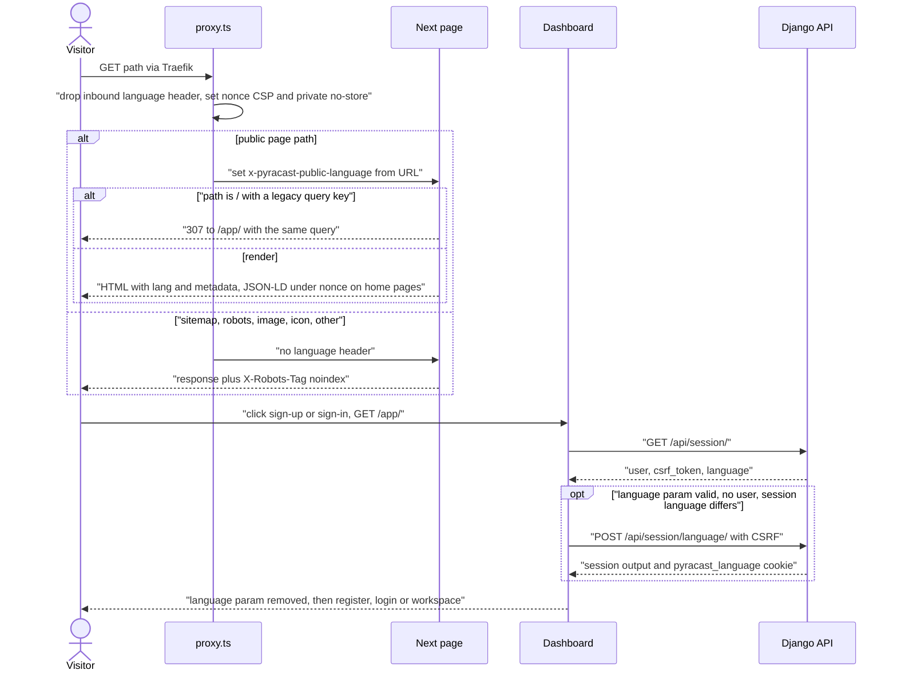

# Browse the public marketing and legal site

An anonymous visitor or a crawler requests the bilingual product, privacy or terms page, or a discovery route (sitemap,
robots, social image, icon). Next.js renders them on the server with no API call and no database access. The outcome is
a readable page or file whose calls to action hand off to the private application at `/app/`.

## Entry points

- Pages: `web/src/app/page.tsx` (`/`) and `tr/page.tsx` render `WebsiteData` and `HomePage`; `privacy/page.tsx`,
  `terms/page.tsx` and their `tr/` twins render `LegalPage` with `legalCopy(language, kind)`. All wrap `SiteShell`.
- Discovery: `sitemap.ts`, `robots.ts`, `opengraph-image.tsx`, `tr/opengraph-image.tsx` (`createSocialImage`), `icon.svg`.
- Legacy links: `/` with any query key `token`, `next`, `social_callback`, `account` or `workspace`. Handoff:
  `/app/?signup=1&language=<lang>` (sign-up) and `/app/?language=<lang>` (header sign-in) for `Dashboard`; `Auth` links
  back. Traefik router `frontend` takes every path not in `backend` (`/api`, `/admin`, `/static/`, `/health/`).

## Sequence

## Data

| Table | R/W | What |
| --- | --- | --- |
| None | - | Public pages: no API call, table or job; copy lives in `home-copy.ts`, `legal-copy.ts`, `public-metadata.ts`. |
| `accounts_userlanguagepreference` | W | Only on a signed-in language POST, which `Dashboard` never sends. |

## Authorization

- None by design: every public page is anonymous and indexable (`robots: index, follow` in `publicMetadata`).
- `web/src/proxy.ts` is not a gate: six exact paths (one trailing slash stripped) count as public, every other matched
  path gets `X-Robots-Tag: noindex, nofollow`. It deletes a client-sent `x-pyracast-public-language` before setting its
  own, so `i18n/request.ts` can prefer that header over the `pyracast_language` cookie.
- Handoff: `SessionLanguageView` is `AllowAny` with `csrf_protect`; a `ChoiceField` rejects other languages.

## Failure paths

| Condition | Result |
| --- | --- |
| `/` has a legacy query key | 307 to `/app/?<same query>`, repeated keys kept; backend now emits `/app/` links |
| `/tr/` has the same keys | No redirect; Turkish home renders, query ignored |
| Unknown path (for example `/tr/foo/`) | Default 404 with `X-Robots-Tag: noindex, nofollow`, locale from cookie |
| No trailing slash (`/privacy`) | 200, no redirect (`skipTrailingSlashRedirect`); canonical names `/privacy/` |
| `language` param not `en` or `tr` | Ignored and kept in the URL; the form shows at once |
| Session GET or language POST fails | Error with retry before any form shows; app code, not site code |

## Rules and invariants

- A new page needs `PublicPage` and `descriptions`, the `sitemap.ts` list and the `proxy.ts` list (else `noindex`).
- Sitemap, robots and JSON-LD use the literal `siteOrigin` (`https://pyracast.app`); canonical and hreflang are relative
  paths resolved against a second literal, `metadataBase` in `layout.tsx`. Public paths end in `/`.
- HTML renders per request (`getLocale`; `headers()` nonce on home); proxy sets `private, no-store` (dev shows `no-store`).
- Operator name and address come only from `operatorDetails` in `legal-copy.ts`; the contact email is also a literal in
  `legal-page.tsx` and `site-shell.tsx`, and each of the four documents has its own "updated" literal.

## Tests

- `web/tests/public-site.spec.ts`: per page, no-JS render at 320px with spoofed header and cookie, status, no
  `X-Robots-Tag`, CSP, title, `lang`, canonical, hreflang, og/twitter image, robots meta, no `/api/` call, language
  switch, home JSON-LD; axe on three pages; 200% text; sitemap, robots, `/app/` noindex, image size; 307 redirect.
- `web/tests/localization.spec.ts` (guest language first, retry, no write when signed in or matching; auth links),
  `auth-registration.spec.ts` (sign-up public links), `tests/test_language.py` (CSRF, anonymous cookie).
- Gaps: `/tr/` legacy keys, HTML cache, discovery noindex, legal dates, header link, list sync, no-slash URLs.
