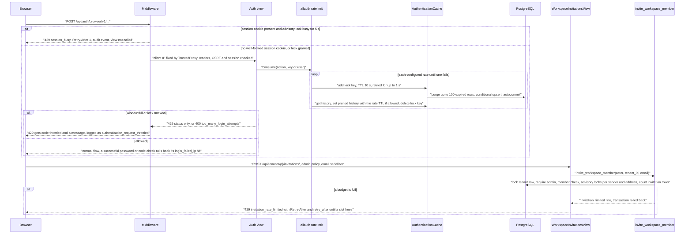

# Rate limiting and the database-backed authentication cache

Every anonymous or signed-in caller of the allauth browser API (login, signup, password reset, email verification and change, MFA codes, reauthentication, device list) is counted by allauth's rate limiter, whose state lives in a PostgreSQL table behind a custom Django cache. A workspace administrator inviting members is limited separately, by counting invitation rows. Customer API routes carry per-route DRF throttles counted in process memory, and the gateway limits each client by rate and concurrency. An exhausted limit answers 429 (or a form error), and any 429 under `/api/auth/` is logged as a security event.

## Entry points

- Screens: `features/auth` (`web/src/features/auth/steps/submit.ts`, `web/src/features/auth/steps/resend-code.tsx`) through `authRequest` in `web/src/lib/auth-api.ts` to `/api/auth/browser/v1/...`; invitations and every other screen through the typed client in `web/src/lib/api/lane.ts`. A 429 from a sign-in or sign-up step shows a wait message, a pending code step a "limited" refusal and the resend a wait timer; other screens show the server message.
- Limited auth views (`pyracast.accounts.auth_urls`): `pyracast.accounts.headless` `LoginView`, `RequestPasswordResetView`, `ResetPasswordView`, `ChangePasswordView`, `ReauthenticateView`, `RequestReauthenticationCodeView`, `ResendEmailVerificationCodeView` and `ManageEmailView` (`request_email_change`, plus allauth's `manage_email`); `pyracast.accounts.signup.CompanySignupView`; `pyracast.accounts.social_views.ProviderSignupView` (explicit `consume_or_429` on a POST with a pending provider signup); `pyracast.accounts.mfa_views` `AuthenticateView`, `ReauthenticateView` and `ManageTOTPView`; `pyracast.accounts.devices.SessionsView` (`manage_sessions`, GET included). `pyracast.accounts.login_limits` reserves the failure slots: per IP and per address for passwords (`AccountAdapter.pre_authenticate`, `authenticate`, `authentication_failed`), per IP and per user for second-factor codes (`SecondFactorInput`, `SecondFactorReauthenticateInput`, also the console confirmation) and per user for TOTP enrolment codes (`TOTPActivationInput`), in place of allauth's per-user code limiter.
- Customer API: `pyracast.api.throttling.RouteThrottle`, the default throttle class, takes its scope from the route's `Policy` in `ROUTE_POLICIES` (`api/permissions.py`) and its rate from `DEFAULT_THROTTLE_RATES`. It counts in the process-local `throttle` cache, keyed by user id, or by client address for a signed-out caller (scope `invitation` also limits the invitation preview), and runs only after the policy admits the request.
- Invitations: `POST /api/tenants/{t}/invitations/` -> `pyracast.api.workspaces.WorkspaceInvitationsView.post` -> `pyracast.accounts.invitations.invite_workspace_member` (also used by resend), which counts invitation rows in `_check_budgets` and raises a 429 `DomainError`.
- `pyracast.accounts.cache.AuthenticationCache`: `CACHES["default"]`, backed by `DATABASES["auth_cache"]` (a second autocommit connection to the same database) and table `pyracast_authentication_cache`. `pyracast.api.middleware.PrivateAPIResponses` logs `authentication_request_throttled`; `SessionRequestSerialization` is the other source of a 429 there. Limits come from `settings.ACCOUNT_RATE_LIMITS`, merged over allauth's defaults.
- Gateway: `deploy/routes.yml` applies `client-rate`, `client-in-flight` and, on `/api/auth/`, `authentication-rate` per client address (IPv6 by /64); its 429 answers are Traefik's plain bodies.
- Worker: `pyracast.notifications.outbox` sends the anonymous account mails (`ANONYMOUS_MAIL`) within one budget of 20 an hour.

## Sequence

## Data

| Table | R/W | What |
| --- | --- | --- |
| `pyracast_authentication_cache` | R/W | Timestamp lists per limiter key, 10 s lock rows, finished-failure markers, allauth's used TOTP-code markers, verified provider logins until taken once; `expires` is checked against `clock_timestamp()`, NULL never expires |
| `accounts_workspaceinvitation` | R | `created_at` counts of all rows (any state) per budget; the supersede update and insert belong to `member-invitation` |
| `notifications_outboundmail` | R/W | Daily-lock notice of an attempted address, stored through the `auth_cache` connection under an advisory lock; the anonymous-mail budget counts `transmit_started_at` of `ANONYMOUS_MAIL` rows |
| `accounts_tenant`, `accounts_membership`, `auth_user` | R | Tenant row `FOR UPDATE` in `authorize_workspace_admin` serializes concurrent invitations; membership gives the administrator check and, joined to `auth_user.email`, the existing-member check |

## Authorization

- Keys: client IP (IPv6 by /64), a hash of the lowercased email (`reset_password`, `confirm_email`), of `<site domain>:<email>` (`login_failed`) or of `mfa-auth-user-<pk>`, or the user id (`change_password`, `request_email_change`, `manage_sessions`, `reauthenticate`); `login_failed_ip` is per IP only. A signed-in client posting to `auth/login` gets 409 before allauth's view runs, so it consumes no limit.
- The client IP is written by `TrustedProxyHeaders` into `X-Pyracast-Client-IP` only from a trusted gateway's headers and read by `AccountAdapter.get_client_ip`. Headers that cannot be verified from a trusted gateway are refused earlier (403 `invalid_proxy_headers`); an unparsable address is a 403 `permission_denied`.
- Route throttles and invitation budgets run only for callers the access policy or `authorize_workspace_admin` admitted, so only administrators consume the invitation limit.

## Failure paths

| Condition | Result |
| --- | --- |
| `login` 20/min per IP, `signup` 5/h per IP (password and social share it), `reset_password` 5/h per IP or 3/h per email, `reset_password_from_key` 10/h per IP, `confirm_email` 1 per min and 6 per hour per address on resend or email change, `change_password` 5 per 10 min per user, `request_email_change` 3/10 min and 10/day per user and 20/h per IP, `manage_sessions` 30/min per user, allauth per-user defaults | 429 with allauth's `status`, plus `code: throttled` and a localized message, no `retry_after`; the web client maps it to a wait message per screen |
| `login_failed` 5 per 10 min or 100 per day per email or MFA code key, or `login_failed_ip` 10 failures per 10 min per IP; correct password for an unverified address within a minute of the last code | 400 with allauth code `too_many_login_attempts` (`rate_limited` when enrolling TOTP); a refused password login logs `login_locked` (client IP, keyed subject, no address), a locked code check `second_factor_locked`; a password reset lifts an address's daily lock |
| Customer API scope: `forecast` 60/min, `calibration` 20/h, `production_import` 120/h, `submission` 30/h, `invitation` 60/h | 429 `throttled` with `Retry-After`; logged as `api_throttled` with the scope |
| Session lock busy for 5 s | 429 `session_busy`, `Retry-After: 1`, same audit event |
| Invitation budgets: 20 an hour per workspace, 1 a minute per address and workspace (a failed or uncertain delivery may be reissued at once), 50 a day per sender, 3 a day per address, 1 workspace a day per address | 429 `invitation_rate_limited` "Too many invitations were sent. Try again later." with the real `retry_after` of the longest wait; logged as `invitation_limited` with the budget as reason |
| Gateway per-client rate, in-flight or `/api/auth/` budget exceeded | 429 from the gateway, not the application |
| Cache database error, or `auth_cache` inside a transaction | Exception, HTTP 500 (`ImproperlyConfigured` for the latter) |
| Invitation by non-admin, invalid email or existing member | 403 / 400 before a budget is checked |

## Rules and invariants

- The cache connection must be in autocommit, so application rollbacks never reset limits or used TOTP codes. `add` has exactly one winner (`ON CONFLICT ... WHERE NOT add OR expired`), which is allauth's lock primitive; a lock not won within 1 s counts as limited (fail closed).
- Expired rows are deleted only by writes, at most 100 per write (`SKIP LOCKED`); reads never purge, and `clear()` wipes limits and code markers alike.
- Unlisted allauth actions keep their defaults (`manage_email` 10/min and `reauthenticate` 10/min per user, `request_login_code` for the code reauthentication). GET requests are not limited, except `manage_sessions` and `confirm_email`.
- A password check reserves its failure slots before it runs: `login_failed_ip`, then the address's `login_failed`, rolled back on success. Only finished failures count toward the daily lock, so a reservation that never finished stops counting after 90 s, and a refused attempt keeps none of the slots it took (allauth's consume keeps the 10-minute hit when the daily rate refuses, so the project consumes each rate itself). Concurrent requests from one IP never run more than 10 failing checks per window.
- `login_failed` has only per-key rates because allauth's `clear` wipes every rate of an action, IP rates included. A completed MFA check clears its `mfa-auth-user-<pk>` key and a password reset the keys of the user's addresses; neither touches `login_failed_ip`, which only expires. Every second-factor code check reserves a client slot, except TOTP enrolment; the console confirmation shares these limits. A correct password of an inactive user or of staff without TOTP is refused inside `AuthenticationBackend` and counts as a failure.
- A daily lock stores at most one notice per address in 24 hours, written at once through the `auth_cache` connection so it stays when the sign-in rolls back; an unknown address stores the same notice and mails nobody. The worker, not the request, enforces the anonymous mail budget, under an advisory lock before the transmit marker; no mail outcome changes the `confirm_email` windows.
- Every `POST auth/signup` not refused by a rate limit answers no sooner than `PYRACAST_SIGNUP_MINIMUM_ANSWER_SECONDS` (`SignupMinimumAnswerTime`, outside the session lock); a 429 answers at once, and an address without a verification mail allowance answers like any other, so only the per-IP `signup` limit answers 429.
- Invitation counts include revoked, replaced, accepted and expired rows, so revoke and re-invite within a minute is limited. The check runs before the earlier pending invitation is superseded.

## Tests

- `tests/test_account_security.py`: cache sharing, expiry, DB clock, rollback survival, transactional refusal, one-winner `add`, concurrent `consume`, the 100-row purge batch, a held lock refusing after about 1 s, IP identity (Cloudflare, IPv4-mapped, IPv6 /64), throttle audit event.
- `tests/test_security_audit.py`: 429 audit for session contention and a real login limit. `tests/test_session_serialization.py`: `session_busy` with `Retry-After: 1`; `auth/email/verify/resend` answers 429 under the project `confirm_email` limit, then the resend cap.
- `tests/test_authentication_limits.py`: the project limits over HTTP with a fixed rate-limit clock: per-address, per-IP and daily login lockouts, the per-IP allowance shared by second-factor codes and concurrent password checks, the per-user code lockout, unfinished reservations, daily lock notices, refused correct passwords, `login_locked`, the signed-in 409, the verification mail limits, the password-change limit and provider signup without a pending signup.
- `tests/test_api_throttling.py` (route scopes, `Retry-After`, per-user budgets, concurrent requests), `tests/test_invitation_limits.py` (every invitation budget, real waits, refused invitation line), `tests/test_signed_in_devices.py` (`manage_sessions`), `tests/test_account_mail_outbox.py` (anonymous mail budget), `tests/test_company_registration.py` (signup minimum answer time), `tests/test_social_accounts.py` `test_social_signup_has_same_rate_limit_as_password_signup`, `tests/test_proxy.py`, `tests/test_operations_contracts.py` (gateway middleware chain). Gaps: no Playwright or integration spec for a 429 state in the UI.
