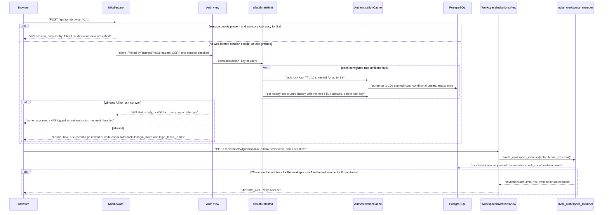

# Rate limiting and the database-backed authentication cache

Every anonymous or signed-in caller of the allauth browser API (login, signup, password reset, email verification, MFA codes, reauthentication) is counted by allauth's rate limiter, whose state lives in a PostgreSQL table behind a custom Django cache. A workspace administrator inviting members is limited separately, by counting invitation rows. An exhausted limit answers 429 (or a form error), and any 429 under `/api/auth/` is logged as a security event. Business endpoints have no DRF throttle.

## Entry points

- Screens: `web/src/components/auth.tsx` through `authRequest` in `web/src/lib/auth-api.ts` to `/api/auth/browser/v1/...`; `web/src/components/workspace-members.tsx` through `request` in `web/src/lib/api.ts` for invitations. Neither has a 429-specific state.
- Limited auth views (urls.py): `pyracast.accounts.headless` `LoginView`, `RequestPasswordResetView`, `ResetPasswordView`, `ChangePasswordView`, `ReauthenticateView`; `pyracast.accounts.signup.CompanySignupView`; `pyracast.accounts.social_views.ProviderSignupView` (explicit `ratelimit.consume_or_429` on a POST with a pending provider signup); `pyracast.accounts.mfa_views` `AuthenticateView` and `ReauthenticateView` (`auth/2fa/authenticate`, `auth/2fa/reauthenticate`) and `ManageTOTPView` (TOTP activation form); through `allauth.headless.urls`: `auth/email/verify/resend`, `account/email`, `auth/reauthenticate/code/*`. `pyracast.accounts.login_limits` reserves the failure slots: per IP and per address for passwords (`AccountAdapter.pre_authenticate` and `authenticate`), per IP and per user for second-factor codes (`SecondFactorInput`, `SecondFactorReauthenticateInput`) and per user for TOTP enrolment codes (`TOTPActivationInput`), in place of allauth's per-user code limiter.
- `POST /api/tenants/{t}/invitations/` -> `pyracast.api.workspaces.WorkspaceInvitationsView.post` -> `pyracast.accounts.invitations.invite_workspace_member`, which raises `InvitationRateLimitError`, mapped to `Throttled(wait=60)`.
- `pyracast.accounts.cache.AuthenticationCache`: `CACHES["default"]`, backed by `DATABASES["auth_cache"]` (a second autocommit connection to the same database) and table `pyracast_authentication_cache`. `pyracast.api.middleware.PrivateAPIResponses` logs `authentication_request_throttled`; `pyracast.accounts.session_lock.SessionRequestSerialization` is the other source of a 429 there. Limits come from `settings.ACCOUNT_RATE_LIMITS`, merged over allauth's defaults; no command, script or worker.

## Sequence

## Data

| Table | R/W | What |
|---|---|---|
| `pyracast_authentication_cache` | R/W | Timestamp lists per limiter key, 10 s lock rows, allauth's TOTP used-code markers, Google ID-token `jti` replay markers from the OAuth callback; `expires` is checked against `clock_timestamp()`, NULL never expires |
| `accounts_workspaceinvitation` | R | `created_at` counts of all rows (any state) per tenant and per tenant plus email; the supersede update and insert belong to `member-invitation` |
| `accounts_tenant`, `accounts_membership`, `auth_user` | R | Tenant row `FOR UPDATE` in `require_workspace_admin` serializes concurrent invitations; membership gives the administrator check and, joined to `auth_user.email`, the existing-member check |

## Authorization

- Keys: client IP (IPv6 by /64), SHA-256 of the lowercased email (`reset_password`, `confirm_email`), of `<site domain>:<email>` (`login_failed`) or of `mfa-auth-user-<pk>`, or the user id (`change_password`, `manage_email`, `reauthenticate`); `login_failed_ip` is per IP only. Decorated views consume before input validation; `reset_password` only after the email validates; `login_failed_ip` and then `login_failed` before the password check. A signed-in client posting to `auth/login` gets 409 before allauth's view runs, so it consumes no limit at all. Per-user limits run after allauth's session check, so an anonymous call gets 401 first.
- The client IP is trusted only through `TrustedProxyHeaders` (immediate proxy CIDRs, one Cloudflare hop) and `AccountAdapter.get_client_ip`. An unparsable address is a 403; with proxy trust on, a request that bypassed the proxy has no `X-Real-IP` and gets 403 at the first IP limit.
- Invitation limit: `IsAuthenticated` and `WorkspaceWritePermission` on the view, then `require_workspace_admin` under the tenant lock, then the counts, so only administrators consume it.

## Failure paths

| Condition | Result |
|---|---|
| `login` 20/min per IP, `signup` 5/h per IP (password and social share it), `reset_password` 5/h per IP or 3/h per email, `reset_password_from_key` 10/h per IP, `confirm_email` 1 per min and 6 per hour per address on resend or email change, `change_password` 5 per 10 min per user, allauth per-user defaults | 429, body `{"status": 429}`, no `Retry-After`; the sign-in form asks the user to wait or reset the password, sign-up, social sign-up, code and second-factor submits ask to wait a few minutes, the verification resend asks to wait a minute, other screens show "Request failed (429). Please try again." |
| `login_failed` 5 per 10 min or 100 per day per email or MFA code key, or `login_failed_ip` 10 failures per 10 min per IP; correct password for an unverified address within a minute of the last code | 400 with allauth code `too_many_login_attempts` (`rate_limited` when enrolling TOTP); a refused password login logs `login_locked` (client IP, no address); a password reset lifts an address's daily lock |
| Cache database error, or `auth_cache` inside a transaction | Exception, HTTP 500 (`ImproperlyConfigured` for the latter) |
| Unparsable client address, or proxy bypassed while trust is on | 403 `PermissionDenied` |
| Session lock busy for 5 s | 429 `session_busy`, `Retry-After: 1`, same audit event |
| Invitation limit | 429 `{"code": "http_429", "detail": {"detail": "Request was throttled. ..."}}`, `Retry-After: 60` fixed |
| Invitation by non-admin, invalid email or existing member | 403 / 400 before the limit is checked |

## Rules and invariants

- The cache connection must be in autocommit, so application rollbacks never reset limits or used TOTP codes. `add` has exactly one winner (`ON CONFLICT ... WHERE NOT add OR expired`), which is allauth's lock primitive; a lock not won within 1 s counts as limited (fail closed).
- Expired rows are deleted only by writes, at most 100 per write (`SKIP LOCKED`); reads never purge, and `clear()` wipes limits and code markers alike.
- Unlisted allauth actions keep their defaults: `manage_email` 10/min, `reauthenticate` 10/min (both per user). GET requests are not limited, except `confirm_email`. Email resends are limited to 1 per minute and 6 per hour per address while a code lives 10 minutes and 3 resends are allowed.
- Login consumes `login_failed` before checking credentials and rolls the hit back on success, so only failures count. Password reauthentication goes through the same `authenticate` and also consumes `login_failed`. A correct password of an inactive user or of staff without TOTP is refused inside `AuthenticationBackend` and counts as a failure.
- `login_failed` has only per-key rates because allauth's `clear` wipes every rate of an action, IP rates included. A completed MFA check clears its `mfa-auth-user-<pk>` key and a password reset the keys of the user's addresses; neither touches `login_failed_ip`, which only expires.
- Every password check and every second-factor code check (`auth/2fa/authenticate`, `auth/2fa/reauthenticate`) reserves one `login_failed_ip` slot before it runs and releases it on success or when another limit refuses the attempt, so concurrent requests from one IP never run more than 10 failing checks per window. A refused attempt keeps none of the slots it took: allauth's consume keeps the 10-minute hit when the daily rate refuses, so the project consumes each rate itself and rolls back on refusal.
- Invitation counts include revoked, replaced, accepted and expired rows, so revoke and re-invite within a minute is limited. The check runs before the earlier pending invitation is expired.

## Tests

- `tests/test_account_security.py`: cache sharing, expiry, DB clock, rollback survival, transactional refusal, one-winner `add`, concurrent `consume`, the 100-row purge batch, a held lock refusing after about 1 s, IP identity (Cloudflare, IPv4-mapped, IPv6 /64), throttle audit event.
- `tests/test_security_audit.py`: 429 audit for session contention and a real login limit. `tests/test_session_serialization.py`: `session_busy` with `Retry-After: 1`; `auth/email/verify/resend` answers 429 under the project `confirm_email` limit, then the resend cap.
- `tests/test_authentication_limits.py`: the project limits over HTTP with a fixed rate-limit clock: per-address, per-IP and daily login lockouts, the per-IP allowance shared by second-factor codes of several accounts and by concurrent password checks, the per-user code lockout, verify-email before the second factor, the 15-minute stage expiry, failure counts that survive TOTP login, TOTP reauthentication and password reset, refused correct passwords, `login_locked`, refusals just before daily failures expire (password, both code endpoints, TOTP enrolment), the signed-in 409, the verification mail limits, the password-change limit and event, and provider signup without a pending signup.
- `tests/test_social_accounts.py` `test_social_signup_has_same_rate_limit_as_password_signup`; `tests/test_workspaces.py` (per-address 429 over HTTP, hourly limit at the operation); `tests/test_auth_lifecycle.py` parallel single use of a TOTP or recovery code. Gaps: no invitation `Retry-After` assertion, and no Playwright or integration spec for any 429 state.
