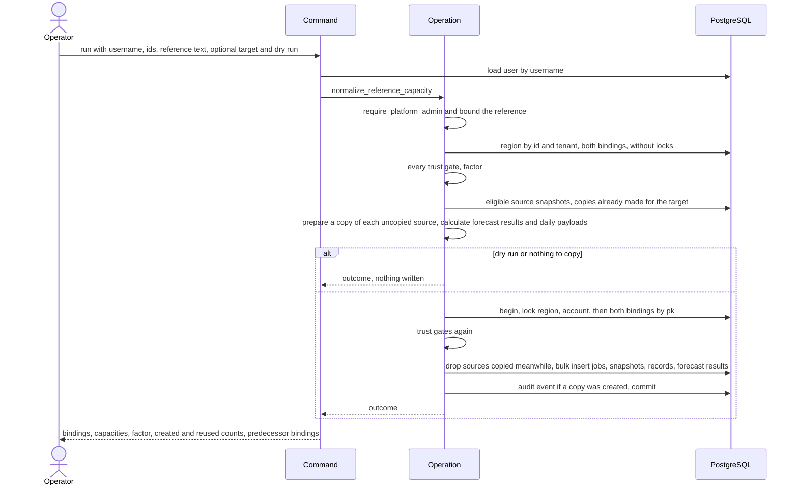

# Rescale reference snapshots to another binding capacity

A platform administrator runs a CLI command after a plant's provider binding changed only its declared Solcast reference capacity (for example 1 kW to 1000 kW). The command copies the source binding's archived estimated-actuals and forecast snapshots to the target binding, by default the plant's approved binding, with `power_kw` multiplied by the capacity ratio. Calculations, calibration and forecast reads then see continuous history at the new scale, while the originals stay untouched. A dry run reports the plan; a replay writes nothing.

## Entry points

- Command `normalize_reference_capacity` (`uv run --locked pyracast normalize_reference_capacity`), `pyracast.forecasts.management.commands.normalize_reference_capacity.Command`. Options `--username`, `--tenant-id`, `--region-id`, `--source-binding-id`, `--reference` (required), `--target-binding-id` (defaults to the approved binding) and `--dry-run`. It is the only caller in `src` of `pyracast.forecasts.capacity_normalization.normalize_reference_capacity`, which returns a `NormalizationOutcome`; the trust gates are `pyracast.forecasts.trust.normalization_problems`.
- No HTTP endpoint, screen, worker job or schedule. The outcome surfaces as the audit row in `pyracast.platform_admin.read_models.recent_activity_context` (`/admin/`) and as provenance in payloads: key `reference_capacity_normalization` (copy results and their daily payloads, `forecasts.history`, `forecasts.actuals`) or `capacity_normalization` (`plants.forecasting`, `plants.calibration_data`). Customers receive only the policy, both capacities, the factor and the time (`api/public.py`).

## Sequence

## Data

| Table | R/W | What |
| --- | --- | --- |
| `auth_user` | R | Actor looked up by the command; the operation requires an active staff superuser |
| `regions_region` | R, lock | Tenant-scoped, non-trashed region; must be approved with the target as approved binding; `revision` goes to the audit row |
| `connections_provideraccount` | R, lock | Target binding's account: Solcast, enabled, authorized, authorization reference and actor required |
| `connections_sitebinding` | R, lock | Source and target compared field by field |
| `forecasts_forecastsnapshot` | R, W | Eligible originals read; scaled copy inserted per original (raw and weather payloads unchanged) |
| `forecasts_collectionjob` | R, W | Inserted `succeeded` with endpoint `scaled_<original endpoint>` and the original `scheduled_for`, never dispatched |
| `forecasts_forecastresult` | W | One result per forecast copy from `calculate`, with `daily_payloads` from `prepare_daily_payloads`; the payload and every daily entry carry `reference_capacity_normalization`; `published_at` = run time. Actuals copies get no result |
| `forecasts_referencecapacitynormalization` | R, W | Lineage, both capacities, factor, operator and reference text; deleted before snapshots on region purge (`pyracast.trash`) |
| `regions_auditevent` | W | `reference_capacity_normalized` with actor, region and revision only, once per run that created copies |

## Authorization

- Command: the user must exist (`Command.handle`). The operation then calls `require_platform_admin` (active staff superuser) before any other query. There is no tenant role: platform administrators bypass workspaces.
- Tenant boundary: the region is fetched by id and `tenant_id`; both bindings must belong to that region.
- Trust gates, each a named problem code with its own message (`trust.PROBLEM_MESSAGES`): distinct bindings (`same_binding`); the target passes `binding_is_current` (`target_not_current`); the account is Solcast with an authorization reference and actor; both bindings are validated, have verified capacity semantics and a settings verification reference; the source is healthy; the bindings differ in no field but their capacity (`field_differs:<field>`); the target is AC; both capacities are finite, positive and different; both declare DC capacity with the same DC to AC ratio.
- Database: checks require finite positive capacities and factor, forbid a self-referencing record and keep `factor = target_capacity_kw / source_capacity_kw` exactly (`referencecapacitynormalization_target_over_source_chk`); a deferred composite FK (migration only) ties the copy to the target binding.

## Failure paths

| Condition | Result |
| --- | --- |
| Unknown, inactive or non-administrator username | `CommandError` "Reference capacity normalization failed: ..." (exit 1) |
| Blank or over 1000 character reference | `ValidationError` "A bounded capacity-only equivalence authorization is required." |
| No target given and no approved binding | "The plant has no approved connection to normalize onto." |
| Region, tenant, binding or provider account not found | `DoesNotExist`, reported as `CommandError` |
| One or more trust gates fail, before or under the locks | `CommandError` with each unmet gate's message on its own line; nothing written |
| Source power not a nonnegative number, or scaled value overflows | `ValidationError`; nothing written |
| Lock timeout, deadlock or statement timeout | "Region busy, retry."; another database error propagates |
| `IntegrityError` on write | "a stored copy conflicts; nothing was written." |
| `ValueError`/`KeyError` from `calculate`, `AttributeError` on non-dict rows | Not caught by the command: traceback, nothing written |
| Nothing left to copy | Exit 0, "Created 0 snapshots; reused N.", no audit row |
| Dry run | Exit 0, "Dry run: would create ...; reused N; nothing was written." |

## Rules and invariants

- Preparation, including `calculate`, runs without locks; one short transaction locks region, provider account, then both bindings by pk, re-checks every gate and writes. `jobs.publish` and `validate_binding` also take the region before the account and the historical import locks only the region, so they cannot deadlock.
- Idempotent per (source snapshot, target binding): unique constraint plus a re-read under the lock, so only uncopied sources are written. A replay writes nothing, not even an audit row, and reports the existing copies as reused; newly archived sources are picked up by a later run. When the source history holds copies from an earlier binding, the output names that binding: copies are never rescaled again, so it needs its own run onto the target.
- Source eligibility: succeeded jobs, endpoint `estimated_actuals` or `forecasts` with matching `source_kind`, no historical-import jobs, no snapshot that is itself a copy, collected, available and issued no later than the run's single `moment`. A snapshot without `available_at` (unpublished) never qualifies. Copies never backdate: job and snapshot `available_at`, result `published_at` and record `created_at` are the run time; `collected_at` and `issued_at` are preserved.
- Only `power_kw` is scaled, so reconstructed GHI (`power / capacity * 1000`) is unchanged; raw payloads keep the original scale, explained by `source_capacity_kw`. Copies create no forecast issuances. Read-side precedence covers actuals only: `forecasts.actuals.legacy_actual_queryset` (used by `history.select_actual_snapshot`) ranks native, scaled, then imports; `sources.current_forecast_snapshots` ranks forecasts by recency alone.

## Tests

- `tests/test_capacity_normalization.py`: scaled actuals, forecast copy and result recalculation, regional selection, composition provenance, authorization text bounds, changed inputs, non-admin. `tests/test_capacity_normalization_boundaries.py`: unpublished legacy forecasts, import exclusion, no re-normalization, unverified or non-equivalent bindings, nonfinite capacity, same binding and foreign tenant, DC rules, invalid power and overflow rollback, exact quotient at the float limits, native precedence, concurrent replay on PostgreSQL (one audit row), calibration provenance, purge.
- `tests/test_normalization_outcome.py` (the command's default target, report, dry run, replay cost, daily results, predecessor bindings, one line per refusal, busy region), `tests/test_reference_trust.py` (each gate named), `tests/test_capacity_normalization_command.py` (routing and error mapping), `tests/test_snapshot_lineage.py` (constraints), `tests/test_archive_invariants.py` (exact factor check, two source revisions onto one target), `tests/test_customer_confidentiality.py` (customer fields), `tests/test_language.py` (audit label on `/admin/`). No Playwright: no UI. Gaps: no test for a lock timeout under the real lock or malformed intervals.
