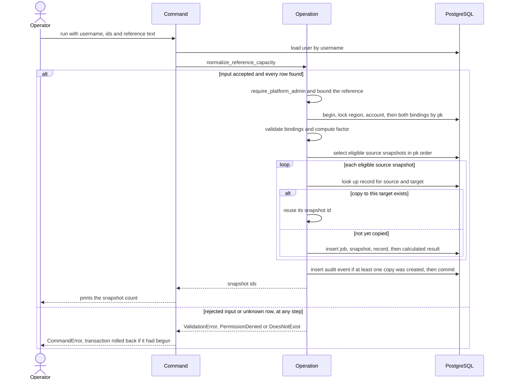

# Rescale reference snapshots to another binding capacity

A platform administrator runs a CLI command after a plant's provider binding changed only its declared Solcast reference capacity (for example 1 kW to 1000 kW). The command copies the source binding's archived estimated-actuals and forecast snapshots to the target binding with `power_kw` multiplied by the capacity ratio. Calculations, calibration and forecast reads then see continuous history at the new scale, while the originals stay untouched.

## Entry points

- Command `normalize_reference_capacity` (`uv run --locked pyracast normalize_reference_capacity`), `pyracast.forecasts.management.commands.normalize_reference_capacity.Command`. Options `--username`, `--tenant-id`, `--region-id`, `--source-binding-id`, `--target-binding-id`, `--reference`, all required. It is the only caller in `src` of `pyracast.forecasts.capacity_normalization.normalize_reference_capacity`.
- No HTTP endpoint, screen, worker job or schedule. The outcome surfaces as the audit row in `pyracast.platform_admin.read_models.recent_activity_context` (`/admin/`) and as provenance in payloads: key `reference_capacity_normalization` (copy results, `forecasts.history`, `forecasts.actuals`) or `capacity_normalization` (`plants.forecasting`, `plants.calibration_data`). Customers receive only the policy, both capacities, the factor and the time (`api/public.py`).

## Sequence

## Data

| Table | R/W | What |
| --- | --- | --- |
| `auth_user` | R | Actor looked up by the command; the operation requires an active staff superuser |
| `regions_region` | R, lock | Tenant-scoped, non-trashed region; must be approved with the target as approved binding; `revision` goes to the audit row |
| `connections_provideraccount` | R, lock | Target binding's account: Solcast, enabled, authorized, authorization reference and actor required |
| `connections_sitebinding` | R, lock | Source and target compared field by field |
| `forecasts_forecastsnapshot` | R, W | Eligible originals read; scaled copy inserted per original (raw and weather payloads unchanged) |
| `forecasts_collectionjob` | R, W | Inserted `succeeded` with endpoint `scaled_<original endpoint>` and the original `scheduled_for`, never dispatched |
| `forecasts_forecastresult` | W | One result per copy (actuals copies too) from `calculate` plus provenance, `published_at` = run time; `daily_payloads` stays empty |
| `forecasts_referencecapacitynormalization` | R, W | Lineage, both capacities, factor, operator and reference text; deleted before snapshots on region purge (`pyracast.trash`) |
| `regions_auditevent` | W | `reference_capacity_normalized` with actor, region and revision only, once per run that created copies |

## Authorization

- Command: the user must exist (`Command.handle`). The operation then calls `require_platform_admin` (active staff superuser) before any other query. There is no tenant role: platform administrators bypass workspaces.
- Tenant boundary: the region is fetched by id and `tenant_id`; both bindings must belong to that region.
- Trust gates in `_validate_bindings`: distinct bindings; the target passes `binding_is_current` (region approved at the binding's revision with the target as approved binding, account enabled and authorized, credential revision validated); the account is Solcast with an authorization reference and actor; both bindings are validated, have verified capacity semantics and a settings verification reference; the source is healthy.
- Database: checks require finite positive capacities and factor, forbid a self-referencing record and keep `factor = target_capacity_kw / source_capacity_kw` exactly (`referencecapacitynormalization_target_over_source_chk`); a deferred composite FK (migration only) ties the copy to the target binding.

## Failure paths

| Condition | Result |
| --- | --- |
| Unknown, inactive or non-administrator username | `CommandError` "Reference capacity normalization failed: ..." (exit 1) |
| Blank or over 1000 character reference | `ValidationError` "A bounded capacity-only equivalence authorization is required." |
| Region, tenant, binding or provider account not found | `DoesNotExist`, reported as `CommandError` |
| Trust gate fails (same binding, stale target, non-Solcast, unvalidated or unhealthy source, unverified capacity) | `ValidationError` "Authorized and verified source and current target bindings are required." |
| Bindings differ beyond capacity scale, nonfinite or equal capacity, DC/AC ratio differs, DC undeclared, target not AC | `ValidationError` "The bindings must differ only in their declared reference capacity scale." |
| Capacity ratio overflows or underflows | `ValidationError` "The capacity scale must be finite and positive." |
| Source power not a nonnegative number, or scaled value overflows | `ValidationError`; whole run rolls back, no partial copies |
| `ValueError`/`KeyError` from `calculate`, `AttributeError` on non-dict rows, `IntegrityError`, lock wait over 5 s or statement over 60 s (`settings.DATABASES`) | Not caught by the command: traceback, run rolled back |
| No eligible snapshots | Exit 0, "0 snapshots", no audit row |

## Rules and invariants

- Lock order is region, provider account, then both bindings by pk; `jobs.publish`, `validate_binding` and the historical import also lock region before account, so they cannot deadlock. Concurrent runs serialize on the region lock, subject to the 5 s lock timeout.
- Idempotent per (source snapshot, target binding): unique constraint plus a lookup under the lock. A re-run returns existing copy ids and writes nothing, not even an audit row; newly archived sources are picked up by a later run. Source bindings of several revisions can normalize the same slot onto one target, because scaled copies take part in no slot-unique constraint.
- Source eligibility: succeeded jobs, endpoint `estimated_actuals` or `forecasts` with matching `source_kind`, no historical-import jobs, no snapshot that is itself a copy (never rescaled twice), collected, available and issued no later than the run's single `moment`. A snapshot without `available_at` (unpublished) never qualifies. Copies never backdate: job and snapshot `available_at`, result `published_at` and record `created_at` are the run time; `collected_at` and `issued_at` are preserved.
- Only `power_kw` is scaled, so reconstructed GHI (`power / capacity * 1000`) is unchanged; raw payloads keep the original scale, explained by `source_capacity_kw`. Copies are not full publications: no `daily_payloads` and no forecast issuances. Read-side precedence covers actuals only: `forecasts.actuals.legacy_actual_queryset` (used by `history.select_actual_snapshot`) ranks native, scaled, then imports; `sources.current_forecast_snapshots` ranks forecasts by recency alone.

## Tests

- `tests/test_capacity_normalization.py`: scaled actuals, forecast copy and result recalculation, regional selection, composition provenance, authorization text bounds, changed inputs, non-admin. `tests/test_capacity_normalization_boundaries.py`: unpublished legacy forecasts, import exclusion, no re-normalization, unverified or non-equivalent bindings, nonfinite capacity, same binding and foreign tenant, DC rules, invalid power and overflow rollback, exact quotient at the float limits, native precedence, concurrent replay on PostgreSQL (one audit row), calibration provenance, purge.
- Also `tests/test_capacity_normalization_command.py` (real user lookup; operation mocked for routing and error mapping), `tests/test_snapshot_lineage.py` (constraints), `tests/test_archive_invariants.py` (exact factor check, two source revisions onto one target), `tests/test_customer_confidentiality.py` (customer fields), `tests/test_language.py` (audit label on `/admin/`). No Playwright: no UI. Gaps: the command's success path never runs the real operation; no test for non-Solcast, unhealthy source, stale target, lock timeout, `IntegrityError`, malformed intervals or the command's zero-result output.
