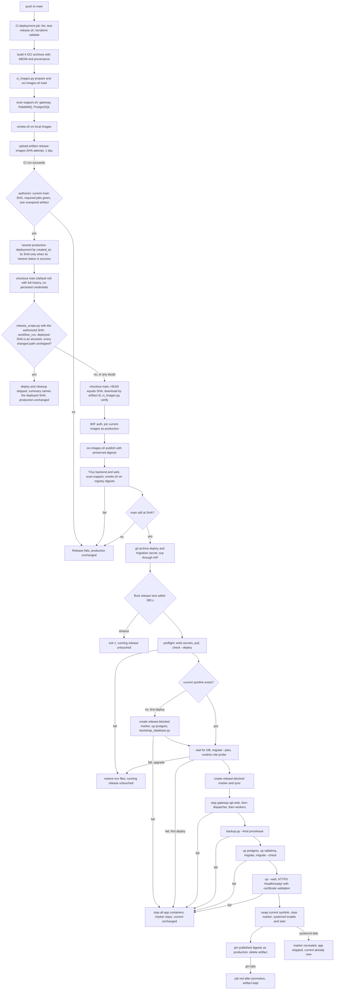

# CI image build, verification and production release

Every CI run builds the four production images once, scans the support images and smoke-tests the real Compose stack. On `main` (push or manual dispatch) the `deployment` job also keeps the OCI archives as a one-day artifact tied to that run attempt. The Release workflow is triggered when a CI run on `main` completes, or when an operator dispatches it; its jobs run only after a successful CI and with `GCP_DEPLOY_ENABLED`. It authorizes only the current `main` commit and skips the deployment when the newest `production` deployment succeeded and every path changed since its commit is unshipped (documentation under `docs/`, tests, development scripts, or agent, scanner, Dependabot, Git-ignore and Prettier-ignore configuration); otherwise it publishes, scans and smoke-tests those exact digests and installs them on the VM through IAP during a maintenance window. Success promotes `/opt/pyracast/current`. Any failure inside the window leaves the application stopped and blocked until an operator recovers it.

## Entry points

- `.github/workflows/ci.yml` job `deployment` ("Deployment configuration and containers"): runs on push to `main`, pull request, merge group and manual dispatch. Runs actionlint and shellcheck, `deploy/test-release.sh`, Terraform fmt and validate, BuildKit builds of `Dockerfile` (runs `collectstatic` at build time), `web/Dockerfile`, `deploy/gateway` and `deploy/postgres`, then the scripts below.
- `.github/workflows/release.yml`: `workflow_run` when CI completes on `main`, or `workflow_dispatch`. Jobs `authorize`, `deploy` (GitHub environment `production`) and `cleanup`.
- `deploy/release_scope.py` (standard library, runner `python3`): run by `authorize` with the event name, the deployed SHA and the authorized SHA; writes `release=true|false` to the job output and the reason to the step summary.
- `deploy/ci_images.py` `prepare` / `verify`: binds the archives to the SHA, run id and attempt in `images.json`.
- `deploy/oci-images.sh` `load` (CI, into the local Docker daemon) and `publish` (Release only, skopeo copy into Artifact Registry; exports the four `*_IMAGE` digest references to later steps).
- `deploy/scan-support.sh` and `deploy/check_support_images.py`: Trivy gate for the gateway, RabbitMQ and PostgreSQL images.
- `deploy/smoke.sh` with `deploy/compose.smoke.yaml` and `deploy/tls.smoke.yml`: disposable full stack on the runner, including `migrate` and `check --deploy --fail-level WARNING`.
- `deploy/pin_release_images.py` `current` / `published`: moves the `production` retention tags. `current` reads the live `release.env` over IAP SSH.
- `deploy/install-release.sh`: runs as root on the VM against `deploy/compose.yaml` (project `pyracast`). Runs Django `check --deploy --fail-level WARNING` and `migrate` (default command of the Compose service `migrate`).
- Actors: GitHub Actions, the deploy service account (Workload Identity Federation) and the operator. The operator dispatches releases, owns the environment settings in GitHub and recovers failed releases.

## Sequence

## Data

| Table | R/W | What |
| --- | --- | --- |
| `django_migrations` | R/W | `migrate --plan` (preflight), `migrate --noinput` as the schema owner, then `migrate --check` |
| All application tables | R | Pre-release `pg_dump` through `deploy/backup.py --kind prerelease`, uploaded to the backup bucket (see `backup-and-restore-rehearsal`) |
| All application tables | R/W (schema and data) | Migrations applied as the owner role from the migration secret, including data migrations that read and update rows (see `database-migration`) |
| PostgreSQL roles | W | First deploy only: `bootstrap_database.py` applies `bootstrap.sql` and sets both role passwords (see `database-migration`) |
| Smoke-only rows | R/W | User, tenant, membership, region, provider account, binding, forecast job and result in the disposable `pyracast-smoke` project, removed with its volumes |
| Host files (not tables) | R/W | `/opt/pyracast/releases/<sha>/deploy`, `release.env`, the `current` symlink, `/var/lib/pyracast/release-blocked`, `last-backup.json`, `/run/pyracast/{runtime,broker,database,migration}.env` |
| Registry and Actions (not tables) | W | Image tags `<sha>` and `production` in Artifact Registry. CI artifact `release-images-<sha>-<attempt>` |
| External services (not tables) | R/W | GitHub REST API (branch, runs, jobs, artifacts), Google STS, Secret Manager (migration secret on the runner; pinned runtime and database versions on the VM), IAP SSH, VM metadata token, Cloud Storage backup upload |

## Authorization

- CI: workflow token `contents: read`. Images are built without cloud credentials. The release artifact is uploaded only for `main` push or dispatch, so pull requests cannot produce a releasable artifact.
- Release `authorize` job condition: repository variable `GCP_DEPLOY_ENABLED == 'true'`, ref `main`, and either a dispatch or a successful CI `workflow_run`. Otherwise all three jobs are skipped.
- Release `authorize` script: the CI run must be `ci.yml` in this repository (no forks), triggered by push or dispatch on `main`, at the current `main` SHA, completed and successful. Eight named jobs must have passed, plus "Sonar quality gate" when `SONAR_ENABLED`. Exactly one unexpired artifact for that SHA and run attempt must exist.
- Release `authorize` compares the dispatch commit (`github.sha`) with the current `main` commit and refuses the dispatch when they differ: "Main advanced after the dispatch; dispatch Release again".
- Release classification (after every check above): `authorize` also has `deployments: read`. It lists the ten most recent `production` deployments, picks the newest by `created_at`, and takes its SHA only when that deployment's newest status by `created_at` is `success` (a newest deployment that failed, errored or is still running leaves production in doubt, so no older one is used). It then checks out the run's default ref (`main`) with full history and no persisted credentials, without a ref expression, so no fork's code can run; the clone is fetched after `authorize` and therefore contains the authorized SHA, which `deploy/release_scope.py` receives as its argument. `deploy` runs unless the job output `release` is exactly `false`. It is `false` only for a `workflow_run` event whose deployed SHA is an ancestor of the authorized SHA and whose changed paths (`git diff --name-only --no-renames`, so a rename counts both paths) all lie on the allowlist of unshipped paths below. A manual dispatch, a newest deployment without success, a missing, unknown or non-ancestor deployed SHA, an empty change set, any git or API failure, and a classification step that fails or exceeds its step limit (one minute for the lookup and the classification, three for the checkout; the job limit is ten) all release.
- `deploy` job: GitHub environment `production`. Its reviewers and branch rules live in GitHub settings, not in this repository. `id-token: write` lets it use WIF; it holds no service-account key. Before cloud authentication it checks `HEAD == RELEASE_SHA`, downloads by artifact id with `digest-mismatch: error` and runs `ci_images.py verify`. Every production variable must be non-empty; only `RELEASE_SHA`, `GCP_ARTIFACT_REPOSITORY`, `GCP_INSTANCE` and `GCP_ZONE` are also format-checked by regex.
- Deploy identity: the WIF provider in `infra/terraform/iam.tf` accepts only this repository and owner id, ref `refs/heads/main`, workflow `release.yml` on `main` and environment `production`. The service account can write to the registry, read the migration secret and open root SSH through IAP on port 22.
- A second check that `main` still equals the SHA runs after the scans and smoke test, right before the transfer. Nothing rechecks it during the install.
- VM: IAP SSH with keys that expire after 1 h. `install-release.sh` requires root and exactly seven arguments, and regex-checks the SHA and the four `*-docker.pkg.dev/...@sha256:` references. `release.env` values pass a character allow-list. The VM pulls with its own service-account token, kept in a per-run `DOCKER_CONFIG`.
- Database: only the `migrate` service reads `migration.env` (owner credentials). The `api` probe and the running services use the runtime role. `smoke.sh` asserts that the runtime role cannot run DDL and that the process is not root.
- `cleanup` job: `actions: write`, used only to delete the artifact.

## Failure paths

| Condition | Result |
| --- | --- |
| CI on `main` fails (build, scan, smoke, `test-release.sh` or any other job) | No artifact when the `deployment` job failed. The automatic Release run skips every job, without an error |
| `GCP_DEPLOY_ENABLED` is not `true`, or Release is dispatched from another ref | Every Release job is skipped |
| Dispatch without a successful CI run for the current `main` SHA; CI run from a fork, another event or an older SHA | "Only the current main SHA with successful repository CI may be released" |
| CI green but a required job is skipped or renamed (for example Sonar skipped while `SONAR_ENABLED`) | "Every required CI job must pass for this run" |
| Artifact missing, expired, already deleted by a successful Release, or from a partial re-run | "Run CI again to produce an unexpired image artifact" |
| Every change since the deployed commit is on the allowlist of unshipped paths | Run succeeds with `deploy` and `cleanup` skipped; summary "Nothing to release: changes since SHA touch only unshipped paths."; the artifact expires after one day |
| Dispatch while `main` advanced after it | "Main advanced after the dispatch; dispatch Release again" |
| Deployment record unreadable, newest deployment without success, checkout or git failure, or the classification step fails or times out | Warning or step marked failed with `continue-on-error`; the release proceeds as an ordinary deploy |
| Archive, digest, revision label or attestation mismatch | `ci_images.py` `ValueError` (for example "CI image record mismatch"), before cloud auth |
| `HEAD` differs from the authorized SHA, a production variable is empty, or the SHA, registry, instance or zone is malformed | Step exits 1 before cloud auth. Only an empty variable prints a message ("Missing production variable: NAME"). A malformed project, WIF provider, service account or migration secret passes this step and fails later (authentication, or Secret Manager access in the transfer step after publish and smoke) |
| Live `release.env` unreadable or malformed | `pin_release_images.py current` fails, release stops before publishing |
| HIGH or CRITICAL finding in any image, missing package inventory, or an unpinned support image | Trivy exit 1, "Support image gate failed" or "Pin the ... image to an immutable digest."; images stay published under their SHA tag but are not deployed |
| `main` advanced during the run | "Main advanced; release the new passing CI commit" |
| Installer not root or wrong argument count; malformed SHA, image reference or bundle | Usage text and exit 2; the pattern checks exit 1 without a message. Nothing changed |
| Release lock held more than 300 s | "Timed out waiting for another release, backup or watchdog operation.", nothing changed |
| Preflight fails (secrets, pull, `check --deploy`, DB wait 12 x 5 s, `migrate --plan`, runtime role) | Previous `runtime.env` and `broker.env` restored, old release keeps running, new release directory left behind. On a first deploy the marker already exists from PostgreSQL start onward (DB start, bootstrap, DB wait, `migrate --plan`, role probe), so those failures take the maintenance path below |
| Failure after the marker (drain, backup, support upgrade, migration, health, readiness) | All app containers stopped, marker kept, `current` unchanged: "Release failed during maintenance. Application remains stopped..." |
| `systemctl` fails after promotion | Same handler: marker recreated and app containers stopped, but `current` already points at the new release |
| SIGKILL during backup or migration | Marker and `migration.env` remain, so systemd units refuse to start the app |
| Retention tag cannot be verified after deploy | Job fails after promotion; artifact not deleted |

## Rules and invariants

- One lock, `/run/lock/pyracast-release.lock`, is shared with the `pyracast.service` `ExecStop` (blocking), the backup timer (non-blocking, exits 0) and the watchdog (non-blocking, skips). The release therefore stops containers with Compose directly, never through `systemctl stop`.
- The marker `/var/lib/pyracast/release-blocked` is created and `sync`ed before anything is stopped. `pyracast.service`, the backup and the watchdog all carry `ConditionPathExists=!` on it. It is cleared only after readiness and the symlink swap; a later failure in the same run recreates it.
- Drain order and limits: gateway, api, web (100 s), then dispatcher (660 s), then worker and notifications (660 s). Next come the backup, `postgres`, `rabbitmq`, migrate, `migrate --check`, `up --wait` (180 s) and HTTPS readiness (curl retries for up to 180 s, `--resolve` to 127.0.0.1 with real certificate validation). PostgreSQL and RabbitMQ are not drained; `up -d` recreates them only when their definition changed.
- First deploy (no `current` symlink): maintenance starts before PostgreSQL initialization and `bootstrap_database.py`, so every later failure leaves the marker. `pin_release_images.py current` then pins nothing.
- An image is built once. Publish uses `skopeo copy --all --preserve-digests` and checks that the pushed manifest digest equals the CI digest. Everything after that addresses images by digest only.
- Retention: the live digests are tagged `production` before publishing; the tag moves to the new digests only after success. Terraform keeps `production` tags and the 20 newest versions, and deletes versions older than 30 days (dry-run by default).
- Concurrency: CI cancels superseded runs per ref. Release runs in group `production-release` with `cancel-in-progress: false`, and its `deploy` job has a 60-minute limit.
- Secrets: `runtime_secrets.py` rewrites `runtime.env`, `broker.env` and `database.env` before preflight. `migration.env` is removed right after `migrate --check`; it and `migration.json` are also removed on every exit that runs the trap (not SIGKILL). The migration secret is read at version `latest`.
- The allowlist of unshipped paths: the directories `docs/`, `tests/`, `scripts/`, `web/tests/`, `web/integration/` and `.agents/`, and exactly the files `AGENTS.md`, `CLAUDE.md`, `.claude/settings.json`, `.codex/hooks.json`, `.github/dependabot.yml`, `qodana.yaml`, `sonar-project.properties`, `.gitignore`, `web/.gitignore` and `web/.prettierignore`. No image build context ships them (both `.dockerignore` files exclude them; the other build contexts lie under `deploy/`), the release bundle is `deploy/` only, and apart from `deploy/release_scope.py`, which declares the list and ships in no image, neither the image-building CI job, Release, `deploy/`, `infra/` nor a Dockerfile names them. Every other path releases, including look-alikes such as `AGENTS.md.bak` or `qodana-js.yaml`, `README.md` (copied into the backend image), the Dockerfiles and `.dockerignore` files, lockfiles, `pyproject.toml`, `package.json`, workflows, `deploy/`, `infra/`, `src/` and `web/src/`.
- Redeploying the same SHA reruns the full maintenance window and needs a fresh CI artifact once a Release has succeeded. The classification never skips a manual dispatch; it is the operator's override, also after a manual recovery that the deployment record does not know about, and still needs green CI and an unexpired artifact. Once `main` is ahead of the deployed commit only by unshipped changes, a dispatched CI run alone does not redeploy: its automatic Release is skipped, so Release must be dispatched too. There is no automatic rollback; the documented path is a revert followed by a new release.

## Tests

- `deploy/test-release.sh` (CI step, no network): 16 modes covering preflight, drain, backup, support upgrade, migration, health, TLS, readiness body, success, first deploy, SIGKILL during backup or migration, lock wait and lock timeout. They check the marker, the symlink, file cleanup and the step order.
- pytest: `tests/test_ci_images.py` (archive tampering, CLI identity recheck), `tests/test_release_images.py` (image validation, current-release script, tag pinning), `tests/test_release_scope.py` (classification on temporary git repositories: skip, baselines, malformed authorized SHA, git failure and exit status, renames, every allowlisted path alone, off-list paths and look-alikes, dispatch, an ambient `GIT_*` environment; that no allowlisted path or tracked file is in any CI image build context, evaluating `.dockerignore` rules as Docker cleans and matches them, including glob re-includes, with no Dockerfile-specific ignore file, or in the `git archive` bundle; that no entry is a glob, a build or pin input or lies under `deploy/`, `infra/`, `src/`, `web/src/` or the workflows; and that no release input names an allowlisted path outside step names and comments), `tests/test_support_images.py` (scan report gate), `tests/test_deployment_helpers.py` (the helpers run by the VM and runner system Python parse as Python 3.12), `tests/test_health.py` (readiness body and 503).
- `deploy/smoke.sh` is itself an end-to-end test of TLS, headers, static files, roles, the queue, dump and restore, and graceful stop. It runs only in CI and Release.
- No Playwright coverage applies.
- Gaps: the `authorize` scripts (CI run checks and the deployment lookup) and the IAP transfer step are untested; the classification itself is tested. `oci-images.sh publish` and `pin_release_images.py` `main` first run in a real Release. Nothing tests a failure after promotion (`systemctl` or `pin ... published`), a redeploy of the live SHA, or the 60-minute job timeout firing mid-maintenance.
