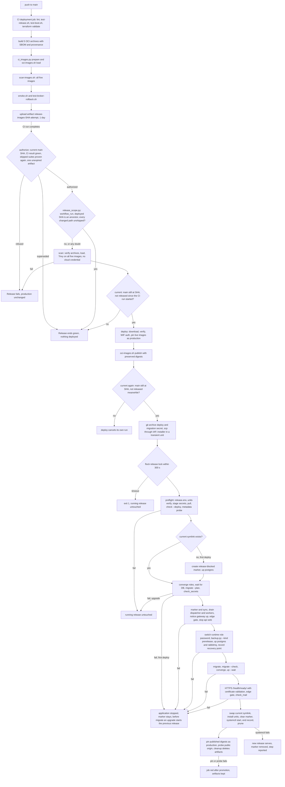

# CI image build, verification and production release

Every CI run that is not a draft's builds the five production images once (backend, web, gateway, PostgreSQL, RabbitMQ), scans all of them and smoke-tests the real Compose stack. On `main` (push or manual dispatch) the `deployment` job also keeps the OCI archives as a one-day artifact tied to that run attempt. The Release workflow starts when a CI run on `main` completes or when an operator dispatches it. Its `authorize` job decides from facts about that CI run; `scan` verifies and scans the archives before any cloud credential exists; `deploy` publishes the exact digests and installs them on the VM through IAP during a maintenance window; `cleanup` deletes the image artifacts. Success promotes `/opt/pyracast/current`. A failure before `migrate` of an upgrade starts the previous release again; any later failure leaves the application stopped and blocked until an operator recovers it.

## Entry points

- `.github/workflows/ci.yml` job `deployment` ("Deployment configuration and containers"): runs on push to `main`, a pull request that is not a draft and manual dispatch. Checks out without the unshipped paths, then runs actionlint and shellcheck, `deploy/test-release.sh`, `deploy/test-boot.sh`, `systemd-analyze verify` of `deploy/systemd`, Terraform fmt and validate, BuildKit builds of `Dockerfile` (compiles the translation catalogs and runs `collectstatic`), `web/Dockerfile`, `deploy/gateway`, `deploy/postgres` and `deploy/rabbitmq`, then the scripts below and `deploy/test-broker-rollback.sh`. Job `merge_proof` ("Find the pull request run that passed on this tree", push only) applies the proof rule below to the pushed commit and writes `proven`; a proven push skips `verify_ubuntu`, `web_ubuntu` and `scientific` (and so Sonar) and runs every other job, including the images, the scans, the smoke tests, both audits and the browser suite against the shipped web build. Job `CI result` fails unless every other CI job passed (`scripts/ci_result.py`; Sonar may be skipped, and on a push whose `merge_proof` succeeded with `proven=true` so may those three suites; on a push `merge_proof` itself must pass), and fails for a draft, whose run skips every other job. Job `pr_tested` ("Record the tested tree", pull requests only) uploads the tested base and tree after a passing `CI result`, which a draft's run never has. The jobs `stop_after_*` ("Stop the pull request run") each need one job and cancel a pull request run as soon as that job fails.
- `.github/workflows/release.yml`: `workflow_run` when CI completes on `main`, or `workflow_dispatch` (an operator; it takes no inputs, and no workflow dispatches it). Jobs `authorize`, `scan`, `deploy` (GitHub environment `production`) and `cleanup`.
- `deploy/release_authorization.py` `authorize` / `prove` / `current` (standard library): `authorize` reads the facts the github-script steps collect (`release-facts.json`, and `merge-proof.json` from the same step CI's `merge_proof` runs) and writes `authorized`, `sha`, the CI run, attempt and artifact ids to the job output; `prove` (CI's `merge_proof`) reads `merge-proof.json` and the commit `GITHUB_SHA` names from git and writes `proven=true|false`, with the reason in the summary; `current` answers whether a commit still needs its release.
- `deploy/release_scope.py` `classify` (run by `authorize`): writes `release=true|false` and the reason. `sparse-patterns`: prints the sparse-checkout patterns derived from the allowlist. Every workflow job that checks out code, except those that test, analyse or report on the whole repository, gives them to its only `actions/checkout` step (`sparse-checkout`, `sparse-checkout-cone-mode: false`), so the action leaves the unshipped paths out and no script of the commit runs for it; the deploy job's later `git checkout --detach` keeps the patterns.
- `deploy/ci_images.py` `prepare` / `verify`: binds the archives to the SHA, run id and attempt in `images.json`.
- `deploy/oci-images.sh` `load` (CI and `scan`, into the local Docker daemon) and `publish` (`deploy` only, skopeo copy into Artifact Registry; exports the five `*_IMAGE` digest references).
- `deploy/scan-images.sh` and `deploy/check_image_scans.py` (exceptions in `deploy/image-scan-exceptions.json`): Trivy gate for all five images.
- `deploy/smoke.sh` with `deploy/compose.smoke.yaml` and `deploy/tls.smoke.yml`: disposable full stack on the runner, including `migrate` and `check --deploy --fail-level WARNING`. `deploy/test-broker-rollback.sh`: queued work moves from the public broker to the built one and back on one volume.
- `deploy/pin_release_images.py` `current` / `published`: moves the `production` retention tags. `current` reads the live `release.env` over IAP SSH.
- `deploy/release_unit.py` `start` / `run` / `follow`: runs the installer in the transient unit `pyracast-release-<sha>-<run>-<attempt>.service` and follows its journal.
- `deploy/install-release.sh` (root, eight arguments) with `deploy/release_environment.py` (renders `release.env` from `host.json` through `deploy/host_contract.py`), `deploy/install-units.sh`, `deploy/edge_gate.py`, `deploy/release_record.py` and `deploy/release_state.py`. Runs against `deploy/compose.yaml` (project `pyracast`).
- `deploy/probe_origin.py`: the last `deploy` step, a probe of the public origin.
- Actors: GitHub Actions, the deploy service account (Workload Identity Federation) and the operator. The operator dispatches releases, owns the environment settings in GitHub and recovers failed releases.

## Sequence

## Data

| Table | R/W | What |
| --- | --- | --- |
| `django_migrations` | R/W | `migrate --plan` (preflight), `migrate --noinput` as the schema owner, then `migrate --check` |
| All application tables | R | Pre-release `pg_dump` through `deploy/backup.py --kind prerelease`, uploaded to the backup bucket and kept on the data disk as the recovery point (see `backup-and-restore-rehearsal`, `database-reset-and-restore`) |
| All application tables | R/W (schema and data) | Migrations applied as the owner role from the migration secret, including data migrations that read and update rows (see `database-migration`); `check_secrets` reads the stored secrets in preflight (see `encryption-key-rotation`) |
| PostgreSQL roles | W | Every release: `bootstrap_database.py` converges `bootstrap.sql` and the owner's password before and after `migrate`, and the runtime role's password after api and web stop (see `database-migration`) |
| Smoke-only rows | R/W | User, tenant, membership, region, provider account, binding, forecast job and result in the disposable `pyracast-smoke` project, removed with its volumes |
| Host files (not tables) | R/W | `/opt/pyracast/releases/<sha>-<digest hash>/deploy`, `release.env`, `prerelease-backup.json`, the `current` symlink, `/var/lib/pyracast/{release-blocked,release-state.json,release.lock,reset/}`, `/run/pyracast/releases/<release>/{runtime,broker,database,migration}.env` |
| Registry and Actions (not tables) | W | Image tags `<sha>` and `production` in Artifact Registry. CI artifacts `release-images-<sha>-<attempt>` (1 day) and `pr-tested-<number>-<base>-<tree>-<attempt>` (7 days) |
| External services (not tables) | R/W | GitHub REST API (branch, runs, run attempts, jobs, artifacts, deployments, pull requests), Google STS, Secret Manager (migration secret on the runner; pinned runtime and database versions on the VM), IAP SSH, VM metadata token, Cloud Storage backup upload, the public origin |

## Authorization

- CI: workflow token `contents: read`; only the stop jobs write (`actions`), and none of them checks out code. `merge_proof` reads actions and pull requests. Images are built without cloud credentials. The release artifact is uploaded only for `main` push or dispatch, so pull requests cannot produce a releasable artifact.
- Release `authorize` runs when repository variable `GCP_DEPLOY_ENABLED == 'true'`, ref `main`, and either a dispatch or a successful CI `workflow_run`; otherwise every job is skipped. It reads actions, deployments and pull requests; `scan` reads actions and deployments and holds no `id-token`; `deploy` adds `id-token: write` (WIF; no service-account key) and `actions: write` (to cancel its own run); `cleanup` holds `actions: write` to delete artifacts.
- Authorization rule (`decide`): the CI run must be `ci.yml` of this repository (no forks) and the commit must be the current `main` commit. A commit `main` has moved past is *superseded*: the job ends green and the release for the newer commit deploys it. Whole-run rule (`workflow_run` or a dispatch): a completed successful push or dispatch run whose `CI result` job succeeded, with the newest unexpired image artifact of its attempt or an earlier one (a partial re-run reuses it), created within the image job of the attempt its name carries: that job started at or after the start of that attempt and before the start of the next one, and the artifact was created between the job's start and end (a re-run lists the jobs it kept with their first times, so the attempts' starts tell which attempt ran the job; a missing time refuses); an automatic release is also superseded once a production deployment of the commit has succeeded since the run began. Unless Verify, Web and Scientific each passed once, the run is releasable only when each of them passed or was skipped once and the proof rule holds again on the release's own facts; otherwise it is refused. Proof rule (`merge_proof` in `deploy/release_authorization.py`, the one function both CI's first job and `authorize` call): the commit is the squash merge of exactly one pull request from this repository, merged at most 24 hours after the creation of that pull request's newest CI run on its final head; that run passed every job (skipped stop jobs and the push-only first job aside, Sonar only while it is off) and recorded, inside its `pr_tested` job of that attempt (the same rule as for the images), a tested base equal to the commit's parent, committed before the run was created, and a tested tree equal to the commit's tree; and the commit changes no pipeline path (`.github/`, `deploy/`, `infra/`, `scripts/`, `web/eslint/`, `web/testing/`, lock files, tool configuration; list in `deploy/release_authorization.py`), so the pull request ran the workflow of `main`. A failed lookup, an expired or missing record and any unexpected fact prove nothing.
- Release classification (after authorization): `authorize` lists the ten most recent `production` deployments, picks the newest by `created_at`, and takes its SHA only when that deployment's newest status is `success`. It then checks out `main` with full history and no persisted credentials, so no fork's code runs, and `deploy/release_scope.py` compares the deployed and authorized SHAs. `scan` and `deploy` run unless the job output `release` is exactly `false`. It is `false` only for a `workflow_run` event whose deployed SHA is an ancestor of the authorized SHA and whose changed paths (`git diff --name-only --no-renames`, so a rename counts both paths) all lie on the allowlist of unshipped paths below. A manual dispatch, a newest deployment without success, a missing, unknown or non-ancestor deployed SHA, an empty change set, any git or API failure, and a classification step that fails or exceeds its one-minute limit all release.
- `scan`: checks out the authorized commit, verifies the archives and scans every image (Trivy, HIGH and CRITICAL, dated reviewed exceptions) before any cloud credential exists.
- `deploy` job: GitHub environment `production` (reviewers and branch rules live in GitHub settings, not in this repository). It proves the authorized commit is an ancestor of `main`, downloads by artifact id with `digest-mismatch: error` and runs `ci_images.py verify` before cloud authentication. Every production variable must be non-empty; `RELEASE_SHA`, `GCP_ARTIFACT_REPOSITORY`, `GCP_INSTANCE`, `GCP_ZONE` and `GCP_MIGRATION_SECRET_VERSION` are also format-checked.
- Deploy identity: the WIF provider in `infra/terraform/iam.tf` accepts only this repository and owner id, ref `refs/heads/main`, workflow `release.yml` on `main` and environment `production`. The service account can write to the registry, read the migration secret and open root SSH through IAP on port 22.
- `current` runs before each download and again right before the transfer; nothing rechecks during the install.
- VM: IAP SSH with keys that expire after 1 h. `install-release.sh` requires root and exactly eight arguments, and regex-checks the SHA and the five `*-docker.pkg.dev/...@sha256:` references. `release.env` values pass a character allow-list. The VM pulls with its own service-account token, kept in a per-run `DOCKER_CONFIG`.
- Database: only the `migrate` service reads `migration.env` (owner credentials). The `api` probe and the running services use the runtime role. `smoke.sh` asserts that the runtime role cannot run DDL and that the process is not root.

## Failure paths

| Condition | Result |
| --- | --- |
| CI on `main` fails (any job), `GCP_DEPLOY_ENABLED` is not `true`, or Release is dispatched from another ref | Every Release job is skipped, without an error |
| No successful repository CI run for the current `main` commit (a fork, another event, another workflow) | "Only the current main SHA with successful repository CI may be released" |
| The `CI result` job did not pass | "The CI result job of CI run N did not pass" |
| Artifact missing, expired, deleted by a successful release's cleanup, or of no attempt up to the authorizing one | "Run CI again to produce an unexpired image artifact"; no action is needed when the commit is already the one serving |
| The chosen image artifact was not created within the image job of the attempt its name carries, or a time it is judged by is missing | "The image artifact of attempt N was not created within the Deployment configuration and containers job of that attempt" |
| `main` moved past the commit, or an automatic release finds the commit already released | `authorize`, `scan` or `deploy` ends as a skip (`deploy` cancels its own run, so a superseded deploy never ends successfully and the deployment record keeps naming what production runs) |
| The run skipped Verify, Web or Scientific and the release's own facts do not prove the commit | "CI run N skipped jobs that no pull request run proved: <reason>" |
| Verify, Web or Scientific of the run is missing, listed twice, or ended other than passed or skipped | "CI run N did not end each of Scientific (ubuntu-latest), Verify (ubuntu-latest), Web (ubuntu-latest) once" |
| Every change since the deployed commit is on the allowlist of unshipped paths | Run succeeds with `scan`, `deploy` and `cleanup` skipped; summary "Nothing to release: changes since SHA touch only unshipped paths." |
| Deployment record unreadable, newest deployment without success, checkout or git failure, or the classification step fails or times out | Warning or step marked failed with `continue-on-error`; the release proceeds as an ordinary deploy |
| Archive, digest, revision label or attestation mismatch | `ci_images.py` `ValueError` (for example "CI image record mismatch"), before cloud auth |
| HIGH or CRITICAL finding without a live exception, an expired or unneeded exception, missing package inventory | "Image scan gate failed: ..."; nothing is published |
| Image artifact gone with no successful release of the commit | "The image artifact could not be downloaded and no release of this commit has succeeded." (or says the deployments could not be read) |
| A production variable is empty or malformed | Step exits 1 before cloud auth. An empty variable prints "Missing production variable: NAME". A malformed project, WIF provider, service account or migration secret passes this step and fails later |
| Live `release.env` unreadable or malformed | `pin_release_images.py current` fails, release stops before publishing |
| Installer not root, wrong argument count, malformed SHA or image reference, or the same images already live | Message and exit 2; nothing changed |
| `host.json` refused (unknown, ill-typed or missing setting) | "Release refused before maintenance: ..." exit 2 |
| Release lock held more than 300 s | "Timed out waiting for another release, backup or watchdog operation; nothing was changed.", exit 1 |
| Preflight fails (secrets, units verify, pull, `check --deploy`, metadata probe, converge, DB wait 12 x 5 s, `migrate --plan`, `check_secrets`) | Old release keeps running with its own staged secrets; the new release directory is left behind. On a first deploy the marker exists from PostgreSQL start onward, so failures from `converge` on take the maintenance path below |
| Failure after the marker (drain, edge gate, role switch, backup, support upgrade, migration, readiness) | Dispatcher and workers, then api and web stop; the gateway shows the maintenance notice (stopped when the previous recovery helper cannot run beside it); marker kept, `current` unchanged. A failure before `migrate` of an upgrade that began without the marker also puts the role password right and starts the previous release again; otherwise "Release failed during maintenance. ..." with the recovery command of the maintenance session (see `database-reset-and-restore`) |
| `ORIGIN_PULL=required` and the edge does not answer | `edge_gate.py` exit 1 after 12 tries 5 s apart, or 3 for a Cloudflare challenge; maintenance path |
| `systemctl start` or a later step fails after promotion | The marker is removed and nothing is stopped; the installer prints "Release ... is serving, but a step after promotion failed" with the command to finish |
| Retention tag cannot be verified, or the public origin probe fails, after deploy | Job fails after promotion; artifacts not deleted |
| SIGKILL during backup or migration | Marker and `migration.env` remain, so `pyracast.service` refuses to start the app |

## Rules and invariants

- One lock, `/var/lib/pyracast/release.lock` (opened for appending under umask 077), is shared with the `pyracast.service` `ExecStop` (blocking), the hourly backup (waits up to 600 s, then skips), the watchdog (non-blocking, skips), the reset helper and the boot script. The release therefore stops containers with Compose directly, never through `systemctl stop`.
- The marker `/var/lib/pyracast/release-blocked` is created and `sync`ed before anything is stopped. The attempt that creates it writes `{"revision", "started_at"}` (UTC) into it; a later attempt leaves an existing marker's content (an earlier attempt's record or the reset helper's identity) and file time unchanged, so the watchdog's `pyracast_release_blocked` measures the whole block. `pyracast.service` carries `ConditionPathExists=!` on it; the backup and the watchdog check it themselves. A successful release clears it only after readiness, the symlink swap and the unit install; a failure after promotion removes it and stops nothing.
- Drain order and limits: while the previous release still serves, dispatcher (660 s), then worker and notifications (660 s); the new `maintenance` and `gateway` start (180 s) before api and web stop (100 s). Next come the role switch, backup, `postgres`, `rabbitmq`, `migrate`, `migrate --check`, `up --wait` (180 s) and HTTPS readiness (curl retries for up to 180 s, `--resolve` to 127.0.0.1 with real certificate validation, the loopback entrypoint when compose defines one). PostgreSQL and RabbitMQ are not drained; `up -d` recreates them only when their definition changed.
- First deploy (no `current` symlink): maintenance starts before PostgreSQL initialization, so every later failure leaves the marker and no previous release exists to resume. `pin_release_images.py current` then pins nothing.
- A release lives in `releases/<sha>-<first 12 hex of a digest over the five image references>` and the live directory is never written; the same images as the live release are refused. Each release reads secrets staged for it under `/run/pyracast/releases/<release>`, so a failed preflight never changes what the serving release reads. After promotion `release_state.py` records current and previous and prunes every other release, staged secret and image (nothing while a restore rehearsal holds its lock).
- The recovery point of an upgrade is recorded right before `migrate` (`release_record.py record`: the pre-release dump kept on the data disk and counted by a throwaway restore; a dump with no applied migration is refused). `discard` runs before maintenance and in the cleanup of a run that failed before its record, and removes pre-release files the held session does not name; after promotion `end` removes the kept dumps, records and session (a failure only warns).
- Build cache: the `deployment` job's `RELEASE_BUILD` (push or dispatch on `main`, the runs whose images a release can take) builds the five images without importing the shared BuildKit cache (`type=gha`, one scope per image) and is the only run that exports to it; every other run imports it and exports nothing. The builder setup does not use the shared cache of builder binaries (`cache-binary: false`), and the image rescan builds without the build cache too.
- An image is built once. Publish uses `skopeo copy --all --preserve-digests` and checks that the pushed manifest digest equals the CI digest. Everything after that addresses images by digest only. A live release from before the broker image reads as four images.
- Retention: the live digests are tagged `production` before publishing; the tag moves to the new digests only after success. Terraform keeps `production` tags and the 20 newest versions, and deletes versions older than 30 days (dry-run by default).
- Concurrency: CI cancels superseded runs per ref. Only `deploy` is serialized (group `production-release`, `cancel-in-progress: false`, 60-minute limit); `authorize` has 10 and `scan` 30 minutes. `scan` and `deploy` install no locked dependencies and set up uv with its cache off.
- Runners: `merge_proof`, `CI result`, `Record the tested tree`, the stop jobs and Release `authorize` and `cleanup` run on `ubuntu-slim` (one CPU, a container, a 15-minute job limit). They run github-script, git and standard-library scripts on that runner's system `python3`; a workflow case requires those scripts to parse as Python 3.12. The scheduled dependency audit also runs there with its own uv and Node. Every other job runs on `ubuntu-latest`.
- Secrets: `runtime_secrets.py` writes the staged `runtime.env`, `broker.env` and `database.env` in preflight; `migration.env` is removed after the second `converge` and on every exit that runs the trap (not SIGKILL). The migration secret is read at `GCP_MIGRATION_SECRET_VERSION`, else `latest`. `check_secrets` runs with the staged secrets before maintenance and refuses a key set that cannot read a stored secret.
- The allowlist of unshipped paths: the directories `docs/`, `tests/`, `scripts/`, `web/tests/`, `web/integration/`, `web/production-tests/` and `.agents/`, and exactly the files `AGENTS.md`, `CLAUDE.md`, `.claude/settings.json`, `.codex/hooks.json`, `.github/dependabot.yml`, `qodana.yaml`, `qodana-js.yaml`, `sonar-project.properties`, `.gitignore`, `web/.gitignore` and `web/.prettierignore`. No image build context ships them (both `.dockerignore` files exclude them; the other build contexts lie under `deploy/`), the release bundle is `deploy/` only, and the jobs that build the images (`ci.yml` `deployment`, `image-rescan.yml` `rescan`) and the Release jobs `authorize`, `scan` and `deploy` work in a checkout without them. A pull request's `deployment` job runs its checks, image builds, scans and smoke tests from that checkout, so those steps read none of them; Release's jobs use the same checkout but first run in the release after a merge. `infra/` is applied outside CI, so no reduced checkout covers it: no file under `infra/` names an allowlisted path. Every other path releases, including look-alikes such as `AGENTS.md.bak`, `README.md` (copied into the backend image), the Dockerfiles and `.dockerignore` files, lockfiles, `pyproject.toml`, `package.json`, workflows, `deploy/`, `infra/`, `src/` and `web/src/`.
- An operator's dispatch never skips as unshipped and is not superseded by an earlier deployment of the commit: it is the operator's override, also after a manual recovery that the deployment record does not know about, and still needs green CI and an unexpired artifact. Once `main` is ahead of the deployed commit only by unshipped changes, a dispatched CI run alone does not redeploy: its automatic Release is skipped, so Release must be dispatched too. There is no automatic rollback beyond the pre-`migrate` resume; the documented path is a revert followed by a new release.

## Tests

- `deploy/test-release.sh` (CI step, no network): 50 modes covering preflight (image pull, deploy check, migration plan refused for an old ledger, unreadable stored secrets, metadata guard, invalid units), drain, role switch, backup, support upgrades, migration, health, TLS, readiness body, success, prune, first deploy, resume of the previous release, SIGKILL during backup or migration, lock wait, lock timeout, a reset session already in the marker, and the edge gate. They check the marker, the symlink, file cleanup and the step order. `deploy/test-boot.sh` runs the boot script on a stubbed host.
- pytest: `tests/test_release_authorization.py` (the decision for automatic and dispatched releases, the proof rule and the release of a run that skipped suites, supersession, the image artifact and the tested tree bound to the job of their attempt, partial re-runs, the pipeline-path list, the `prove` and `current` commands), `tests/test_release_workflow.py` (the workflows read as text: job order, runners, build cache by event, permissions, scans before credentials, the first job of a push and the jobs it may skip, the proof step shared with Release, cancellation, pinned actions), `tests/test_ci_artifacts.py`, `tests/test_ci_result.py`, `tests/test_ci_images.py` (archive tampering, CLI identity recheck), `tests/test_release_images.py` (five-image validation, current-release script, tag pinning, broker data compatibility), `tests/test_release_scope.py` (classification on temporary git repositories: baselines, git failure, renames, every allowlisted path alone, off-list paths and look-alikes, dispatch; that no allowlisted path is in any CI image build context or the `git archive` bundle, or is a build or pin input; the derived patterns, and that a clone of the repository reduced as the checkout action does holds exactly the shipped tracked files; that every workflow job checks out at most once, unconditionally and with those patterns, unless a short list names it as needing every path, and that no workflow file is unknown; and that no `infra/` file names an allowlisted path outside comments), `tests/test_release_unit.py`, `tests/test_release_environment.py`, `tests/test_deployment_release_state.py`, `tests/test_deployment_previous_helper.py` (recovery record and helper), `tests/test_image_scans.py` (scan report gate and exceptions), `tests/test_deployment_helpers.py` (the helpers run by the VM and runner system Python parse as Python 3.12), `tests/test_health.py` (readiness body and 503), `tests/test_operations_contracts.py` (the job names Release waits for exist in `ci.yml`; queue, service, timeout, range and key agreement across `deploy/`, `infra/terraform` and the workflows; drain order, recovery point and edge gate).
- `deploy/smoke.sh` is itself an end-to-end test of TLS, headers, static files, Turkish catalogs, the anonymous session JSON, a refused wrong-password sign-in, the workspace app shell, roles, the queue, the refusal of a deployment check and a worker without a broker, dump and restore, graceful stop, the maintenance notice, Authenticated Origin Pulls and the reset tool (see `database-reset-and-restore`). It runs in CI.
- No Playwright coverage applies.
- Gaps: the github-scripts that collect the facts for `authorize` and `merge_proof` and the IAP transfer commands run only in a real Release (the Python decision and the workflow text are tested). `oci-images.sh publish` first runs in a real Release. Nothing tests the 60-minute job timeout firing mid-maintenance.
