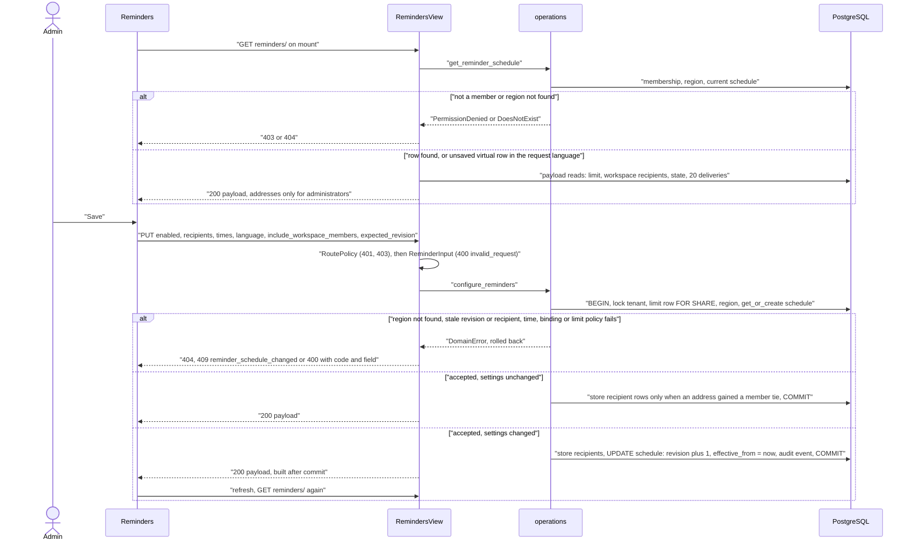

# Configure forecast email reminders for a site

Any workspace member opens a plant's Settings, Email reminders tab, to read the plant's reminder state, schedule, recipient limit and the 20 newest deliveries. A workspace administrator replaces the enabled flag, local `HH:MM` times, extra recipients, workspace-member inclusion and email language in one PUT that names the revision it was read at. The save only writes the shared `ReminderSchedule` and its recipient rows (and creates the `NotificationSettings` singleton if missing); it enqueues no job and calls no external service. The dispatcher and the notification worker read the rows later (flow `reminder-delivery`).

## Entry points

- Screen: `web/src/features/plant/reminders.tsx` `Reminders` (remount key) and `ReminderSettings`, with `DeliveryTimes` and `RecipientFields`. Mounted by `features/plant/workspace/settings-section.tsx` for `?view=reminders` on `/app/w/<tenant>/plants/<region>/settings/`. The form is `ui/form.tsx` `ActionForm`, read-only unless `WorkspaceAccess` is true (tenant role `admin`, set in `features/workspace/workspace-shell.tsx`).
- `GET|PUT /api/tenants/{t}/regions/{r}/reminders/` -> `pyracast.notifications.views.RemindersView` -> `operations.get_reminder_schedule` or `operations.configure_reminders` (its only caller), then `overview.reminder_overview`. Input `serializers.ReminderInput`.
- Related reads of the same state: `overview.reminder_summaries` (state and latest outcome per plant in the site list, `plants/site_api.py`) and `overview.plants_at_recipient_limit` (members screen).
- Side writers of the same rows: `accounts.operations.remove_workspace_member` -> `recipients.remove_member_recipients`; `trash.restore_region` resets `effective_from` and advances `revision`; `trash._purge_region` deletes schedules, recipients and deliveries.

## Sequence

## Data

| Table | R/W | What |
| --- | --- | --- |
| `notifications_reminderschedule` | R/W | One row per region (`reminderschedule_region_uniq`): created lazily on first PUT, then updated in place, including `configured_by` and `revision` |
| `notifications_reminderrecipient`, `notifications_reminderrecipienttie` | R/W | One row per address (`key` = stripped, case-folded address, unique per schedule); ties hold the membership ids the address was pinned to |
| `notifications_notificationsettings` | R/W | Singleton limit row: read `FOR SHARE` and created if missing on PUT, plain read for every payload |
| `accounts_tenant`, `accounts_membership` | R | Tenant `FOR UPDATE` in `tenant_membership`; role checks, workspace recipients, membership ids for ties |
| `auth_user`, `account_emailaddress` | R | Active flag, primary email, verified addresses |
| `regions_region` | R | `FOR UPDATE` on PUT; timezone, status, `approved_binding` |
| `connections_sitebinding`, `connections_provideraccount` | R | `daily_quota`, `enabled`, `authorized_at`, region revision (`eligibility.binding_can_notify`) |
| `notifications_notificationdelivery`, `notifications_deliveryrecipient`, `forecasts_forecastsnapshot` | R | Newest 20 deliveries of every schedule of the region, with `collected_at` and addresses |
| `regions_auditevent` | W | `reminder_schedule_updated` with `schedule_revision` for every real change |

## Authorization

- Authentication and view: `SessionAuthentication` with CSRF on PUT; `RoutePolicy` (`api/permissions.py`) admits GET to active members and PUT to active tenant administrators (403 `membership_required` or `workspace_admin_required`) before the body is read.
- Operation: GET calls `tenant_membership`; PUT calls it with `role=ADMIN, lock=True`, which locks the tenant row first.
- Tenant scope: the region is always fetched with `tenant_id` and `Region.objects.active()`; a foreign or trashed region under the caller's tenant is a 404, a foreign tenant id is a 403. The `ActionForm` read-only state is not a boundary. Members who do not administer the workspace read `recipient_count` and delivery counts, never addresses.

## Failure paths

| Condition | Result |
| --- | --- |
| Anonymous request | 401 `not_authenticated` with `WWW-Authenticate: Session` |
| CSRF failure on PUT | 403 `csrf_failed` |
| GET by a non-member (any foreign tenant id); PUT by a non-member or a non-administrator | 403 `membership_required`; 403 `workspace_admin_required` |
| Region unknown, in another tenant or trashed | 404 `not_found` (on PUT after the shape check, before the stale check and the policy checks) |
| Unknown field | 400 `invalid_request`, reason in `message` without `fields` |
| Any field missing, bad email, address over 254 characters, bad `HH:MM`, more than 10 times, more than 32767 addresses, language not `en`/`tr` | 400 `invalid_request` with field errors |
| `expected_revision` differs from the stored revision | 409 `reminder_schedule_changed` |
| Duplicate addresses (case-insensitive); enabled with no address and no workspace inclusion | 400 `duplicate_recipients`; `recipient_required` (field `recipients`) |
| Duplicate times; enabled without times; more times than `daily_quota` (10 without a binding) when the list is longer than the stored one | 400 `duplicate_reminder_times`; `reminder_time_required`; `too_many_reminder_times` (field `times`) |
| Switching reminders on without an approved current binding, or with a disabled or unauthorized provider account | 400 `plant_not_approved`; `provider_account_unavailable` (field `enabled`) |
| Effective recipient count above the limit, unless it shrinks or an unchanged disabled save | 400 `recipient_limit_exceeded` (field `recipients`) |
| Row lock not granted within 5 s (`lock_timeout`) | 503 `busy`, `Retry-After: 1`; the UI does not retry |
| GET fails in the UI, or the PUT fails | Error notice replaces the form (GET) or an alert keeps the entered values; after a 409 the screen offers "Reload reminders", which refetches and remounts the form |

## Rules and invariants

- Lock order is tenant, then the `NotificationSettings` row (`FOR SHARE`: readers never wait for each other, the platform form's change of the limit waits for every check made under the old one), then region. `scheduler._create_slot`, `jobs.process_notification` and `jobs._mark_transmit` take the same order, so a save cannot interleave with slot creation or send permission.
- A save whose `enabled`, recipients, workspace inclusion, sorted times and language equal the stored values keeps `revision`, `effective_from` and `configured_by` and writes no audit event; it stores recipient rows again only when an address gained a member tie. A changing save sets `effective_from = now`, so the scheduler never creates slots before it, advances `revision` and records one audit event. A member removal and a restore from trash advance `revision` too, so a form read earlier is refused. Queued deliveries are not cancelled by the new boundary: at claim and transmit `jobs._authorize` cancels a row with `cancelled_by_settings_change` only when the schedule is disabled or its local time is no longer in `times`, and narrows the recipients per row, so an added address is not added to a queued row and a removed one is dropped from it. A queued row keeps the language it was created with.
- Times are sorted; only the first `daily_quota` of them are effective, so a reduced quota silently drops the later times, while a save after the reduction keeps the stored times. Times are wall-clock in the region timezone. The client sends times and addresses as entered (trimmed, empty rows dropped) and only hints counts; the server decides format, duplicates and limits.
- The limit counts distinct addresses after case folding, including included workspace members (verified primary addresses of active members) and excluding addresses tied only to inactive members. An over-limit list is accepted only when the effective count strictly drops or a disabled save leaves addresses, times and workspace inclusion unchanged.
- Each submitted address keeps its stored ties and gains those of the members who hold it now (primary or verified address), so an email change of its member keeps the link. An address is a recipient while it has no tie or any tied membership is active; removing a member deletes the addresses tied to its membership (and untied ones equal to its own addresses) and revokes them from queued deliveries unless another active member holds them. Disabling needs no approved binding; the binding and account checks run only when reminders are switched on.

## Tests

- pytest: `tests/test_reminder_boundary.py` (viewer counts, administrator addresses, bounded input, codes and fields, approval and provider checks, trashed location before input, quota reduction), `tests/test_reminder_revision.py` (revision, stale form, audit), `tests/test_reminder_recipient_rows.py`, `tests/test_reminder_recipient_shape.py` (database checks), `tests/test_reminder_limit_lock.py`, `tests/test_notifications.py` (API access, limits, over-limit reduction, unchanged resave, recipient change and settings cancellation of queued rows), `tests/test_notification_groups.py`, `tests/test_notification_group_boundaries.py`, `tests/test_notification_recipient_validation.py`, `tests/test_notification_recipient_history.py`, `tests/test_shared_reminder_schedule.py`, `tests/test_route_policy.py`, `tests/test_workspace_authorization.py`, `tests/test_api_localization.py`, `tests/test_trash_api.py`.
- Playwright (mocked API): `web/tests/reminder-recipients.spec.ts`, `web/tests/reminder-state.spec.ts`, `web/tests/workspace.spec.ts`, `web/tests/workspace-roles.spec.ts`, `web/tests/schedule-sorting.spec.ts`. Real API: `web/integration/workspace.spec.ts`.
- Gaps: no 503 test for this view (only `tests/test_api_contention.py` for the handler); no test that a delivery `last_error` code has a UI label.
