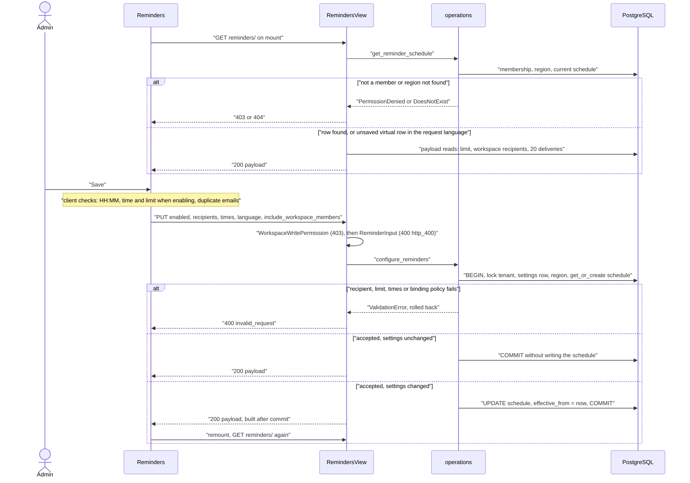

# Configure forecast email reminders for a site

Any workspace member opens a plant's Settings, Email reminders tab, to read the plant's reminder schedule, recipient limits and the 20 newest deliveries. A workspace administrator replaces the enabled flag, local `HH:MM` times, extra recipients, workspace-member inclusion and email language in one PUT. The save only writes the shared `ReminderSchedule` row (and creates the `NotificationSettings` singleton if missing); it enqueues no job and calls no external service. The dispatcher and the notification worker read the row later (flow `reminder-delivery`).

## Entry points

- Screen: `web/src/components/reminders.tsx` `Reminders` (remount key) and `ReminderSettings`, with `DeliveryTimes` and `RecipientFields`. Mounted by `plant-workspace.tsx` `PlantWorkspace` for `settingsView === "reminders"`. The form is `ui.tsx` `ActionForm`, read-only unless `WorkspaceAccess` is true (tenant role `admin`, set in `dashboard.tsx`).
- `GET|PUT /api/tenants/{t}/regions/{r}/reminders/` -> `pyracast.notifications.views.RemindersView` -> `operations.get_reminder_schedule` or `operations.configure_reminders` (its only caller), then `views.reminder_schedule_payload`. Input `serializers.ReminderInput`.
- Side writers of the same row: `accounts.operations.remove_workspace_member` -> `recipients.remove_member_recipients`; `trash.restore_region` resets `effective_from`; `trash._purge_region` deletes schedules and their deliveries.

## Sequence

## Data

| Table | R/W | What |
| --- | --- | --- |
| `notifications_reminderschedule` | R/W | The one current row per region (`retired_at IS NULL`): created lazily on first PUT, then updated in place, including `configured_by` |
| `notifications_notificationsettings` | R/W | Singleton limit row: `FOR UPDATE` and created if missing on PUT, plain read for every payload |
| `accounts_tenant`, `accounts_membership` | R | Tenant `FOR UPDATE` in `require_workspace_admin`; role checks, workspace recipients, membership ids for pinning |
| `auth_user`, `account_emailaddress` | R | Active flag, primary email, verified addresses; actor email re-read after the tenant and settings locks |
| `regions_region` | R | `FOR UPDATE` on PUT; timezone, status, `approved_binding` |
| `connections_sitebinding`, `connections_provideraccount` | R | `daily_quota`, `enabled`, `authorized_at`, region revision (`eligibility.binding_can_notify`) |
| `notifications_notificationdelivery`, `forecasts_forecastsnapshot` | R | Newest 20 deliveries of every schedule of the region, with `collected_at` |

## Authorization

- Authentication and view: `SessionAuthentication` with CSRF on PUT and `IsAuthenticated` (`settings.REST_FRAMEWORK`); the default `api.permissions.WorkspaceWritePermission` rejects a PUT by anyone but an active tenant `admin` before the body is read.
- Operation: GET calls `accounts.operations.require_member`; PUT calls `require_workspace_admin` inside the transaction, which locks the tenant row first.
- Tenant scope: the region is always fetched with `tenant_id` and `deleted_at IS NULL`; a foreign or trashed region under the caller's tenant is a 404, a foreign tenant id is a 403. The `ActionForm` read-only state is not a boundary.

## Failure paths

| Condition | Result |
| --- | --- |
| Anonymous request or CSRF failure on PUT; GET by a non-member (any foreign tenant id); PUT by a non-administrator | 403 `http_403`: DRF's authentication or CSRF detail, "Tenant membership required." (untranslated) or "Workspace administrator required." |
| Region unknown, in another tenant or trashed | 404 `not_found` (on PUT only once the recipients are valid) |
| Missing field (all but `include_workspace_members`), bad email, address over 254 characters, bad `HH:MM`, more than 1440 times, language not `en`/`tr` | 400 `http_400` with per-field `detail` |
| Duplicate addresses (case-insensitive), duplicate times, more times than `daily_quota` (10 without a binding), or an empty list without workspace inclusion and an actor with no valid email | 400 `invalid_request` |
| Effective recipient count above the limit, unless it shrinks or an unchanged disabled save | 400 `invalid_request` |
| Enabling without times, without an approved current binding or with a disabled or unauthorized provider account | 400 `invalid_request`, one shared message |
| Stored `recipients` not a list of strings (`effective_recipients` raises `TypeError`) | 500 on GET and PUT |
| Row lock not granted within 5 s (`lock_timeout`) | 503 `workspace_busy`, `Retry-After: 1`; the UI does not retry |
| GET fails in the UI, or client check or PUT fails | Error notice replaces the form (GET) or an alert keeps the entered values |

## Rules and invariants

- Lock order is tenant, then `NotificationSettings` row, then region. `scheduler._enqueue_schedule`, `jobs.process_notification` and `jobs._mark_transmit` take the same order, so a save cannot interleave with slot creation or send permission.
- A save whose `enabled`, recipients, workspace inclusion, sorted times and language equal the stored row keeps `effective_from` and `configured_by`; it writes only `recipient_memberships` when an address gained a membership pin, and nothing otherwise. A changing save sets `effective_from = now`, so the scheduler never creates slots before it. Queued deliveries are not cancelled by the new boundary: at claim and transmit `jobs._skip_reason` cancels a row with `cancelled_by_settings_change` only when the schedule is disabled or retired or its local time is no longer in `times`, and re-checks the recipients per row (`permitted_recipients`), so an added address is not added to a queued row and a removed one is dropped from it. A queued row keeps the language it was created with.
- Times are sorted; only the first `daily_quota` of them are effective, so a reduced quota silently drops the later times. The client drops duplicate times before the PUT, so the server's duplicate-time 400 is reached only by other clients. Times are wall-clock in the region timezone.
- The limit counts distinct addresses after case folding, including included workspace members and excluding addresses pinned to inactive members. An over-limit list is accepted only when the effective count strictly drops or a disabled save leaves addresses, times and workspace inclusion unchanged. An empty list without workspace inclusion stores the saving administrator's email, read after the tenant and settings locks.
- Addresses that belong to a member (verified aliases and primary email) are pinned to the membership id. Existing pins win, so an email change keeps the link, and removing the member removes the address and revokes it from queued deliveries. Omitting `include_workspace_members` stores false. Disabling needs no approved binding.

## Tests

- pytest: `tests/test_notifications.py` (API access, limits, trimming, concurrent viewer, over-limit reduction, unchanged resave including a new membership pin, recipient change and settings cancellation of queued rows), `tests/test_notification_groups.py`, `tests/test_notification_group_boundaries.py`, `tests/test_notification_recipient_validation.py`, `tests/test_notification_recipient_history.py`, `tests/test_shared_reminder_schedule.py`, `tests/test_workspace_authorization.py`, `tests/test_api_localization.py`, `tests/test_trash_api.py`.
- Playwright (mocked API): `web/tests/reminder-recipients.spec.ts`, `web/tests/workspace.spec.ts`, `web/tests/workspace-roles.spec.ts`, `web/tests/schedule-sorting.spec.ts`. Real API: `web/integration/workspace.spec.ts`.
- Gaps: no 503 test for this view (only `tests/test_api_contention.py` for the handler); no test that a delivery `last_error` code has a UI label; no test of the 500 on malformed stored recipients.
