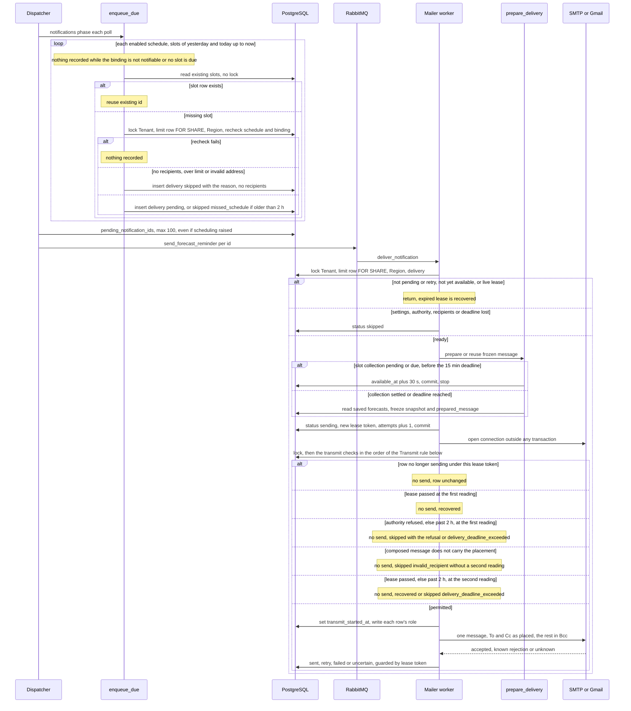

# Reminder delivery

The dispatcher's `notifications` phase turns each enabled plant reminder schedule into one durable
`NotificationDelivery` per local slot, pinning binding, recipients and language, and publishes ready
rows to the `notifications` queue. The mailer worker waits briefly for the slot's forecast collection,
freezes one rendered message, rechecks authority after opening the mail connection and sends one
message whose To, Cc and Bcc follow the schedule's mode and each recipient's placement, decided at the
transmit marker; the outcome is shown in the plant's "Forecast email history". The mail lists tomorrow
first and today second, each with its figure or the reason it has none (incomplete or missing), a line
with the collection time of the forecast when one is known (`Forecast data: 25 Nov 2026, 16:02
(UTC+3)`), and an Excel file. Only when both days have no data at all does it send the same frame
without figures and without a file; a failed preparation sends a plain-text notice instead.

The Excel file (`workbook.py`) is one compact sheet (`Forecast`; `Irradiance` for a region without a
plant) 42 characters wide: columns 9, 9 and 24, or 9, 9, 12 and 12 with the "Without outage (MWh)"
column; no grid lines, no row and column headers, no filter, no frozen rows; cells centred and wrapped,
row heights measured from the wrapped text; printing fits one page wide. On top, full-width rows give
the plant name, the subtitle, the forecast data time (a date-time cell whose format carries the label),
the time zone with its offset and the unit. "Daily totals" follow (Date over the first two columns),
then the notes as full-width rows on a neutral fill. "Hourly values" ("Interval values" for a region
without a plant) then give each day its own block after a blank row: a dark heading row with the date
over the full width, a header row (From, To, the value columns) and the day's rows at full precision.
Days alternate white and a light tint of the header colour (`DDEBEA`), and a day's daily total row
carries the same fill. On a day with a clock change each time cell shows its UTC offset.

## Entry points

- Dispatcher phase `notifications` (first phase of every cycle): `src/pyracast/orchestration/management/commands/dispatch.py` -> `orchestration/dispatcher.py` `phases` -> `src/pyracast/notifications/runtime.py` `dispatch_notifications` -> `scheduler.py` `enqueue_due`, `jobs.py` `pending_notification_ids`; the same phase then publishes outbound account mail (flow `email-transport`).
- Actor `send_forecast_reminder` (`orchestration/kinds.py` `REMINDER`, queue `notifications`, `max_retries=0`): `runtime.py` `deliver_notification` -> `jobs.py` `process_notification`. Consumed only by a worker started with `notifications` in `--queues` (`WORKER_QUEUES` exclude it; `deploy/compose.yaml` service `notifications`).
- Preparation and rendering: `preparation.py` `prepare_delivery`, `sources.py` `eligible_saved_forecasts`, `saved_report_results`, `report_data.py` `saved_report_context`, `rendering.py` `render_forecast` (templates `src/pyracast/notifications/templates/notifications/forecast.txt` and `forecast.html`), `presentation.py` `present_report`, `workbook.py` `build_workbook`, `mail.py` `build_message`, `build_unavailable_message`, `reminder_slot.py` (`collection_slot`, shared with the preparation wait; `missed_collection`; `edition`), `formats.py` (catalogue date formats, `UTC+3` offsets, two-decimal grouped energy, the file name), `links.py` `forecast_day_url`, `reminder_notice.py` (`reminder_headers`, the footer, `forecast_mail`, and `unavailable_text`, the failure notice composed without templates).
- Transmission: `pyracast.mail.send.send` over `mail.mailers["default"]` (flow `email-transport`); `Message-ID` from the delivery's `message_token`.
- Addressing: `recipients.py` (`workspaces`, one read of people in each claim and transmit transaction, made only when the list needs it: `reads_people`, for included members, a typed row with ties or the visible mode; `placements`, `headers`, `carries_exactly`, `record_roles`) and `addressing.py` `roles` (the rule, flow `reminder-configuration`).
- Result surface: `web/src/features/plant/reminders.tsx` "Forecast email history" (columns Scheduled, Recipients, Status, Forecast data, Sent, Details; to administrators each address with its role for `sent` and `uncertain` deliveries, the bare addresses otherwise; counts to other members) via `GET /api/tenants/{t}/regions/{r}/reminders/` (`notifications/views.py` `RemindersView.get`, `overview.reminder_overview`); operator counts in `orchestration/delivery_health.py`, shown by the console (`platform_admin/health.py`, `platform_admin/read_models.py`); read-only rows in the console (`platform_admin/records.py` `NotificationDeliveryAdmin`).

## Sequence

## Data

| Table | R/W | What |
| --- | --- | --- |
| `notifications_reminderschedule`, `notifications_reminderrecipient`, `notifications_reminderrecipienttie`, `notifications_remindermemberrole` | R | The region's schedule: `enabled`, sorted `times`, `include_workspace_members`, `hide_recipients`, `language`, `effective_from`, the typed addresses with their member ties, `role` and `role_members`, and the members' choices |
| `notifications_notificationdelivery` | R/W | One row per schedule slot; status, lease, attempts, language, binding, snapshot, `preparation_deadline`, `prepared_message` (the rendered mail and its frozen report data), the typed metadata `forecast_kind`, `forecast_complete` (tomorrow's energy complete; false when no saved forecast is eligible, null only for the fallback notice) and `prepared_at`, written with the frozen message or the unavailable notice, `transmit_started_at`, `sent_at`, `last_error`, `message_token` |
| `notifications_deliveryrecipient` | R/W | The delivery's candidate addresses (`revoked` flag, `key`); claim and transmit marker delete the rows they exclude, so after the marker the rows are the envelope, and each marker writes every row's `role` for its attempt (`to`, `cc` or `bcc`; a new row is `bcc`, and a retry keeps the previous attempt's roles until its own marker) |
| `notifications_notificationsettings` | R (locked) | Singleton global recipient limit, read `FOR SHARE` in every scheduling slot and every claim and transmit transaction; `operations.py` `recipient_limit` inserts row `pk=1` if it is missing |
| `accounts_tenant`, `regions_region` | R (locked) | Serialization with membership and admin changes; approval, revision, timezone, `deleted_at` |
| `connections_sitebinding`, `connections_provideraccount` | R | Pinned binding; `daily_quota` caps reminder times; account enabled and authorized |
| `accounts_membership`, `auth_user`, `account_emailaddress` | R | One statement per transaction (`recipients.workspaces`): every membership of the workspace with its account's activity, administrator flag, primary and verified addresses; the list, the members of each address and placement derive from it. Read only when the list needs people (`recipients.reads_people`: inclusion, ties, or a schedule not sent hidden) |
| `forecasts_forecastsnapshot`, `forecasts_forecastresult` | R | Eligible saved forecasts and `daily_payloads` for today and tomorrow |
| `forecasts_collectionjob`, `forecasts_collectionschedule` | R | Whether the slot's collection is still running or due |
| `plants_plant`, `plants_plantconfiguration`, `plants_calibrationactivation`, `plants_calibrationrun`, `plants_plantevent`, `metering_epiassnapshot`, `metering_epiascollectionjob`, `incidents_incidentrevision` | R | Electrical report at the slot cutoff: configuration, active calibration and its production evidence, outages |
| `forecasts_dispatcherstatus` | W | Phase `notifications` attempt, success and error type (`orchestration/dispatcher.py` `record_dispatch_phase`) |

## Authorization

No user acts in this flow; authority is the state of the plant at each step and is checked three times.
- Scheduling (`scheduler.py` `_create_slot`, under Tenant, limit and Region locks): `eligibility.py` `binding_can_notify` (region not deleted, approved, current revision, binding is the approved one, provider account enabled and authorized), schedule enabled and current, slot not before `effective_from`, clock within `times[:daily_quota]`. A due slot whose effective recipients are empty, above the global limit or fail `validate_recipient` gets a `skipped` row with the reason and no recipients.
- Claim (`jobs.py` `process_notification` -> `_authorize`, same locks plus the delivery row): schedule enabled and its local time still in `times`; the schedule's list is refused by `jobs.list_refusal` (first, when the list needs one, a read of people in which any person, active or not, holds a non-blank primary or verified address that is not plain, `Workspace.holds_non_plain`; then the scheduler's recipient check, `scheduler.recipient_refusal`); then the row's recipients shrink to `recipients.py` `narrow_recipients` (rows not revoked whose stored key is in the current list) and must not be empty; then the same binding checks against the pinned binding, except `effective_from`.
- Transmit (`jobs.py` `_mark_transmit` inside `send`'s `before_send`): leaves a row no longer `sending` under the attempt's lease token unchanged, repeats `_authorize` with its own read of people when the list needs it, then reads the clock (`_stopped`): a passed lease is recovered as in the failure rows below, else an authorization refusal is recorded, else a passed 2 h deadline. It then places the narrowed list (`recipients.placements`) and sets `to`, `cc` and `bcc` (`recipients.headers`: each key once, in its frozen spelling, at its first placement). Before `transmit_started_at` is written it checks the composed message (`recipients.carries_exactly`): every address is plain, `message.recipients()` is To, Cc and Bcc in order, and the To, Cc and Bcc parsed back from the bytes each transport writes (`recipients.serialized_headers`: SMTP under both body types, Gmail with its added `Bcc` header) are exactly the placed lists in order, a header with no address absent; a message that fails is skipped with `invalid_recipient` at once. Only a message that passes reads the clock again: a passed lease is recovered, else a passed deadline is skipped, and nothing is marked. Then it writes the marker (`transmit_started_at`, the second reading) and every row's `role` (`record_roles`). The marker is the place and cutoff of evaluation: a choice, a join or an address confirmation committed after its read of people changes only a later attempt.
- Database: unique `notificationdelivery_schedule_scheduled_for_uniq` (one delivery per schedule and `scheduled_for`) and `deliveryrecipient_delivery_key_uniq`; checks on status, language, `last_error` (`notificationdelivery_last_error_chk`, every `MailFailure` code is allowed), `notificationdelivery_prepared_message_chk` (a `sending` row holds its prepared message), the prepared message's `format`, `notificationdelivery_forecast_kind_chk`, `notificationdelivery_prepared_at_chk` (no metadata, or a kind with `prepared_at`), and `notificationdelivery_lease_chk` (`sending` holds the lease, `uncertain` keeps or drops it whole). The history is readable by any active workspace member of a non-trashed region (`operations.py` `get_reminder_schedule`): the region's 20 newest rows; administrators read the recipient addresses and, for `sent` and `uncertain` deliveries only, each address's role (`recipients.delivery_roles`: a message that reached nobody showed no address), other members `recipient_count`.

## Failure paths

| Condition | Result |
| --- | --- |
| A schedule raises (for example a database error) | Logged `notification_schedule_failed item=schedule:<id>` with error type and origin, never the message; that schedule is skipped for 15 minutes (process-local); other schedules continue; pending ids are still published; `ItemsFailedError` after publishing, phase stored as `items_failed:<n>` |
| Publishing raises (`pending_notification_ids` or `actor.send`) | Logged `notification_publish_failed` and, when a scheduling failure exists, that failure is the one stored; otherwise the phase is stored with the publishing error type; rows stay ready and are republished next cycle |
| Queue holds 1000 or more messages | Nothing is published this cycle (`publication_skipped`); ids stay in the database |
| Slot older than 2 h when first scheduled, with no recipient refusal | Row created `skipped`, `missed_schedule` |
| Slot: its effective list (`scheduler.slot_recipients`, `recipient_refusal`) holds an address that fails `validate_recipient`, is empty or is above the global limit | Row created `skipped` with `invalid_recipient`, `no_recipients` or `recipient_limit_exceeded` (in that order, and in place of `missed_schedule`), no recipient rows, no snapshot; logged with the schedule id and reason, never the address; the slot is not retried when the cause clears, the next slot is created normally; counted in `paused_notifications` (informational). Only the effective list is checked here: an address that is not plain held only in the read of people, outside the list, does not refuse the slot |
| Unknown or purged delivery id, or its region row is gone | Worker returns without any change |
| Schedule disabled, or the slot's local time removed from `times`, before claim or transmit (at transmit while the lease is valid) | `skipped`, `cancelled_by_settings_change` |
| Delivery, before claim or transmit (`jobs._authorize`): the read of people holds an address that is not plain; the schedule's present effective list holds an address that fails `validate_recipient`, is empty or is above the limit; or none of the delivery's frozen rows is left (`narrow_recipients`); at transmit only while the lease is valid at the first clock reading | `skipped`, `invalid_recipient`, `no_recipients` or `recipient_limit_exceeded` for the list, `no_recipients` for the rows; counted in `paused_notifications`. A list that does not read people is not affected by its people's addresses |
| Overview: the reminder's answer (`overview.assess`) applies `jobs.list_refusal` to the present schedule, never to a delivery's frozen rows | `state` `invalid_recipient`, `no_recipients` or `over_recipient_limit`, else `sending`, unless an earlier state applies (`paused_by_user`, `waiting_for_approval` or `provider_attention`, `overview.reminder_state`); `operations.invalid_recipient_region_ids` reports the plant only for an enabled schedule of an approved region outside the trash whose provider account is enabled |
| At the marker, the composed message does not carry exactly the placement (an address that is not plain, also a frozen row's text, or To, Cc or Bcc that read back otherwise) | `skipped`, `invalid_recipient` at once, also when the lease passed during the check; the lease is released, no marker, no row role written, nothing transmitted |
| A slot already terminal for another reason (`recipient_limit_exceeded`, `no_recipients`) while the answer and the health report name invalid recipients for the same list | Keeps its reason; no mail is sent either way |
| Before claim or transmit (at transmit while the lease is valid) the binding, region or quota no longer permits this slot: the schedule's region is not the binding's, the slot's time is not among the first daily-quota times of the schedule, or the binding can no longer notify (`jobs._authorize`) | `skipped`, `schedule_or_authority_changed` |
| Claimed after 2 h without an authorization refusal; at the transmit marker past 2 h while the lease is valid, at the first clock reading without an authorization refusal or at the second | `skipped`, `missed_schedule` (claim) or `delivery_deadline_exceeded` (transmit) |
| Slot collection pending, or due but not yet created, before the 15 min deadline | Status unchanged; `available_at` moved to `min(now + 30 s, deadline)` |
| Preparation or rendering raises a non-database error | A plain-text failure notice frozen (format `plain`) and sent: the no-forecast subject, the no-figures sentence and the plant link, no HTML part and no file; `forecast_kind` `unavailable`, `forecast_complete` null, `prepared_at` kept from an earlier freeze (its `scheduled_for` when that freeze has none), else now |
| Lock timeout or deadlock during claim or preparation | Transaction rolls back; the delivery ends normally with `job_claim_contended` (`worker-runtime`); the row is left as it was for a later cycle |
| Other database error during claim or preparation | Transaction rolls back; the actor fails without a Dramatiq retry; row stays ready for the next cycle |
| Lease expired before transmission marker | `retry`, `interrupted_connection` (or `failed` after 8 attempts or past 2 h) |
| Lease expired after the transmit marker | `uncertain`, `interrupted_send`; never retried |
| `NotSentError` or an unclassified error before the marker | `retry` with backoff and the `MailFailure` code (`mail_not_sent` when unclassified); `failed` when the budget is exhausted |
| `PermanentlyNotSentError` | `failed` at once with its code (for example `mail_rejected`) |
| `DeliveryUncertainError` or an unclassified error after the marker | `uncertain`, `mail_outcome_uncertain`; never retried |
| Site (region) moved to trash | `pending`, `retry` and a `sending` row before its transmit marker -> `cancelled`; a `sending` row after the marker -> `uncertain`, keeping its lease so a late outcome still lands; all `definition_trashed`, shown in the console as "Plant in recycle bin" (`trash.py` `trash_region`) |

## Rules and invariants

- Lock order in scheduling, claim and transmit: Tenant -> NotificationSettings -> Region -> NotificationDelivery; a settings save follows it, trash and member removal take Tenant -> Region -> delivery rows without the settings row. The settings row is read `FOR SHARE`, held during preparation and rendering: deliveries of other workspaces do not wait for each other, only the platform form's change of the limit waits for them. The scheduler reads existing slots without any lock and locks only to create a missing one, reusing a slot another pass created meanwhile.
- Idempotency: one row per (schedule, slot); duplicate queue messages find a non-ready status or a live lease and return. The final outcome update requires the original lease token, so a late answer can still resolve an `interrupted_send` row of the same attempt. Once `transmit_started_at` is set, a lost outcome is never retried automatically.
- Times: `MAX_LATENESS` 2 h from the slot, `PREPARATION_GRACE` 15 min, `LEASE_DURATION` 5 min. Claim and transmit add the elapsed lock wait to `now` before deadline checks.
- Retry: at most 8 attempts, delay `min(30 * 2^n, 1800)` s after `n` attempts plus 0-30 s jitter (`retry_policy.MAIL`), only if the retry time is before the 2 h deadline. Dramatiq never retries; PostgreSQL state plus the next dispatcher cycle does.
- A save of reminder settings that changes a setting, the mode or a choice (flow `reminder-configuration`) and a restore from trash (`trash.py` `restore_region`) reset `effective_from` to now: earlier slots are never created. A save that changes only the ties keeps it. Rows already queued are not cancelled by the new boundary; they are re-checked against the settings, authority and permitted recipients above. An unchanged settings save writes nothing.
- Recipients are frozen at scheduling as `DeliveryRecipient` rows and only shrink: workspace addresses come from the current memberships at scheduling, claim and marker; a member removal marks the rows `revoked`, which survives retries; the history shows the rows after the marker, else the rows not revoked. A list holds each key once, in its first entry's spelling (`recipients.effective`), so freezing, the limit, the audit counts and the history count it once.
- Addressing: a hidden schedule (`ReminderSchedule.hide_recipients`, the default) puts every recipient in Bcc; a visible one follows the rule of `notifications/addressing.py` (flow `reminder-configuration`) at the marker, over the narrowed list and the marker's read of people. When the only To is narrowed away, the default members move to To. The rows hold the roles of the last attempt that reached its marker (`record_roles`); a retry keeps them until its own marker writes them.
- What is guaranteed is addresses as text, by address identity (`recipient_key`: the text with only ASCII letters lower-cased): an address the transmit marker places in Bcc never appears in To or Cc, and nothing appears there that the marker's placement did not put there; the check on the composed message is what this rests on. Every recipient of a message, Bcc recipients and recipients outside the workspace included, sees its To and Cc headers. The product does not know which addresses a mail provider delivers to one mailbox (dots or tags at some providers, domain aliases) and claims nothing about it: texts with different identities are two recipients with their own placements, and spellings that differ only in ASCII case are one. Visibility follows people: in visible mode the marker places the identities frozen when the slot was scheduled and still permitted (`narrow_recipients`), by the rule applied to the workspace as it is at the marker, without a new save; an identity that becomes eligible later (a member who joins, a newly verified primary address) can enter a later slot when the workspace's members are included. An included member address with no applicable choice is To when one of its members administers the workspace, otherwise Cc when an earlier step placed an address in To, and To otherwise (`addressing.roles`); a typed To or Cc that rests counts again once its address's members are its `role_members` again. A Bcc choice belongs to a person or a typed row: a member's hides that member's present verified primary address, not a text another member later verifies; a typed row's hides its own identity, whoever holds it, and follows each tied active member to that member's present verified primary identity when it is on the list, for as long as the row keeps the tie; it says nothing about other addresses of that member. A visible save's confirmation binds the mode and the exact To and Cc lists, in order and spelling, that the server places at the save's check; the review shows each identity once and can order them, or spell a member's address, otherwise. The lists follow the people afterwards, and the saved view always shows the present placement.
- Content: newest complete tomorrow forecast (`forecast_kind` `current` if from the slot's own collection job, else `saved_complete`), else newest partial (`saved_partial`), else a full report with `forecast_kind` `unavailable`; frozen once and reused by every retry. Each day without a total shows why: incomplete when it has some coverage, missing otherwise; a message with at least one day not missing attaches the workbook, also when neither day has a total. When both days are missing the templated message without figures stores format `xlsx` with no `attachment_name` or `attachment_base64`; the restored message attaches a file only when they are present. The data line is left out when the report has no collection time.
- Not current: when the slot is one of the binding's collection slots and tomorrow's snapshot is not that slot's own forecast job, or when `prepared_at` is more than 26 hours (`presentation.STALE_AFTER`) after the snapshot's collection, `Newer forecast data was not available.` stands above the data line in one notice block and as a note in the workbook. A binding without a collection time uses only the 26-hour rule.
- Subject: `{plant}: forecast for Thu 26 Nov` (with irradiance, incomplete and no-forecast variants). When the slot's local day has more than one send (slots already created and not ended unsent, with those the schedule can still create within the provider quota), the subject ends with ` (14:00 edition)` and the file name `pyracast-{slug}-{date}[-HHMM].xlsx` with `-1400`.
- Retention (flow `dispatcher-cycle`): `prepared_message` of a delivery in a final state (not pending, retry, sending or uncertain) is cleared 90 days after `scheduled_for` (`notifications.retention.trim_rendered_mail`); the row, its typed metadata and its recipients stay, so the history and the health checks read the columns, never `prepared_message`. Every mail ends with the footer that says whose forecast email it is (plant, workspace) and that the workspace's administrators manage who receives it (`reminder_footer`), links the plant as an underlined text link (`mail/text_link.html`), carries no hidden text, and has the headers `Message-ID`, `Auto-Submitted: auto-generated`, `X-Auto-Response-Suppress: OOF, AutoReply` and `Content-Language` with the delivery's language; no list header, no `Precedence`, no `Reply-To`. Emails make no provider requests.
- DST: nonexistent local times are skipped, repeated times use the first occurrence (`local_time.py` `local_slot`).

## Tests

- Scheduling and runtime: `tests/test_notifications.py`, `test_notifications_runtime.py`, `test_claim_contention.py` (a delivery behind a held workspace lock ends without claiming), `test_notification_schedule_isolation.py` (a failing schedule is logged and the others published), `test_reminder_limit_lock.py`, `test_notification_recipient_validation.py`, `test_shared_reminder_schedule.py`, `test_dispatch_resilience.py`.
- Preparation and content: `test_notification_preparation.py` (collection-slot and 20 or 27 hour cases, two editions), `test_notification_completeness.py`, `test_notification_intraday.py`, `test_notification_report_data.py`, `test_notification_presentation.py` (texts, subject, data-time rule, link, frame), `test_notification_workbook.py` (one sheet, the width, the day blocks and their fills), `test_mail_frame.py` (every frame mail without hidden text or invisible filler and with at most two application links), `test_notification_language.py`, `test_notification_render_failure.py`, `test_reminder_mail_footer.py` (failure notice, edition and quota), `test_reminder_message_id.py`, `test_delivery_metadata.py` (typed metadata, no history or health query reads the rendered mail), `test_delivery_metadata_migration.py`, `test_retention_sweeps.py` (rendered mail trimmed).
- Transmission and concurrency: `test_notification_transmission.py`, `test_notifications_races.py`, `test_notification_mail.py`, `test_smtp_mail.py`, `test_gmail_mail.py`, `test_vocabularies.py` (every `MailFailure` is a storable `last_error`).
- Addressing: `test_reminder_addressing_send.py` (To and Cc headers and the envelope follow the rule on the SMTP wire and in the Gmail request, no hidden address in the SMTP content, a mail with Cc and no To, narrowing at the marker, a schedule hidden between claim and marker, roles after a retry, choices across address changes, joins and administrator changes without a save, a confirmation committed after the marker's read leaves that attempt as read), `test_reminder_addressing_wire.py` (the mail headers over SMTP and Gmail, each plain address as typed in every header and serialization, case and look-alike spellings, the composed-message check, people holding an address that is not plain), `test_address_boundaries.py`, `test_reminder_outcome.py`.
- Recipients: `test_notification_groups.py`, `test_notification_group_boundaries.py`, `test_notification_revocations.py`, `test_notification_recipient_history.py`, `test_reminder_recipient_rows.py`; trash and restore: `test_trash_operations.py`, `test_trash_boundaries.py`, `test_trash_restore_rules.py` (`definition_trashed`); health counters and console: `test_delivery_health.py`, `test_admin_health_queries.py`, `test_notification_admin.py`.
- Playwright: `web/tests/reminder-recipients.spec.ts` and `reminder-state.spec.ts` render delivery history from a mocked API only.
