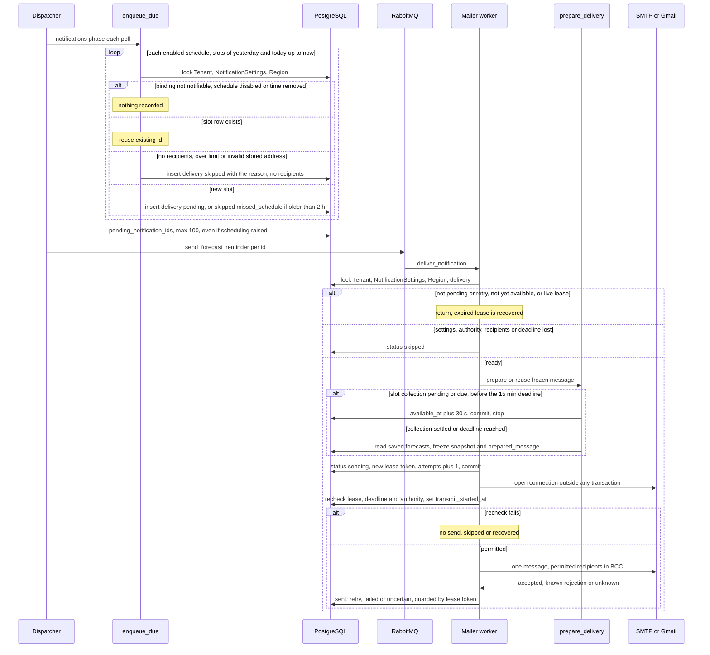

# Reminder delivery

The dispatcher's `notifications` phase turns each enabled plant reminder schedule into one durable
`NotificationDelivery` per local slot, pinning binding, recipients and language, and publishes ready
rows to the `notifications` queue. The mailer worker waits briefly for the slot's forecast collection,
freezes one rendered message with an XLSX attachment, rechecks authority after opening the mail
connection and sends a single BCC message; the outcome is shown in the plant's Email reminders history.

## Entry points

- Dispatcher phase `notifications` (first phase of every cycle): `src/pyracast/forecasts/management/commands/dispatch.py` `Command.handle` -> `src/pyracast/notifications/runtime.py` `dispatch_notifications` -> `scheduler.py` `enqueue_due`, `jobs.py` `pending_notification_ids`.
- Actor `send_forecast_reminder` (queue `notifications`, `max_retries=0`): `runtime.py` `make_notification_actor`, `deliver_notification` -> `jobs.py` `process_notification`. Consumed only by a worker started with `notifications` in `--queues` (`worker.py` defaults exclude it; `deploy/compose.yaml` service `notifications`).
- Preparation and rendering: `preparation.py` `prepare_delivery`, `sources.py` `eligible_saved_forecasts`, `saved_report_results`, `report_data.py` `saved_report_context`, `rendering.py` `render_forecast` (templates `notifications/forecast.txt` and `forecast.html`), `presentation.py` `present_report`, `workbook.py` `build_workbook`, `mail.py` `build_message`, `build_unavailable_message`.
- Transmission: `pyracast.mail.send.send` over `MAILERS["default"]` (flow `email-transport`); `Message-ID` from the delivery's `message_token`.
- Result surface: `web/src/components/reminders.tsx` "Recent deliveries" via `GET /api/tenants/{t}/regions/{r}/reminders/` (`notifications/views.py` `RemindersView.get`, `reminder_schedule_payload`); operator counts in `forecasts/monitoring.py` `delivery_health`; read-only rows in the admin console (`admin.py` `NotificationDeliveryAdmin`).

## Sequence

## Data

| Table | R/W | What |
| --- | --- | --- |
| `notifications_reminderschedule` | R | The region's schedule: `enabled`, sorted `times`, `recipients`, `include_workspace_members`, `recipient_memberships`, `language`, `effective_from` |
| `notifications_notificationdelivery` | R/W | One row per schedule slot; status, lease, attempts, pinned recipients and memberships, `revoked_recipients`, language, binding, snapshot, `preparation_deadline`, `prepared_message` (frozen payload with `kind`, `tomorrow_complete`), `transmit_started_at`, `sent_at`, `last_error` |
| `notifications_notificationsettings` | R/W (locked) | Singleton global recipient limit, read `FOR UPDATE` in every scheduling slot and every claim and transmit transaction; `operations.py` `recipient_limit` inserts row `pk=1` if it is missing |
| `accounts_tenant`, `regions_region` | R (locked) | Serialization with membership and admin changes; approval, revision, timezone, `deleted_at` |
| `connections_sitebinding`, `connections_provideraccount` | R | Pinned binding; `daily_quota` caps reminder times; account enabled and authorized |
| `accounts_membership`, `auth_user`, `account_emailaddress` | R | Effective recipients (active members, verified addresses) and pinned membership ids |
| `forecasts_forecastsnapshot`, `forecasts_forecastresult` | R | Eligible saved forecasts and `daily_payloads` for today and tomorrow |
| `forecasts_collectionjob`, `forecasts_collectionschedule` | R | Whether the slot's collection is still running or due |
| `plants_plant`, `plants_plantconfiguration`, `plants_calibrationactivation`, `plants_calibrationrun`, `plants_plantevent`, `metering_epiassnapshot`, `metering_epiascollectionjob`, `incidents_incidentrevision` | R | Electrical report at the slot cutoff: configuration, active calibration and its production evidence, outages |
| `forecasts_dispatcherstatus` | W | Phase `notifications` attempt, success and error type (`monitoring.py` `record_dispatch_phase`) |

## Authorization

No user acts in this flow; authority is the state of the plant at each step and is checked three times.
- Scheduling (`scheduler.py` `_enqueue_schedule`, under Tenant, settings and Region locks): `eligibility.py` `binding_can_notify` (region not deleted, approved, current revision, binding is the approved one, provider account enabled and authorized), schedule enabled and current, slot not before `effective_from`, clock within `times[:daily_quota]`. A due slot whose effective recipients are empty, above the global limit or fail `validate_recipient` gets a `skipped` row with the reason and no recipients.
- Claim (`jobs.py` `process_notification` -> `_skip_reason`, same locks plus the delivery row): the same checks against the pinned binding, except `effective_from`; the schedule's effective recipients pass the scheduler's recipient check again (`scheduler.slot_recipients`), then the row's recipients shrink to `recipients.py` `permitted_recipients` (still effective, not revoked, a pinned member still active) and must not be empty.
- Transmit (`jobs.py` `_mark_transmit` inside `send`'s `before_send`): repeats the recipient shrink and `_skip_reason`, checks the lease token and expiry and the 2 h deadline, then writes `transmit_started_at` and the final BCC list.
- Database: unique `unique_reminder_group_slot` (one delivery per schedule and `scheduled_for`); check constraints on status, language and `notification_delivery_sending_prepared` (a `sending` row holds its prepared message). The history is readable by any active workspace member of a non-trashed region (`operations.py` `get_reminder_schedule` -> `require_member`): the region's 20 newest rows, recipient addresses included.

## Failure paths

| Condition | Result |
| --- | --- |
| Schedule raises an unexpected error (for example a database error) | Its remaining slots are dropped for this cycle; other schedules continue; pending ids are still published; `NotificationSchedulingError`; phase recorded with the error type |
| Publishing raises (`pending_notification_ids` or `actor.send`) | Phase recorded with that error, which replaces a scheduling error; rows stay ready and are republished next cycle |
| Slot older than 2 h when first scheduled | Row created `skipped`, `missed_schedule` |
| Due slot with no effective recipient, more than the global limit, or a stored address that fails `validate_recipient` or is not a string | Row created `skipped` with `no_recipients`, `recipient_limit_exceeded` or `invalid_recipient`, `recipients` empty, no snapshot; logged with the schedule id and reason, never the address; the slot is not retried when the cause clears, the next slot is created normally; counted in `paused_notifications` (informational) |
| Unknown or purged delivery id, or its region row is gone | Worker returns without any change |
| Schedule disabled, or the slot's local time removed from `times`, before claim or transmit | `skipped`, `cancelled_by_settings_change` |
| Before claim or transmit, the schedule's effective recipients are above the limit or fail `validate_recipient`, or no permitted recipient of the row is left | `skipped`, `recipient_limit_exceeded`, `invalid_recipient` or `no_recipients` (the scheduler's check, shared as `scheduler.slot_recipients`); counted in `paused_notifications` |
| Binding, region or quota changed before claim or transmit | `skipped`, `schedule_or_authority_changed` |
| Claimed or transmitted after 2 h | `skipped`, `missed_schedule` (claim) or `delivery_deadline_exceeded` (transmit) |
| Slot collection pending, or due but not yet created, before the 15 min deadline | Status unchanged; `available_at` moved to `min(now + 30 s, deadline)` |
| Preparation or rendering raises a non-database error | Plain-text "forecast unavailable" notice frozen and sent, `kind` `unavailable` |
| Database error during claim or preparation | Transaction rolls back; the actor fails without a Dramatiq retry; row stays ready for the next cycle |
| Lease expired before transmission marker | `retry`, `interrupted_connection` (or `failed` after 8 attempts or past 2 h) |
| Lease expired after the transmit marker | `uncertain`, `interrupted_send`; never retried |
| `NotSentError` (connection, credentials, SMTP 4xx, Gmail 401, 429 or quota 403, invalid mailer configuration, marker raised) or an unclassified error before the marker | `retry` with backoff and the `MailFailure` code; `failed` when budget is exhausted. `PermanentlyNotSentError` is `failed` at once with its code |
| SMTP 5xx or unsupported transaction, any other Gmail 4xx except 408, invalid Gmail headers | `failed`, `mail_rejected` |
| `DeliveryUncertainError` (SMTP disconnect or invalid reply after DATA began, Gmail 5xx, 408, read timeout, unconfirmed response) or an unclassified error after the marker | `uncertain`, `mail_outcome_uncertain`; never retried |
| Site (region) moved to trash | `pending`/`retry` -> `cancelled`, `sending` -> `uncertain`, both `definition_trashed` (`trash.py` `trash_region`). |

## Rules and invariants

- Lock order in scheduling, claim and transmit: Tenant -> NotificationSettings -> Region -> NotificationDelivery; a settings save follows it, trash and member removal take Tenant -> Region -> delivery rows without the settings row. The settings row is a single global lock, held during preparation and rendering.
- Idempotency: one row per (schedule, slot); duplicate queue messages find a non-ready status or a live lease and return. The final outcome update requires the original lease token, so a late answer can still resolve an `interrupted_send` row of the same attempt. Once `transmit_started_at` is set, a lost outcome is never retried automatically.
- Times: `MAX_LATENESS` 2 h from the slot, `PREPARATION_GRACE` 15 min, `LEASE_DURATION` 5 min. Claim and transmit add the elapsed lock wait to `now` before deadline checks.
- Retry: at most 8 attempts, delay `min(60 * 2^(n-1), 1800)` s plus 0-30 s jitter, only if the retry time is before the 2 h deadline. Dramatiq never retries; PostgreSQL state plus the next dispatcher cycle does.
- A save of reminder settings (`operations.py` `configure_reminders`) and a restore from trash (`trash.py` `restore_region`) reset `effective_from` to now: earlier slots are never created. Rows already queued are not cancelled by the new boundary; they are re-checked against the settings, authority and permitted recipients above. An unchanged settings save writes nothing.
- Recipients pinned at scheduling only shrink; revocations (`remove_member_recipients`) survive retries.
- Content: newest complete tomorrow forecast (`kind` `current` if from the slot's own collection job, else `saved_complete`), else newest partial (`saved_partial`), else a full report with `kind` `unavailable`; frozen once and reused by every retry. Emails make no provider requests.
- DST: nonexistent local times are skipped, repeated times use the first occurrence (`schedule.py` `local_slot`).

## Tests

- Scheduling and runtime: `tests/test_notifications.py`, `test_notifications_runtime.py`, `test_notification_schedule_isolation.py`, `test_notification_recipient_validation.py`, `test_shared_reminder_schedule.py`, `test_dispatch_resilience.py`.
- Preparation and content: `test_notification_preparation.py`, `test_notification_completeness.py`, `test_notification_intraday.py`, `test_notification_report_data.py`, `test_notification_presentation.py`, `test_notification_workbook.py`, `test_notification_language.py`, `test_notification_render_failure.py`.
- Transmission and concurrency: `test_notification_transmission.py`, `test_notifications_races.py`, `test_notification_mail.py`, `test_smtp_mail.py`, `test_gmail_mail.py`.
- Recipients: `test_notification_groups.py`, `test_notification_group_boundaries.py`, `test_notification_revocations.py`, `test_notification_recipient_history.py`; trash and restore: `test_trash_operations.py`, `test_trash_boundaries.py`; health counters: `test_delivery_health.py`, `test_admin_health_queries.py`.
- Playwright: `web/tests/reminder-recipients.spec.ts` renders delivery history from a mocked API only.
- Gaps: no test of contention on the global settings lock under `lock_timeout`; no check that every backend `last_error` code has a UI label; no test asserts `definition_trashed`.
