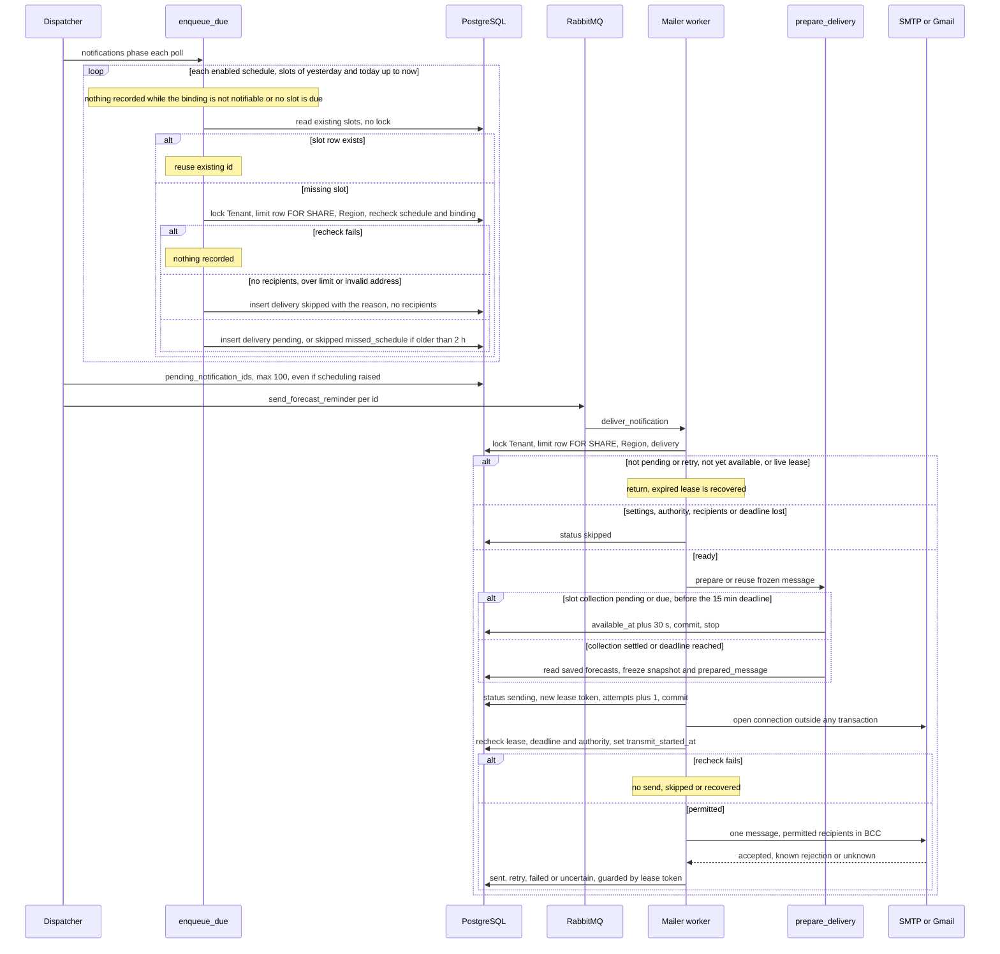

# Reminder delivery

The dispatcher's `notifications` phase turns each enabled plant reminder schedule into one durable
`NotificationDelivery` per local slot, pinning binding, recipients and language, and publishes ready
rows to the `notifications` queue. The mailer worker waits briefly for the slot's forecast collection,
freezes one rendered message with an XLSX attachment, rechecks authority after opening the mail
connection and sends a single BCC message; the outcome is shown in the plant's Email reminders history.

## Entry points

- Dispatcher phase `notifications` (first phase of every cycle): `src/pyracast/orchestration/management/commands/dispatch.py` -> `orchestration/dispatcher.py` `phases` -> `src/pyracast/notifications/runtime.py` `dispatch_notifications` -> `scheduler.py` `enqueue_due`, `jobs.py` `pending_notification_ids`; the same phase then publishes outbound account mail (flow `email-transport`).
- Actor `send_forecast_reminder` (`orchestration/kinds.py` `REMINDER`, queue `notifications`, `max_retries=0`): `runtime.py` `deliver_notification` -> `jobs.py` `process_notification`. Consumed only by a worker started with `notifications` in `--queues` (`WORKER_QUEUES` exclude it; `deploy/compose.yaml` service `notifications`).
- Preparation and rendering: `preparation.py` `prepare_delivery`, `sources.py` `eligible_saved_forecasts`, `saved_report_results`, `report_data.py` `saved_report_context`, `rendering.py` `render_forecast` (templates `notifications/forecast.txt` and `forecast.html`), `presentation.py` `present_report`, `workbook.py` `build_workbook`, `mail.py` `build_message`, `build_unavailable_message`, `reminder_notice.py` (footer, `List-Unsubscribe` header, unavailable notice).
- Transmission: `pyracast.mail.send.send` over `mail.mailers["default"]` (flow `email-transport`); `Message-ID` from the delivery's `message_token`.
- Result surface: `web/src/features/plant/reminders.tsx` "Recent deliveries" via `GET /api/tenants/{t}/regions/{r}/reminders/` (`notifications/views.py` `RemindersView.get`, `overview.reminder_overview`); operator counts in `orchestration/delivery_health.py`, shown by the console (`platform_admin/health.py`, `platform_admin/read_models.py`); read-only rows in the console (`platform_admin/records.py` `NotificationDeliveryAdmin`).

## Sequence

## Data

| Table | R/W | What |
| --- | --- | --- |
| `notifications_reminderschedule`, `notifications_reminderrecipient`, `notifications_reminderrecipienttie` | R | The region's schedule: `enabled`, sorted `times`, `include_workspace_members`, `language`, `effective_from`, and the explicit addresses with their member ties |
| `notifications_notificationdelivery` | R/W | One row per schedule slot; status, lease, attempts, language, binding, snapshot, `preparation_deadline`, `prepared_message` (frozen payload with `kind`, `tomorrow_complete`), `transmit_started_at`, `sent_at`, `last_error`, `message_token` |
| `notifications_deliveryrecipient` | R/W | The delivery's candidate addresses (`revoked` flag); claim and transmit marker delete the rows they exclude, so after the marker the rows are the envelope |
| `notifications_notificationsettings` | R (locked) | Singleton global recipient limit, read `FOR SHARE` in every scheduling slot and every claim and transmit transaction; `operations.py` `recipient_limit` inserts row `pk=1` if it is missing |
| `accounts_tenant`, `regions_region` | R (locked) | Serialization with membership and admin changes; approval, revision, timezone, `deleted_at` |
| `connections_sitebinding`, `connections_provideraccount` | R | Pinned binding; `daily_quota` caps reminder times; account enabled and authorized |
| `accounts_membership`, `auth_user`, `account_emailaddress` | R | Effective recipients (active members, verified addresses) and member ties |
| `forecasts_forecastsnapshot`, `forecasts_forecastresult` | R | Eligible saved forecasts and `daily_payloads` for today and tomorrow |
| `forecasts_collectionjob`, `forecasts_collectionschedule` | R | Whether the slot's collection is still running or due |
| `plants_plant`, `plants_plantconfiguration`, `plants_calibrationactivation`, `plants_calibrationrun`, `plants_plantevent`, `metering_epiassnapshot`, `metering_epiascollectionjob`, `incidents_incidentrevision` | R | Electrical report at the slot cutoff: configuration, active calibration and its production evidence, outages |
| `forecasts_dispatcherstatus` | W | Phase `notifications` attempt, success and error type (`orchestration/dispatcher.py` `record_dispatch_phase`) |

## Authorization

No user acts in this flow; authority is the state of the plant at each step and is checked three times.
- Scheduling (`scheduler.py` `_create_slot`, under Tenant, limit and Region locks): `eligibility.py` `binding_can_notify` (region not deleted, approved, current revision, binding is the approved one, provider account enabled and authorized), schedule enabled and current, slot not before `effective_from`, clock within `times[:daily_quota]`. A due slot whose effective recipients are empty, above the global limit or fail `validate_recipient` gets a `skipped` row with the reason and no recipients.
- Claim (`jobs.py` `process_notification` -> `_authorize`, same locks plus the delivery row): schedule enabled and its local time still in `times`; the schedule's effective recipients pass the scheduler's recipient check again (`scheduler.slot_recipients`), then the row's recipients shrink to `recipients.py` `narrow_recipients` (still effective for the schedule and not revoked) and must not be empty; then the same binding checks against the pinned binding, except `effective_from`.
- Transmit (`jobs.py` `_mark_transmit` inside `send`'s `before_send`): repeats `_authorize`, checks the lease token and expiry and the 2 h deadline, then writes `transmit_started_at` and the final BCC list.
- Database: unique `notificationdelivery_schedule_scheduled_for_uniq` (one delivery per schedule and `scheduled_for`) and `deliveryrecipient_delivery_key_uniq`; checks on status, language, `last_error` (`notificationdelivery_last_error_chk`, every `MailFailure` code is allowed), `notificationdelivery_prepared_message_chk` (a `sending` row holds its prepared message), the prepared message's `format` and `kind`, and `notificationdelivery_lease_chk` (`sending` holds the lease, `uncertain` keeps or drops it whole). The history is readable by any active workspace member of a non-trashed region (`operations.py` `get_reminder_schedule`): the region's 20 newest rows; administrators read the recipient addresses, other members `recipient_count`.

## Failure paths

| Condition | Result |
| --- | --- |
| A schedule raises (for example a database error) | Logged `notification_schedule_failed item=schedule:<id>` with error type and origin, never the message; that schedule is skipped for 15 minutes (process-local); other schedules continue; pending ids are still published; `ItemsFailedError` after publishing, phase stored as `items_failed:<n>` |
| Publishing raises (`pending_notification_ids` or `actor.send`) | Logged `notification_publish_failed` and, when a scheduling failure exists, that failure is the one stored; otherwise the phase is stored with the publishing error type; rows stay ready and are republished next cycle |
| Queue holds 1000 or more messages | Nothing is published this cycle (`publication_skipped`); ids stay in the database |
| Slot older than 2 h when first scheduled | Row created `skipped`, `missed_schedule` |
| Due slot with no effective recipient, more than the global limit, or an address that fails `validate_recipient` | Row created `skipped` with `no_recipients`, `recipient_limit_exceeded` or `invalid_recipient`, no recipient rows, no snapshot; logged with the schedule id and reason, never the address; the slot is not retried when the cause clears, the next slot is created normally; counted in `paused_notifications` (informational) |
| Unknown or purged delivery id, or its region row is gone | Worker returns without any change |
| Schedule disabled, or the slot's local time removed from `times`, before claim or transmit | `skipped`, `cancelled_by_settings_change` |
| Before claim or transmit, the schedule's effective recipients are above the limit or fail `validate_recipient`, or no permitted recipient of the row is left | `skipped`, `recipient_limit_exceeded`, `invalid_recipient` or `no_recipients`; counted in `paused_notifications` |
| Binding, region or quota changed before claim or transmit | `skipped`, `schedule_or_authority_changed` |
| Claimed or transmitted after 2 h | `skipped`, `missed_schedule` (claim) or `delivery_deadline_exceeded` (transmit) |
| Slot collection pending, or due but not yet created, before the 15 min deadline | Status unchanged; `available_at` moved to `min(now + 30 s, deadline)` |
| Preparation or rendering raises a non-database error | Plain-text "forecast unavailable" notice frozen and sent, `kind` `unavailable`; it names the plant, links to it and gives the reminder time in plant time |
| Database error during claim or preparation | Transaction rolls back; the actor fails without a Dramatiq retry; row stays ready for the next cycle |
| Lease expired before transmission marker | `retry`, `interrupted_connection` (or `failed` after 8 attempts or past 2 h) |
| Lease expired after the transmit marker | `uncertain`, `interrupted_send`; never retried |
| `NotSentError` or an unclassified error before the marker | `retry` with backoff and the `MailFailure` code (`mail_not_sent` when unclassified); `failed` when the budget is exhausted |
| `PermanentlyNotSentError` | `failed` at once with its code (for example `mail_rejected`) |
| `DeliveryUncertainError` or an unclassified error after the marker | `uncertain`, `mail_outcome_uncertain`; never retried |
| Site (region) moved to trash | `pending`/`retry` -> `cancelled`, `sending` -> `uncertain`, both `definition_trashed` (`trash.py` `trash_region`) |

## Rules and invariants

- Lock order in scheduling, claim and transmit: Tenant -> NotificationSettings -> Region -> NotificationDelivery; a settings save follows it, trash and member removal take Tenant -> Region -> delivery rows without the settings row. The settings row is read `FOR SHARE`, held during preparation and rendering: deliveries of other workspaces do not wait for each other, only the platform form's change of the limit waits for them. The scheduler reads existing slots without any lock and locks only to create a missing one, reusing a slot another pass created meanwhile.
- Idempotency: one row per (schedule, slot); duplicate queue messages find a non-ready status or a live lease and return. The final outcome update requires the original lease token, so a late answer can still resolve an `interrupted_send` row of the same attempt. Once `transmit_started_at` is set, a lost outcome is never retried automatically.
- Times: `MAX_LATENESS` 2 h from the slot, `PREPARATION_GRACE` 15 min, `LEASE_DURATION` 5 min. Claim and transmit add the elapsed lock wait to `now` before deadline checks.
- Retry: at most 8 attempts, delay `min(30 * 2^n, 1800)` s after `n` attempts plus 0-30 s jitter (`retry_policy.MAIL`), only if the retry time is before the 2 h deadline. Dramatiq never retries; PostgreSQL state plus the next dispatcher cycle does.
- A save of reminder settings (flow `reminder-configuration`) and a restore from trash (`trash.py` `restore_region`) reset `effective_from` to now: earlier slots are never created. Rows already queued are not cancelled by the new boundary; they are re-checked against the settings, authority and permitted recipients above. An unchanged settings save writes nothing.
- Recipients are frozen at scheduling as `DeliveryRecipient` rows and only shrink: workspace addresses come from the current memberships at scheduling, claim and marker; a member removal marks the rows `revoked`, which survives retries; the history shows the rows after the marker, else the rows not revoked.
- Content: newest complete tomorrow forecast (`kind` `current` if from the slot's own collection job, else `saved_complete`), else newest partial (`saved_partial`), else a full report with `kind` `unavailable`; frozen once and reused by every retry. Every mail ends with a footer naming the workspace and plant and how to stop, and carries a `List-Unsubscribe` mailto header to the sender mailbox. Emails make no provider requests.
- DST: nonexistent local times are skipped, repeated times use the first occurrence (`local_time.py` `local_slot`).

## Tests

- Scheduling and runtime: `tests/test_notifications.py`, `test_notifications_runtime.py`, `test_notification_schedule_isolation.py` (a failing schedule is logged and the others published), `test_reminder_limit_lock.py`, `test_notification_recipient_validation.py`, `test_shared_reminder_schedule.py`, `test_dispatch_resilience.py`.
- Preparation and content: `test_notification_preparation.py`, `test_notification_completeness.py`, `test_notification_intraday.py`, `test_notification_report_data.py`, `test_notification_presentation.py`, `test_notification_workbook.py`, `test_notification_language.py`, `test_notification_render_failure.py`, `test_reminder_mail_footer.py`, `test_reminder_message_id.py`.
- Transmission and concurrency: `test_notification_transmission.py`, `test_notifications_races.py`, `test_notification_mail.py`, `test_smtp_mail.py`, `test_gmail_mail.py`, `test_vocabularies.py` (every `MailFailure` is a storable `last_error`).
- Recipients: `test_notification_groups.py`, `test_notification_group_boundaries.py`, `test_notification_revocations.py`, `test_notification_recipient_history.py`, `test_reminder_recipient_rows.py`; trash and restore: `test_trash_operations.py`, `test_trash_boundaries.py`, `test_trash_restore_rules.py` (`definition_trashed`); health counters and console: `test_delivery_health.py`, `test_admin_health_queries.py`, `test_notification_admin.py`.
- Playwright: `web/tests/reminder-recipients.spec.ts` and `reminder-state.spec.ts` render delivery history from a mocked API only.
