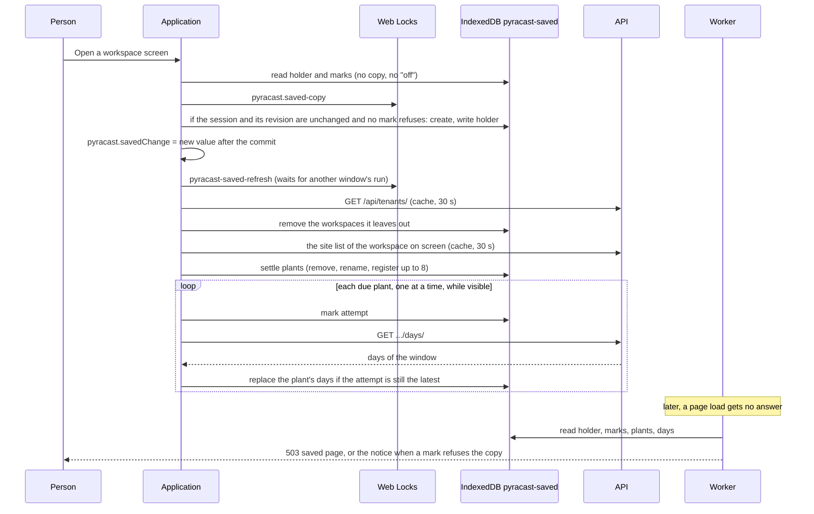

# Keep figures on a device: the setting, the refresh and the saved pages

Figures are kept on a device by default; a person turns this off with a checkbox under "Account". The browser then
holds the forecast and production figures of up to eight of the person's plants, and the application reads each plant's
days again when they are due. When the server does not answer a page load under `/app/`, the service worker shows a
page built from those figures. Sign-out, another person's sign-in, the setting, a removal on a saved page and 90 days
without a sign-in remove them. The facts that decide whether figures may be kept and shown (the person's "off" and the
sessions that ended) live in the same database as the figures, and the application and the worker read them in the
transactions that read the copy. The server keeps nothing for any of this.

## Entry points

- `web/src/features/account/kept-figures-setting.tsx`: the checkbox in the account settings, on by default. It shows
  the state the store last confirmed; while a choice is written its panel is `aria-busy` and shows `Common.saving`,
  and it changes once the write committed. Texts are the `KeptFigures` namespace of `web/messages/{en,tr}/core.json`;
  a choice that could not be stored, or a copy the device refused to create, shows `Common.saveFailed` on the field.
- `web/src/features/saved/saved-figures.ts`: the plant and workspace on screen (`useShownPlant` in
  `web/src/features/plant/plant-workspace.tsx`, `useShownWorkspace` in the switch), the mount of the refresh
  (`useSavedFigures` in `web/src/features/workspace/workspace-shell.tsx`, so only the workspace screens keep and
  refresh), the default keeping, the setting's read and write (`useKeptFiguresPreference`) and the registration check.
  Both read the copy again at every committed change, at every change signalled by another window, when the window
  becomes visible and when `navigator.serviceWorker.ready` settles (a registration that completes after the screen
  mounted).
- `web/src/features/saved/refresh.ts`: the refresh, loaded through `import()` only while it runs.
- `web/src/lib/saved/feature.ts`: the constant `SAVED_FIGURES`, in the first load so a withdrawn build loads neither the
  refresh nor the switch's store reads.
- `web/src/lib/saved/store.ts`: the only IndexedDB code of the application, loaded through `import()`.
  `web/src/lib/session-client.ts` `boundedStore` runs store operations through one queue per document, one Web Lock per
  browser (`pyracast.saved-copy`) and one deadline of 2 s per operation; a read of the state skips the queue and the
  lock, since IndexedDB orders it. `commitToStore` runs the setting's choice and a sign-out's record the same way and
  answers only once the write committed: the deadline aborts the write unless its commit has begun, and only a
  committed write is told to other windows. It keeps the change signal.
- `web/src/lib/api/query.ts` `readListOnce`: the workspace list and the site list, read through the query cache under
  the screens' key with a `staleTime` of 30 s.
- The days read: `GET /api/tenants/{tenant}/regions/{site}/plants/{plant}/days/` (`PlantDaysView` in
  `src/pyracast/plants/api.py`, the answer from `src/pyracast/plants/plant_days.py`).
- `web/public/app/sw.js`: the reader and the saved pages (`docs/flows/installed-app.md`).

## Sequence

## What the device holds

| Storage                                          | Written by                                                        | Content                                                                                                                                                                                                                                                                                                                                        |
| ------------------------------------------------ | ----------------------------------------------------------------- | ---------------------------------------------------------------------------------------------------------------------------------------------------------------------------------------------------------------------------------------------------------------------------------------------------------------------------------------------- |
| `pyracast.savedChange` (`localStorage`)     | A committed creation, choice or sign-out record             | A random value; other windows read the setting, the cover and the refresh's state again. It never decides anything                                                                                                   |
| `pyracast.sessionRevision` (`localStorage`) | Every change of the observed session tag                    | A random value; a session read is used only when tag and revision are what they were when it started                                                                                                                 |
| `pyracast-saved` (IndexedDB, version 1)     | `store.ts`, the worker                                      | `holder` under the key `"holder"`: `{ user, language, session, active, confirmedAt, removal, retryAt }`; in the same store the marks `["off", user]` (this person turned keeping off here) and `["ended", at, session]` (a sign-out of that session began at `at`; marks older than 90 days are dropped when one is written); `plants` keyed `[tenant, site, plant]`: `{ name, workspace, openedAt, attemptedAt, refreshedAt }`; `days` keyed `[tenant, site, plant, kind, date]`: the day object of the days read unchanged. Times are `Date.now()` values or null |

## Rules and where they are implemented

| Rule (PLAN section 2)                                                                                                                                                                                                                                                                                                                                                                                                                                                                                                                                                                                                                                                                                                                                                                                                                                                 | Implemented in                                                                                                                                                                               |
| --------------------------------------------------------------------------------------------------------------------------------------------------------------------------------------------------------------------------------------------------------------------------------------------------------------------------------------------------------------------------------------------------------------------------------------------------------------------------------------------------------------------------------------------------------------------------------------------------------------------------------------------------------------------------------------------------------------------------------------------------------------------------------------------------------------------------------------------------------------------- | -------------------------------------------------------------------------------------------------------------------------------------------------------------------------------------------- |
| Offline reading: only the worker's answer to a page load the server did not answer; figures of up to 8 plants, forecast 7 days back to 14 ahead, production 30 days back, as the days read answers                                                                                                                                                                                                                                                                                                                                                                                                                                                                                                                                                                                                                                                                    | `web/public/app/sw.js` (reader, builder); window in `src/pyracast/plants/plant_days.py`; bound of 8 in `store.ts` `openPlant`, `settle`                                                      |
| Saved pages: no script, links built from integer ids, notice CSP, removal on a saved page with the token                                                                                                                                                                                                                                                                                                                                                                                                                                                                                                                                                                                                                                                                                                                                                              | `web/public/app/sw.js`                                                                                                                                                                       |
| The days read: one read per plant, scope `days` at 120 an hour, one read per API process at a time, refused day `calculation_out_of_range`                                                                                                                                                                                                                                                                                                                                                                                                                                                                                                                                                                                                                                                                                                                            | `src/pyracast/plants/api.py` `PlantDaysView`, `src/pyracast/plants/plant_days.py`, `src/pyracast/settings.py`, `src/pyracast/api/permissions.py`                                             |
| The copy: created only by the keeping of a workspace screen, never for a person or session a mark refuses; at most 8 plants (one never opened leaves first, then the least recently opened), 22 forecast and 30 production days, 52 rows a day; one transaction replaces a plant's days                                                                                                                                                                                                                                                                                                                                                                                                                                                                                                                                                                                                                                                    | `store.ts` `turnOn`, `openPlant`, `settle`, `writeDays`                                                                                                                                      |
| Refresh: only inside the workspace screens; at the mount, turn on, a plant opened, `online`, visible, every 5 min while visible, a changed production answer of the plant on screen; a start during a run runs once more after it; due when never read, the plant on screen after 15 min or after a production change, any other after 60 min, never within 5 min of the last attempt; one run per browser, a start in another window waits for it and then judges by its own screen; the holder is checked before any list read, and the window's visibility, the holder and the session before each request and before an attempt is marked; an answered workspace list removes the workspaces it leaves out at once; a 403 removes the workspace, a 404 the plant, a 429 stops days reads for the time it names and at least 5 min, any other failure ends the run | `web/src/features/saved/refresh.ts`, `store.ts` `markAttempt`, `writeDays`, `setRetryAt`, `removeWorkspace`, `removePlant`                                                                   |
| Who may read the copy: one rule, `store.ts` `refuses`: no copy is created, activated, refreshed or reported as shown for a person with an "off" mark or a session with an "ended" mark, read in the transaction that acts; the worker applies the same rule (`sw.js` `refused`), pinned to the store by one table of cases. Turning off writes the mark and removes that person's holder and figures in one transaction; a sign-out writes its mark and pauses its session's holder in one transaction (also without a copy, creating the database) and sends its request only once that committed, or, when it cannot commit within 10 s, after deleting the whole database with `indexedDB.deleteDatabase`; every signed-in start asks the browser whether the database exists (`indexedDB.databases()`, an absence again under the lock) and, unless it answers that it does not, the store, and another user's start removes the holder and the figures and keeps the marks; 90 days after the last signed-in start | `kept-figures-setting.tsx`, `saved-figures.ts`; `store.ts` `refuses`, `setKept`, `endSession`, `adopt`, `turnOn`; `session-client.ts` `handOff`, `signOut`, `turnOnSavedFigures`; `sw.js` `refused` and the expiry |

## Authorization

- The days read is a member read of any role, checked as the forecast read checks a plant; the device keeps only
  figures the person could download as CSV.
- A plant or day is written only while the holder is active, its user and session tag equal the document's and no mark
  refuses them, checked in the transaction that writes; an answer whose attempt was overtaken is dropped there too.
- The setting is shown only where the worker is registered for `/app/`, `SAVED_FIGURES` is on and IndexedDB answered
  once; a later read that fails keeps the field and its last confirmed state. Without a registration the copy is not
  refreshed either, since only the worker reads it.
- A creation that waited for the lock changes nothing when, inside its transaction, the session or the observed
  revision is no longer the one it started with, or a mark refuses the person or the session.
- Keeping never asks the browser for persistent storage.
- With `SAVED_FIGURES` off no refresh starts, the setting and "Show last loaded figures" are not shown and
  their store reads are not loaded, whatever the copy holds and whether its deletion at start succeeded.

## Failure paths

| Case                                                    | Behaviour                                                                                                                                                                                                                                                                                       |
| ------------------------------------------------------- | ----------------------------------------------------------------------------------------------------------------------------------------------------------------------------------------------------------------------------------------------------------------------------------------------- |
| The database cannot be opened, or is of a newer format  | No setting; a signed-in start shows "The figures kept on this device could not be checked." with Try again. Storage refused at the open itself (`indexedDB.open` throws) holds no copy the worker could read, so the start goes on |
| The device refuses to create the copy                   | The setting shows keeping off with `Common.saveFailed`; the next check tries again |
| A days read answers 403 or 404                          | The workspace's plants, or the plant, are removed and the run goes on                                                                                                                                                                                                                           |
| A days read answers 429                                 | `retryAt` is set to the time it names, at least 5 min ahead; no days read is sent before                                                                                                                                                                                                        |
| A days read answers 401, 500 or gets no answer          | The run ends; the held days stay                                                                                                                                                                                                                                                                |
| The site list fails after the workspace list answered   | The workspaces the list left out are already removed; on 403 or 404 the workspace on screen leaves the device and the run goes on with the other plants, otherwise the run ends                                                                                                                 |
| The window is hidden                                    | No run starts and a running one sends no further request                                                                                                                                                                                                                                        |
| A choice that cannot be stored                          | The field says it could not be saved and keeps the state the store last confirmed                                                                                                                                                                                                               |
| A sign-out whose record cannot commit within 10 s       | The database is deleted before the request; a pending deletion holds every later open, the worker's too. The deletion leaves no mark of the session's end: another window of that session that keeps figures before the request ends the session can create the copy again, and a deletion the browser itself fails leaves the copy as it was; the worker can then show it offline until a later sign-in hands it over, a later sign-out ends it or its 90 days pass |
| Another window holds the lock                           | The operation waits within its 2 s deadline; a refresh start waits for the other window's run and then runs                                                                                                                                                                                     |
| A session read answers while the store is busy past 2 s | The same owner with no other session observed since its adoption: the screen and the refresh go on, and the hand-over (marks, language, the 90 days) runs behind it and is retried at the next read; another owner or revision: "The figures kept on this device could not be checked." |

## Cost of the days read

Measured in K70: about 8 queries per forecast day without a calibration, 13 with one usable calibration and 15 with a
usable calibration that carries provider evidence; no query per production day. The read stays under 25 single-day
forecast reads, also at ten times the forecast history (about 14 to 15 on a development machine).

## Tests

- `web/tests/keep-figures.spec.ts`: observed at the worker's answer: the setting, a creation overtaken by a sign-out, a
  window opened during another window's sign-out, an "off" while the lock is held or while another window's creation
  waits, a choice being written, a choice that cannot be stored or that another window's stored choice replaces, a
  failed read, a registration after the screen mounted; observed in the store: a creation the device refuses, a
  creation overtaken by a session change, a signed-in start that waits for another window's lock, a
  session read again while the store is busy, committed changes in other windows, the refresh's cadence, visibility, a window hidden while its run judges the plants, a start during a run or in another window's run, the 429
  pause, the 403, 404 and 500 answers, a workspace left out of the list, a plant opened, a production change, two
  windows, the invitation page, the cached site list, the store's bounds and write guards, the privacy notice.
- `web/tests/saved-figures-withdrawn.spec.ts`: runs only when `feature.ts` sets `SAVED_FIGURES` to `false`; no switch,
  cover button, refresh code, registration lookup or read over a copy whose deletion failed; a database of marks only is
  deleted.
- `web/tests/saved-copy.spec.ts`: a start without a database that loads no store code, a browser that lacks or fails
  the database list, adoption, every removal, the sign-out's record before its request and the deletion
  when it cannot commit, each observed at the worker's answer, the marks against every writer, the rule's table of
  cases against the store, the observed revision, the notice.
- `web/tests/saved-pages.spec.ts` and `web/production-tests/saved-pages.spec.ts`: the worker's pages, the rule's table
  of cases against the worker.
- `web/production-tests/round-trip.spec.ts`: with saved figures on, switch on, offline pages (each answer checked as the
  worker's), renewal after the connection returns, removal on a saved page and a sign-out without a connection; with
  them withdrawn, no switch and no days read. `web/tests/support/worker-state.ts` tells the three states apart: saved
  figures on, saved figures withdrawn with the worker kept, the worker withdrawn.
- `tests/test_plant_days.py`: the days read.

## Device checklist

On Edge (Windows), Chrome (Android) and Safari (iOS, iPadOS 26 and 27, macOS with Add to Dock), for each release that
touches the worker, the switch or sign-in:

1. Figures are kept after sign-in without a prompt, and turning the setting off under "Account" removes them.
2. Turn on, open a plant, then airplane mode: launch from the icon after the app was closed; read a plant that was never
   opened, both kinds and another day; see the curve and the read time.
3. Connection back: "Try again" or a link opens the application, and after the next read the figures are the server's.
4. "Remove saved figures" works in airplane mode.
5. After a sign-out no saved page appears, also through Back in a window that showed one.
6. On iOS: the installed app after two weeks unused, and a Safari tab after a week of other browsing.

## Withdrawal

- Offline reading alone: a release that sets `SAVED_FIGURES` in `web/src/lib/saved/feature.ts` to `false` and serves
  the Phase 3 worker (the worker without the reader and the saved pages); the tests then run in the state "saved
  figures withdrawn". Every document then deletes the database at its start where one exists (a copy whose clear is
  refused stays, unread), the setting renders nothing and no refresh runs. Keep the deletion at start for at least one further release, 90 days later,
  because a window of the withdrawn build can still keep figures until its session ends.
- The worker: the withdrawal of `docs/DEPLOYMENT.md`, "App worker", together with `SAVED_FIGURES` off, so no copy
  remains without a reader.
