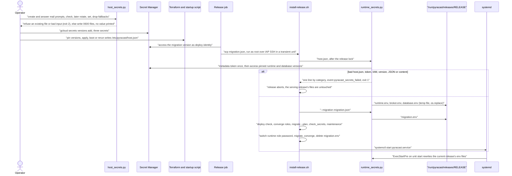

# Generate, upload and materialise production secrets

An operator generates three JSON secrets locally with `deploy/host_secrets.py` and uploads each as a Secret Manager version by hand. On the VM, `deploy/runtime_secrets.py` turns the pinned runtime and database versions into root-only env files in a directory staged for each release under `/run/pyracast/releases` at every release and every start of `pyracast.service`; the release job additionally hands it the migration secret (the pinned version, else `latest`) for the duration of the migration. No Django view, web screen or database table is involved.

## Entry points

- Operator commands `uv run --locked python deploy/host_secrets.py create|check|rotate TARGET|drop-fallbacks|set KEY` (`main`); files go to the repository's git-ignored `secrets/` (`--directory` overrides). `create` writes the three files and asks the mail questions; `check` tests them against the host contract; `rotate secret-key|runtime-password|owner-password` replaces one generated value (the broker and database superuser passwords are refused: they only initialise a new data directory); `drop-fallbacks` finishes a secret-key rotation; `set` stores one setting typed without echo.
- Operator commands `gcloud secrets versions add pyracast-runtime|pyracast-migration|pyracast-database --data-file=secrets/<name>.json` (manual, `docs/DEPLOYMENT.md` "2. Add secrets"). `deploy/authorize_gmail.py` edits `runtime.json` in between (own flow).
- Terraform variables `runtime_secret_version` and `database_secret_version` (`infra/terraform/variables.tf`), rendered into `/etc/pyracast/host.json` (mode `0600`) by the `startup-script` metadata (`infra/terraform/main.tf`, `templates/startup.sh.tftpl`) that runs at boot. Terraform creates the three secrets (`google_secret_manager_secret.application`) but never a version; the migration version is the GitHub variable `GCP_MIGRATION_SECRET_VERSION` (empty reads `latest`).
- `deploy/install-release.sh` (root, run by `deploy/release_unit.py` from the `release.yml` step "Transfer the verified release and deploy through IAP") runs `deploy/runtime_secrets.py` (`main`) plain, which writes the runtime, broker and database files, then with `--migration`, which writes `migration.env`. It then applies the staged passwords to the roles (`deploy/bootstrap_database.py`) and runs `check_secrets` (see `database-migration`, `encryption-key-rotation`). `ExecStartPre` of `pyracast.service` (`templates/startup.sh.tftpl`) runs the helper plain whenever the unit starts: at boot, from the startup script, and from the `systemctl start` that ends the release. A resume of the previous release runs it plain too.

## Sequence

## Data

No PostgreSQL table is read or written (`bootstrap_database.py` only sets the role passwords from the staged secrets).

| Table | R/W | What |
| --- | --- | --- |
| `secrets/*.json` (workstation) | W `host_secrets.py`, R upload | `create` once; `rotate`, `set` and `drop-fallbacks` replace a file atomically; removed by the operator after upload |
| Secret Manager `pyracast-runtime`, `-migration`, `-database` | W operator, R VM and deploy identity | JSON objects of environment strings |
| `/etc/pyracast/host.json` | W startup script, R `runtime_secrets.py` through `deploy/host_contract.py` | pinned version resource names from Terraform |
| `migration.json` in the runner temp dir and the VM stage `/run/pyracast-release-<sha>-<run>-<attempt>` | W release job, R `--migration` | removed by the installer cleanup and the workflow cleanup |
| `/run/pyracast/releases/<release>/{runtime,broker,database,migration}.env` | W `runtime_secrets.py`, R Compose, `bootstrap_database.py` | tmpfs env files named in the release's `release.env`; a release reads only its own directory; `release_state.py prune` removes those of retired releases |

## Authorization

- Upload uses the operator's own Google credentials; Terraform grants no `secretVersionAdder` (`infra/terraform/iam.tf`). Local files are `0600` in a `0700` directory on POSIX only, and the directory mode applies only when `create` creates it; `write_environment` uses `mkstemp` in a `0700` directory.
- The runtime service account reads only `runtime` and `database` (`runtime_read`), the deploy account only `migration` (`migration_read`). Grants are per secret, so every version is readable. Terraform binds the deploy account only to Workload Identity from the release workflow on `main` in the configured environment; it and every `operator_members` entry are OS Login administrators (`ssh_admin`) and may act as the runtime account (`ssh_runtime_identity`): an IAM split, not a barrier against a compromised release job. Secret Manager `DATA_READ` access is audit-logged.
- `runtime_secrets.py` accepts only a pinned `projects/.../secrets/.../versions/<number>` resource from the validated host contract, so `latest` is refused on the VM. `install-release.sh` refuses to run without root and eight validated arguments. Compose scoping (`deploy/compose.yaml`): `web` and `gateway` have no env file, `postgres` only `database.env`, `rabbitmq` only `broker.env`, `migration.env` only the `migrate` service.

## Failure paths

| Condition | Result |
| --- | --- |
| `create` finds a secret file, or the mail backend is not `gmail`/`smtp`, or the SMTP host is empty | Exit 2, no file written (an existing key is preserved); a failed write removes what it already wrote |
| `check` finds a problem | Each one named by file and key, never a value; exit 1 |
| `rotate`, `set` or `drop-fallbacks` on a file that is not environment strings, a runtime file without a key, a managed or unknown key, or no fallbacks to drop | Exit 2, the file is unchanged |
| Version variable below 1 or not an integer; or a pinned version that does not exist | Plan error; or (inferred, not run) plan and apply succeed and boot or release fails at access time |
| Any error in `runtime_secrets.py` | Exit 1 (at boot `pyracast.service` fails in `ExecStartPre`) with one line "Secret preparation failed (CATEGORY): ..." where the category is configuration, identity, permission, version, unavailable, format, write or unexpected, and the event `pyracast_secrets_failed` (an alert) naming the category and the secret. Answers 429, 5xx and network errors are retried for 60 s; no secret text is printed |
| That or any other release failure before maintenance (staging, image pull, deploy check, role convergence, database wait, plan, `check_secrets`) | Abort; the serving release's secrets are untouched because each release has its own directory; `migration.json` and `migration.env` removed |
| Release failure after maintenance began (backup, migration, health, final `systemctl start`) | The new release's env files stay, application stopped and `release-blocked` set (see `release-pipeline`), migration files removed |
| Release lock not obtained within 300 s | Exit 1 before the cleanup trap is set: nothing staged, `migration.json` left for the workflow cleanup |
| `gcloud secrets versions access` fails | Release step fails before any VM change, local stage files removed |
| Installer killed by SIGKILL | `migration.json` and `migration.env` stay (pinned by `deploy/test-release.sh`); the workflow cleanup removes the stage unless the release unit still runs, and `migration.env` lasts until reboot or the prune that retires that release |

## Rules and invariants

- Runtime and database versions change only after `terraform apply` plus a startup-script rerun or reboot refreshes `host.json`, and take effect at the next release or unit start. The migration secret is the exception: every release reads the version `GCP_MIGRATION_SECRET_VERSION` names, else `latest`.
- A new version is a rotation only through the release: the owner's password converges in preflight (the serving release does not use it), the runtime role's after api and web stopped, both only when the stored verifier differs. `POSTGRES_PASSWORD` and `RABBITMQ_DEFAULT_PASS` only initialise a new data directory, so `rotate` refuses them.
- Content contract: keys match `[A-Z][A-Z0-9_]*`, values are strings without CR, LF or NUL, Compose reads `format: raw` so `$` is never expanded. `host_secrets.py check` also requires the runtime keys, role names `pyracast_app` and `pyracast_owner`, complete sign-in client id and secret pairs and distinct runtime and owner passwords, and names keys the application does not read. Runtime keys not starting with `PYRACAST_`, `PG` or `EPIAS_` are dropped silently by the helper, and the Compose `environment` block overrides same-named keys (`PGHOST`, `PGPORT`, `PGDATABASE`, `PYRACAST_DEBUG`, host and proxy settings). `RABBITMQ_DEFAULT_PASS` goes to `broker.env` and, percent-encoded, into `PYRACAST_RABBITMQ_URL` (fixed user `pyracast`), never into `runtime.env`.
- The migration secret is exactly `PGUSER` and `PGPASSWORD`, the database secret exactly `POSTGRES_PASSWORD`. `migration.env` follows `runtime.env` in `migrate`, so it overrides the application role for every `migrate` service run of the release (deploy check, database wait, plan, `check_secrets`, migrate) and is deleted after the migration.
- `install-release.sh` holds `/var/lib/pyracast/release.lock` while materialising; `ExecStartPre` does not take it, `ExecStop` does. `RuntimeDirectory=pyracast` lets systemd create and remove `/run/pyracast` with the unit (removal not verified on a VM). The helper writes nothing until both host secrets validate; each file is then replaced atomically, the set is not.

## Tests

- `tests/test_host_secrets.py`: `create`, `check`, `rotate`, `set` and `drop-fallbacks` (private files, no printed value, refusals, atomic replacement). `tests/test_deployment_secrets.py`: entry validation without leaking the payload, broker separation, percent-encoding and literal `$`, key sets, the staged directory of the resolved release, one identity token, retry with backoff, failures by category and write failures. `tests/test_host_contract.py`, `tests/test_deployment_helpers.py` (`runtime_secrets.py` parses as Python 3.12, Ubuntu's system Python). `deploy/test-release.sh` (CI job `deployment`): release failure modes with `runtime_secrets.py` mocked; pins migration file cleanup, their survival after SIGKILL and `migration.json` after a lock timeout.
- No Playwright test applies. Gaps: real Secret Manager and metadata answers (the helper is tested against stubs), the real `--migration` wiring end to end, and the `RuntimeDirectory` removal.
