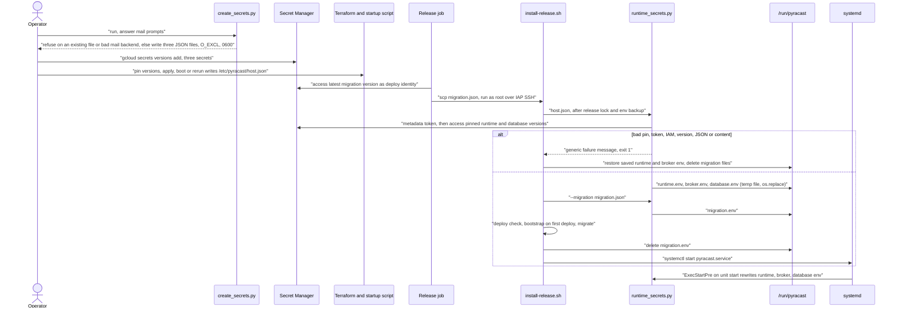

# Generate, upload and materialise production secrets

An operator generates three JSON secrets locally with `deploy/create_secrets.py` and uploads each as a Secret Manager version by hand. On the VM, `deploy/runtime_secrets.py` turns the pinned runtime and database versions into root-only env files under `/run/pyracast` at every release and every start of `pyracast.service`; the release job additionally hands it the migration secret (read as `latest`) for the duration of the migration. No Django view, web screen or database table is involved.

## Entry points

- Operator command `uv run --locked python deploy/create_secrets.py` (`main`, `mail_configuration`), meant for the repository root; output goes to `secrets/` relative to the current directory (ignored only at the root).
- Operator commands `gcloud secrets versions add pyracast-runtime|pyracast-migration|pyracast-database --data-file=secrets/<name>.json` (manual, `docs/DEPLOYMENT.md` "2. Add secrets"). `deploy/authorize_gmail.py` edits `runtime.json` in between (own flow).
- Terraform variables `runtime_secret_version` and `database_secret_version` (`infra/terraform/variables.tf`), rendered into `/etc/pyracast/host.json` (mode `0600`) by the `startup-script` metadata (`infra/terraform/main.tf`, `templates/startup.sh.tftpl`) that runs at boot. Terraform creates the three secrets (`google_secret_manager_secret.application`) but never a version; the migration secret has no version variable.
- `deploy/install-release.sh` (root, `release.yml` step "Transfer the verified release and deploy through IAP") runs `deploy/runtime_secrets.py` (`main`) plain, which calls `prepare_runtime` and `prepare_database`, then with `--migration`, which calls `prepare_migration`. `ExecStartPre` of `pyracast.service` (`templates/startup.sh.tftpl`) runs it plain whenever the unit starts: at boot, from the startup script, and from the `systemctl start` that ends `install-release.sh` (effective only while the unit is inactive, in practice the first deploy).

## Sequence

## Data

No PostgreSQL table is read or written (`bootstrap_database.py` only applies the secret passwords to roles on the first deploy).

| Table | R/W | What |
| --- | --- | --- |
| `secrets/*.json` (workstation) | W `create_secrets.py`, R upload | generated once, removed by the operator after upload |
| Secret Manager `pyracast-runtime`, `-migration`, `-database` | W operator, R VM and deploy identity | JSON objects of environment strings |
| `/etc/pyracast/host.json` | W startup script, R `runtime_secrets.py` | pinned version resource names from Terraform |
| `migration.json` in the runner temp dir and the VM stage `/run/pyracast-release-*` | W release job, R `--migration` | removed by the installer cleanup and the workflow trap |
| `/run/pyracast/{runtime,broker,database,migration}.env` | W `runtime_secrets.py`, R Compose, `bootstrap_database.py` | tmpfs env files; `install-release.sh` keeps copies of the first two in `release.*/` for the restore |

## Authorization

- Upload uses the operator's own Google credentials; Terraform grants no `secretVersionAdder` (`infra/terraform/iam.tf`). Local files are `0600` in a `0700` directory on POSIX only, and the directory mode applies only when `create_secrets.main` creates it; `write_environment` uses `mkstemp` in a `0700` directory.
- The runtime service account reads only `runtime` and `database` (`runtime_read`), the deploy account only `migration` (`migration_read`). Grants are per secret, so every version is readable. Terraform binds the deploy account only to Workload Identity from the release workflow on `main` in the configured environment; it and every `operator_members` entry are OS Login administrators (`ssh_admin`) and may act as the runtime account (`ssh_runtime_identity`): an IAM split, not a barrier against a compromised release job.
- `runtime_secrets.access_secret` accepts only a regex-checked `projects/.../secrets/.../versions/<number>` resource, so `latest` is refused on the VM. `install-release.sh` refuses to run without root and seven validated arguments. Compose scoping (`deploy/compose.yaml`): `web` and `gateway` have no env file, `postgres` only `database.env`, `rabbitmq` only `broker.env`, `migration.env` only the `migrate` service.

## Failure paths

| Condition | Result |
| --- | --- |
| A secret file exists, or mail backend not `gmail`/`smtp` | `SystemExit`, no file written (existing key preserved); a failed write after the first file leaves a partial set that blocks reruns |
| Version variable below 1 or not an integer; or a pinned version that does not exist | plan error; or (inferred, not run) plan and apply succeed and boot or release fails at access time |
| Any error in `runtime_secrets.py` (pin, metadata token, 403, 404, timeout, base64, JSON, invalid entry, missing required key, wrong key set) | exit 1 (at boot `pyracast.service` fails in `ExecStartPre`), "Secret preparation failed; check configuration, IAM and secret format." The specific `ValueError` text is discarded |
| That or any other release failure before maintenance (image pull, deploy check, database wait) | abort, saved `runtime.env` and `broker.env` restored if they existed (none on a first deploy), `migration.json` and `migration.env` removed; `database.env` is not restored |
| Release failure after maintenance began (first-deploy bootstrap, backup, migration, health, final `systemctl start`) | new env files stay, application stopped and `release-blocked` set, migration files removed |
| Release lock not obtained within 300 s | exit 1 before the cleanup trap is set: env files untouched, `migration.json` left for the workflow trap |
| `gcloud secrets versions access latest` fails | release step fails before any VM change, local stage files removed |
| Release killed by SIGKILL | `migration.json` and `migration.env` stay (pinned by `deploy/test-release.sh`); the workflow trap removes the stage, `migration.env` lasts until reboot or the next release cleanup |

## Rules and invariants

- Runtime and database versions change only after `terraform apply` plus a startup-script rerun or reboot refreshes `host.json`, and take effect at the next release or unit start. The migration secret is the exception: every release reads `latest`.
- A new version is not a rotation. Role passwords are applied only when `bootstrap_database.py` finds no `pyracast_owner` role, which is also the only place that checks the role names `pyracast_app` and `pyracast_owner`; `POSTGRES_PASSWORD` and `RABBITMQ_DEFAULT_PASS` only initialise a new data directory.
- Content contract: keys match `[A-Z][A-Z0-9_]*`, values are strings without CR, LF or NUL, Compose reads `format: raw` so `$` is never expanded. Runtime keys not starting with `PYRACAST_`, `PG` or `EPIAS_` are dropped silently, and the Compose `environment` block overrides same-named keys (`PGHOST`, `PGPORT`, `PGDATABASE`, `PYRACAST_DEBUG`, host and proxy settings). `RABBITMQ_DEFAULT_PASS` goes to `broker.env` and, percent-encoded, into `PYRACAST_RABBITMQ_URL` (fixed user `pyracast`), never into `runtime.env`.
- The migration secret is exactly `PGUSER` and `PGPASSWORD`, the database secret exactly `POSTGRES_PASSWORD`. `migration.env` follows `runtime.env` in `migrate`, so it overrides the application role for every `migrate` run of the release (deploy check, database wait, plan, migrate) and is deleted right after the migration.
- `install-release.sh` holds `/run/lock/pyracast-release.lock` while materialising; `ExecStartPre` does not take it, `ExecStop` does. `RuntimeDirectory=pyracast` lets systemd create and remove `/run/pyracast` with the unit (removal not verified on a VM). Each file is written atomically, the set is not: `runtime.env` and `broker.env` are replaced before the database secret is fetched.

## Tests

- `tests/test_deployment_secrets.py`: entry validation without leaking the payload, broker separation, percent-encoding and literal `$`, missing keys, migration and database key sets. `tests/test_deployment_helpers.py`: `runtime_secrets.py` parses as Python 3.12 (Ubuntu system Python). `deploy/test-release.sh` (CI job `deployment`): release failure modes with `runtime_secrets.py` mocked; pins migration file cleanup, their survival after SIGKILL and `migration.json` after a lock timeout.
- No Playwright test applies. Gaps: `create_secrets.py`, `access_secret`, `main`, file modes, the key-prefix filter, the real `--migration` wiring, the env restore on failure and the final `systemctl start`. `deploy/` is outside the coverage `source`.
