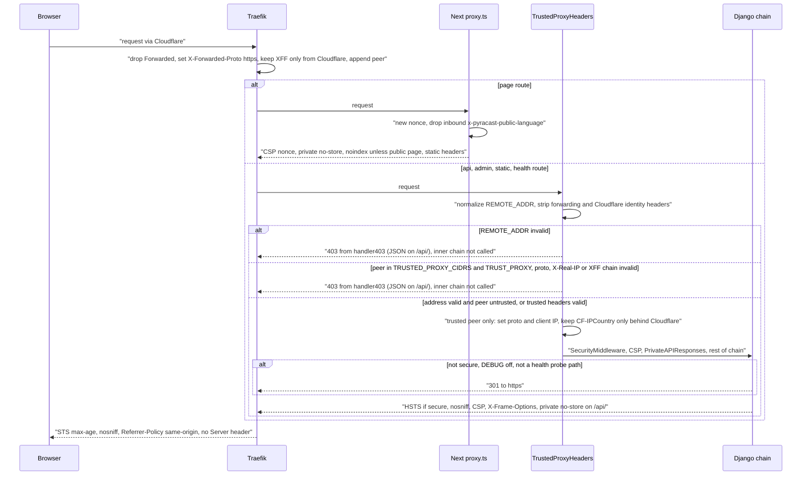

# Security headers, CSP and trusted proxy chain

Every HTTP request passes this flow before any feature code. Traefik routes it either to the Next.js server (pages) or to Django (`/api`, `/api/`, `/admin`, `/admin/`, `/static/`, `/health/`) and adds its own response headers to both. Next sets a per-request CSP nonce and cache and indexing headers. Django discards forwarding headers it cannot trust, derives the client IP, scheme and country, and adds its own security headers. The outcome is one verified client identity per request and a consistent header set per response.

## Entry points

- `web/src/proxy.ts` `proxy` (Next 16 proxy, formerly middleware): runs for every path except `api/`, `admin`, `static/`, `_next/static`, `_next/image`, `favicon.ico`.
- `web/next.config.ts` `headers()`: static headers on every Next response (`poweredByHeader: false`); `rewrites()` proxies `/admin`, `/static` and `/api` to Django in the dev server only.
- `pyracast.accounts.middleware.TrustedProxyHeaders` (outermost Django middleware) and `pyracast.api.middleware.PrivateAPIResponses` (cache policy and throttle audit for `/api/`).
- `pyracast.accounts.security.normalize_client_ip` and `AccountAdapter.get_client_ip` (`pyracast.accounts.adapters`): IP normalisation shared with allauth rate limits and `record_security_event`.
- Settings in `src/pyracast/settings.py`: `PYRACAST_TRUST_PROXY`, `PYRACAST_TRUSTED_PROXY_CIDRS`, `PYRACAST_TRUSTED_UPSTREAM_PROXY_CIDRS`, `SECURE_*`, `SECURE_CSP`, `ALLAUTH_TRUSTED_CLIENT_IP_HEADER`; `src/pyracast/production.py` inserts WhiteNoise.
- `deploy/routes.yml` `security` middleware, `deploy/compose.yaml` (`x-cloudflare-proxies`, entrypoint `forwardedHeaders`) and `deploy/gunicorn_conf.py` feed this flow.

## Sequence

## Data

None. No table is read or written; the flow only reads and rewrites `request.META` and response headers, and logs one audit line for 429 on `/api/auth/`.

## Authorization

- Network: only the gateway peer (`172.30.80.2/32`, `PYRACAST_TRUSTED_PROXY_CIDRS`) may supply scheme and client IP; enforced in `TrustedProxyHeaders`, not in the view layer.
- Gateway: Traefik trusts forwarding headers only from the Cloudflare ranges, blanks `Forwarded`, forces `X-Forwarded-Proto: https` and deletes underscore or dot header aliases (`ALIASHEADERSSTRATEGY=delete`). Gunicorn trusts none (`forwarded_allow_ips` and `secure_scheme_headers` empty).
- Client IP consumers: allauth rate limits and `record_security_event` read `X-Real-IP` through `ALLAUTH_TRUSTED_CLIENT_IP_HEADER` when trust is on, `REMOTE_ADDR` otherwise.
- The `noindex` header is a crawler hint, not access control (stated in `docs/ARCHITECTURE.md`).

## Failure paths

| Condition | Result |
| --- | --- |
| `REMOTE_ADDR` empty, malformed or a list | 403 from `handler403` (`PermissionDenied("Invalid client address.")`, message not shown): `{"code": "permission_denied"}` on `/api/`, HTML elsewhere, both `Cache-Control: private, no-store` |
| Trusted peer sends proto other than `http`/`https`, no or malformed `X-Real-IP` (without upstream ranges), no or malformed `X-Forwarded-For` (with upstream ranges), or a chain whose only entry is a Cloudflare address | Same 403 (`Invalid trusted proxy headers.`); `pyracast.security` logs `invalid_proxy_headers` with the proxy peer address |
| Peer not trusted (or trust off) | Headers silently stripped, request continues with the socket peer as client |
| Request not secure (untrusted peer, proto `http`, or trust off) with `DEBUG` off | `SecurityMiddleware` 301 to https, except `/health/live/` and `/health/ready/` |
| Trust on but `PYRACAST_TRUSTED_PROXY_CIDRS` empty | `ImproperlyConfigured` at middleware load; an invalid CIDR raises `ValueError` there |
| `PYRACAST_PUBLIC_ORIGIN` not a bare https origin (http allowed with `DEBUG`) | `ImproperlyConfigured` at middleware load; deploy check `accounts.E002` |
| Trust on, request from an untrusted peer reaches an allauth rate limit (`X-Real-IP` was stripped) | 403 `Unable to determine client IP address`; audit logs record a null IP |
| Auth endpoint answers 429 (rate limit or busy session lock) | audit event `authentication_request_throttled` |

## Rules and invariants

- Client IP: with upstream ranges set, take the entry before the gateway-appended peer when that peer is a Cloudflare address; otherwise take the peer. A client inside a Cloudflare range stays the client; no hop is skipped; the `X-Real-IP` value is required but ignored. Without upstream ranges, `X-Real-IP` is used after normalisation.
- `CF-IPCountry` survives only if the peer is trusted, upstream ranges are set and the last `X-Forwarded-For` entry is a Cloudflare address; `request_language` uses it as the last fallback.
- `TrustedProxyHeaders` is outermost, so its 403 never receives `SecurityMiddleware`, CSP, `PrivateAPIResponses`, `Content-Language` or `X-Frame-Options` headers from Django; `handler403` sets `Cache-Control: private, no-store` itself.
- Header ownership is split: Traefik sets HSTS `max-age`, nosniff and `Referrer-Policy: same-origin` on every routed response. Next sets CSP (nonce, `strict-dynamic`), `Cache-Control`, `X-Robots-Tag` and four static headers. Django sets `SECURE_CSP` (nonce only when a template reads it, as admin does), HSTS with `includeSubDomains; preload` on secure requests only, nosniff, `Referrer-Policy`, COOP and `X-Frame-Options: DENY`. `style-src-attr 'unsafe-inline'` is allowed in Next; dev adds `unsafe-eval`, `ws:` and `unsafe-inline` styles.
- A nonce works only on dynamically rendered pages (`connection()` in `web/src/app/app/page.tsx`, `headers()` in `web/src/i18n/request.ts`); caching HTML would reuse a stale nonce.
- `x-pyracast-public-language` is deleted from the inbound request, then set only for the six public paths, so clients cannot choose the public language.
- In production WhiteNoise sits after `SecurityMiddleware` and before the CSP middleware, so `/static/` carries no Django CSP and no `PrivateAPIResponses` header.

## Tests

- `tests/test_account_security.py`: untrusted peers, missing CIDRs, ambiguous identity, invalid `REMOTE_ADDR`, Cloudflare chain parsing, rate-limit separation, origin validation; `tests/test_language.py` (country trust), `tests/test_api_cache.py` (`/api/` no-store, other paths untouched), `tests/test_security_audit.py` (429 audit), `tests/test_admin_mfa_bootstrap.py` (admin CSP).
- `web/tests/security-headers.spec.ts` (fresh nonce, injected script blocked); `web/tests/public-site.spec.ts` (language header spoofing, `form-action` in CSP, `noindex` on `/app/`, none on public pages or discovery files); `security-headers.spec.ts` also pins the `same-origin` referrer policy and an ignored spoofed language header on `/app/`.
- `deploy/smoke.sh`: Traefik HSTS `max-age` and nosniff on `/`, http to https redirect, forged and aliased headers through Traefik, simulated Cloudflare peer.
- Gaps: no test for Django HSTS or SSL redirect, Django `Referrer-Policy` on `/api/` and `/admin/`, `X-Frame-Options`, `Permissions-Policy`, `Cache-Control` from `proxy.ts`, the allauth 403 for untrusted peers.
