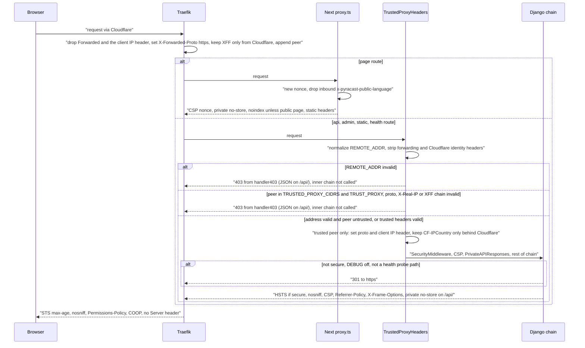

# Security headers, CSP and trusted proxy chain

Every HTTP request passes this flow before any feature code. Traefik routes it either to the Next.js server (pages) or to Django (`/api`, `/api/`, `/admin`, `/admin/`, `/static/`, `/health/`) and adds its own response headers to both. Next sets a per-request CSP nonce and cache and indexing headers. Django discards forwarding headers it cannot trust, derives the client IP, scheme and country, and adds its own security headers. The outcome is one verified client identity per request and a consistent header set per response.

## Entry points

- `web/src/proxy.ts` `proxy` (the Next 16 proxy): runs for every path except `api/`, `admin`, `static/`, `_next/static`, `_next/image`, the discovery and icon files, `opengraph-image` and `identity/` (see its `matcher`).
- `web/next.config.ts` `headers()`: `Referrer-Policy` and `X-Frame-Options` on every Next response (`poweredByHeader: false`); `rewrites()` proxies `/admin`, `/static` and `/api` to Django in the dev server only.
- `pyracast.proxy.TrustedProxyHeaders` (outermost Django middleware; `resolve_forwarded_identity` decides the identity) and `pyracast.api.middleware.PrivateAPIResponses` (cache policy and throttle audit for `/api/`).
- `pyracast.api.csp_reports.CSPReportView` at `POST /api/csp-reports/`: receives the `report-uri` reports of both policies.
- `pyracast.accounts.security.normalize_client_ip` and `AccountAdapter.get_client_ip` (`pyracast.accounts.adapters`): IP normalisation shared with allauth rate limits and `record_security_event`.
- Settings in `src/pyracast/settings.py`: `PYRACAST_TRUST_PROXY`, `PYRACAST_TRUSTED_PROXY_CIDRS`, `PYRACAST_TRUSTED_UPSTREAM_PROXY_CIDRS`, `SECURE_*`, `SECURE_CSP`, `ALLAUTH_TRUSTED_CLIENT_IP_HEADER`, `CSRF_TRUSTED_ORIGINS`; `src/pyracast/production.py` inserts WhiteNoise.
- Deploy checks `accounts.E002`, `E004` and `E005` in `pyracast.accounts.checks` (`pyracast check --deploy`, run by `deploy/install-release.sh` before maintenance).
- `deploy/routes.yml` `security` middleware, `deploy/compose.yaml` (`x-cloudflare-proxies`, entrypoint `forwardedHeaders`) and `deploy/gunicorn_conf.py` feed this flow.

## Sequence

## Data

None. No table is read or written; the flow only reads and rewrites `request.META` and response headers, and logs one audit line for 429 on `/api/auth/`, one for refused proxy headers and one `csp_violation` line per reported violation.

## Authorization

- Network: only the gateway peer (`172.30.80.2/32`, `PYRACAST_TRUSTED_PROXY_CIDRS`) may supply scheme and client IP; enforced in `TrustedProxyHeaders`, not in the view layer.
- Gateway: Traefik trusts forwarding headers only from the Cloudflare ranges, blanks `Forwarded` and `X-Pyracast-Client-Ip`, forces `X-Forwarded-Proto: https` and deletes underscore or dot header aliases (`ALIASHEADERSSTRATEGY=delete`). Gunicorn trusts none (`forwarded_allow_ips` and `secure_scheme_headers` empty).
- Client IP consumers: allauth rate limits and `record_security_event` read the client from `X-Pyracast-Client-IP` through `ALLAUTH_TRUSTED_CLIENT_IP_HEADER` when trust is on, `REMOTE_ADDR` otherwise. Only the middleware writes that header.
- `POST /api/csp-reports/` is a public route that needs no CSRF token (browsers send none).
- The `noindex` header is a crawler hint, not access control (stated in `docs/ARCHITECTURE.md`).

## Failure paths

| Condition | Result |
| --- | --- |
| `REMOTE_ADDR` empty, malformed or a list | 403 from `handler403` (`PermissionDenied("Invalid client address.")`, message not shown): `{"code": "permission_denied", "message": ...}` on `/api/`, HTML elsewhere, both `Cache-Control: private, no-store` |
| Trusted peer sends proto other than `http`/`https`, no or malformed `X-Real-IP` (without upstream ranges), no or malformed `X-Forwarded-For` (with upstream ranges), or a chain whose only entry is a Cloudflare address | 403 from `handler403` (`ForbiddenError`): `{"code": "invalid_proxy_headers", "message": ...}` on `/api/`, HTML elsewhere, both no-store; `pyracast.security` logs `invalid_proxy_headers` with the proxy peer address |
| Peer not trusted (or trust off) | Headers silently stripped, request continues with the socket peer as client |
| Request not secure (untrusted peer, proto `http`, or trust off) with `DEBUG` off | `SecurityMiddleware` 301 to https, except `/health/live/` and `/health/ready/` |
| Trust on but `PYRACAST_TRUSTED_PROXY_CIDRS` empty | `ImproperlyConfigured` at middleware load; an invalid CIDR raises `ImproperlyConfigured` naming its setting |
| `PYRACAST_PUBLIC_ORIGIN` not a bare https origin (http allowed with `DEBUG`) | `ImproperlyConfigured` at middleware load; deploy check `accounts.E002` |
| Deploy check: proxy trust off, or gateway or edge networks empty or invalid (`accounts.E004`); `CSRF_TRUSTED_ORIGINS` not exactly the public origin, or its host not allowed (`accounts.E005`) | The release is refused before maintenance |
| Trust on, request from an untrusted peer reaches an allauth rate limit (the client IP header was stripped) | `AccountAdapter.get_client_ip` raises `PermissionDenied`; 403 `permission_denied`; audit logs record a null IP |
| Auth endpoint answers 429 (rate limit or busy session lock) | audit event `authentication_request_throttled` |
| CSP report with another content type | 415 through the error contract |
| CSP report unreadable, of another type or over 16 KiB | 204, nothing logged |

## Rules and invariants

- Client IP: with upstream ranges set, take the entry before the gateway-appended peer when that peer is a Cloudflare address; otherwise take the peer. A client inside a Cloudflare range stays the client; no hop is skipped. Without upstream ranges, `X-Real-IP` is required and used after normalisation; with them it is ignored. The resolved client travels in `X-Pyracast-Client-IP` and the scheme in `X-Forwarded-Proto`; every other forwarding header is removed.
- `CF-IPCountry` survives only if the peer is trusted, upstream ranges are set and the last `X-Forwarded-For` entry is a Cloudflare address; `request_language` uses it as the last fallback.
- `TrustedProxyHeaders` is outermost, so its 403 never receives `SecurityMiddleware`, CSP, `PrivateAPIResponses`, `Content-Language` or `X-Frame-Options` headers from Django; `handler403` sets `Cache-Control: private, no-store` itself.
- Header ownership is split: Traefik sets HSTS `max-age`, nosniff, `Permissions-Policy` and `Cross-Origin-Opener-Policy` on every routed response and removes `Server`; `deploy/smoke.sh` pins each of them once with its exact value. Next sets CSP (nonce, `strict-dynamic`), `Cache-Control`, `X-Robots-Tag`, `Referrer-Policy` and `X-Frame-Options`. Django sets `SECURE_CSP` (nonce only when a template reads it, as admin does), HSTS and nosniff on its own responses, `Referrer-Policy`, COOP and `X-Frame-Options: DENY`. `style-src-attr 'unsafe-inline'` is allowed in Next; dev adds `unsafe-eval`, `ws:` and `unsafe-inline` styles.
- Both CSPs carry `report-uri /api/csp-reports/` (Next also `base-uri 'none'`). `CSPReportView` accepts `application/csp-report` and `application/reports+json`, reads at most 16 KiB and logs at most ten violations per request as `csp_violation`, with the blocked URL's origin (never credentials or a path) and only the document's first path segment; a malformed URL is logged as empty.
- A nonce works only on dynamically rendered pages (`connection()` in `web/src/app/app/layout.tsx`, `headers()` in `web/src/i18n/request.ts`); caching HTML would reuse a stale nonce.
- `x-pyracast-public-language` is deleted from the inbound request, then set only for the six public paths, so clients cannot choose the public language. A public path requested without its trailing slash is redirected (308) with its query.
- In production WhiteNoise sits after `SecurityMiddleware` and before the CSP middleware, so `/static/` carries no Django CSP and no `PrivateAPIResponses` header.

## Tests

- `tests/test_proxy.py`: resolver decisions from the trusted chain, untrusted peers, missing or mistyped networks, unverifiable gateway headers, unreadable peers, origin validation, authentication limits per Cloudflare visitor, the client IP header written only by the middleware; `tests/test_deployment_checks.py` (`accounts.E002`, `E004`, `E005` against the shipped compose file); `tests/test_error_pages.py` (proxy refusal body and log); `tests/test_csp_reports.py`; `tests/test_language.py` (country trust), `tests/test_api_cache.py` (`/api/` no-store, other paths untouched), `tests/test_security_audit.py` (429 audit), `tests/test_admin_mfa_bootstrap.py` (admin CSP).
- `web/tests/security-headers.spec.ts` (fresh nonce, injected script blocked, `base-uri` and `report-uri` in the policy, same-origin referrer policy, ignored spoofed language header on `/app/`); `web/tests/public-site.spec.ts` (language header spoofing, `form-action` in CSP, `noindex` on `/app/`, none on public pages or discovery files).
- `deploy/smoke.sh`: Traefik transport headers once with exact values on every router, http to https redirect, forged and aliased headers through Traefik, simulated Cloudflare peer.
- Gaps: no test for Django HSTS or SSL redirect, Django `Referrer-Policy` on `/api/` and `/admin/`, `X-Frame-Options`, `Cache-Control` from `proxy.ts`.
