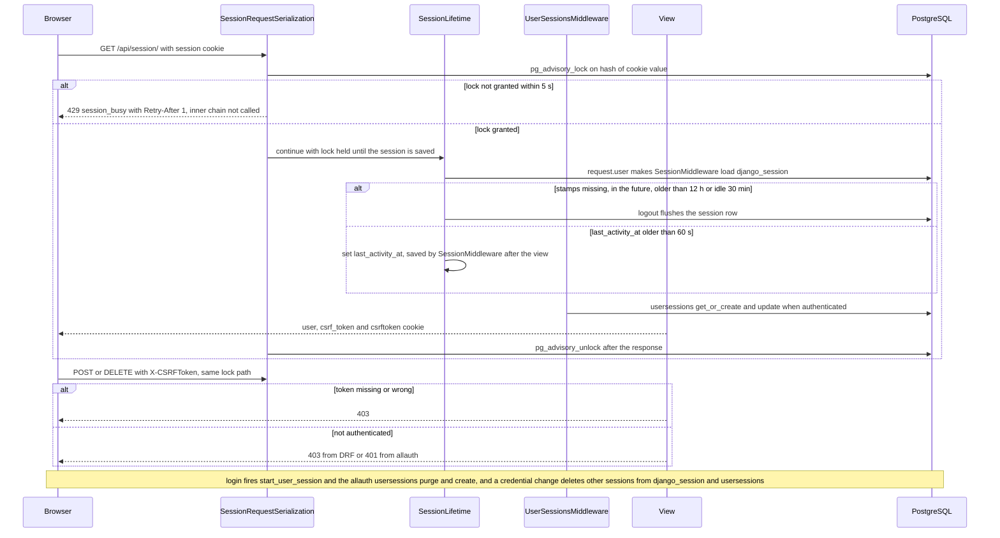

# Session lifetime, request serialisation, CSRF and session revocation

Every browser request that carries a session cookie passes the same cross-cutting middleware. It serialises requests per session, applies the 12 h absolute and 30 min idle limits, and demands a CSRF token on allauth, `/admin/` and authenticated DRF mutations. The token comes from `GET /api/session/`. Credential changes end the user's other sessions. Expired rows are never purged automatically.

## Entry points

- `GET /api/session/` (`pyracast.api.session.SessionView`, anonymous allowed): user projection, `csrf_token`, language. `POST /api/session/language/` (`SessionLanguageView`) is the only DRF view with an explicit `csrf_protect`.
- Middleware `pyracast.accounts.session_lock.SessionRequestSerialization` (advisory lock, `serialize_session`) and `pyracast.accounts.middleware.SessionLifetime` (expiry, activity stamp).
- Signal receivers wired in `pyracast.accounts.apps.AccountsConfig.ready`: `pyracast.accounts.security.start_user_session` (`user_logged_in`) and `pyracast.accounts.sessions.revoke_other_sessions` (`authenticator_added`, `authenticator_removed`, `authenticator_reset`, `email_changed`, via `connect_session_revocation`).
- `GET|DELETE /api/auth/browser/v1/auth/sessions` (allauth headless `usersessions.SessionsView`): routed by `allauth.headless.urls` because `allauth.usersessions` is installed, no web caller.
- `web/src/lib/api.ts` `request` (sends `X-CSRFToken` only when the caller passes a token) and `web/src/lib/auth-api.ts` `authRequest` (always sends it) are the only two `fetch` sites; `Dashboard` in `web/src/components/dashboard.tsx` refetches the session on focus and visibility.
- Command `uv run --locked pyracast clearsessions` (stock, manual, README only).

## Sequence

## Data

| Table | R/W | What |
|---|---|---|
| `django_session` | R every request carrying a session cookie (`SessionLifetime` evaluates `request.user`); W on login, logout, allauth flow state, activity refresh (at most once per 60 s) and revocation | Database session engine; `authenticated_at` and `last_activity_at` live in the payload |
| `usersessions_usersession` | R and W on every authenticated request (`USERSESSIONS_TRACK_ACTIVITY`); W on login purge and create; delete on revocation, on `DELETE auth/sessions` and on stale rows during `GET auth/sessions` | allauth device list: ip, user agent, `last_seen_at` |
| (advisory lock) | W | `pg_advisory_lock` per session cookie on the default connection for the whole request |
| `mfa_authenticator` | R | Only for `can_admin` (staff and superuser) via `has_verified_mfa` |

## Authorization

- CSRF: `CsrfViewMiddleware` covers allauth browser views (also before login) and `/admin/`; DRF views are `csrf_exempt`, so `SessionAuthentication` enforces it only for authenticated users. `SessionLanguageView` adds `csrf_protect` because anonymous users may call it.
- `auth/sessions` requires an authenticated session (`AuthenticatedAPIView`, else 401) and accepts only the caller's own `UserSession` ids; it needs no reauthentication.
- `PrivateAPIResponses` adds `private, no-store` to every `/api/` response, including the 429. Revocation is a signal receiver, not an endpoint check.

## Failure paths

| Condition | Result |
|---|---|
| Same-session request waits longer than 5 s | 429 `{"code": "session_busy", "detail": "..."}` (English, outside the DRF handler), `Retry-After: 1`; connection closed; audit event `authentication_request_throttled` for `/api/auth/` |
| Lock connection lost or replaced, lock missing at release | `SessionInterrupted`: 400 `{"code": "session_ended"}` from `handler400` on `/api/` (HTML elsewhere), connection closed; a configured pool raises `ImproperlyConfigured` (500) |
| Session row deleted by revocation or logout elsewhere while this request modifies the session | `SessionMiddleware` raises `SessionInterrupted` on save: 400 `session_ended` on `/api/` |
| Stamp missing, non-finite, in the future, older than 12 h, or idle 30 min | Session flushed, audit event `logout` (same as a sign-out), request anonymous; later mutations get 403 (DRF) or 401 (allauth) |
| Missing or stale CSRF token on allauth or `/admin/` | Django CSRF failure view (HTML 403); `authRequest` shows `Errors.request` with the status |
| Missing or stale CSRF token on a DRF view | 403 `{"code": "http_403", "detail": {...}}` with the untranslated `CSRF Failed: ...` text |
| Focus refresh fails in the browser | Ignored; the screen keeps its last session |

## Rules and invariants

- Lock scope: taken before `SessionMiddleware` loads the session and released after it saves, so concurrent code attempts cannot overwrite each other. The lock is a session-level advisory lock on the raw connection; `lock_timeout` is set to 5 s for acquisition and restored. An `execute_wrapper` fails any query if the connection object changes. The key is the pre-login cookie value; login cycles the key, so the login request is serialised under the old key. A missing cookie or one not matching `[a-z0-9]{32}` takes no lock.
- `authenticated_at` is written only by `start_user_session`; the activity refresh never extends the 12 h limit, and sessions without stamps fail closed. The row's `expire_date` slides with each save, so only the stamp enforces 12 h.
- `request` in `api.ts` queues every `/api/session/` call: GETs share one in-flight promise, mutations run in turn. Other `/api/` and `/api/auth/` calls are not queued and rely on the server lock. Django `login` rotates the CSRF secret (logout does not), so the token held in React state is stale after sign-in. Every sign-in, sign-out and security form refetches `/api/session/` afterwards.
- `ACCOUNT_LOGOUT_ON_PASSWORD_CHANGE` signs out the current session as well. Revocation on TOTP, recovery-code and email changes keeps the acting session.
- Gunicorn runs one worker with two threads (`deploy/gunicorn_conf.py`), so a request waiting on the lock occupies half a container.

## Tests

- `tests/test_session_serialization.py` (real PostgreSQL): lock timeout 429, connection loss, release failure, malformed cookie, pool rejection, code-attempt races. `tests/test_account_security.py`: invalid and expired stamps, activity refresh keeps the absolute limit.
- `tests/test_session.py`, `tests/test_auth_lifecycle.py`, `tests/test_api.py`, `tests/test_language.py`: CSRF 403 without token, token rotation, logout, password change ends all sessions.
- `tests/test_account_session_revocation.py`: the four signals (sent directly, not via the endpoints). `tests/test_security_audit.py`: 429 audit event.
- Playwright: `web/tests/*.spec.ts` (mocked API) assert the `x-csrftoken` header; `web/tests/workspace.spec.ts` checks one shared session GET under Strict Mode; `web/integration/auth-security.spec.ts` and `web/integration/workspace.spec.ts` use the real token against the real backend.
- Gaps: no test for `auth/sessions`, `clearsessions` or table growth, the focus or visibility refresh itself, session expiry in the browser, or a `session_busy` response in the UI.
