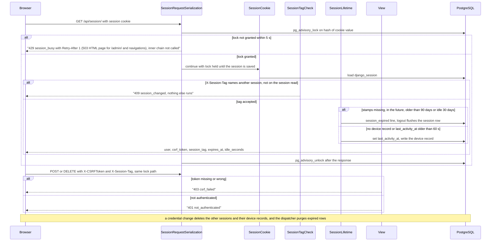

# Session lifetime, request serialisation, CSRF and session revocation

Every browser request that carries a session cookie passes the same cross-cutting middleware. It serialises requests per session, applies the 90-day absolute and 30-day idle limits, and demands a CSRF token on allauth, `/admin/` and authenticated DRF mutations. The token comes from `GET /api/session/`. Credential changes end the user's other sessions. The dispatcher purges expired rows.

## Entry points

- `GET /api/session/` (`pyracast.api.session.SessionView`, public): user projection (`can_admin`, `mfa_required`), `csrf_token`, language, `expires_at`, `idle_seconds` (null without a user), `session_tag`. `POST /api/session/language/` (`SessionLanguageView`) is the only DRF view with an explicit `csrf_protect`.
- Middleware in the order `accounts.E003` enforces (`pyracast.accounts.checks.SESSION_MIDDLEWARE`): `session_lock.SessionRequestSerialization` (advisory lock), `session_cookie.SessionCookie` (store and cookie), `AuthenticationMiddleware`, `session_tag.SessionTagCheck`, `middleware.SessionLifetime` (expiry, activity), `processes.PendingProcessAuthority` (ends processes and reauthentications resting on a changed account state). `signup.SignupMinimumAnswerTime` runs just outside the lock.
- `pyracast.accounts.sessions.connect_session_lifecycle`, called from `AccountsConfig.ready`: `start_session` (`user_logged_in`: stamps, tag, authority record), `revoke_other_sessions` for `REVOKING_SIGNALS` and social disconnect, key rotation after a reauthentication, device-record cleanup on sign-out. TOTP activation and recovery-code replacement revoke in `mfa_views`; `reset_mfa` ends every session of the account.
- `GET|DELETE /api/auth/browser/v1/auth/sessions` (`pyracast.accounts.devices.SessionsView`): the account's live sessions, ended by id (`features/account/signed-in-devices.tsx`).
- Web: `lib/api/lane.ts` (`deliver`, the one `fetch` site, sends `X-CSRFToken` on unsafe methods and `/api/auth/` calls, and `X-Session-Tag`), `lib/session-client.ts` (`loadSession`, `signOut`), `lib/auth-api.ts`; `features/session/app-root.tsx` rereads the session on focus and visibility and, through `useSessionClock` (every 30 s and on visibility), every 30 s while the last confirmation is as old as the session's `idle_seconds` or more (flow `app-entry-routing`); `features/workspace/workspace-shell.tsx` warns five minutes before `expires_at` (`SessionEndingSoon`).

## Sequence

## Data

| Table | R/W | What |
|---|---|---|
| `django_session` | R every request carrying a session cookie; W on login, logout, flow state, activity refresh (at most once per 60 s); D by revocation, the retention sweep (at `expire_date`, at most 500 a cycle) and account erasure | `authenticated_at`, `last_activity_at`, the tag and the authority record live in the payload |
| `usersessions_usersession` | W on login, at the first request of a session lacking its device record, then at most once a minute; D on sign-out, revocation, `DELETE auth/sessions`, rows without a session in the retention sweep, account erasure | allauth device list: ip, user agent, `last_seen_at` |
| (advisory lock) | W | `pg_advisory_lock` per session cookie on the default connection for the whole request; a provider callback with valid state releases it before the code exchange |
| `auth_user`, `mfa_authenticator` | `auth_user` `FOR UPDATE` | Revocation and key rotation of one account serialise on the account row; `mfa_authenticator` is read for `can_admin` via `has_mfa_evidence` |

## Authorization

- CSRF: `CsrfViewMiddleware` covers allauth browser views (also before login) and `/admin/`; DRF views are `csrf_exempt`, so `SessionAuthentication` enforces it only for authenticated users. `SessionLanguageView` adds `csrf_protect` because anonymous users may call it. The CSRF cookie is HTTP-only, so the page learns the token only from the session read.
- `auth/sessions` requires an authenticated session (401 otherwise), is rate limited (`docs/flows/rate-limiting.md`) and accepts only the caller's own session ids; an unknown or foreign id selects nothing. It needs no reauthentication.
- The session tag names one signed-in session across its key renewals; it is an observation, never a credential. Revocation is a signal receiver, not an endpoint check.

## Failure paths

| Condition | Result |
|---|---|
| Same-session request waits longer than 5 s | 429 `session_busy` with message and `Retry-After: 1`; the connection is kept; on `/admin/` and a navigation GET outside `/api/` a no-store 503 HTML page with `Retry-After: 1` (only a GET reloads itself once); under `/api/auth/` audit event `authentication_request_throttled` |
| Lock connection lost or replaced, lock missing at release | `SessionInterrupted`: 400 `session_ended` on `/api/` (HTML elsewhere), connection closed; a configured pool raises `ImproperlyConfigured` (500) |
| Session ended by another session while this request modifies it, also after its own work committed | 400 `session_ended` on `/api/` |
| Stamp missing, non-finite, in the future, older than 90 days, or idle 30 days | Audit `session_expired` with the reason, then `logout`; session flushed, request anonymous; later mutations get 401 |
| `X-Session-Tag` of another session | 409 `session_changed` before any view; the session read is never refused |
| Missing or stale CSRF token on a DRF view or allauth | 403 `csrf_failed` JSON; a signed-in refusal writes `csrf_refused` (once a minute per actor, view and code) |
| Missing or stale CSRF token on `/admin/` | HTML 403 page |
| Missing or stale CSRF token on a navigation to the provider redirect or callback | Redirect to the social callback with `error=expired_form` |
| Focus refresh fails in the browser | Ignored; the screen keeps its last session |

## Rules and invariants

- Lock scope: taken before `SessionCookie` loads the session and released after it saves, so concurrent code attempts cannot overwrite each other. It is a session-level advisory lock on the raw connection; `lock_timeout` is set to 5 s for the acquiring transaction only, so nothing is restored. An `execute_wrapper` fails any query if the connection object changes. The key is the pre-login cookie value, so the login request is serialised under the old key. A missing cookie or one not matching `[a-z0-9]{32}` takes no lock. The provider callback releases the lock once it has taken its state (`release_session`).
- `SessionCookie` sends the cookie only when its request created or rotated the key and deletes it only when its request ended the stored session the cookie named, other than by expiry. A request whose session no longer exists answers as signed out and leaves the cookie, so a late answer never restores an older key.
- `authenticated_at` is written only by `start_session`; the activity refresh never extends the 90-day limit (`PYRACAST_SESSION_ABSOLUTE_SECONDS`; idle `PYRACAST_SESSION_IDLE_SECONDS`, 30 days; both judged by `accounts/sessions.py` `expiry_reason`), and sessions without stamps fail closed. `start_session` sets the stored expiry to `absolute_end`, so the cookie of a created or rotated key carries what is left of the 90 days and outlasts the browser; a session without a sign-in keeps the browser-close cookie. A reauthentication rotates the session key and records the device under the new one.
- Revocation deletes the sessions and device records in two statements and writes `sessions_revoked`. `ACCOUNT_LOGOUT_ON_PASSWORD_CHANGE` signs out the current session as well; other revoking changes keep the acting session.
- `lib/api/lane.ts` and `lib/session-client.ts`: session and auth requests of a tab run one at a time; other `/api/` calls rely on the server lock. A session read is shared while nothing changed. A `not_authenticated` or `session_ended` answer is confirmed by a session read sent after it, and a signed-in document takes a session read without a user only when a second read sent after it agrees; an ended session reaches the sign-in screen of a fresh document, which shows one expiry notice when this tab's `sessionStorage` recorded the owner it showed (flow `app-entry-routing`). A visible signed-in window whose last confirmation (the send time of an adopted session read or of a workspace-list read the mounted shell saw answered) is as old as the session's `idle_seconds` or more, or later than the clock, covers its screens with "Could not confirm your session" and Retry when its session read fails, until an answer whose request was sent less than `idle_seconds` ago; a `session_changed` refusal is repeated once when that read shows the same session. Tabs share the last observed tag in `localStorage`. A `session_busy` answer is retried once.
- Django `login` rotates the CSRF secret, so every sign-in, sign-out and security form takes a fresh token from `/api/session/` afterwards. A hidden tab does not poll, so it reaches the idle limit.
- Gunicorn runs one worker with two threads (`deploy/gunicorn_conf.py`), so a request waiting on the lock occupies half a container.

## Tests

- `tests/test_session_serialization.py` (real PostgreSQL): lock timeout and kept connection, connection loss, release failure, malformed cookie, pool rejection, code-attempt races. `tests/test_session_lifecycle.py`: limits, activity cadence, revocation, key rotation, middleware order, `session_ended` after committed work. `tests/test_session_cookies.py`, `tests/test_session_tag.py`, `tests/test_session_authority.py`, `tests/test_signed_in_devices.py`, `tests/test_account_retention.py` (session purge).
- `tests/test_session.py`, `tests/test_auth_lifecycle.py`, `tests/test_api.py`, `tests/test_language.py`: CSRF 403 without token, token rotation, logout, password change. `tests/test_account_session_revocation.py`, `tests/test_security_audit.py` (429 audit event).
- Playwright: `web/tests/transport.spec.ts` (CSRF header, busy retry, ended sessions), `session-tag.spec.ts`, `session-tabs.spec.ts`, `session-document.spec.ts`, `session-clock.spec.ts` (warning and idle cover), `workspace.spec.ts` (one shared session GET under Strict Mode); `web/integration/auth-security.spec.ts` and `workspace.spec.ts` use the real token.
