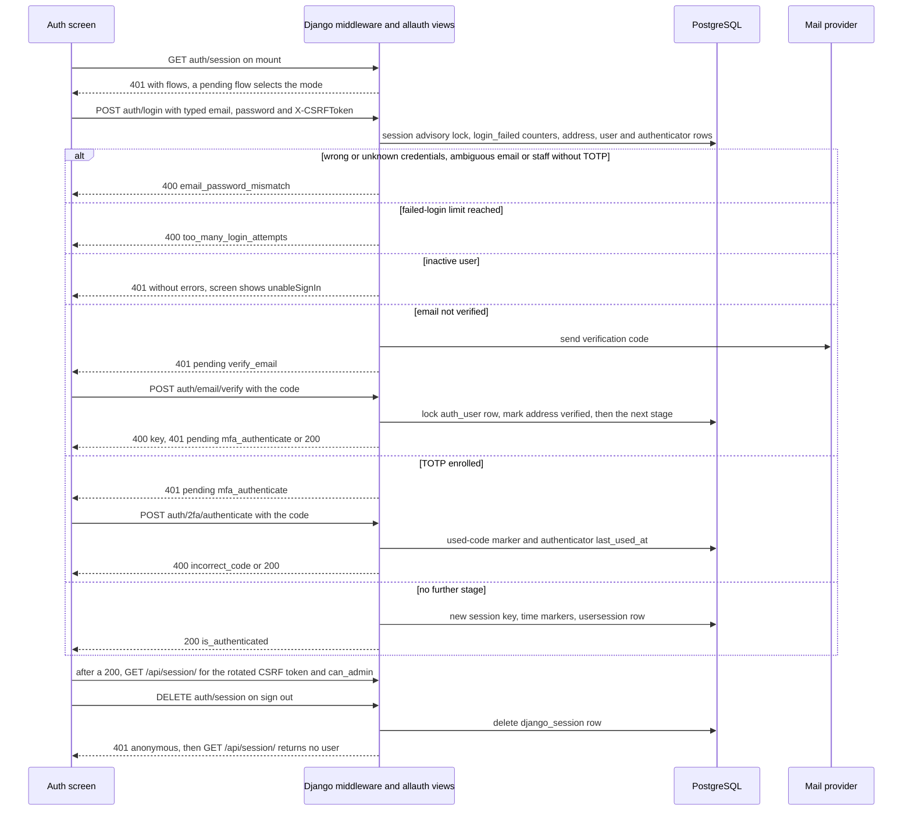

# Sign in and sign out

A customer user or platform administrator signs in with email and password. The allauth browser API creates a Django session, or parks the login in a pending stage (email code, then TOTP or recovery code) that the screen resumes after a reload. Sign out deletes the session and the screen refetches `/api/session/`. Staff and superusers without a TOTP factor cannot sign in.

## Entry points

- Screen: `web/src/components/auth.tsx` `Auth` (modes `login`, `mfa`, pending `verify`), rendered by `web/src/components/dashboard.tsx` `DashboardView` while `/api/session/` has no user; calls go through `web/src/lib/auth-api.ts` `authRequest`. A session with `can_admin` is then sent to `/admin/`.
- `POST /api/auth/browser/v1/auth/login` -> `pyracast.accounts.headless.LoginView` (`inputs.LoginInput`), routed in `src/pyracast/urls.py` ahead of the allauth include; `POST .../auth/email/verify` -> allauth `VerifyEmailView` wrapped in `require_POST`; `POST .../auth/2fa/authenticate` -> allauth mfa `AuthenticateView`; `GET .../auth/session` -> allauth `SessionView` (pending-flow probe on mount); `DELETE .../auth/session` -> allauth `SessionView`, callers: sign-out button in `dashboard.tsx` `Workspace`, "use another account" in `web/src/components/workspace-members.tsx` `AcceptInvitation`.
- `GET /api/session/` -> `pyracast.api.session.SessionView` (user, CSRF token, `can_admin`); `POST /admin/logout/` -> `PlatformAdminSite.workspace_logout`; `/admin/login/` only redirects to `/app/?next=/admin/` (or `/admin/` when already permitted). Also routed by the allauth include, unconfigured, no web caller: `POST .../auth/code/confirm`, `POST .../auth/phone/verify`, `POST .../auth/phone/verify/resend`, `GET|POST .../account/phone`.

## Sequence

## Data

| Table | R/W | What |
| --- | --- | --- |
| `auth_user` | R/W | Password check and flags; Django updates `last_login` and may upgrade the hash |
| `account_emailaddress` | R/W | Identity lookup (`AuthenticationBackend` via `email_identity`) and verified check; address marked verified by the email code |
| `mfa_authenticator` | R/W | TOTP gate for staff, code validation, recovery-code use, `last_used_at` |
| `django_session` | R/W | Pending login state, `authenticated_at`, `last_activity_at`; row deleted on sign out or `SessionLifetime` expiry |
| `usersessions_usersession` | R/W | User's stale rows purged and a row created on login, touched per authenticated request, kept on sign out |
| `pyracast_authentication_cache` | R/W | Rate-limit counters and used-TOTP markers via the autocommit `auth_cache` connection |

## Authorization

- Allauth browser views are public; `CsrfViewMiddleware` rejects any POST or DELETE without the token. `AccountAdapter.authenticate` refuses `is_staff` or `is_superuser` users without a TOTP authenticator, so a password alone never creates an admin session. `pyracast.api.session` reports `can_admin` only for staff plus superuser with `has_verified_mfa` (TOTP or recovery-code evidence in this session bound to a live authenticator); `PlatformAdminSite.has_permission` (active staff, superuser, MFA) and `api/views.py` `PlatformAdmin` (active superuser, MFA) re-check per request. `SessionLifetime` logs out sessions older than 12 hours, idle for 30 minutes, or lacking valid time markers.

## Failure paths

| Condition | Result |
| --- | --- |
| Missing or wrong CSRF token | 403 |
| Wrong password, unknown or ambiguous email, staff without TOTP | 400 `email_password_mismatch` on `password`, identical in every case |
| Password over 1024 characters | 400 `max_length` on `password`, rejected before hashing |
| `login_failed` limit (10 per 10 min per IP, 5 per address), or an unverified address mailed a code under 3 minutes ago (`confirm_email`) | 400 `too_many_login_attempts` |
| `login` limit (20 per minute per IP) or session lock held for 5 s | 429 (`session_busy`, `Retry-After: 1` for the lock); both log `authentication_request_throttled` |
| POST login while signed in | 409, after the credentials were validated |
| Inactive user with correct password | 401 without errors; screen shows `unableSignIn` |
| Wrong or reused MFA code | 400 `incorrect_code`; beyond 5 attempts per user (or 10 per IP, shared with password failures) in 10 min 400 `too_many_login_attempts`; success clears both counters |
| Stored TOTP secret cannot be decrypted | 403 from `MFAAdapter.decrypt` |
| 2fa authenticate without a pending stage or after 15 minutes | 401 with flows; screen shows `unableSignIn` |
| Mail backend error on the verification code of an unverified login | Contained and logged by the account mail adapter (`account-mail-notifications`); 401 pending `verify_email` as on success |
| Sign-out DELETE or the following refetch fails | Notice with the message; if only the refetch failed, the server session is already gone |

## Rules and invariants

- Stage order (email verification before TOTP) and the 15 minute pending-stage timeout are allauth defaults, not set in `settings.py`; pending stages live in the session. `SessionRequestSerialization` holds a PostgreSQL advisory lock per well-formed session cookie (32 lowercase alphanumerics) for the whole request, so parallel code attempts cannot lose state. It rejects pooled connections and fails closed on connection loss.
- `AccountAdapter.authenticate` calls Django `authenticate`, whose only backend (`AUTHENTICATION_BACKENDS`) is `pyracast.accounts.authentication.AuthenticationBackend`; it overrides allauth's email lookup with `email_identity` and then checks the password. Login identity is one verified address match, or the sole unverified primary address of a user with no other address; several verified matches never authenticate. Rate-limit counters and used-TOTP markers use a separate autocommit connection so a rolled-back request cannot reset them. Session cookies expire at browser close; `last_activity_at` is refreshed at most once a minute and never extends the 12 hour limit. The screen learns of expiry from the focus or visibility refetch of `/api/session/`, or immediately when a security action (password change, reauthentication, two-factor, linked accounts) gets an anonymous 401 and calls `refreshExpiredSession`; other requests just fail meanwhile.

## Tests

- pytest: `tests/test_session.py` (login, CSRF, logout, replay, generic errors, inactive user), `tests/test_auth_lifecycle.py` (TOTP and recovery codes, replay, oversized password, email identity), `tests/test_session_serialization.py` (lock, parallel codes, verify then TOTP), `tests/test_account_security.py` (lifetime, IP identity, 429 audit), `tests/test_admin_mfa_bootstrap.py` (staff without TOTP), `tests/test_admin_workspace.py` (admin logout), `tests/test_security_audit.py` (event shape, 429 for lock and rate limit).
- Playwright (mocked API): `web/tests/auth-registration.spec.ts` (pending-flow resume, MFA mode), `web/tests/workspace.spec.ts` (sign in and out), `web/tests/workspace-roles.spec.ts` (use another account). Real browser: `web/integration/auth-security.spec.ts` (signs out, signs in again with a recovery code), `web/integration/admin-csp.spec.ts` (admin sign-out).
- Gaps: the 10/10m and 5/10m limits, the per-user MFA limit, the `confirm_email` login throttle, the 409 and the 15 minute stage timeout are not tested through the real endpoints; the phone and login-code routes are untested.
