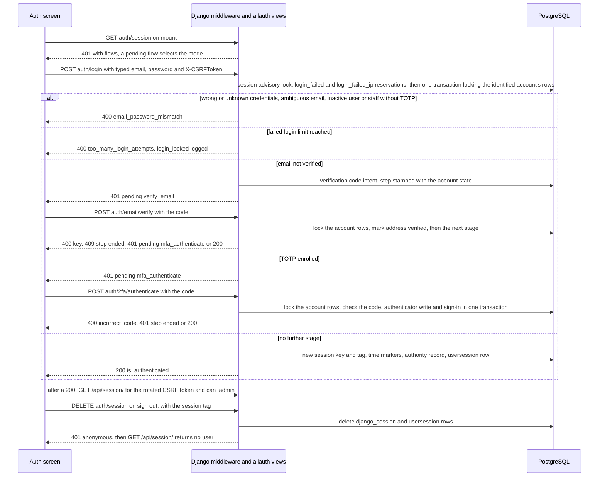

# Sign in and sign out

A customer user or platform administrator signs in with email and password. The allauth browser API creates a Django session, or parks the login in a pending stage (email code, then TOTP or recovery code) that the screen resumes after a reload. Sign out is a state of the document: "Signing out" replaces every screen until the session is deleted, and the document then reloads at its address; a sign-out from a pending sign-in stage deletes the session and reads `/api/session/` again. Staff and superusers without a TOTP factor cannot sign in.

Customers can also choose **Sign in with a passkey** on a supported browser. The device asks them to verify their identity. A discoverable credential identifies the account, so the form needs neither an email address nor a password. Password and provider sign-in still offer the customer's enrolled second factors, including a passkey or recovery code. Platform staff use their operator-provisioned factors.

## Entry points

- `GET|POST /api/auth/browser/v1/auth/webauthn/login` starts and finishes a discoverable sign-in. The GET accepts no account identifier. `GET|POST .../auth/webauthn/authenticate` completes a pending second factor. Both use the existing Django session, CSRF protection and server-side membership checks.
- The browser requests a challenge only when the person chooses a passkey. allauth shares one challenge across these operations in a session. Pyracast bounds it to the operation and five minutes, consumes a submitted challenge, and requires the signed origin to match `PYRACAST_PUBLIC_ORIGIN` exactly. The WebAuthn RP ID is the host of that origin. A browser without the credential APIs can use the existing sign-in form.
- A valid passwordless assertion takes the account lock and rechecks that the credential still belongs to an active customer before issuing the session. Business authorization still uses live memberships. Promotion to staff prevents passkey sign-in and excludes earlier passkey evidence from console access.

- Screen: `web/src/features/auth/auth.tsx` `Auth` (modes `login`, `mfa`, pending `verify`; parts in `features/auth/steps`), rendered by `RequireUser` while `/api/session/` has no user; calls go through `web/src/lib/auth-api.ts` `authRequest`. A code stage offers one exit that ends the pending sign-in through `DELETE auth/session`. A session with `can_admin` is then sent to the console path (`/admin/` or the validated `next`) by `features/session/entry.tsx`.
- Only the allauth routes of `src/pyracast/accounts/auth_urls.py` exist; stock routes outside it answer 404. `POST /api/auth/browser/v1/auth/login` -> `pyracast.accounts.headless.LoginView`; `POST .../auth/email/verify` -> `headless.VerifyEmailView`; `POST .../auth/2fa/authenticate` -> `pyracast.accounts.mfa_views.AuthenticateView`; `GET .../auth/session` -> allauth `SessionView` (pending-flow probe on mount); `DELETE .../auth/session` -> the same view, called by `signOut` in `lib/session-client.ts` (sign-out button, stage exits, and "Use another account" in `features/workspace/accept-invitation.tsx` with `keepInvitation`); `GET|DELETE .../auth/sessions` -> `accounts.devices.SessionsView`.
- `GET /api/session/` -> `pyracast.api.session.SessionView` (user, CSRF token, `can_admin`, `expires_at`, `idle_seconds`, `session_tag`); `POST /admin/logout/` -> `pyracast.platform_admin.access.logout` (outside the console gate, CSRF-protected, POST only); `/admin/login/` only redirects: to the console path when permitted, to `/app/` for a signed-in refusal, else to `/app/?next=<console path>`.

## Sequence

## Data

| Table | R/W | What |
| --- | --- | --- |
| `auth_user` | R/W | Password check and flags; locked with the account's other rows (`processes.account_state`); Django updates `last_login` |
| `account_emailaddress` | R/W | Identity lookup and verified check; address marked verified by the email code |
| `mfa_authenticator`, `socialaccount_socialaccount` | R/W, R | TOTP gate for staff, code validation, recovery-code use, `last_used_at`; both belong to the credential state a pending step rests on |
| `django_session` | R/W | Pending login state with its credential-state stamp, session tag, authority record; row deleted on sign out or `SessionLifetime` expiry |
| `usersessions_usersession` | R/W | User's stale rows purged and a row created on login, deleted on sign out |
| `notifications_outboundmail` | W | Verification code intent for an unverified address; daily-lock notice `account/email/login_locked` |
| `pyracast_authentication_cache` | R/W | Rate-limit counters, finished-failure entries and used-TOTP markers via the autocommit `auth_cache` connection |

## Authorization

- Allauth browser views are public; `CsrfViewMiddleware` rejects any POST or DELETE without the token. `AuthenticationBackend` refuses inactive users and `is_staff` or `is_superuser` users without a TOTP authenticator exactly like a wrong password, so a password alone never creates an admin session; a refused correct password counts as any failure. `pyracast.api.session` reports `can_admin` only for an active staff superuser with `security.has_mfa_evidence` (TOTP or recovery-code evidence in this session bound to a live authenticator); the console re-checks it per request (flow `admin-console-access`). `SessionLifetime` logs out sessions older than 90 days, idle for 30 days or lacking valid time markers, writing `session_expired` before `logout`. A request carrying `X-Session-Tag` is refused with 409 `session_changed` unless the tag is the session's own; the session read is never refused (`SessionTagCheck`).

## Failure paths

| Condition | Result |
| --- | --- |
| Missing or wrong CSRF token | 403 `csrf_failed` |
| Wrong password, unknown or ambiguous email, inactive user, staff without TOTP | 400 `email_password_mismatch` on `password`, identical in every case |
| Password over 1024 characters | 400 `max_length` on `password`, before hashing |
| `login_failed_ip` (10 failed passwords or MFA codes per 10 min per IP) or `login_failed` (5 per 10 min and 100 per day per address), or an unverified address mailed a code under a minute ago (`confirm_email`) | 400 `too_many_login_attempts`, worded by `AccountAdapter.validation_error` to cover both causes; a refused password check logs `login_locked`. A refused attempt keeps no slot; a password reset clears the address limits |
| 100 finished failures of an address in a day, and each attempt refused while it is locked on them | One `account/email/login_locked` intent per address and 24 hours (`mail_intents.enqueue_lock_notice`, written through `auth_cache` so a rolled-back sign-in keeps it) |
| `login` limit (20 per minute per IP) or session lock held for 5 s | 429, or 429 `session_busy` with `retry_after` and `Retry-After: 1`; both log `authentication_request_throttled` |
| POST login while signed in | 409 before the input is read; no failure is counted |
| Wrong or reused MFA code | 400 `incorrect_code`, counted towards `login_failed_ip`; beyond that limit or 5 attempts per user in 10 min (100 per day) 400 `too_many_login_attempts`; success clears the per-user counter only |
| Stored TOTP secret cannot be decrypted | 403 from `MFAAdapter.decrypt` |
| 2fa authenticate without a pending stage or after 15 minutes | 401 with flows; screen shows `unableSignIn` |
| Credential state of the account changed since the step started | Second factor: 401, step cleared; email code: 409 |
| Mail cannot be delivered for the verification code | 401 pending `verify_email` as on success; the worker retries or ends the intent |
| Sign-out DELETE fails or carries another session's tag | "Signing out" stays, across history, with the error and Retry (409 `session_changed`: nothing ends); Retry signs out again |
| A tagged request while this tab's sign-out is pending (other than its DELETE), or after its confirmed sign-out | Not sent: `NotSentError` (`Errors.notSentSigningOut`), not taken for a lost answer |

## Rules and invariants

- Stage order (email verification before TOTP) is an allauth default; the 15 minute pending-stage timeout is explicit (`ACCOUNT_LOGIN_TIMEOUT = 900`). `SessionRequestSerialization` holds a PostgreSQL advisory lock per session cookie for the whole request, so parallel code attempts cannot lose state.
- `AccountAdapter.pre_authenticate` reserves the client and address failure slots before the check and refuses when either is full; `authenticate` releases them on success or error, so only finished failures count towards the daily lock. The only backend is `pyracast.accounts.authentication.AuthenticationBackend`; login identity is one verified address match, or the sole unverified primary address of a user with no other address; several verified matches never authenticate.
- A sign-in runs in one transaction opened before the credentials are validated (`processes.starting`): the failure budgets refuse without taking a lock, then the identified account's rows are locked, so concurrent sign-ins of one account serialize, and the steps it starts are stamped from those rows. A step's completion rechecks the stamp under the same locks and commits the sign-in under them, so a credential change started meanwhile commits after it or ends the step. The second-factor completion takes the locks before its code is checked, so a refused completion uses no code.
- A sign-in issues a new session tag and key; sign-out removes the session's device record. Rate-limit counters and used-TOTP markers use a separate autocommit connection so a rolled-back request cannot reset them. A signed-in session's cookie lasts for what is left of the 90 days (flow `session-and-csrf`); `last_activity_at` is refreshed at most once a minute. The screen learns of expiry from the focus or visibility refetch of `/api/session/`, from a failed request answering `not_authenticated` or `session_ended`, or from a security action's `refreshExpiredSession`.
- A sign-out begun from a signed-in document first records the end of its session in the saved copy's database, also where no copy exists (it creates the database then): one transaction writes the mark `["ended", at, session]` and pauses that session's holder, emptying `plants` and `days`; a holder another session activated meanwhile is left as it is. Once it committed, no window can create, activate, refresh or show a copy for that session, also one opened while the sign-out is in flight. The record waits for neither the copy's lock nor the document's queue. The DELETE is sent only once the record committed. When it cannot commit within 10 s (the store's code does not load, the transaction fails, or it is still waiting and is aborted), the document deletes the whole database with `indexedDB.deleteDatabase` and then sends the DELETE; a person can always sign out. That deletion leaves no mark, so another window of that session can keep figures again before the DELETE ends the session (flow `saved-figures`). When the DELETE fails, the session stays marked as ended on this device, or the database is gone. A build whose saved figures are withdrawn sends the DELETE at once.

## Tests

- `tests/test_passkeys.py` covers sign-in, step-up, removal, account roles, CSRF, expiry and origin. `tests/e2e/test_passkeys_spec.py` runs the browser flow with a Chromium virtual authenticator.

- pytest: `tests/test_session.py` (login, CSRF, logout, generic errors), `tests/test_auth_lifecycle.py` (TOTP and recovery codes, replay, oversized password, the `confirm_email` throttle), `tests/test_session_tag.py`, `tests/test_pending_process_authority.py`, `tests/test_authentication_limits.py` (failed-login limits, the daily lock and its notice, the 15 minute stage expiry, the signed-in 409).
- Playwright (mocked API): `web/tests/auth-registration.spec.ts`, `web/tests/session-tag.spec.ts`, `web/tests/session-sign-out.spec.ts` (the sign-out state, its failures and Retry, requests not sent meanwhile), `web/tests/saved-copy.spec.ts` (removal of the saved figures at sign-out). Real browser: `web/integration/auth-security.spec.ts`, `web/integration/admin-csp.spec.ts` (admin sign-out).
