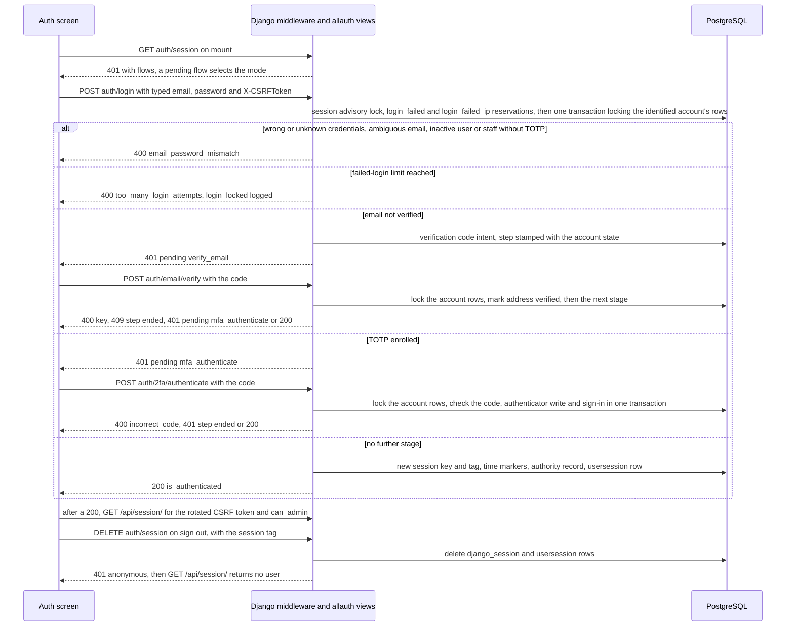

# Sign in and sign out

A customer user or platform administrator signs in with email and password. The allauth browser API creates a Django session, or parks the login in a pending stage (email code, then TOTP or recovery code) that the screen resumes after a reload. Sign out deletes the session and the screen refetches `/api/session/`. Staff and superusers without a TOTP factor cannot sign in.

## Entry points

- Screen: `web/src/features/auth/auth.tsx` `Auth` (modes `login`, `mfa`, pending `verify`; parts in `features/auth/steps`), rendered by `RequireUser` while `/api/session/` has no user; calls go through `web/src/lib/auth-api.ts` `authRequest`, serialized with the session calls in `lib/api/lane.ts`, and failure bodies (`code`, `message`, `fields`) map through `errorFromResponse`. A code stage hides the sign-in/sign-up switch and offers one exit that ends the pending sign-in through `DELETE auth/session`; a 409 there shows "This step has ended", a 429 "Too many attempts". A session with `can_admin` is then sent to the console path (`/admin/` or the validated `next`) by `features/session/entry.tsx`.
- Only the allauth routes of `src/pyracast/accounts/auth_urls.py` exist; stock routes outside it answer 404. `POST /api/auth/browser/v1/auth/login` -> `pyracast.accounts.headless.LoginView` (`inputs.LoginInput`); `POST .../auth/email/verify` -> `headless.VerifyEmailView`; `POST .../auth/2fa/authenticate` -> `pyracast.accounts.mfa_views.AuthenticateView` (`inputs.SecondFactorInput`); `GET .../auth/session` -> allauth `SessionView` (pending-flow probe on mount); `DELETE .../auth/session` -> the same view, called by `signOut` in `lib/session-client.ts` (sign-out button, stage exits) and by `features/workspace/accept-invitation.tsx`; `GET|DELETE .../auth/sessions` -> `accounts.devices.SessionsView` (lists the account's sessions, ends chosen ones).
- `GET /api/session/` -> `pyracast.api.session.SessionView` (user, CSRF token, `can_admin`, `expires_at`, `session_tag`); `POST /admin/logout/` -> `pyracast.platform_admin.access.logout` (outside the console gate, `never_cache`, CSRF-protected, POST only); `/admin/login/` only redirects: to the console path when permitted, to `/app/` for a signed-in refusal, else to `/app/?next=<console path>`.

## Sequence

## Data

| Table | R/W | What |
| --- | --- | --- |
| `auth_user` | R/W | Password check and flags; locked with the account's other rows in the order of `processes.account_state`; Django updates `last_login` and may upgrade the hash |
| `account_emailaddress` | R/W | Identity lookup (`AuthenticationBackend` via `login_identity`) and verified check; address marked verified by the email code |
| `mfa_authenticator`, `socialaccount_socialaccount` | R/W, R | TOTP gate for staff, code validation, recovery-code use, `last_used_at`; both belong to the credential state a pending step rests on |
| `django_session` | R/W | Pending login state with its credential-state stamp, `authenticated_at`, `last_activity_at`, session tag, authority record; row deleted on sign out or `SessionLifetime` expiry |
| `usersessions_usersession` | R/W | User's stale rows purged and a row created on login, touched at most once a minute, deleted on sign out |
| `notifications_outboundmail` | W | Verification code intent for an unverified address; daily-lock notice `account/email/login_locked` |
| `pyracast_authentication_cache` | R/W | Rate-limit counters, finished-failure entries and used-TOTP markers via the autocommit `auth_cache` connection |

## Authorization

- Allauth browser views are public; `CsrfViewMiddleware` rejects any POST or DELETE without the token. `AuthenticationBackend` refuses inactive users (`login_refused` reason `inactive`) and `is_staff` or `is_superuser` users without a TOTP authenticator (`mfa_not_provisioned`) exactly like a wrong password, so a password alone never creates an admin session; a refused correct password counts as any failure. `pyracast.api.session` reports `can_admin` only for an active staff superuser with `security.has_mfa_evidence` (TOTP or recovery-code evidence in this session bound to a live authenticator); `PlatformAdminSite.has_permission` re-checks it per request. `SessionLifetime` logs out sessions older than 12 hours, idle for 30 minutes or lacking valid time markers, writing `session_expired` (reason `absolute`, `idle` or `invalid_marker`) before `logout`. A request carrying `X-Session-Tag` is refused with 409 `session_changed` unless the tag is the session's own; the session read is never refused (`SessionTagCheck`).

## Failure paths

| Condition | Result |
| --- | --- |
| Missing or wrong CSRF token | 403 `csrf_failed` |
| Wrong password, unknown or ambiguous email, inactive user, staff without TOTP | 400 `email_password_mismatch` on `password`, identical in every case; `login_failed` is written, besides `login_refused` for the last two |
| Password over 1024 characters | 400 `max_length` on `password`, before hashing |
| `login_failed_ip` (10 failed passwords or MFA codes per 10 min per IP) or `login_failed` (5 per 10 min and 100 per day per address), or an unverified address mailed a code under a minute ago (`confirm_email`) | 400 `too_many_login_attempts`, worded by `AccountAdapter.validation_error` to cover both causes; a refused password check logs `login_locked` with the address key and the client IP. A refused attempt keeps no slot; a password reset clears the address limits |
| 100 finished failures of an address in a day, and each attempt refused while it is locked on them | One `account/email/login_locked` intent per address and 24 hours (`mail_intents.enqueue_lock_notice`, written through `auth_cache` so a rolled-back sign-in keeps it); the worker mails the account's primary address, or skips an unknown one |
| `login` limit (20 per minute per IP) or session lock held for 5 s | 429, or 429 `session_busy` with `retry_after` and `Retry-After: 1`; both log `authentication_request_throttled`. A busy `/admin/` or non-API navigation GET gets a no-store 503 page that reloads once |
| POST login while signed in | 409 before the input is read; no failure is counted |
| Wrong or reused MFA code | 400 `incorrect_code`, counted towards `login_failed_ip`; beyond that limit or 5 attempts per user in 10 min (100 per day) 400 `too_many_login_attempts` (`second_factor_locked` for the user); success clears the per-user counter only |
| Stored TOTP secret cannot be decrypted | 403 from `MFAAdapter.decrypt` |
| 2fa authenticate without a pending stage or after 15 minutes | 401 with flows; screen shows `unableSignIn` |
| Credential state of the account changed since the step started | Second factor: 401, step cleared; email code: 409; never 500 |
| Mail cannot be delivered for the verification code | 401 pending `verify_email` as on success; the worker retries or ends the intent |
| Sign-out DELETE fails or carries another session's tag | Notice with the message (409 `session_changed`: nothing ends and the tab shows the session the browser holds); if only the refetch failed, the server session is already gone |

## Rules and invariants

- Stage order (email verification before TOTP) is an allauth default; the 15 minute pending-stage timeout is explicit (`ACCOUNT_LOGIN_TIMEOUT = 900`). `SessionRequestSerialization` holds a PostgreSQL advisory lock per well-formed session cookie for the whole request, so parallel code attempts cannot lose state.
- `AccountAdapter.pre_authenticate` reserves the client and address failure slots before the check and refuses when either is full; `authenticate` releases them on success and when the check ends in an error, so only finished failures count towards the daily lock, and a reservation older than `login_limits.REQUEST_CEILING_SECONDS` (90) stops counting. The only backend (`AUTHENTICATION_BACKENDS`) is `pyracast.accounts.authentication.AuthenticationBackend`; login identity is one verified address match, or the sole unverified primary address of a user with no other address; several verified matches never authenticate.
- A sign-in runs in one transaction opened before the credentials are validated (`processes.starting`): the failure budgets refuse without taking a lock, then the identified account's rows are locked, so concurrent sign-ins of one account serialize, and the steps it starts are stamped from those rows. A step's completion rechecks the stamp under the same locks and commits the sign-in under them, so a credential change started meanwhile commits after it or ends the step. The second-factor completion takes the locks before its code is checked, so a used recovery code, the authenticator write and the sign-in commit together and a refused completion uses no code.
- `login_succeeded` carries the method of the last authentication step. A sign-in issues a new session tag and key; sign-out removes the session's device record. Rate-limit counters and used-TOTP markers use a separate autocommit connection so a rolled-back request cannot reset them. Session cookies expire at browser close; `last_activity_at` is refreshed at most once a minute. The screen learns of expiry from the focus or visibility refetch of `/api/session/`, from a failed request answering `not_authenticated` or `session_ended`, or from a security action's `refreshExpiredSession`; the workspace shell warns five minutes before `expires_at`.

## Tests

- pytest: `tests/test_session.py` (login, CSRF, logout, generic errors), `tests/test_auth_lifecycle.py` (TOTP and recovery codes, replay, oversized password, the `confirm_email` throttle, stage ended by sign-out), `tests/test_session_serialization.py` (lock, parallel codes), `tests/test_session_lifecycle.py` (limits, device record), `tests/test_session_tag.py`, `tests/test_pending_process_authority.py` (credential state of pending steps), `tests/test_signed_in_devices.py`, `tests/test_routed_surface.py` (listed routes), `tests/test_admin_mfa_bootstrap.py` (staff without TOTP), `tests/test_admin_workspace.py` (admin logout), `tests/test_security_signals.py` (event shape), `tests/test_authentication_limits.py` (failed-login limits, `login_locked`, the daily lock and its notice, the 15 minute stage expiry, the signed-in 409).
- Playwright (mocked API): `web/tests/auth-registration.spec.ts` (pending-flow resume, MFA mode, stage exits), `web/tests/workspace.spec.ts`, `web/tests/workspace-roles.spec.ts` (use another account), `web/tests/session-tag.spec.ts`. Real browser: `web/integration/auth-security.spec.ts` (signs out, signs in with a recovery code), `web/integration/admin-csp.spec.ts` (admin sign-out).
