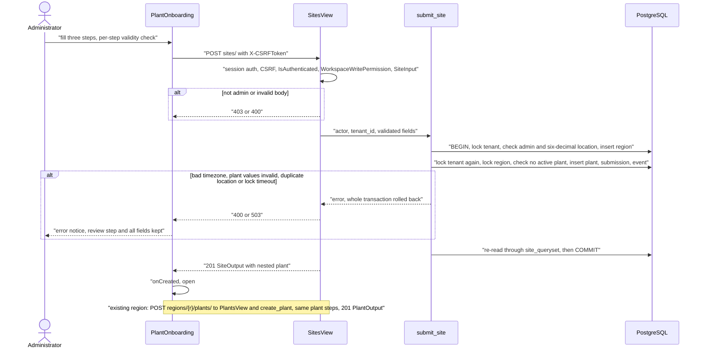

# Onboard a site: location plus plant submitted for approval

A workspace administrator adds a plant in a three-step wizard (location, technical details, review). One request creates a `pending` region, its plant and a typed technical declaration (`PlantSubmission`) in one transaction. A region that exists without a plant completes setup through the plant endpoint. The site then waits for `provider-connection-setup` and `plant-approval`; nothing here touches a provider.

## Entry points

- `web/src/components/dashboard.tsx` `Dashboard`: the admin-only "Add a plant" button renders `web/src/components/plant-onboarding.tsx` `PlantOnboarding` (three steps) and, on success, opens the new plant.
- `web/src/components/region-workspace.tsx` `RegionWorkspace`: a region without a plant (the portfolio's "Complete setup" card) renders `PlantOnboarding` with `existing` for administrators (steps two and three, location fixed, plant name prefilled with the region name and editable); other members see a notice. Fields live in `plant-configuration-fields.tsx` `PlantConfigurationFields`, `configurationInput`.
- `POST /api/tenants/{t}/sites/` -> `pyracast.plants.site_api.SitesView.post` -> `pyracast.plants.sites.submit_site`. Actor: workspace administrator.
- `POST /api/tenants/{t}/regions/{r}/plants/` -> `pyracast.plants.api.PlantsView.post` -> `pyracast.plants.operations.create_plant`.
- `POST /api/tenants/{t}/regions/` -> `pyracast.api.views.RegionsView.post` -> `pyracast.regions.operations.submit_region`: no web caller, yields a region without a plant.
- Reads: `GET sites/` (`SitesView`, polled every 30 s by `Dashboard`), `GET regions/{r}/plants/` (polled every 30 s by `RegionWorkspace`), `GET sites/{r}/` (`SiteView`, no web caller). Command `configure_plant` without `--plant-id` calls `create_plant` for an existing region (actor `--username`; with `--plant-id` it revises, see `plant-configuration-revision`). No script or Dramatiq job.

## Sequence

## Data

| Table | R/W | What |
| --- | --- | --- |
| `accounts_membership`, `auth_user`, `accounts_tenant` | R, tenant `FOR UPDATE` | Administrator check (view and operation), member check for reads, per-workspace lock |
| `regions_region`, `plants_plant` | R/W | Region insert (`status=pending`, `revision=1`, coordinates rounded to 6 decimals), duplicate probe, `FOR UPDATE` in `create_plant`; plant insert after an active-plant probe, named from the request's `name` |
| `plants_plantsubmission`, `plants_plantevent` | W | `update_or_create` of the technical declaration (later edits by `revise_plant`); event `submission_saved` |
| `plants_plantconfiguration`, `plants_plantevent`, `plants_calibrationrun`, `connections_sitebinding`, `connections_provideraccount`, `metering_epiasconnection` | R/W | Scoped endpoint on an approved region only: configuration revision 1, event `configuration_created`, supersede update and EPIAS probe (both empty for a new plant), see rules |
| `django_session`, `regions_auditevent` | R/W, none | Session authentication under a per-session advisory lock; `SessionLifetime` writes `last_activity_at` once 60 s have passed; region creation writes no audit row |

## Authorization

- Authentication: `SessionAuthentication` with CSRF; `request()` in `web/src/lib/api.ts` sends `X-CSRFToken`.
- View: `IsAuthenticated`, then `WorkspaceWritePermission` (`pyracast.api.permissions`) admits non-safe methods only for an active administrator of `tenant_id`, without a lock. `GET sites/` needs membership (`site_queryset` calls `require_member`). `PlantsView.post` then resolves the region in the tenant (`plant_queryset`, `require_member`), so an unknown or trashed region is 404.
- Operation: `require_workspace_admin` (`pyracast.accounts.operations`) in `submit_region` and `create_plant` locks the tenant and re-checks the role; `submit_site` runs both.
- Database: `one_active_region_per_tenant_location`, `one_active_plant_per_region`, `submission_*` check constraints, `region_latitude`, `region_longitude`, `region_status`.
- UI: the button and wizard are admin-only (`canManage`) as a convenience only.

## Failure paths

| Condition | Result |
| --- | --- |
| Not signed in, bad CSRF token, non-administrator or foreign tenant | 403 `http_403` (not signed in: "Authentication credentials were not provided."; CSRF: "CSRF Failed: ..."; otherwise "Workspace administrator required."; reads: "Tenant membership required.") |
| Unknown or missing field, name blank or over 200 characters, latitude or longitude out of range, negative capacity, tilt or azimuth, tilt over 90, bad enum | 400 `http_400` with a per-field `detail` (DRF serializer; unknown fields under `non_field_errors`) |
| Bad IANA timezone, capacity exactly zero, azimuth 360 or more, angles with non-fixed mounting | 400 `invalid_request`, `detail` is a list of messages without field names |
| Same tenant, same six-decimal coordinates as an active region | 400 `invalid_request`, `detail` holds the localized text for `location_already_exists` |
| Region already has an active plant (scoped endpoint, concurrent submit) | 400 `invalid_request`, localized text for `location_already_has_plant` |
| Scoped endpoint with unknown, foreign or trashed region | 404 (`get_object_or_404`, or `not_found` if trashed after the check) |
| Scoped endpoint on a rejected or suspended region, or an approved one without a current validated binding | 400 "An approved current provider binding is required." and no plant row |
| Tenant or region lock not granted within 5 s; another request of the same session holds its advisory lock over 5 s | 503 `workspace_busy`, `Retry-After: 1`; session lock: 429 `session_busy`, `Retry-After: 1` |
| Any failure inside `submit_site` | Region, plant and submission all rolled back; UI shows a notice, stays on review, keeps every field |

## Rules and invariants

- Lock order: tenant row, then (new) region insert, then tenant again (already held) and region row `FOR UPDATE`, then plant insert. The tenant lock serializes concurrent submits; the unique indexes are the backstop (an `IntegrityError` is not mapped and would be a 500).
- Location identity is the tenant plus latitude and longitude rounded half away from zero to six decimals, ignoring trashed regions. Stored coordinates are the rounded values.
- `_save_plant_parameters` decides the shape: a pending region with a plant that has no configuration stores a `PlantSubmission` and no configuration. Any other region must be approved with a current binding and gets configuration revision 1 at once, with no plant-approval step.
- Through `sites/` one `name` names both region and plant; through the scoped endpoint the plant takes the form's name. A later plant rename records `plant_renamed` and, when the region name differs, also renames the region and records `region_renamed`; a save that changes no submitted value keeps the submission, its `submitted_by` and writes no `submission_saved`.
- Plant fields are validated after the region insert, inside the transaction, so a bad plant never leaves a region.
- No idempotency key: a retried POST after a lost response fails with the duplicate-location error instead of duplicating.
- The wizard keeps every step mounted (hidden) so one `FormData` spans all steps. It is read before the fieldset is disabled, because disabled controls drop out of `FormData`.

## Tests

- `tests/test_site_onboarding.py`: combined API, atomic rejection, 403 across tenants, query count of the site list, approval materializing the submission, duplicate coordinates, restore conflicts, concurrent site and plant submit (`Barrier`, operations only), purge.
- `tests/test_plant_operations.py` (`test_invalid_configuration_is_atomic`; `test_tenant_and_binding_boundaries` proves only the foreign-admin refusal for `create_plant`, its later calls stop at `location_already_has_plant`), `tests/test_plant_commands.py` (`configure_plant` creation), `tests/test_workspace_authorization.py` (viewer 403 on `sites/` and `regions/` POST), `tests/test_api.py` (`POST regions/` creation, missing CSRF token 403) and `tests/test_api_localization.py` (error shape).
- `web/tests/plant-onboarding.spec.ts` (mocked API: add a plant through `sites/` then approval refresh, retry after error, complete setup); `web/integration/workspace.spec.ts` (real backend, complete setup on an approved region, configuration revision 1).
- Gaps: no real-backend browser test of `POST sites/`; no CSRF case for `sites/` and no `workspace_busy` case; no `create_plant` test reaches the suspended-region or missing-binding refusal (`tests/test_onboarding_boundaries.py` covers it only for revision); the client-side duplicate-location messages are only exercised by a mocked raw key; the cancel-while-saving path is untested.
