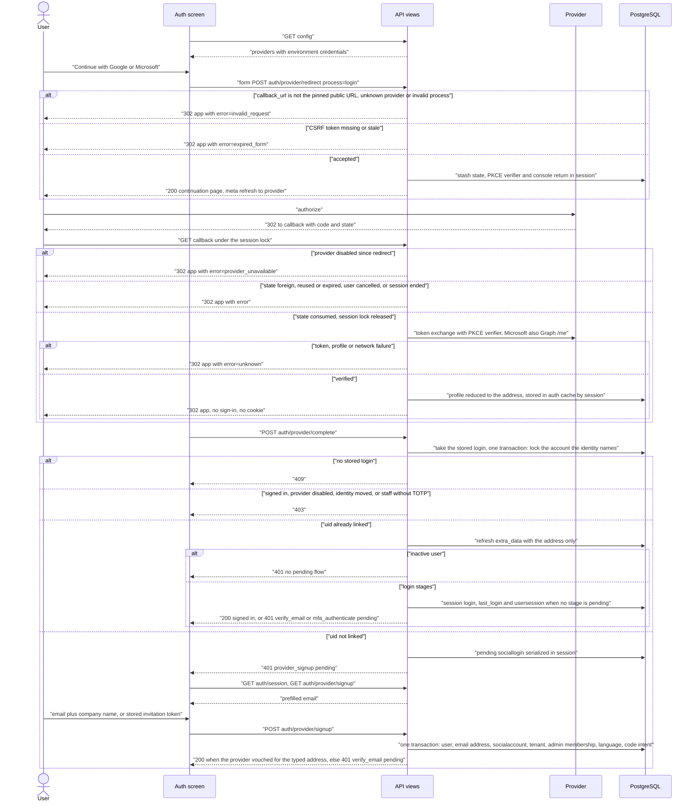

# Sign in or sign up with Google or Microsoft

An anonymous visitor on the `/app/` sign-in screen clicks a provider button; a native form post sends the browser to Google or Microsoft, and the backend callback exchanges the code (PKCE), stores the verified login for that browser session and bounces back to `/app/?social_callback=1`. The screen then posts `auth/provider/complete`: a known identity signs in (subject to email verification and MFA stages); an unknown identity leaves a pending `provider_signup` in the session, which the screen completes with a company name (new workspace, user becomes its administrator) or a workspace invitation token (no membership until explicit acceptance).

## Entry points

- Screen: `web/src/features/auth/auth.tsx` `Auth` (rendered by `RequireUser` when the session has no user) with `social-provider-buttons.tsx` `SocialProviderButtons` (`process="login"`, modes `login` and `register`) and `useSocialProviders`. Mode `socialSignup` is the completion form; its exit "Use another sign-in method" ends the pending provider login on the server (`DELETE auth/session`). On return `Auth` strips the callback marker and calls `completeProviderLogin`; a signed-in browser is sent to the account page by `features/session/entry.tsx` (flow `linked-accounts`).
- `GET /api/auth/browser/v1/config` -> allauth `ConfigView` (provider list through `SocialAccountAdapter.list_providers` and `list_apps`; a failed request hides the buttons silently).
- `POST /api/auth/browser/v1/auth/provider/redirect` (form-encoded native post, shared with `linked-accounts`) -> `pyracast.accounts.social_views.RedirectToProviderView`.
- `GET /api/accounts/google/login/callback/` and `/api/accounts/microsoft/login/callback/` -> `social_views.provider_callback` -> `ProviderCallbackView` (verifies and stores the login, `social.store_verified_login`).
- `POST /api/auth/browser/v1/auth/provider/complete` -> `social_views.CompleteProviderLoginView` (`sign_in` inside `processes.starting`).
- `GET|POST /api/auth/browser/v1/auth/provider/signup` -> `social_views.ProviderSignupView` (input `CompanySocialSignupInput`, extra fields from `forms.AccountSignupForm`, which `register_account` serves).
- Actors: anonymous user, identity provider. Owned by other flows: `GET auth/session` and `auth/2fa/authenticate` (`sign-in-and-sign-out`), `auth/email/verify` (`company-signup`), `POST /api/invitations/accept/` (`invitation-acceptance`). No command, job or script; mails are outbound intents sent by the mailer actor (`account-mail-notifications`).

## Sequence

## Data

| Table | R/W | What |
| --- | --- | --- |
| `socialaccount_socialaccount` | R/W | Lookup by `(provider, uid)` after the account's rows are locked; `extra_data` is reduced to `{"email": ...}` before the lookup, so nothing else is saved; inserted at signup. Never matched by email. |
| `auth_user` | R/W | Staff/superuser and `is_active` checks and `last_login` on login; created at signup with an unusable password, never staff. |
| `account_emailaddress` | R/W | Uniqueness check at signup and verified check in the login stage; the signup row is `verified` only when the provider vouches for the typed address (Google `@gmail.com` or `hd`, verified by the provider). |
| `accounts_tenant`, `accounts_membership`, `accounts_userlanguagepreference` | W | Tenant (names need not be unique) and administrator membership of a company signup (none for invitation signup); the request language, always. |
| `accounts_workspaceinvitation` | R | `pending_invitation` validates token, email, expiry and not-accepted; never marked accepted here. |
| `mfa_authenticator` | R | Staff TOTP requirement and the `mfa_authenticate` stage. |
| `django_session` | R/W | OAuth states (`socialaccount_states`), pending `socialaccount_sociallogin`, login stages with their credential-state stamp, the console return path, login. |
| `usersessions_usersession` | R/W | allauth `usersessions` purges stale rows and records the session on every completed login. |
| `pyracast_authentication_cache` | R/W | The verified login (`provider-login:<hmac of the session key>`, `statekit.STATE_TTL` 600 s, taken by one atomic delete), the `signup` counter and the verification mail limit. |
| `notifications_outboundmail` | W | Verification code or `account_already_exists` intent of a signup whose address the provider did not vouch for. |
| `socialaccount_socialapp`, `socialaccount_socialtoken` | none | Ignored: apps are built in memory from `SOCIALACCOUNT_PROVIDERS` (a stored `SocialApp` row has no effect), the token is dropped in `pre_social_login`. |

## Authorization

- CSRF: `CsrfViewMiddleware` on the redirect (hidden `csrfmiddlewaretoken`), the completion and the signup POST (`X-CSRFToken`). The callback GET carries no token; the state protects it, and the verified login is stored under a digest of the session key that started the round trip, so only that session can complete it, once.
- Provider enablement: only environment credentials (`settings.py` loop over `PYRACAST_{GOOGLE,MICROSOFT}_CLIENT_*`), checked in `SocialAccountAdapter.list_apps` (redirect form, config, pending deserialization), `provider_callback` and again in `pre_social_login`.
- Open redirect: `RedirectToProviderView.post` accepts exactly `social_callback_url()`, built from `PYRACAST_PUBLIC_ORIGIN` on each request. State: allauth stashes it in the session, bound to the provider, single use, 600 s TTL, about ten kept per session.
- Account takeover: `SOCIALACCOUNT_EMAIL_AUTHENTICATION`, `..._AUTO_CONNECT` and `SOCIALACCOUNT_AUTO_SIGNUP` are off, so a new identity always goes through the signup form.
- Administrators: `pre_social_login` refuses an existing staff or superuser identity without a TOTP authenticator; allauth MFA adds the `mfa_authenticate` stage for users with one.
- Workspace access: signup grants a tenant only through a new company; an invitation needs the separate, verified-email-checked acceptance. Database backstops: unique `(provider, uid)`, `unique_verified_email`.

## Failure paths

| Condition | Result |
| --- | --- |
| `callback_url` differs (other host, port, scheme or query), unknown or unconfigured provider, invalid `process` | 302 `/app/?social_callback=1&error=invalid_request` |
| Missing or stale CSRF token | Redirect form: 302 `error=expired_form`; completion and signup POST: 403 `csrf_failed` |
| Provider removed before the callback | 302 `error=provider_unavailable`, `social_login_refused` `provider_disabled`; a completion after it answers 409 |
| State foreign, reused, expired or for another provider; provider `error`; token, profile or network failure; session ended before the state was taken | 302 with `error` (`cancelled` for `access_denied`, else `unknown`; `error_process=login`), `social_login_refused` `provider_error`; an ended session stores nothing and sends no cookie; generic `callbackError` |
| Completion without a stored login (another browser, session ended or changed, expired, already completed) | 409, nothing changes |
| Existing staff identity without TOTP, signed-in browser, identity connected after the lookup | 403, no session, `social_login_refused` (`mfa_not_provisioned`, `signed_in`, `identity_changed`) |
| Existing identity whose user is deactivated | 401 without pending flow, no session, `social_login_refused` `inactive` |
| Unverified email on existing identity, or TOTP present | 401 pending `verify_email` or `mfa_authenticate`, screen switches mode |
| Another request of the same session holds the lock for 5 s | 429 `session_busy` JSON with `retry_after`, shown raw when it hits the callback or the form post |
| Signup GET or POST without pending signup (expired, disabled provider) | 409; the mount-time prefill GET swallows it silently (email stays empty), a POST shows the ended stage and consumes no signup quota |
| Signup rate limit (`5/h/ip`, shared with password signup) | 429 JSON |
| Missing company name without token; bad workspace name; bad invitation; missing email or a typed address that is not plain (`CompanySocialSignupInput.clean_email`, `accounts.addresses.plain_address`) | 400 field errors (`company_name`, `email`, non-field invitation message); the name rules of `company-signup` apply |
| Identity or vouched address claimed by another account while the signup runs | 409 from the unique identity or the unique verified address |
| A refusal raised while the account is saved | Identity, user, tenant and membership roll back and the pending signup is restored |
| Email of an existing account | No new user; the same 401 `verify_email` pending as a new address, and an "account already exists" mail |
| Token login (`auth/provider/token`), stock `/api/accounts/
/login/` | 404 (unrouted); non-GET on the callbacks 405 |

## Rules and invariants

- The redirect URI sent to the provider is the request host on `ACCOUNT_DEFAULT_HTTP_PROTOCOL` (https outside debug) for the URL names `google_callback`, `microsoft_callback`, so production relies on `PYRACAST_TRUST_PROXY=1` (`deploy/compose.yaml`); the pinned callback URL must also pass allauth `is_safe_url` (request host, `PYRACAST_HOSTS` or `PYRACAST_CSRF_ORIGINS`). A provider error without state returns to the same pinned URL (`HEADLESS_ADAPTER` `HeadlessAdapter`).
- A provider authorize URL on another host is returned as a 200 same-origin continuation page (`src/pyracast/accounts/templates/accounts/provider_redirect.html`, `no-store`, `no-referrer`, cookies copied) because the `/app/` document's CSP (`web/src/proxy.ts`, `form-action 'self'`) would block a cross-origin redirect after a form post. A login redirect posted with a console `next` keeps the validated path with the state; the completion stores it in the session and the console's first page follows it after the second factor.
- The callback takes its state under `SessionRequestSerialization` (per-session advisory lock, 5 s wait, else 429 `session_busy`), releases the lock (`session_lock.release_session`), exchanges with no lock and no transaction, and only stores the verified login; it never signs in. The session cookie must stay `SameSite=Lax` for the top-level callback GET. Google identity comes from the ID token in the token response (userinfo request only when it is missing); Microsoft needs the Graph profile request.
- The completion runs in `processes.starting`: `social.lock_identity` locks the account the identity names before allauth looks the identity up, and a refused sign-in still commits the refreshed profile. The steps it starts are stamped from the locked rows and end on any change of the account's credential state.
- Only an email survives in `extra_data`; access and refresh tokens are never stored (`SOCIALACCOUNT_STORE_TOKENS=False`, `sociallogin.token=None`). Google mailbox authority: `@gmail.com` or an `hd` claim, and the provider's own verified flag. Microsoft addresses are never trusted; the email falls back to `mail`, then `userPrincipalName`, then empty. The account keeps only the typed address, verified at once only when the provider vouches for that same address, otherwise by a mailed code. `SocialAccountAdapter.populate_user` leaves out every provider address that is not plain and clears the user's address when it is not plain, so the provider sign-up neither offers nor stores one.
- Signup is all or nothing: one transaction wraps user, email, social account, tenant and membership. Order on POST: pending check (409, no quota used), rate limit, validation (400), save. A pending provider signup names no account.
- Refused sign-ins write `social_login_refused` with `provider` and `reason`, once a minute per actor, provider and reason.
- `UnavailableSocialAppError` is a `ValueError` on purpose: allauth treats it as an expired pending signup (409) once the provider is disabled.
- The invitation token comes from `sessionStorage` (`pyracast.workspaceInvitation`), survives the provider round trip and hides the company field.

## Tests

- `tests/test_social_accounts.py`: continuation page and escaping, local redirect passthrough, config listing, atomic workspace signup for both providers, Google email authority, no email matching, staff and MFA on existing identity, state binding and single use, callback URL rejection, unrouted token and stock login routes, method restrictions, provider disabling, rate limit, refused signup rollback, Microsoft UPN fallback, environment credentials, invitation signup with explicit acceptance, network failure. `tests/test_provider_completion.py`: callback only verifies, completion without a stored login, forged completion. `tests/test_social_refusal_audit.py`, `tests/test_pending_process_authority.py`: refusal lines, provider sign-in and signup against concurrent changes. `tests/test_provider_callback_contract.py`: the allauth sequence the callback rests on. `tests/test_configured_social_apps.py`: in-memory apps, incomplete credentials.
- `tests/test_plain_addresses.py`: a typed address that is not plain is refused, a provider address that is not plain is never offered or stored.
- `web/tests/social-auth.spec.ts` (mocked API): button form fields and layout, hidden unconfigured providers, invitation restore without password, completion on return, second factor, callback error notice, Turkish 320 px fit. `web/tests/auth-registration.spec.ts`: pending `provider_signup` precedence and exit. `web/integration/social-auth.spec.ts`: real backend up to the provider authorize page under strict `form-action`.
- Gaps: no full round trip against the real backend; the Google ID-token path is never exercised (the fixture returns no `id_token`, so the userinfo fallback runs); no browser test for the 409 completion or the 403 refusals; no test of provider identities removed by a password reset (`password-reset`).
